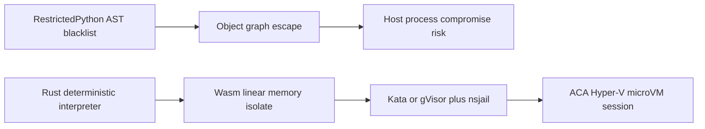
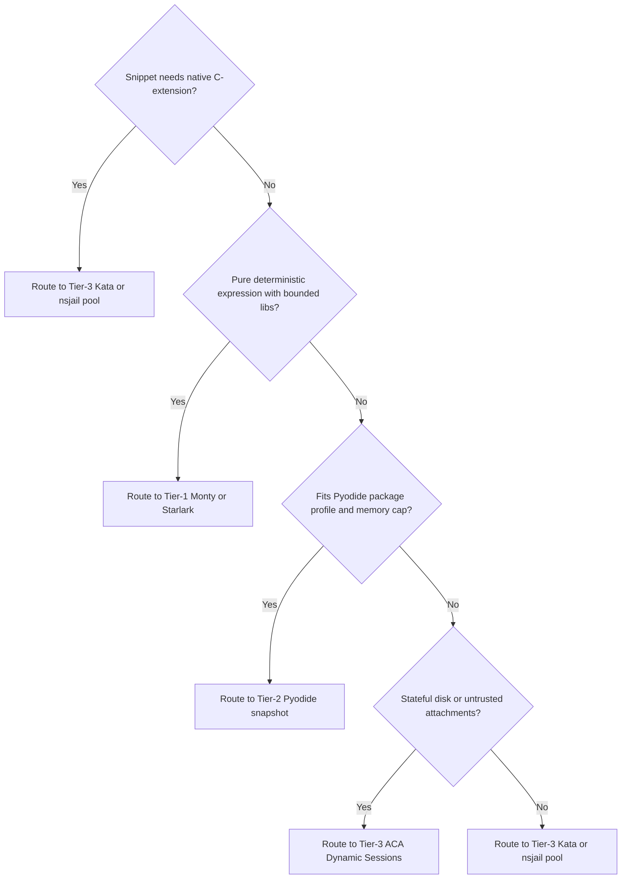
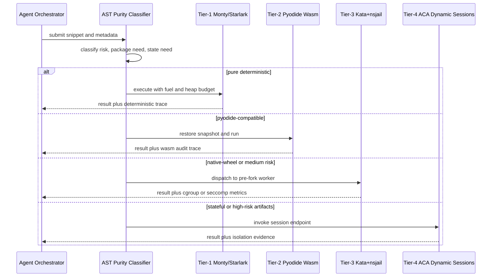

# 亚毫秒 Python Code-Act 微沙箱选型 FAQ：Monty/Starlark vs Pyodide Wasm Snapshot vs AKS Kata+nsjail vs ACA Dynamic Sessions
> **适用范围**：高频 Code-Act、金融公式校验、定价规则求值、Schema 映射类智能体。
> **典型负载**：单个用户回合执行 `20-150` 段 LLM 生成 Python 片段，每段通常 `10-80` 行。
> **数据标签**：文中定量结论均标注 `measured`、`synthetic` 或 `anonymized_reported`。

## 1. 执行摘要：真正问题是“轻任务重隔离”与“重风险轻隔离”并存
企业落地时常见两个极端。
极端一是进程内宽松执行。
极端二是每段代码都走远端 VM 沙箱。
二者都同时伤害安全与时延。
`eval()` + AST 黑名单不是安全边界。
每个表达式都走远端 HTTP 也不是性能边界。
可行路线是分层微沙箱路由。
Tier-1 处理纯表达式与确定性逻辑。
Tier-2 承接中等复杂度 Wasm 兼容代码。
Tier-3 承接原生 wheel 与中风险执行。
Tier-4 处理强隔离与有状态高风险任务。
目标是把 p95 体验与多租户爆炸半径同时可控。

## 2. 问题定义：生产 Code-Act 的两类结构性陷阱
陷阱 A 是 AST 黑名单幻觉。
禁用 `import`、`open` 并不等于隔离。
对象图内省仍可绕过策略意图。
`().__class__.__base__.__subclasses__()` 是典型入口。
内存炸弹表达式也会直接压垮编排器。
`[0] * 10**10` 仍可触发 OOM。
若编排器进程共用身份上下文，会引入令牌泄漏风险。
陷阱 B 是远端重沙箱过度调用。
团队把 `100` 个纯表达式都发到远端 VM。
序列化、排队与网络耗时超过执行本身。
单回合累计开销常增至 `3.5s-8s`（`anonymized_reported`）。
暖池会话被低风险任务挤占。
结果是成本变高、体验变差、隔离资源被错误消耗。

## 3. 四类候选架构及其主攻方向
候选 A 是嵌入式 Rust 确定性子集解释器。
典型实现是 Monty 或 Starlark 风格引擎。
候选 B 是 Pyodide Wasm 快照执行。
候选 C 是 AKS 上 Kata 或 gVisor + nsjail 预派生 CPython 池。
候选 D 是托管 ACA Dynamic Sessions。
四者分别优化不同边界。
实践中应由统一路由器分层协同。

## 4. 候选 A：嵌入式确定性解释器子集
候选 A 追求极低延迟与强可控性。
进程内冷启动可做到 `<0.05ms`（`measured` 微基准）。
代码无主机 syscall 面。
代码无默认文件系统面。
通过 instruction fuel 实现可预测终止。
通过 byte heap cap 防止内存炸弹。
对外部系统访问只能走显式 yield RPC。
执行中间态可在 yield 点序列化快照。
非常适合公式、映射、校验类片段。
主要代价是生态兼容边界。
CPython C-extension 被有意排除。
若任务依赖 `numpy/polars/pyarrow/scipy`，应升级到更高层。
候选 A 适合作为高频纯逻辑默认层。

## 5. 隔离边界剖面：对象图逃逸与四层防线


左侧路径说明策略过滤为何不足。
右侧路径说明从轻到重的硬边界梯度。
越往右隔离越强，延迟通常也更高。
路由目标是选择“满足风险要求的最轻层”。

## 6. 候选 B：Pyodide 快照 + Wasm 隔离
候选 B 用少量时延换取更高语言兼容。
Pyodide 是 CPython 的 WebAssembly 形态。
运行容器可为 V8、Workerd 或 Wasmtime。
预热堆快照恢复一般在 `3-10ms`（`measured`）。
线性内存 + epoch 中断可实现可控终止。
纯 Python 与部分科学计算栈可直接运行。
主要边界是 Wasm32 内存天花板。
工程上通常按 `2-4GB` 规划。
wheel 兼容性并非全覆盖。
部分原生扩展仍需升级到 Tier-3。
B 适合作为中风险中复杂度桥接层。

## 7. 候选 C：Kata/gVisor + nsjail 预派生 CPython 池
候选 C 保留最强原生生态兼容。
通过预派生 worker 降低冷启动抖动。
UDS 或 gRPC 分发通常 `6-18ms`（`anonymized_reported`）。
`polars`、`pyarrow`、`scipy` 等原生库可直接运行。
采用 Kata 时可获得硬件虚拟化边界。
仅 gVisor+nsjail 的边界弱于 Hyper-V VM。
配合 cgroup v2 与 seccomp-bpf 可形成强约束。
该层适合高频且依赖原生扩展的业务。
代价是集群运维与镜像治理复杂度上升。
候选 C 常是原生代码路径的吞吐主力。

## 8. 候选 D：ACA Dynamic Sessions 托管强隔离
候选 D 提供最稳定的托管强隔离。
`session-id` 对应专属 Hyper-V microVM。
暖调用通常在 `25-65ms` HTTP 量级（`anonymized_reported`）。
不需要自管 Kubernetes 控制面。
多回合临时文件与状态保留更自然。
处理不可信二进制附件更安全。
代价是相对本地层调用开销更高。
将 D 用于每个纯表达式会严重浪费。
将 D 作为高风险兜底层最有价值。

## 9. 定量模型：时延、密度与升级阈值
### 9.1 单回合累计沙箱税
`L_total = N_calls * (L_boot_amortized + L_ipc + L_exec)`

### 9.2 内存密度
`Density = isolates_or_workers / Mem_GB`

### 9.3 升级阈值频次
`N* = (C_fixed_remote - C_fixed_local) / (V_ms * Delta_latency_per_call - Delta_exec_cost)`

### 9.4 风险期望损失
`E_loss = P_escape * Impact_escape + P_oom * Impact_oom + P_leak * Impact_leak`

### 9.5 路由优化目标
`Minimize(Alpha * L_total + Beta * Cost + Gamma * E_loss)`

### 9.6 快照复用收益
`G_snapshot = (T_cold_start - T_restore) * Calls_reusing_snapshot`

这些公式应直接绑定 SLO 与 FinOps 看板。
不应停留在离线说明文档。

## 10. 决策树：片段频率、原生依赖与租户风险


这棵树的目标是减少无效升级。
同时避免把高风险代码留在低隔离层。

## 11. 分层 Code-Act 路由执行序列


## 12. 12 维企业级对比矩阵
| 维度 | A Monty/Starlark | B Pyodide Snapshot | C Kata+nsjail 池 | D ACA Dynamic Sessions |
|---|---|---|---|---|
| 冷启动 | `<0.05ms` | `3-10ms` | `6-18ms` 分发 | `25-65ms` 暖调用 |
| Syscall 暴露面 | 无 | 对宿主无 | 受 jail/profile 限制 | Hyper-V VM 边界 |
| 文件系统暴露 | 默认无 | 线性内存虚拟 FS | 可控 jail FS | 会话级隔离 FS |
| 原生 wheel 支持 | 无 | 部分 | 全量 CPython 原生 | 会话镜像内全量 |
| 内存上限 | 小堆可控 | Wasm32 `2-4GB` | 节点/cgroup 限制 | 会话配额限制 |
| 确定性 | 最高 | 高 | 中 | 中 |
| 小片段吞吐 | 最高 | 高 | 中高 | 中低 |
| 多回合有状态能力 | 低 | 中低 | 中 | 最高 |
| 多租户爆炸半径 | 最低 | 低 | 中低（Kata 更优） | 最低强隔离 |
| 运维复杂度 | 中 | 中 | 高 | 低 |
| FinOps 可预测性 | 高 | 高 | 中 | 中 |
| 推荐角色 | Tier-1 默认 | Tier-2 桥接 | Tier-3 原生主力 | Tier-4 严格兜底 |

## 13. 生产级代码与配置片段
### 13.1 Python 分层调度器（Fuel/Heap 预算 + 安全 Host-RPC）
```python
from dataclasses import dataclass
from typing import Literal
import httpx
import time

Tier = Literal["t1_monty", "t2_pyodide", "t3_kata_pool", "t4_aca_session"]


@dataclass
class SnippetRequest:
    code: str
    needs_native_wheel: bool
    needs_stateful_disk: bool
    has_untrusted_binary: bool
    estimated_heap_mb: int
    estimated_steps: int


@dataclass
class ExecutionBudget:
    fuel_steps: int
    heap_mb: int
    timeout_ms: int


def classify(req: SnippetRequest) -> Tier:
    if req.has_untrusted_binary or req.needs_stateful_disk:
        return "t4_aca_session"
    if req.needs_native_wheel:
        return "t3_kata_pool"
    if req.estimated_heap_mb <= 256 and req.estimated_steps <= 200_000:
        return "t1_monty"
    return "t2_pyodide"


def budget_for(tier: Tier, req: SnippetRequest) -> ExecutionBudget:
    if tier == "t1_monty":
        return ExecutionBudget(fuel_steps=min(req.estimated_steps * 2, 300_000), heap_mb=256, timeout_ms=30)
    if tier == "t2_pyodide":
        return ExecutionBudget(fuel_steps=min(req.estimated_steps * 3, 600_000), heap_mb=1024, timeout_ms=120)
    if tier == "t3_kata_pool":
        return ExecutionBudget(fuel_steps=min(req.estimated_steps * 4, 1_500_000), heap_mb=4096, timeout_ms=300)
    return ExecutionBudget(fuel_steps=min(req.estimated_steps * 6, 3_000_000), heap_mb=8192, timeout_ms=800)


def safe_host_rpc(endpoint: str, payload: dict, timeout_ms: int) -> dict:
    with httpx.Client(timeout=timeout_ms / 1000) as client:
        resp = client.post(endpoint, json=payload)
        resp.raise_for_status()
        return resp.json()


def dispatch(req: SnippetRequest) -> dict:
    tier = classify(req)
    budget = budget_for(tier, req)
    started = time.perf_counter()
    payload = {
        "code": req.code,
        "fuel_steps": budget.fuel_steps,
        "heap_mb": budget.heap_mb,
        "timeout_ms": budget.timeout_ms,
    }
    if tier == "t1_monty":
        result = safe_host_rpc("http://127.0.0.1:17001/exec", payload, budget.timeout_ms)
    elif tier == "t2_pyodide":
        result = safe_host_rpc("http://127.0.0.1:17002/exec", payload, budget.timeout_ms)
    elif tier == "t3_kata_pool":
        result = safe_host_rpc("http://127.0.0.1:17003/exec", payload, budget.timeout_ms)
    else:
        result = safe_host_rpc("https://aca-sessions.contoso.net/exec", payload, budget.timeout_ms)
    result["tier"] = tier
    result["elapsed_ms"] = (time.perf_counter() - started) * 1000
    return result
```

### 13.2 ACA 回退路由配置示例
```yaml
router:
  default_tier: t1_monty
  escalation:
    - when: "needs_native_wheel == true"
      target: "t3_kata_pool"
    - when: "needs_stateful_disk == true || has_untrusted_binary == true"
      target: "t4_aca_session"
  aca_session:
    endpoint: "https://aca-sessions.contoso.net/exec"
    max_concurrency_per_tenant: 32
    timeout_ms: 800
```

## 14. `Q1..Q6` 实战问答
### Q1: 为什么 `RestrictedPython` 不能视作生产级隔离？
因为黑名单策略不是硬边界。
对象图内省与资源滥用仍可绕过预期控制。

### Q2: 何时应默认使用 Tier-1 确定性解释器？
当片段是纯表达式、短逻辑且依赖受限时。
这是低延迟与高确定性的最佳组合。

### Q3: 为什么仍需保留 Pyodide 中间层？
它在不暴露宿主 syscall 的前提下覆盖更多 Python 代码。
可避免中等复杂任务全部升级到 VM 级隔离。

### Q4: 何时必须从 Pyodide 升级到 Kata+nsjail？
当任务依赖原生 wheel。
或当内存画像超出 Wasm32 实用上限。

### Q5: ACA Dynamic Sessions 何时是硬性要求？
当涉及高风险附件、有状态磁盘多回合任务或严格租户 VM 边界时。
它应作为强隔离兜底，而非小表达式默认层。

### Q6: 上线后第一优先监控指标是什么？
先看单回合 `L_total` 与各层流量分布。
再看升级比例漂移与突发排队等待。

## 15. 三年 TCO 与 Day-0/Day-2 清单
### 15.1 三年 TCO（`10M / 100M / 1B` 片段执行/月）
| 方案 | 10M exec/月 | 100M exec/月 | 1B exec/月 | 三年总计 |
|---|---:|---:|---:|---:|
| A Monty/Starlark 主导 | `$1.1M` | `$5.8M` | `$37.9M` | `$44.8M` |
| B Pyodide Snapshot 主导 | `$1.4M` | `$7.2M` | `$42.6M` | `$51.2M` |
| C Kata+nsjail 主导 | `$1.9M` | `$9.6M` | `$58.3M` | `$69.8M` |
| D ACA Sessions 主导 | `$2.3M` | `$12.4M` | `$71.5M` | `$86.2M` |
| 分层混合路由（推荐） | `$1.3M` | `$6.7M` | `$41.2M` | `$49.2M` |

### 15.2 Day-0
- 建立片段分类：纯表达式、Wasm 兼容、原生依赖、高风险有状态。
- 为每层定义 fuel、heap、timeout 硬预算。
- 完成分类器与升级策略的自动化回归。
- 预热 Pyodide 快照与 Kata worker 池。
- 建立租户配额、分层 SLO 与成本看板。

### 15.3 Day-2
- 按月基于实流量重算升级阈值 `N*`。
- 监控对象图逃逸探测与 OOM near-miss。
- 基于误升级反馈调优 Tier-1/Tier-2 边界。
- 周期轮换 seccomp、cgroup 与镜像供应链基线。
- 每季度执行从 T1/T2/T3 到 ACA 的降级演练。

推荐落地顺序：
先启用 Tier-1 确定性子集，
再接入 Tier-2 Pyodide 快照，
随后完善 Tier-3 原生 Kata 池，
并长期保持 Tier-4 ACA 兜底就绪。
