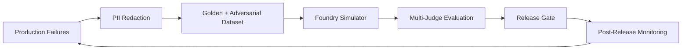
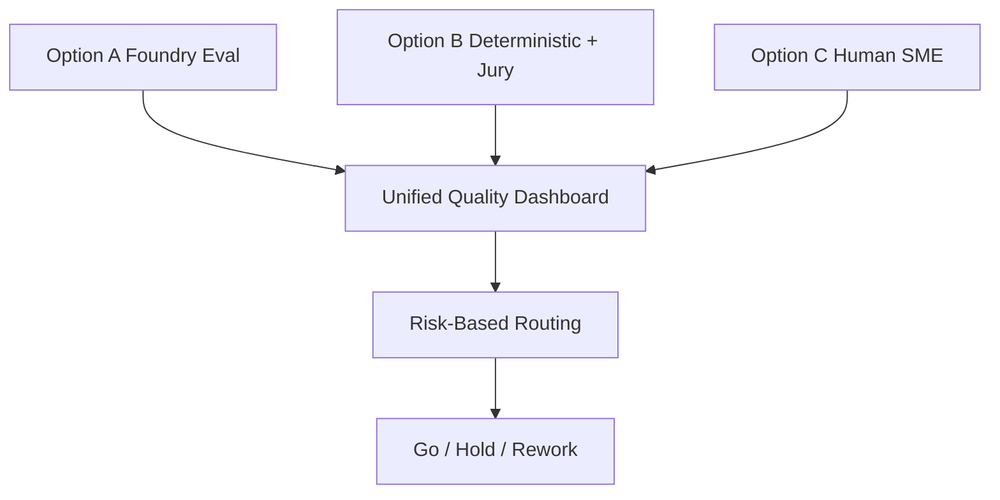

# Enterprise Agent Evaluation Selection FAQ: Synthetic Adversarial Data, Golden Benchmark Drift Governance, and Calibrated LLM Judges (Foundry Simulator vs Hybrid Auto-Eval Jury vs Human Annotation)

## 1. Problem framing: enterprise eval failures are usually about trust, not missing scores

Many teams see model quality scores rise while production incidents also rise.

This is a day-2 evaluation crisis.

Three recurring root causes appear.

First, static benchmark saturation.

A fixed 50-row golden CSV is quickly optimized against.

Teams optimize to the test set, not to user outcomes.

Second, uncalibrated LLM-as-a-Judge bias.

Single-pass judges often show position bias.

Longer answers are over-rewarded.

When judge and generator share model families, self-preference bias can emerge.

Third, production failure signals are not safely reused.

The best negative examples exist in real logs.

Without robust PII redaction and governance, they cannot enter CI pipelines.

So the evaluation stack must evolve from a static scorecard to a continuous calibration and hard-negative flywheel.

## 2. Three architecture choices

**Option A: Azure AI Foundry Evaluation + built-in simulator**

Uses Foundry evaluators and adversarial/multi-turn simulation features.

Fastest path to a unified baseline gate.

Low operational burden.

**Option B: deterministic verifiers + cross-family multi-judge calibration**

Tool-call correctness and state transitions are verified deterministically.

Language quality and policy adherence are scored by multi-model juries.

Position-swapped and verbosity-debiased scoring is enforced.

Agreement is tracked with `Cohen's Kappa` / `Krippendorff's Alpha` on SME gold subsets.

**Option C: 100% human SME annotation**

Self-hosted Label Studio/Argilla or managed annotation vendors.

High quality ceiling.

Lower scalability and higher cost.

Best used as an anchoring layer, not as the only global pathway.

## 3. 12-dimension production selection matrix

| Dimension | Option A: Foundry Integrated | Option B: Hybrid Jury + Verifier | Option C: Human SME |
|---|---|---|---|
| Initial rollout speed | fastest | medium | slow |
| Trust ceiling | medium-high | highest | high |
| Position bias control | medium | high | high |
| Explainability | medium | high | high |
| Scale potential | high | high | low |
| Cost per eval run | low-medium | medium | high |
| Failure trace reuse | medium | high | medium |
| Compliance control | medium-high | high | high |
| Automation degree | high | high | low |
| Platform complexity | low | high | medium |
| Regulated-domain fitness | medium | high | high |
| Long-run TCO | low-medium | medium | high |

Most enterprises converge to layered combinations, not one pure option.

## 4. Option A deep dive: Foundry-first unified baseline

Option A is the fastest way to standardize release-gate language across teams.

Typical capabilities include:

- groundedness checks,
- task-adherence evaluators,
- simulator-driven adversarial conversations,
- release-over-release comparisons.

Key limitations:

- judge bias still requires calibration overlays,
- deterministic state/tool verification usually needs extensions,
- high-risk domains still need human anchor controls.

## 5. Option B deep dive: deterministic lane + calibrated judge jury

Option B separates evaluation into two explicit lanes.

Lane 1: deterministic lane.

Verifies tool calls, side effects, workflow state, and policy predicates.

Lane 2: semantic lane.

Uses cross-family judges to score utility, adherence, and safety tone.

Core controls:

1. position swap A/B and B/A scoring,
2. verbosity-normalized comparisons,
3. confidence-aware aggregation,
4. periodic calibration against SME gold subsets.

When agreement drops below threshold (for example `kappa < 0.80`), gate confidence is downgraded automatically.

## 6. Option C deep dive: human annotation as quality anchor

Human annotation is strongest for high-stakes ambiguity.

Especially in legal, healthcare, and financial advisory settings.

But full human-only queues usually hit cost and latency ceilings.

Practical model:

- use human labels to calibrate auto evaluators,
- route disagreement/high-risk items to SMEs,
- reserve SME time for highest-value decisions.

## 7. Benchmark drift and contamination governance

Static benchmark sets decay quickly.

Business logic changes.

Policy language evolves.

Models learn benchmark quirks.

Use three persistent sets:

- Core Stable Set,
- Recent Failure Set,
- Adversarial Pressure Set.

Require every release gate to cover all three sets.

Track sample lifetime and retirement reason metadata.

## 8. Production hard-negative ingestion with PII-safe replay

Failure ingestion is not raw log copy.

A controlled pipeline is required:

1. extract failure traces from Azure Monitor / ADX,
2. apply rules + model-assisted PII scrubbing,
3. generate replay-safe anonymized test artifacts,
4. version and tag them into regression suites.

This turns incidents into reusable evaluation assets without leaking regulated data.

## 9. Bias calibration: position and verbosity controls are mandatory

Position bias:

candidate shown first tends to win more.

Verbosity bias:

longer text tends to be over-rewarded.

Default mitigation controls:

- bidirectional position swap,
- length normalization,
- content-coverage scoring over raw token volume.

These controls should be baseline defaults, not optional extras.

## 10. Azure sizing and 3-year TCO (`$k/month`)

### 10.1 Assumptions

- 1.2M multi-turn eval sessions per month,
- 8 turns per session on average,
- 2 candidate outputs per turn,
- 15% routed to human review queue.

### 10.2 Option A estimate

- eval/simulator services: `$62k/month`
- storage + telemetry: `$18k/month`
- platform operations: `$14k/month`
- total: `$94k/month`
- 3-year: `$3.38M`

### 10.3 Option B estimate

- multi-judge inference + deterministic verifiers: `$88k/month`
- data engineering + observability: `$26k/month`
- platform maintenance: `$29k/month`
- total: `$143k/month`
- 3-year: `$5.15M`

### 10.4 Option C estimate

- SME annotation + platform cost: `$176k/month`
- quality management: `$21k/month`
- operations: `$19k/month`
- total: `$216k/month`
- 3-year: `$7.78M`

Active-learning disagreement routing can reduce SME labeling hours by roughly `78%`.

## 11. Scenario A: global retail bank 12-turn wealth/mortgage advisory release gate

Pain points:

- multi-turn drift is missed by single-turn tests,
- compliance phrasing can regress despite stable utility,
- incorrect gate decisions create regulatory and reputational risk.

Recommended pattern:

Option B as primary gate engine.

Option A for broad daily regressions.

Option C for high-risk ambiguity anchors.

Expected outcomes:

- better pre-release detection of multi-turn failure modes,
- lower false-pass incidents.

## 12. Scenario B: global healthcare payer prior-authorization hard-negative flywheel

Pain points:

- denial explanations must be policy-traceable,
- wrong outcomes are high-cost and sensitive,
- production failures include regulated PHI/PII.

Recommended pattern:

PII-redacted hard-negative extraction from production traces.

Continuous replay through A/B automatic lanes.

SME escalation for disagreements and high-regulation classes.

Expected outcomes:

- benchmark freshness stays aligned with real failure modes,
- release gates become more predictive of production behavior.

## 13. Reference pipeline snippet: Foundry simulator + cross-family kappa calibration

```python
from sklearn.metrics import cohen_kappa_score

def judge_calibration_round(samples, judge_a, judge_b, sme_gold=None):
    score_a = [judge_a(x) for x in samples]
    score_b = [judge_b(x, swapped_position=True) for x in samples]
    kappa = cohen_kappa_score(score_a, score_b)
    consensus = [(a + b) / 2 for a, b in zip(score_a, score_b)]
    result = {"kappa": kappa, "consensus": consensus}
    if sme_gold is not None:
        # Extend with Krippendorff's Alpha and stratified error slices
        result["sme_subset_size"] = len(sme_gold)
    return result
```

This snippet is illustrative.

The architecture principle is the key: agreement quality is a first-class release signal.

## 14. Deep quantitative Q&A

### 14.1 Q1: why is `kappa >= 0.80` often used as a practical gate threshold?

Because it usually indicates substantial agreement in many operational settings.

Below that level, judge noise can dominate release conclusions.

### 14.2 Q2: how can we detect benchmark contamination early?

If benchmark scores keep rising while production outcomes stagnate or worsen, contamination is likely.

Rising hard-negative miss rates are another signal.

### 14.3 Q3: when must we include human anchor reviews?

Regulated/high-harm domains.

Persistent multi-judge disagreement slices.

Low-confidence model cohorts.

### 14.4 Q4: how do we measure active-learning ROI?

Track:

- SME-hour reduction,
- severe-defect catch rate,
- gate precision/recall for hold decisions.

### 14.5 Q5: how do we mitigate same-family narcissism bias?

Use cross-family judges.

Enforce position swap.

Normalize verbosity.

Continuously calibrate against SME anchors.

### 14.6 Q6: when is Option A alone sufficient?

Lower-risk domains requiring quick standardization and moderate trust guarantees.

Later evolution can layer Option B/C selectively.

## 15. Five-step implementation guide (Good fit vs Not for)

**Step 1: define trust SLOs before coverage SLOs**

Coverage without trust creates false certainty.

**Step 2: maintain three benchmark sets**

Core stable, recent failures, and adversarial pressure.

**Step 3: enforce calibration controls by default**

Position swap, agreement metrics, and verbosity normalization.

**Step 4: build production-failure ingestion with PII controls**

Turn incidents into replayable, anonymized regression assets.

**Step 5: focus humans on disagreements and high-risk slices**

Reserve SME bandwidth for decisions with highest governance value.

**Good fit**

- multi-turn enterprise agents,
- regulated sectors,
- release workflows requiring high-confidence quality signals.

**Not for**

- short-lived prototype teams with lightweight demo goals,
- teams unwilling to operate minimum governance and observability controls.

### 15.1 Diagram A: evaluation data flywheel



### 15.2 Diagram B: layered A/B/C governance model



### 15.3 Final recommendation

Long-run enterprise advantage comes from continuously surfacing real risk and closing the loop quickly, not from maximizing a single static score.

Default to A+B for scale and trust, and keep C as a high-risk anchor layer.

### 15.4 Q7: how should an evaluation trust SLO be defined?

Use at least four indicators:

- judge agreement threshold,
- human-review coverage for high-risk slices,
- release-block precision,
- pre-release defect discovery rate.

A single aggregate score is insufficient.

### 15.5 Q8: how do we avoid false conclusions after major model upgrades?

Trigger benchmark resampling after major model-family changes.

Run baseline alignment on core stable sets before changing gate thresholds.

Update policy interpretation logic first, threshold second.

### 15.6 Q9: how should evaluation outcomes map to release policy?

Define three release bands:

- direct go,
- controlled canary,
- hard hold.

Do not use one global threshold for all domains.

### 15.7 Q10: how do we prevent multi-judge cost explosion?

Apply tiered routing:

- standard samples: single judge,
- critical samples: multi-judge,
- disagreements: human anchor review.

This preserves trust while avoiding linear cost growth.

### 15.8 Q11: how should multilingual fairness be evaluated?

Do not evaluate only one dominant language.

Allocate language slices by business traffic weight.

Track false-positive and false-negative rates per language.

### 15.9 Q12: what should qualify as a hard-negative sample?

Recommended minimum criteria:

- real production failure with replayability,
- completed PII redaction,
- explicit capability-gap tagging.

Samples missing these criteria should not enter long-lived regression suites.

### 15.10 Q13: how do we keep the evaluation system itself explainable?

Every scoring event should keep immutable audit metadata:

- judge version,
- rubric/prompt template version,
- sample version,
- scoring-context hash.

This enables post-incident forensics and governance review.

### 15.11 Q14: when must we expand human annotation capacity?

When one or more conditions persist:

- disagreement queue backlog,
- rising high-risk misclassification rates,
- sustained agreement below target.

In that state, increasing senior SME capacity is often more effective than scaling automation alone.

### 15.12 Q15: how do we connect evaluation to FinOps?

Track “evaluation cost per severe defect found before release.”

Trend it quarterly by domain.

This metric ties spend to actual risk reduction outcomes.

### 15.13 Q16: how do we validate simulator realism?

Compare simulator traces against production traces on:

- intent-switch frequency,
- follow-up depth,
- tool-call trigger distributions.

If divergence widens, retune simulator behavior policies.

### 15.14 Q17: how do we align standards across multiple teams?

Establish a central evaluation governance board.

Standardize rubric dictionaries and gate semantics.

Allow domain extensions under shared control rules.

### 15.15 Q18: closing principle

Evaluation is not a one-time project artifact.

It is a living quality system.

Only continuous calibration, continuous failure ingestion, and continuous governance prevent “good-looking but non-predictive” scorecards.

### 15.16 Q19: how can we measure false-block rate of release gates?

Use historical replay.

Replay previously successful production versions through the current gate policy.

If many are blocked, threshold drift or metric overfitting is likely.

### 15.17 Q20: how do we avoid unusable metric overload?

Keep a two-layer model:

- core decision metrics for go/hold,
- diagnostic metrics for root-cause analysis.

Clear metric hierarchy improves organizational execution and decision speed.

### 15.18 Final closure

When the evaluation stack can consistently catch high-risk defects, explain hold decisions, and continuously ingest real failures,

it has evolved from a scoring tool into a release safety system.

### 15.19 Operational governance note

Run evaluation governance in quarterly architecture review cadences.

Review quality gates, cost trends, and compliance events in one view,

so the system is not optimized narrowly in one dimension.

That shift is essential to move evaluation from project capability to organizational capability.
With that capability in place, release safety and model iteration speed can improve together.
This is the operational baseline recommended for enterprise-scale agent programs.
