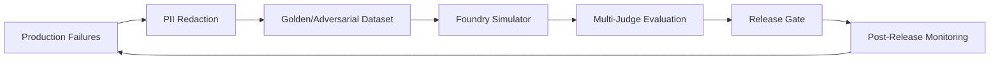
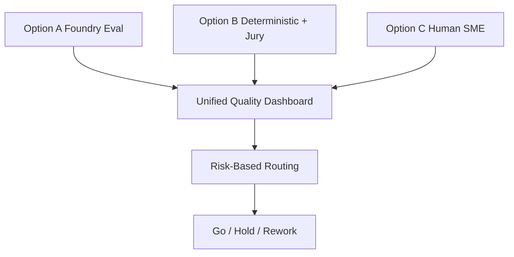

# 企业级 Agent 评测选型 FAQ：合成对抗数据、Golden Benchmark 漂移治理与 LLM Judge 校准（Foundry Simulator vs 多评审团自动评测 vs 人工标注）

## 1. 问题背景：企业评测危机不是“没分数”，而是“分数不可信、数据很快失效”

很多团队上线评测后两周就遇到悖论。

版本分数上升。

线上投诉也上升。

原因通常有三类。

第一类是静态基准过快饱和。

50 条 golden CSV 很快被模型“记住”。

团队优化的是题库，不是能力。

第二类是 LLM-as-a-Judge 偏差。

单模型单轮评审容易出现位置偏差。

更长答案也常被误判为更好。

评审模型与被评模型同家族时还会出现自偏好。

第三类是生产失败样本无法安全回流。

真实失败最有价值。

但若没有 PII 脱敏与合规分级，CI 不能直接使用。

因此评测系统需要从“单次打分工具”升级为“持续校准与持续进化平台”。

## 2. 三种架构路线：A Foundry 一体化评测，B 混合自动评审团，C 人工 SME 主导

**Option A：Azure AI Foundry Evaluation + Simulator**

使用 Foundry 内置 evaluator 与 adversarial/conversation simulator。

优点是集成度高、上线快、运维轻。

适合多数企业先建立统一质量门禁。

**Option B：确定性验证器 + 跨家族多 Judge 校准**

把工具调用与状态变更交给确定性 verifier。

把语言质量与策略对齐交给多模型评审团。

执行 position swap 与 verbosity debias。

对 SME 子集计算 `Cohen's Kappa` / `Krippendorff's Alpha`。

适合高风险高复杂场景。

**Option C：100% 人工标注平台**

自建 Label Studio/Argilla 或采购外部标注。

质量高但成本高、扩展慢。

通常不适合作为全量唯一方案。

## 3. 12 维度评测架构选型矩阵

| 维度 | Option A：Foundry 一体化 | Option B：混合自动评审团 | Option C：人工 SME |
|---|---|---|---|
| 启动速度 | 最快 | 中 | 慢 |
| 评测可信度上限 | 中高 | 最高 | 高 |
| 位置偏差控制 | 中 | 高 | 高 |
| 解释性 | 中 | 高 | 高 |
| 可扩展性 | 高 | 高 | 低 |
| 单次评测成本 | 低中 | 中 | 高 |
| 数据回流闭环 | 中 | 高 | 中 |
| 合规治理可控性 | 中高 | 高 | 高 |
| 自动化程度 | 高 | 高 | 低 |
| 维护复杂度 | 低 | 高 | 中 |
| 适配高风险行业 | 中 | 高 | 高 |
| 长期 TCO | 低中 | 中 | 高 |

矩阵结论通常是分层组合。

不是三选一。

## 4. Option A：Foundry Evaluation + 对抗模拟器的价值与边界

Option A 的核心价值是把评测流水线先跑通。

团队可以快速形成统一门禁语言。

典型能力包括：

- groundedness。
- task adherence。
- conversation simulator。
- 版本对比报告。

主要边界在于：

- Judge 偏差仍需额外校准。
- 跨域确定性约束需要补充 verifier。
- 高风险场景需增加人工复核层。

## 5. Option B：确定性验证器 + 多模型评审团的生产做法

Option B 将评测拆成两条轨道。

轨道一是确定性轨道。

验证工具调用参数、状态变更与副作用。

轨道二是语义轨道。

由跨家族 Judge 评估表达、策略、合规语气。

关键动作：

1. 同题 position swap 双评。
2. 长度归一化评分。
3. 多 Judge 投票与置信区间。
4. 与 SME 金标准子集定期对齐。

当 `kappa < 0.80` 时，自动降级结果可信度。

## 6. Option C：人工标注平台的定位不是“全量替代”，而是“高价值锚点”

人工标注最适合做高质量锚点集。

特别是法规、医疗、金融等高风险问答。

但全量人工会遭遇成本与时效瓶颈。

最佳实践是：

- 用人工标注校准自动评测器。
- 用主动学习路由分歧样本给 SME。
- 把 SME 时间集中到最难样本。

## 7. 漂移与污染：为什么 golden benchmark 需要版本化与失效策略

静态题库必然老化。

业务变化会让旧题失去代表性。

模型升级会让旧题过拟合价值下降。

建议建立三层集合：

- Core Stable Set（稳定基线）。
- Recent Failure Set（近期失败）。
- Adversarial Set（对抗压力）。

每次发布至少覆盖三层集合。

并记录每题有效期与淘汰原因。

## 8. 生产失败样本回流：从 Azure Monitor/ADX 到 PII 脱敏再入库

失败回流不是简单复制日志。

必须先做分类与脱敏。

建议流程：

1. 从 Monitor/ADX 抽取失败轨迹。
2. 规则 + 模型双重 PII 检测。
3. 生成可重放的匿名评测样本。
4. 打标签进入回归套件。

这样可把真实问题转成可安全复现资产。

## 9. 位置偏差与冗长度偏差：校准不做，分数就会失真

位置偏差常见现象是“A 在前更容易赢”。

冗长度偏差常见现象是“更长更像更好”。

缓解策略：

- 双向置换 A/B -> B/A。
- 长度惩罚或归一化。
- 要点覆盖率而非字数优先。

这些动作应成为流水线默认配置。

## 10. Azure SKU 与 3 年 TCO（USD $k/month）

### 10.1 假设

- 每月 120 万多轮评测会话。
- 平均每会话 8 轮。
- 每轮 2 个候选输出。
- 15% 样本进入人工复核队列。

### 10.2 Option A

- 评测与模拟服务：`$62k/月`
- 存储与观测：`$18k/月`
- 运维：`$14k/月`
- 合计：`$94k/月`
- 三年：`$3.38M`

### 10.3 Option B

- 多 Judge 推理与 verifier：`$88k/月`
- 观测与数据工程：`$26k/月`
- 平台维护：`$29k/月`
- 合计：`$143k/月`
- 三年：`$5.15M`

### 10.4 Option C

- 标注人力与平台：`$176k/月`
- 质量管理：`$21k/月`
- 运营：`$19k/月`
- 合计：`$216k/月`
- 三年：`$7.78M`

主动学习分歧路由可让人工时长下降 `78%` 左右。

## 11. 场景一：全球零售银行 12 轮财富/按揭顾问 Agent 发布门禁

痛点：

- 多轮会话长尾风险高。
- 单轮高分不代表多轮稳定。
- 合规措辞漂移会引发监管风险。

推荐：

Option B 为主。

Option A 做规模化日常回归。

Option C 作为高风险样本锚点。

收益：

- 发布前发现多轮失配问题。
- 误放行率显著下降。

## 12. 场景二：全球医保支付方先验授权 Agent 的硬负样本飞轮

痛点：

- 拒赔解释与政策引用必须可追溯。
- 错误决策成本高且舆情风险大。
- 失败样本带有敏感个人信息。

推荐：

从生产失败中提取匿名 hard negatives。

用 Option A/B 做高频自动回归。

将分歧样本路由到医疗 SME 做终审。

收益：

- 评测集持续贴近真实风险。
- 评测门禁与生产事件形成闭环。

## 13. 参考流水线：Foundry Simulator + Judge 校准 + 人工锚点

```python
from sklearn.metrics import cohen_kappa_score

def calibrated_judge_round(samples, judge_a, judge_b, sme_gold=None):
    scores_a = [judge_a(x) for x in samples]
    scores_b = [judge_b(x, swapped_position=True) for x in samples]
    kappa = cohen_kappa_score(scores_a, scores_b)
    consensus = [(a + b) / 2 for a, b in zip(scores_a, scores_b)]
    if sme_gold is not None:
        # 这里可扩展 Krippendorff's Alpha 与分层偏差分析
        pass
    return {"kappa": kappa, "consensus": consensus}
```

该片段表达的是校准思路而非完整平台代码。

核心是把“评审一致性”作为一等指标。

## 14. 深度定量 Q&A（>=5）

### 14.1 Q1：为什么 `kappa >= 0.80` 常作为发布阈值？

因为它通常表示较高一致性。

低于该阈值时评测噪声可能主导结论。

### 14.2 Q2：如何判断 benchmark 已污染？

若分数持续上升但线上关键指标不升反降。

或新增 hard negatives 命中率显著走高。

都可能是污染信号。

### 14.3 Q3：什么时候必须引入人工锚点？

高风险场景。

争议样本。

自动评审分歧持续高的域。

### 14.4 Q4：如何衡量主动学习节省效果？

关注三项：

- SME 工时下降比例。
- 高风险缺陷捕获率。
- 发布阻断准确率。

### 14.5 Q5：如何防止 Judge 家族偏见？

跨家族评审团。

位置互换。

长度归一。

定期与人工锚点回归。

### 14.6 Q6：什么时候 Option A 足够？

中低风险业务。

需要先快速建立统一门禁。

后续可再叠加 B/C 能力。

## 15. 五步落地指南（Good fit vs Not for）

**步骤一：定义可信度目标**

先定义评测可信度，不要先追求评测覆盖率。

**步骤二：建立三层数据集**

稳定集、失败集、对抗集并行维护。

**步骤三：引入校准机制**

至少做 position swap + 双 Judge 一致性跟踪。

**步骤四：构建失败回流**

PII 脱敏后把生产失败转成回归资产。

**步骤五：人机协同收敛**

让人工只处理分歧与高风险样本。

**Good fit：**

- 多轮 Agent、强监管、高合规行业。
- 发布门禁要求高可信解释的团队。

**Not for：**

- 仅需轻量 Demo 验证的小团队。
- 无法建设最小治理链路的临时项目。

### 15.1 架构图一：评测数据飞轮



### 15.2 架构图二：A/B/C 分层治理



### 15.3 收官结论

企业评测体系的长期竞争力，不在“谁分数高”，而在“谁能持续识别真实风险并快速修复”。

因此建议默认采用 A+B 组合，并将 C 作为高风险锚点层。

### 15.4 Q7：如何定义“评测可信度 SLO”？

建议至少包含四项：

- Judge 一致性阈值。
- 高风险样本人工复核覆盖率。
- 发布阻断准确率。
- 线上故障前置发现率。

这四项组合比单一分数更能反映评测系统健康度。

### 15.5 Q8：如何治理“模型改了，评测基线没改”导致的误判？

每次主模型升级都应触发基线重采样。

并在稳定集上运行回归对齐。

若基线解释逻辑与业务策略出现偏移，应先更新策略再更新阈值。

### 15.6 Q9：如何把评测结果映射到发布策略？

建议定义三档：

- 直接发布（风险低且一致性高）。
- 灰度发布（中等风险或分歧上升）。
- 阻断发布（高风险或一致性不达标）。

避免“同一阈值裁决所有业务域”。

### 15.7 Q10：如何控制多 Judge 成本爆炸？

可先做分层采样。

普通样本单 Judge。

关键样本多 Judge。

争议样本再进入人工锚点。

这样既保持可信度又避免线性成本增长。

### 15.8 Q11：如何做跨语言评测公平性？

不要只评英文或主语言。

应按区域业务权重分配语种样本比例。

并单独跟踪各语种误判率。

### 15.9 Q12：如何定义 hard-negative 入池标准？

建议满足：

- 线上真实失败可复现。
- 已完成 PII 脱敏。
- 能映射到明确能力缺口标签。

不满足标准的样本不要进入长期回归集。

### 15.10 Q13：如何防止评测平台本身成为“黑盒”？

每次评分都应有可审计元数据。

包括：

- judge 版本。
- prompt 模板版本。
- 样本版本。
- 评分上下文哈希。

这样可支持事后追溯与争议复盘。

### 15.11 Q14：何时必须扩充人工标注容量？

当以下任一条件持续出现：

- 分歧样本积压。
- 高风险域误判率上升。
- Judge 一致性长期低于阈值。

此时应优先扩充高资历 SME 而非仅扩容自动评审。

### 15.12 Q15：如何把评测接入 FinOps 治理？

建立“每发现一个高风险缺陷的评测成本”指标。

并跟踪其季度趋势。

该指标能帮助判断评测投入是否真正创造价值。

### 15.13 Q16：如何校验对抗模拟器是否贴近真实用户？

对比模拟轨迹与真实轨迹分布：

- 意图切换频率。
- 追问深度。
- 工具调用触发点。

偏差过大时要回调模拟器策略。

### 15.14 Q17：如何做跨团队评测标准统一？

可建立中央评测治理委员会。

统一评分字典与门禁口径。

允许团队在统一框架下扩展领域特定指标。

### 15.15 Q18：收官原则

评测不是一次性项目，而是产品质量系统的一部分。

只有持续校准、持续回流、持续治理，评测才不会沦为“漂亮但无效”的报表。

### 15.16 Q19：如何评估“评测门禁误杀率”？

可用历史版本回放法。

将已上线且表现良好的版本回放到当前门禁。

若被大量阻断，说明门禁可能过拟合或阈值偏紧。

### 15.17 Q20：如何避免“评测指标太多反而无人使用”？

建议控制在核心指标 + 诊断指标两层。

核心指标进入发布决策。

诊断指标用于根因分析，不直接阻断发布。

指标体系越清晰，组织执行力越强。

### 15.18 最终收束

当评测系统能稳定发现高风险缺陷、解释阻断原因、并把真实失败持续回流时，

它就从“评测工具”进化为“发布安全系统”。

### 15.19 组织化运营提示

建议将评测治理纳入季度架构评审例会。

把质量门禁、成本与合规事件放在同一视图审查，

避免系统被局部优化牵引偏航。

这也是把评测工程从“项目能力”升级为“组织能力”的关键一步。
当组织具备该能力后，模型迭代速度与发布安全性才能同时提升。
