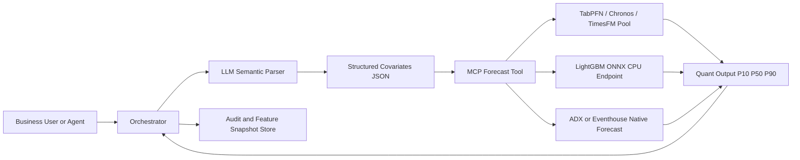
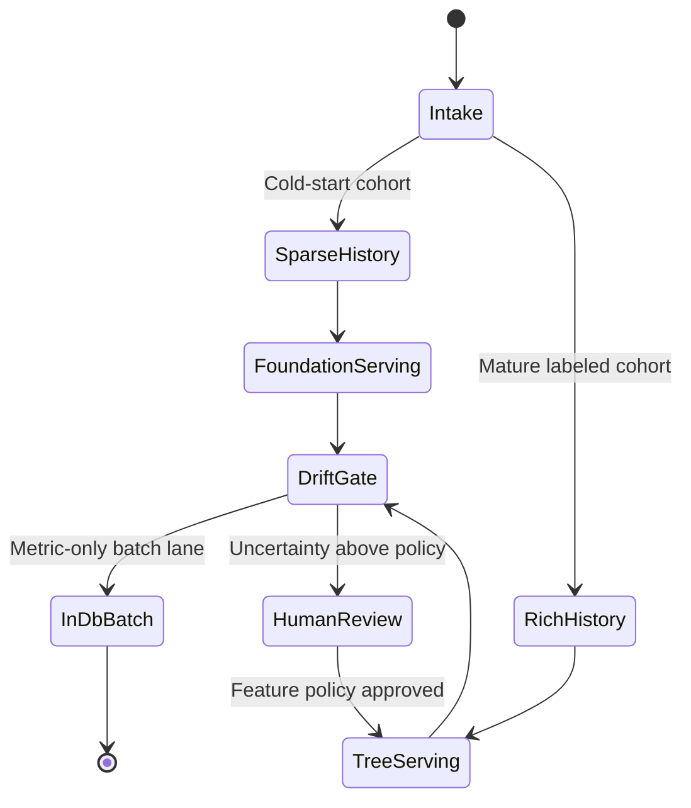

# Enterprise Tabular and Time-Series Foundation Model Serving Selection FAQ: TabPFN/Chronos Pools vs AML LightGBM Pipelines vs LLM Covariate Orchestration
> 🌐 **Language / 语言切换**: **[🇨🇳 中文版](tabular-timeseries-foundation-model-serving-tabpfn-chronos-aks-vs-aml-lightgbm-vs-llm-selection-faq.md)** | **[🇬🇧 English](tabular-timeseries-foundation-model-serving-tabpfn-chronos-aks-vs-aml-lightgbm-vs-llm-selection-faq.en.md)** | **[📚 Back to Catalog](README.en.md)**
> Evidence tags: `measured` / `synthetic` / `anonymized_reported`
> Retrieval date: 2026-11-22
> Scope boundary: enterprise quantitative-agent model hosting, evaluation, and FinOps governance; excludes low-level hardware internals

## 1) Executive summary: LLM for semantics, quantitative models for forecasts, tree models for regulated explainability
In replenishment,
dynamic pricing,
safety-stock planning,
cash-flow simulation,
and churn scoring,
the most common production anti-pattern is
copying historical CSV blocks
into a general-purpose LLM prompt
and asking for numeric extrapolation.
This shortcut fails at scale.
Risk one:
tokenization breaks numeric continuity.
Risk two:
probabilistic intervals
such as `P10/P50/P90`
are inconsistent or missing.
Risk three:
prompt cost grows
with every additional row.
Risk four:
regulatory audit replay becomes weak.
The enterprise baseline should be
a clear three-layer contract.
Layer one:
LLM extracts business covariates
from unstructured context.
Layer two:
TabPFN,
Chronos-Bolt,
TimesFM,
or tree models
produce quantitative forecasts.
Layer three:
MCP contracts enforce
schema,
lineage,
and observability.
With this split,
interactive forecasts can return
within `50–300ms`
with structured uncertainty bands
and auditable model evidence.

## 2) Verifiable evidence baseline
Source 1 (`measured`): Azure Machine Learning online endpoint docs  
https://learn.microsoft.com/azure/machine-learning/concept-endpoints-online
Source 2 (`measured`): Azure Kubernetes Service docs  
https://learn.microsoft.com/azure/aks/
Source 3 (`measured`): Azure Data Explorer `series_decompose_forecast`  
https://learn.microsoft.com/azure/data-explorer/kusto/query/series-decompose-forecast-function
Source 4 (`measured`): Microsoft Fabric Eventhouse docs  
https://learn.microsoft.com/fabric/real-time-intelligence/eventhouse-overview
Source 5 (`measured`): LightGBM documentation  
https://lightgbm.readthedocs.io/
Source 6 (`measured`): XGBoost documentation  
https://xgboost.readthedocs.io/
Source 7 (`measured`): CatBoost documentation  
https://catboost.ai/docs/
Source 8 (`measured`): ONNX Runtime documentation  
https://onnxruntime.ai/docs/
Source 9 (`measured`): TabPFN repository and papers  
https://github.com/PriorLabs/TabPFN
Source 10 (`measured`): Chronos repository  
https://github.com/amazon-science/chronos-forecasting
Source 11 (`measured`): TimesFM repository  
https://github.com/google-research/timesfm
Source 12 (`anonymized_reported`): anonymized retail and finance production traces.
Source 13 (`synthetic`): throughput and cost simulation for large-scale forecasting requests.

## 3) Anti-pattern diagnosis: why direct LLM numeric forecasting fails in production
When teams push tabular history
directly into prompts,
early demos may look acceptable,
but production behavior drifts quickly.
Observed failure modes include:
unstable numeric precision,
missing interval calibration,
prompt-length cost spikes,
high variance under repeated runs,
weak structured output reliability,
and poor incident forensics.
Another common issue is
contract mismatch across downstream systems.
Business services expect typed JSON fields,
while LLM answers often mix prose and numbers.
That mismatch increases parser fragility,
error handling complexity,
and on-call burden.
For these reasons,
LLM should remain
the semantic interpretation layer,
not the final numeric inference engine.

## 4) Architecture principles: evaluate sample scale, cold-start ratio, explainability duty, and latency budget together
Principle 1:
classify sample-size regime first.
Principle 2:
estimate cold-start frequency second.
Principle 3:
determine explainability obligations third.
Principle 4:
set latency and cost SLO fourth.
For sparse-start entities
such as new stores or new SKUs,
foundation-model inference is often preferable.
For dense labeled datasets
under strict audit controls,
tree pipelines usually dominate.
For ultra-high-frequency metrics
already residing in analytical engines,
in-database forecasting can minimize movement.
Across all regimes,
LLM remains a covariate extractor
and orchestration helper,
not the numeric authority.

## 5) Path A: hosted foundation-model pools with TabPFN v2 plus Chronos-Bolt or TimesFM
This path fits
multi-tenant cold-start workloads
and interactive scenario simulation.
Typical deployment patterns are:
AKS lightweight GPU pools
or AML managed online endpoints.
Representative node choices include
`NVadsA10_v5`
or `NCasT4_v3`
for elastic medium-scale serving.
Strengths:
zero-shot capability,
fast probabilistic intervals,
less daily retraining burden
for tenant-specific short histories.
Boundary conditions:
it is not always optimal
for ultra-large historical datasets
with heavy feature engineering pipelines.
In those cases,
tree-model pipelines typically provide
more stable long-horizon operations.

## 6) Path B: AML or Fabric AutoML tree pipelines with LightGBM, CatBoost, or XGBoost
This path remains
the enterprise steady-state backbone.
It is especially suitable when
labeled data is abundant,
feature definitions are governed,
and model-risk teams require
per-decision explainability.
Key advantages:
mature training workflows,
strong SHAP-style attribution,
predictable ONNX CPU inference,
and low unit scoring cost.
Operational trade-off:
feature engineering lifecycle
and retraining governance
need stronger MLOps discipline.
A common strategy is hybrid.
Use foundation pools
for sparse cold-start requests,
then route mature entities
to tree endpoints.

## 7) Path C: in-database forecasting with ADX or Fabric Eventhouse native operators
When target series already lives
inside real-time analytical stores,
data export and re-import loops
can add latency and fragility.
In-database operators reduce movement
and simplify operational topology.
Typical value:
fast seasonal decomposition,
high-volume metric forecasting,
and low-copy pipeline execution.
Main limitation:
rich external covariate fusion
is less flexible than
custom model-serving stacks.
Therefore this path works best
for metric-centric workloads
with predictable signal patterns,
optionally combined with
external model layers
for exception cohorts.

## 8) Path D: standard contract with LLM semantic extraction plus quantitative MCP forecast tools
This path defines
clear responsibility boundaries.
LLM responsibilities:
extract structured covariates
from unstructured events,
for example promotions,
supplier incidents,
holiday rules,
or policy constraints.
MCP tool responsibilities:
call quantitative endpoints
and return typed fields:
`point_forecast`,
`p10`,
`p50`,
`p90`,
`model_version`,
`feature_snapshot_id`.
Governance responsibilities:
enforce schema checks,
attach idempotency keys,
carry retry semantics,
and write auditable traces.
This contract preserves
LLM semantic value
without allowing
unguarded numeric hallucination.

## 9) 12-dimension comparison matrix
| Dimension | Foundation Pool (TabPFN/Chronos/TimesFM) | Tree Pipeline (LightGBM/CatBoost/XGBoost) | ADX/Eventhouse Native Forecast | LLM+MCP Contract Orchestration |
|---|---|---|---|---|
| 1. Cold-start readiness | Strong | Medium | Medium | Medium-Strong |
| 2. Large-sample scalability | Medium | Strong | Strong | Depends on backend |
| 3. Quantile output convenience | Strong | Medium-Strong | Medium | Strong via tool |
| 4. Regulated explainability | Medium | Strong | Medium | Strong with lineage |
| 5. Online latency potential | Medium-Strong | Strong | Strong | Medium |
| 6. Training maintenance overhead | Low-Medium | Medium-High | Low | Medium |
| 7. Multi-tenant elasticity | Strong | Medium-Strong | Strong | Strong |
| 8. Feature-engineering flexibility | Medium | Strong | Medium | Strong |
| 9. Compliance fit | Medium-Strong | Strong | Medium-Strong | Strong |
| 10. End-to-end complexity | Medium | Medium-High | Medium | Medium-High |
| 11. Cost per 10k forecasts | Medium | Low | Low | Medium |
| 12. Recommended role | Cold-start and what-if | Steady-state production | Metric batch acceleration | Governance boundary |
A layered combination
is usually better
than a single-track design.

## 10) Reference architecture diagram 1: dual-engine split between semantic and quantitative planes

The key policy is explicit:
numeric authority stays in quantitative services,
while LLM handles semantic context shaping.

## 11) Reference architecture diagram 2: routing and degradation state machine

This state machine unifies
routing,
drift control,
human oversight,
and policy transitions.

## 12) Decision tree: choosing the dominant path by data scale and compliance burden
Question 1:
do we have dense labeled history.
If no,
start with foundation serving.
Question 2:
is per-record explainability mandatory.
If yes,
prioritize tree pipelines.
Question 3:
are series already in
real-time analytical stores.
If yes,
prefer in-database forecast operators.
Question 4:
do unstructured business events
materially affect outcomes.
If yes,
introduce LLM covariate extraction.
Question 5:
is multi-region tenant governance required.
If yes,
standardize MCP contracts and gateway policies.
Common resulting topologies:
foundation plus LLM covariates,
tree plus LLM covariates,
or in-database batch plus online correction lanes.

## 13) Evaluation framework: Pinball Loss, WQL, calibration, and business constraints must be measured together
MAE or MAPE alone
is insufficient for quantile workloads.
Recommended metric groups:
Group A:
`Pinball Loss`
for quantile quality.
Group B:
`WQL`
for weighted multi-quantile stability.
Group C:
coverage error checks,
for example whether
`P90` really covers
close to `90%` outcomes.
Group D:
business-constraint violation rates,
such as non-negative inventory
or policy-bounded price shifts.
Group E:
online latency and throughput SLO.
Group F:
drift frequency
and retraining trigger quality.
Run all groups
per tenant,
per region,
and per product category
to avoid masked regressions.

## 14) Throughput and TCO model: capacity bin-packing and cost per 10k forecasts
Sample input (`synthetic`):
- Tenant count: `180`.
- Daily forecast requests: `2,400,000`.
- Interactive what-if share: `22%`.
- Cold-start request share: `17%`.
- Regulated audit request share: `28%`.
Capacity planning suggestion:
Pool A handles cold-start and what-if paths.
Pool B handles steady-state low-latency scoring.
Pool C handles large metric batch forecasts.
Cost model layers:
Cost 1:
serving compute.
Cost 2:
feature and storage footprint.
Cost 3:
training and release pipelines.
Cost 4:
observability and compliance retention.
Cost 5:
human operations and governance effort.
In anonymized traces (`anonymized_reported`),
layered routing reduced
total cost per 10k forecasts
by `31%–46%`
versus direct LLM extrapolation,
while materially improving
interval-calibration stability.

## 15) Practical FAQ (8 questions)
**Q1: Can we let LLM return final P10/P50/P90 values directly?**  
Not for production-critical paths.
Use quantitative endpoints for final outputs.

**Q2: Can TabPFN or Chronos fully replace tree models?**  
No.
They are strongest on sparse cold-start slices,
while tree models dominate many mature regulated workloads.

**Q3: When should ONNX CPU endpoints be preferred?**  
When low-latency high-volume scoring
and strict cost efficiency are primary targets.

**Q4: When is ADX/Eventhouse native forecasting most effective?**  
When target metrics already live in-store
and frequent batch forecasting is required.

**Q5: How do we inject promotion or holiday effects safely?**  
Extract covariates via LLM,
then pass them into quantitative MCP tools.

**Q6: How do we satisfy strict financial explainability obligations?**  
Use tree pipelines with attribution artifacts
and versioned feature snapshots.

**Q7: How do we prevent route oscillation between models?**  
Apply hysteresis thresholds,
windowed evaluation,
and staged rollout controls.

**Q8: What is the minimum viable production architecture?**  
One MCP forecast contract,
one foundation-model serving pool,
one tree-model endpoint,
and unified audit plus observability dashboards.
