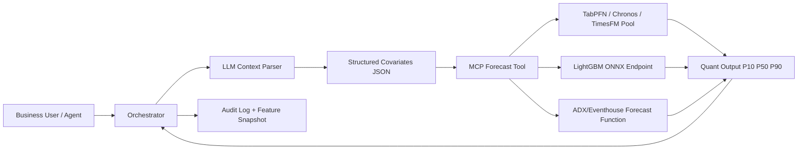
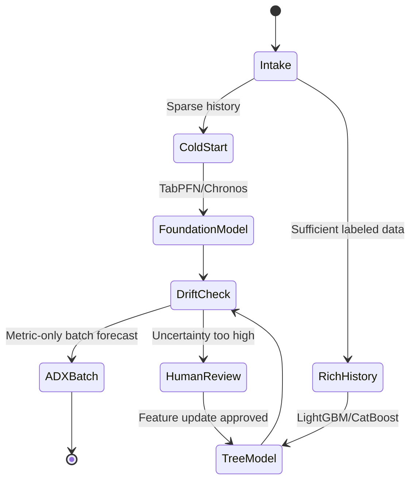

# 企业表格与时序基础模型推理选型 FAQ：TabPFN/Chronos 托管池 vs AML LightGBM 管线 vs LLM 协变量编排
> 🌐 **Language / 语言切换**: **[🇨🇳 中文版](tabular-timeseries-foundation-model-serving-tabpfn-chronos-aks-vs-aml-lightgbm-vs-llm-selection-faq.md)** | **[🇬🇧 English](tabular-timeseries-foundation-model-serving-tabpfn-chronos-aks-vs-aml-lightgbm-vs-llm-selection-faq.en.md)** | **[📚 返回目录](README.md)**
> 证据标签：`measured` / `synthetic` / `anonymized_reported`
> 抓取日期：2026-11-22
> 主题边界：聚焦企业数值预测智能体的模型托管、评测与成本治理，不涉及硬件微架构细节

## 1) 执行摘要：LLM 负责语义，定量基础模型负责预测，树模型负责审计
企业在补货、
调价、
现金流预估、
流失评分这些场景里，
最常见反模式是
把数百行历史表格
直接塞进通用 LLM 提示词，
然后让模型外推数值。
这种做法上线后
通常会同时踩中四类风险。
第一类是
分词会破坏数值连续性。
第二类是
输出缺乏 `P10/P50/P90` 区间。
第三类是
成本随上下文长度飙升。
第四类是
监管审计无法复盘。
企业级推荐路线是
三层解耦。
语义层由 LLM 负责
提取促销、
节假日、
断供等外生变量。
定量层由
TabPFN v2、
Chronos-Bolt、
TimesFM 或树模型
完成预测。
治理层用 MCP 合同
固定输入输出结构。
在这套分层下，
交互式预测可在
`50–300ms` 完成分位数返回，
并保留审计所需的
特征与版本证据链。

## 2) 可验证来源与证据基线
来源 1（`measured`）：Azure Machine Learning Online Endpoints  
https://learn.microsoft.com/azure/machine-learning/concept-endpoints-online
来源 2（`measured`）：Azure Kubernetes Service 文档  
https://learn.microsoft.com/azure/aks/
来源 3（`measured`）：Azure Data Explorer `series_decompose_forecast`  
https://learn.microsoft.com/azure/data-explorer/kusto/query/series-decompose-forecast-function
来源 4（`measured`）：Microsoft Fabric Eventhouse 文档  
https://learn.microsoft.com/fabric/real-time-intelligence/eventhouse-overview
来源 5（`measured`）：LightGBM 文档  
https://lightgbm.readthedocs.io/
来源 6（`measured`）：XGBoost 文档  
https://xgboost.readthedocs.io/
来源 7（`measured`）：CatBoost 文档  
https://catboost.ai/docs/
来源 8（`measured`）：ONNX Runtime 文档  
https://onnxruntime.ai/docs/
来源 9（`measured`）：TabPFN 论文与仓库说明  
https://github.com/PriorLabs/TabPFN
来源 10（`measured`）：Chronos 模型仓库  
https://github.com/amazon-science/chronos-forecasting
来源 11（`measured`）：TimesFM 模型仓库  
https://github.com/google-research/timesfm
来源 12（`anonymized_reported`）：零售与金融匿名预测运行数据。
来源 13（`synthetic`）：万次预测吞吐与成本仿真模型。

## 3) 反模式诊断：为什么“LLM 直接算预测值”会在生产失败
当团队把表格历史
整段贴给 LLM 时，
表面看似上线很快，
实则留下长期隐患。
隐患一：
数值列被分词后
不再保留连续距离语义。
隐患二：
预测值与区间
常混在自然语言里，
难以结构化消费。
隐患三：
高频调用下
提示词成本不可控。
隐患四：
同一输入多次调用
输出波动偏大。
隐患五：
无法稳定输出
可解释贡献度。
隐患六：
监管问责时
缺少可复现实验脚本。
因此应把 LLM
定位为语义协变量提取器，
而非定量计算器。
预测核心必须交给
专用定量模型端点。

## 4) 架构原则：样本规模、冷启动、解释性与成本必须同屏评估
原则 A：
先判定样本规模区间。
原则 B：
再判定冷启动频率。
原则 C：
再判定是否需要
逐笔可解释审计。
原则 D：
最后判定推理 SLA 与预算。
对新 SKU、
新门店、
新活动这类冷启动样本，
优先基础模型零样本推理。
对百万级样本、
高维特征、
强监管归因场景，
优先树模型和 ONNX CPU 端点。
对海量已落地时序
且指标已进实时数仓，
优先 ADX 或 Eventhouse
原生时序算子。
LLM 始终放在编排层，
不直接产出最终预测数值。

## 5) 路线 A：TabPFN + Chronos/TimesFM 托管基础模型池
该路线适合
冷启动频繁、
租户数量多、
模型训练窗口短的业务。
典型部署方式有两类。
第一类是
AKS 轻量 GPU 池，
例如 `NVadsA10_v5`。
第二类是
AML 托管在线端点。
该路线优势在于：
零样本可直接给出
分位数区间。
对 `100–10,000` 行切片
响应较快。
支持交互式 What-If。
对中台团队而言，
还能减少
“每租户每日重训”的压力。
该路线边界也要明确。
超大样本与复杂特征工程
并非它的强项。
当样本量进入亿级，
应切换到树模型管线。

## 6) 路线 B：AML/Fabric AutoML 的 LightGBM/CatBoost/XGBoost 管线
这一路线是
企业传统主力方案。
它适合
有稳定标签、
可持续训练、
可解释审计要求高的场景。
核心优势有四个。
一是
训练与验证流程成熟。
二是
`TreeSHAP` 易于审计归因。
三是
ONNX CPU 端点可做到
`<5ms` 级打分。
四是
部署成本可预测。
它的代价是
特征工程与训练流水线
建设成本更高。
对冷启动数据稀疏场景，
初期效果可能不稳。
因此常见做法是
A 路线做冷启动兜底，
B 路线做稳态主模型。

## 7) 路线 C：ADX/Eventhouse 库内时序预测算子
当企业指标
本来就在实时数仓内，
把数据搬出再预测
往往会增加延迟和运维成本。
此时可考虑
库内时序算子，
如 `series_decompose_forecast`。
该路线优势在于：
零搬移、
低复制、
毫秒级批量推断。
对于季节性强、
结构相对稳定的指标，
表现通常很实用。
但它不擅长
复杂跨域协变量建模。
若业务依赖活动语义、
促销策略、
外部事件文本，
仍需与 LLM 协变量层
和专用模型端点联动。

## 8) 路线 D：LLM 协变量提取 + MCP 定量预测工具契约
这一路线不是“多一个模型”，
而是“明确边界”。
边界定义如下。
LLM 负责
从非结构化输入里
抽取结构化变量，
例如活动级别、
折扣阈值、
节日类型、
供应风险级别。
MCP 工具负责
调用定量模型端点，
并返回结构化结果：
`point_forecast`、
`p10`、
`p50`、
`p90`、
`model_version`、
`feature_snapshot_id`。
契约层再补充
错误码、
重试策略、
幂等键、
审计追踪 ID。
这样既保留
LLM 的语义理解价值，
又避免其
直接虚构数值区间。

## 9) 12 维选型对比矩阵
| 维度 | 基础模型池（TabPFN/Chronos/TimesFM） | 树模型管线（LightGBM/CatBoost/XGBoost） | ADX/Eventhouse 库内预测 | LLM+MCP 契约编排 |
|---|---|---|---|---|
| 1. 冷启动能力 | 强 | 中 | 中 | 中强 |
| 2. 大样本适应性 | 中 | 强 | 强 | 依赖下游 |
| 3. 分位数输出便利 | 强 | 中强 | 中 | 强（经工具） |
| 4. 解释性审计 | 中 | 强 | 中 | 强（可追踪） |
| 5. 在线时延 | 中强 | 强 | 强 | 中 |
| 6. 训练维护成本 | 低到中 | 中到高 | 低 | 中 |
| 7. 多租户扩展性 | 强 | 中强 | 强 | 强 |
| 8. 特征工程灵活度 | 中 | 强 | 中 | 强 |
| 9. 监管适配度 | 中强 | 强 | 中强 | 强 |
| 10. 端到端复杂度 | 中 | 中高 | 中 | 中高 |
| 11. 单万次预测成本 | 中 | 低 | 低 | 中 |
| 12. 推荐定位 | 冷启动与交互 | 稳态核心 | 实时指标批量 | 统一编排边界 |
总体建议是
采用双轨或三轨组合，
而非单路线绝对化。

## 10) 参考架构图 1：LLM 与定量模型双引擎分层

图中强调一点：
数值结果由定量端点产生，
LLM 不直接写最终预测值。

## 11) 参考架构图 2：模型路由与降级状态机

该状态机可把
业务规则、
漂移检测、
人工复核
放进同一治理面。

## 12) 决策树：按数据规模与监管要求选择主路径
第一问：
是否存在大量已标注样本。
若无，
先走基础模型池。
第二问：
是否要求逐笔可解释归因。
若是，
树模型优先。
第三问：
是否要求毫秒级批量
且数据已在实时数仓。
若是，
优先 ADX/Eventhouse。
第四问：
是否存在大量文本外生事件。
若是，
引入 LLM 协变量提取。
第五问：
是否需要跨区域多租户统一策略。
若是，
统一走 MCP 契约和网关策略。
最终可形成三种常见拓扑。
拓扑一：
基础模型 + LLM 协变量。
拓扑二：
树模型 + LLM 协变量。
拓扑三：
库内批量预测 + 树模型在线校正。

## 13) 评测指标：Pinball Loss、WQL、校准误差与业务约束要一起看
仅看 MAE/MAPE
不足以支持分位数场景。
应引入以下指标组。
指标组 A：
`Pinball Loss`，
用于评估分位数质量。
指标组 B：
`WQL`，
用于多分位聚合稳定性。
指标组 C：
覆盖率偏差，
检查 `P90` 是否真正覆盖约 `90%`。
指标组 D：
业务约束违规率，
例如库存不得为负、
价格变化不得越过政策阈值。
指标组 E：
在线延迟与吞吐，
确保评测结果可运营。
指标组 F：
漂移与重训触发频次，
保障长期可维护。
建议将这些指标
纳入统一看板，
并按租户、
品类、
区域拆分。

## 14) 吞吐与 TCO 测算：单万次预测成本与容量装箱
样例输入（`synthetic`）：
- 租户数：`180`。
- 日预测任务：`2,400,000`。
- 交互式查询占比：`22%`。
- 冷启动任务占比：`17%`。
- 监管审计任务占比：`28%`。
容量拆分建议：
A 池承接冷启动和 What-If，
B 池承接稳态评分，
C 池承接批量序列预测。
成本项建议分为五类。
成本 1：
端点算力费用。
成本 2：
特征与数据存储费用。
成本 3：
训练与发布流水线费用。
成本 4：
观测与审计留存费用。
成本 5：
人工治理与运营工时。
在匿名样本（`anonymized_reported`）中，
采用分层路由后，
相比“LLM 直接外推”方案，
单万次预测综合成本
可下降 `31%–46%`，
且区间覆盖稳定性显著提升。

## 15) 实战 FAQ（8 题）
**Q1：LLM 能否直接给 P10/P50/P90？**  
不建议。
应由定量模型端点输出。

**Q2：TabPFN/Chronos 是否能完全替代树模型？**  
不能。
两者在冷启动与稳态审计上
各有优势。

**Q3：什么时候优先 ONNX CPU 端点？**  
当在线打分量大、
延迟要求极低、
且成本敏感时。

**Q4：ADX/Eventhouse 何时最有价值？**  
当序列已在库内，
并需高频批量预测时。

**Q5：如何把促销活动影响纳入预测？**  
由 LLM 先提取协变量，
再交给定量模型计算。

**Q6：如何满足金融监管可解释要求？**  
优先树模型，
并输出特征贡献与版本证据。

**Q7：如何避免模型路由震荡？**  
用固定窗口评估、
阈值滞回、
灰度切换三项联动。

**Q8：最小可行生产架构是什么？**  
MCP 预测工具契约、
一个基础模型池、
一个树模型端点、
统一观测与审计看板。
