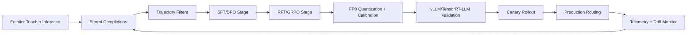
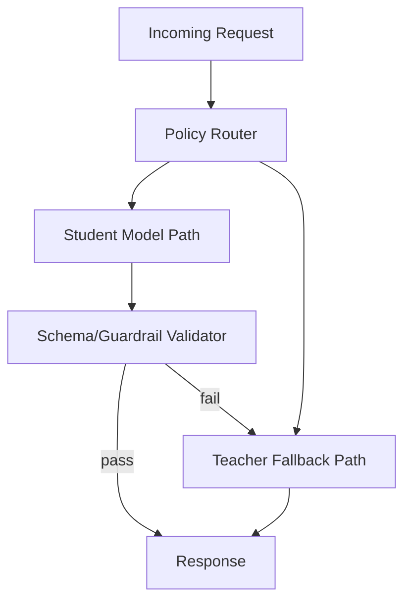

# Enterprise Teacher-Student Distillation Selection FAQ: Trajectory Distillation + RFT/DPO/GRPO with FP8/W8A8 and INT4-AWQ Trade-offs (Foundry vs Azure ML + AKS)

## 1. Why this decision exists: after 50M+ tokens/day, architecture economics dominates

Many enterprise agent programs start with frontier reasoning models.

That is rational in PoC.

The first objective is correctness.

The second objective is business proof.

However, once volume crosses 50M+ tokens/day, architecture pressure shifts.

Cost elasticity becomes central.

Latency variance becomes visible to business users.

Budget predictability becomes an executive concern.

Prompt caching helps.

Batch APIs help.

But they rarely eliminate the core scaling cost for broad online traffic.

At that point, the architecture question becomes:

how to migrate 80–90% of stable requests to a smaller student model,

without catastrophic tool-call regression or multi-hop reasoning collapse.

This FAQ addresses that exact transition.

## 2. Scope and differentiation: this is not static model routing and not LoRA slot packing

This topic is not the same as static tier routing.

Static routing mainly optimizes request-to-model assignment.

This topic is also not the same as LoRA memory-slot orchestration.

LoRA slot packing focuses on adapter multiplexing efficiency.

Teacher-student migration adds additional failure classes:

- trajectory contamination from lucky-but-wrong teacher traces,
- unstable reinforcement rewards and reward hacking,
- post-quantization degradation in structured tool-call precision.

Therefore, architecture decisions must combine:

- dataset governance,
- reward design,
- quantization calibration,
- serving rollout and rollback controls.

## 3. Option map: A (Foundry managed distillation), B (AML + AKS self-hosted), C (frontier-only)

### Option A: Azure AI Foundry managed distillation and RFT

Typical shape:

- collect trajectories with stored completions,
- run managed SFT distillation,
- apply reinforcement tuning for execution correctness,
- deploy to mini/nano style managed endpoints.

Advantages:

- faster time to production,
- lower platform operations burden,
- cleaner managed governance posture.

Constraints:

- less low-level kernel control,
- less freedom over open-weight serving internals.

### Option B: Azure ML distributed training + AKS self-hosted inference

Typical shape:

- trajectory SFT + DPO/GRPO in Azure ML,
- `llm-compressor` smoothquant and W8A8-FP8 calibration,
- AKS serving via vLLM or TensorRT-LLM,
- FP8 KV cache for memory/bandwidth pressure reduction.

Advantages:

- highest optimization freedom,
- deeper cost/perf tuning latitude,
- stronger customization for domain-specific serving behavior.

Tradeoffs:

- highest platform complexity,
- stricter staffing requirements,
- higher release engineering overhead.

### Option C: frontier-only with prompt caching and batch offload

Advantages:

- minimal implementation complexity,
- strongest immediate quality headroom.

Limitations:

- weak long-run unit economics at scale,
- limited latency-cost control flexibility under peak load.

## 4. 12-dimension selection matrix

| Dimension | Option A: Foundry Managed | Option B: AML + AKS Self-Hosted | Option C: Frontier-Only |
|---|---|---|---|
| Delivery speed | high | medium | high |
| Training stack control | medium | high | low |
| Quantization control | medium | high | low |
| Tool-call reliability governance | high | high | high |
| Multi-hop reasoning retention | medium-high | high | high |
| Platform operations complexity | low-medium | high | low |
| Cost compression ceiling | medium | high | low |
| Auditability posture | high | medium-high | medium |
| Rollout and rollback flexibility | medium | high | medium |
| Staffing requirements | medium | high | low |
| 3-year TCO controllability | medium-high | high | low |
| Executive recommendation | primary default | high-scale optimization path | early-stage fallback |

This matrix is a decision instrument, not a product ranking exercise.

## 5. Trajectory governance first: filter before you distill

Distillation failures are often data failures, not model-size failures.

Enterprises should implement at least four trajectory filters:

- structural filter: strict JSON/schema validity,
- execution filter: deterministic tool verifier pass,
- reasoning-path filter: chain consistency checks,
- risk filter: confidentiality and policy compliance checks.

A frequent anti-pattern is keeping lucky traces that ended with a correct output but incorrect intermediate logic.

Those traces poison student policy learning.

In production, this manifests as fragile long-chain behavior.

High-quality trajectory governance usually contributes more than changing optimizers or schedulers.

## 6. Training strategy split: SFT baseline, DPO preference alignment, RFT/GRPO execution reinforcement

Recommended progression:

Phase 1: SFT for schema and task skeleton consistency.

Phase 2: DPO for preference boundaries and refusal behavior.

Phase 3: RFT/GRPO with deterministic graders for tool-call execution quality.

RFT/GRPO design rules:

- rewards must be reproducible,
- invalid tool arguments should receive strong penalties,
- unnecessary long reasoning should receive mild penalties,
- latency or token budget can be explicit optimization terms.

This creates an execution-aware student policy, not just a style-mimicking student.

## 7. Production snippets: FP8 calibration, reward grader, and vLLM FP8 KV-cache serving

### 7.1 `llm-compressor` FP8 calibration example

```python
from llmcompressor import CompressorConfig, quantize_model

cfg = CompressorConfig(
    scheme="W8A8_FP8",
    weight_dtype="fp8_e4m3",
    act_dtype="fp8_e4m3",
    kv_cache_dtype="fp8_e4m3",
    calibration_samples=2048,
    calibration_sequence_length=4096,
    smoothquant_alpha=0.7,
    clip_percentile=99.9,
)

quantize_model(
    model_path="student-14b-sft-rft",
    output_path="student-14b-w8a8-fp8",
    config=cfg,
    eval_tasks=["tool_json_validity", "multi_hop_reasoning", "numeric_precision"],
)
```

### 7.2 reward grader example for RFT

```python
def reward(example, model_output, tool_exec):
    score = 0.0
    if model_output["json_valid"]:
        score += 0.35
    if model_output["schema_valid"]:
        score += 0.25
    if tool_exec["deterministic_pass"]:
        score += 0.25
    if tool_exec["latency_ms"] <= example["latency_slo_ms"]:
        score += 0.10
    score -= min(model_output["extra_tokens"] / 2000.0, 0.10)
    if model_output["unsafe_action"]:
        score -= 0.80
    return max(-1.0, min(1.0, score))
```

### 7.3 AKS vLLM startup parameters with FP8 KV-cache

```bash
python -m vllm.entrypoints.openai.api_server \
  --model /models/student-14b-w8a8-fp8 \
  --dtype float16 \
  --kv-cache-dtype fp8 \
  --max-model-len 8192 \
  --gpu-memory-utilization 0.92 \
  --tensor-parallel-size 8 \
  --enforce-eager false
```

The key production lesson:

quantization, reward tuning, and serving parameters must be co-validated.

Single-axis optimization is unstable at enterprise traffic scale.

## 8. End-to-end lifecycle architecture: from teacher traces to canary rollout



This loop encodes continuous improvement instead of one-shot model shipping.

## 9. Runtime routing and fallback: student-first with deterministic safety nets



Production patterns often look like:

- student handles 70–90% baseline traffic,
- high-risk workflows route directly to teacher,
- validator failures auto-fallback to teacher,
- fallback traces are fed back into training backlog.

This is how quality and cost optimization coexist.

## 10. Break-even economics: when does distillation beat frontier-only spend

Define:

- `C_f`: daily frontier-only cost,
- `C_s`: daily student-serving cost,
- `E_t`: one-time engineering and training investment,
- `D`: amortization horizon in days.

Then:

`Delta = C_f - (C_s + E_t / D)`

If `Delta > 0`, distillation is economically favorable.

But architecture approval should require two additional criteria:

- no material degradation in critical quality metrics,
- reliable rollback and governance controls in production.

Daily token price alone is not a sufficient approval basis.

## 11. Option A deep dive: managed path for speed, governance, and predictable delivery

Option A fits organizations with:

- moderate platform staffing,
- quarterly cost-reduction objectives,
- strong compliance and audit requirements.

Success factors:

- strict trajectory admission rules,
- hard gates for tool-call schema invalidity,
- standardized canary and rollback playbooks.

Primary limitation:

less freedom for low-level serving and quantization internals.

Still, Option A is often the highest-probability path for first successful migration.

## 12. Option B deep dive: highest optimization ceiling with highest engineering burden

Option B can unlock superior long-run economics at very high volume.

Typical advanced optimizations:

- multiple specialist students by intent cluster,
- differentiated quantization by workload profile,
- custom batching and scheduler tuning,
- deep integration with internal observability and chargeback systems.

But costs include:

- complex training and release pipelines,
- stricter reliability engineering obligations,
- higher hiring and retention pressure for specialized talent.

If maturity is low, Option B can increase TCO despite better theoretical efficiency.

## 13. Option C deep dive: where frontier-only remains rational

Option C is still rational when:

- volume is low or unstable (for example <10M tokens/day),
- use cases are still changing quickly,
- training infrastructure is not yet available,
- delivery deadlines prioritize immediate launch over optimization.

In that context, C buys time.

It should still be treated as transitional architecture, not strategic steady-state.

## 14. Scenario A: 120M-token/day insurance claims extraction and coding with 9.4x cost compression target

Business context:

multi-country claims processing with heterogeneous document formats and strict audit requirements.

Target outcomes:

- move 86% of baseline traffic to student path,
- reduce invalid tool-argument rate from 8.0% to 0.4%,
- reduce median latency by 41%,
- achieve approximately 9.4x effective cost compression.

Architecture controls:

- teacher path for high-dispute or high-risk cases,
- strict schema validation before downstream tool execution,
- weekly drift review and targeted retraining.

Operational outcome:

cost relief without sacrificing audit defensibility.

## 15. Scenario B plus deep Q&A: telecom real-time ticket triage with 220ms student latency target

Scenario context:

carrier-grade network ticket streams spike rapidly during incidents.

Target:

student-path p95 latency below 220ms while preserving classification and escalation quality.

Deployment pattern:

- student handles standard ticket classes,
- teacher handles cross-domain uncertainty and ambiguous root-cause chains,
- router uses confidence + risk tags for dynamic assignment,
- failures are captured and recycled into retraining datasets.

Q1: why not default to INT4-AWQ everywhere?

Because under nested JSON + numeric precision workloads, poorly calibrated INT4 can degrade reliability materially.

Q2: is FP8 always superior to INT4?

No.

But on Hopper, W8A8-FP8 frequently provides a stronger quality/performance balance for tool-centric enterprise agents.

Q3: what is the practical split between DPO and RFT?

DPO aligns preference and behavioral boundaries.

RFT aligns execution success and deterministic reward outcomes.

Q4: how do teams reduce reward hacking risk?

Use reproducible deterministic graders, adversarial holdout sets, and periodic evaluator audits.

Q5: when should student traffic be increased?

Only when all conditions hold over sustained windows:

- invalid-argument rate remains under threshold,
- multi-hop success rate is stable,
- fallback rate trends down,
- business KPI and human QA both pass.

Q6: what is a clear Good fit profile?

- high and stable volume,
- explicit tool contracts,
- baseline MLOps maturity,
- willingness to invest in trajectory governance.

Q7: what is a clear Not for profile?

- rapidly changing use cases without stable task templates,
- no deterministic grading capability,
- no canary/rollback discipline,
- treating distillation as a one-off model experiment instead of platform engineering.

Q8: what five-step implementation sequence is recommended?

Step 1: implement teacher-trajectory capture with strict quality gates.

Step 2: build SFT baseline first, then add DPO and RFT/GRPO.

Step 3: calibrate FP8 pipeline and run paired online/offline validation.

Step 4: canary student traffic with deterministic fallback to teacher.

Step 5: run monthly break-even and quality-governance joint review.

Final recommendation:

Distillation is not merely shrinking a model.

It is a cross-disciplinary architecture program spanning data governance, training systems, inference runtime engineering, reliability operations, and cost governance.

The real enterprise win is turning one-time optimization into durable organizational capability.

Q9: how should enterprises handle catastrophic regression after a student rollout?

Use a pre-approved emergency rollback plan with three parallel actions:

- immediate routing switch to teacher-only for affected intents,
- automated incident snapshot capture (prompt, tool payload, validator output, latency),
- frozen replay dataset generation for hotfix training.

Do not run ad-hoc manual patching in production without reproducible evidence capture.

Q10: what does a practical evaluation bundle look like before expanding student traffic?

A robust bundle typically includes:

- schema-validity pass rate by intent family,
- deterministic tool-execution pass rate by critical workflow,
- multi-hop benchmark delta vs teacher baseline,
- p50/p95/p99 latency under realistic concurrency,
- cost-per-1k requests and cost-per-successful-task.

Only when this bundle remains stable over multiple windows should expansion proceed.

Q11: should one global student model be preferred over multiple specialized students?

For many enterprises, a hybrid strategy is superior:

- one general student for broad low-risk intents,
- one or more specialist students for high-volume vertical workflows,
- teacher retained for unresolved ambiguity and high-impact edge cases.

This avoids overfitting one model to conflicting objective surfaces.

Q12: what governance cadence is recommended for long-term sustainability?

A monthly architecture governance board is recommended, covering:

- drift indicators and retraining decisions,
- reward-function integrity and anti-hacking checks,
- quantization calibration refresh windows,
- policy changes for routing thresholds and fallback gates,
- finance review of realized versus planned break-even.

When this cadence is institutionalized, distillation becomes an operating capability instead of a one-off optimization project.
