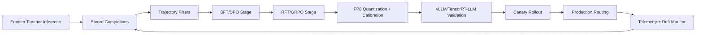
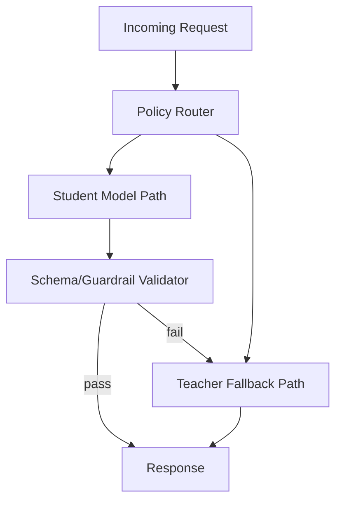

# 企业智能体蒸馏与量化选型 FAQ：Teacher-Student 轨迹蒸馏 + RFT/DPO/GRPO vs FP8/W8A8 与 INT4-AWQ 量化推理（Foundry vs Azure ML+AKS）

## 1. 背景：当 Frontier 模型进入 50M+ tokens/day，问题从“可用”转为“可持续”

很多企业智能体 PoC 阶段会直接使用 Frontier 推理模型。

例如高复杂理赔审阅。

例如多工具研发助理。

例如跨系统工单编排。

早期这样做是合理的。

因为优先目标是正确率与业务可行性。

但当日调用量进入 50M+ tokens/day 后，成本和延迟会迅速成为主矛盾。

单纯依赖 Prompt Caching 可以缓和成本。

但通常不能覆盖全部长尾任务。

此时架构问题变成：

如何把 80%–90% 的稳定流量压缩到 Student 模型。

并保持工具调用参数与多跳推理质量。

同时避免引入一个不可维护的训练平台。

这就是本指南讨论的核心。

## 2. 问题边界：本议题不同于“静态模型分级路由”与“LoRA 显存装箱”

它不同于 #06 的静态路由问题。

静态路由更关注模型家族选择与请求分流阈值。

它也不同于 #20 的 Multi-LoRA 显存编排。

后者更聚焦租户隔离与适配器热切换效率。

本议题新增了三类难点：

- Teacher 轨迹的“正确答案但错误推理”污染；
- RFT/GRPO 评分器稳定性与奖励黑客风险；
- 量化后结构化工具调用精度退化。

因此需要把“训练数据治理、奖励设计、量化校准、在线回滚”放在一张架构图里看。

## 3. 三种候选路线：A（Foundry 托管蒸馏）/ B（AML+AKS 自建）/ C（纯 Frontier）

### Option A：Azure AI Foundry 托管蒸馏与 RFT

典型形态：

- Stored Completions 收集 Teacher 轨迹；
- 托管 SFT Distillation；
- RFT 对齐工具调用与任务奖励；
- 部署到 mini/nano 端点做主流流量承载。

优点：

- 平台运维负担低；
- 治理与审计路径相对清晰；
- 交付速度快。

不足：

- 可定制 kernel 与底层量化栈较受限；
- 对开源权重自由度较低。

### Option B：Azure ML 分布式训练 + AKS 自托管服务

典型形态：

- Azure ML 上做 Trajectory SFT + DPO/GRPO；
- `llm-compressor` 做 SmoothQuant + W8A8-FP8；
- AKS 上 vLLM 或 TensorRT-LLM 服务化；
- `--kv-cache-dtype fp8` 降低带宽与显存压力。

优点：

- 性能与成本调优自由度高；
- 可深度控制模型与推理栈；
- 适合大规模长期成本压缩。

不足：

- 平台工程门槛高；
- 训练与发布治理复杂度明显上升。

### Option C：继续 Frontier + Prompt Caching + Batch API

优点：

- 研发复杂度最低；
- 质量上限通常更稳。

不足：

- 规模化成本高；
- 延迟与预算弹性受限；
- 中长期 TCO 通常不可持续。

## 4. 12 维选型矩阵：从正确率到 TCO 的一体化比较

| 维度 | Option A（Foundry 托管） | Option B（AML+AKS 自建） | Option C（Frontier 直用） |
|---|---|---|---|
| 上线速度 | 高 | 中 | 高 |
| 训练自由度 | 中 | 高 | 低 |
| 量化自由度 | 中 | 高 | 低 |
| Tool-call 精度可控性 | 高 | 高 | 高 |
| 多跳推理可迁移性 | 中-高 | 高 | 高 |
| 平台运维复杂度 | 低-中 | 高 | 低 |
| 成本压缩上限 | 中 | 高 | 低 |
| 合规审计可追溯 | 高 | 中-高 | 中 |
| 回滚与灰度灵活性 | 中 | 高 | 中 |
| 人才结构要求 | 中 | 高 | 低 |
| 三年 TCO 可控性 | 中-高 | 高 | 低 |
| 推荐结论 | 主流企业首选 | 规模化极致优化首选 | 早期或低量阶段可用 |

该矩阵用于决策，不用于宣传某个技术栈。

## 5. Teacher 轨迹治理：先清洗，再蒸馏

蒸馏失败最常见原因不是模型太小。

而是训练轨迹质量差。

需要至少四层过滤：

- 结构过滤：工具参数 JSON 是否严格合规；
- 结果过滤：执行结果是否通过 deterministic grader；
- 路径过滤：推理链是否自洽且与最终答案一致；
- 风险过滤：是否含敏感数据与不可复用上下文。

对于“蒙对答案但推理错误”的样本，应明确剔除。

否则 Student 会学到错误策略捷径。

这会在长链任务中放大为多步失败。

企业实践里，轨迹治理通常比模型微调本身更影响最终收益。

## 6. 训练策略：SFT、DPO、RFT、GRPO 的职责分工

建议分阶段：

阶段一，SFT 打基础格式与任务骨架。

阶段二，DPO 对齐偏好与拒答边界。

阶段三，RFT/GRPO 用 deterministic grader 强化工具执行正确性。

其中 RFT/GRPO 设计要点：

- 奖励函数必须可复算；
- 对延迟和 token 成本可加惩罚项；
- 对非法参数给强惩罚；
- 对“正确但绕远路”给轻惩罚，压缩推理冗余。

这样得到的 Student 才能在生产流量下稳定。

## 7. 生产片段：FP8 校准与 RFT 评分器 + AKS vLLM 配置

### 7.1 `llm-compressor` 量化与校准示例

```python
from llmcompressor import CompressorConfig, quantize_model

cfg = CompressorConfig(
    scheme="W8A8_FP8",
    weight_dtype="fp8_e4m3",
    act_dtype="fp8_e4m3",
    kv_cache_dtype="fp8_e4m3",
    calibration_samples=2048,
    calibration_sequence_length=4096,
    smoothquant_alpha=0.7,
    clip_percentile=99.9,
)

quantize_model(
    model_path="student-14b-sft-rft",
    output_path="student-14b-w8a8-fp8",
    config=cfg,
    eval_tasks=["tool_json_validity", "multi_hop_reasoning", "numeric_precision"],
)
```

### 7.2 RFT 评分器示例（工具参数与执行结果联合评分）

```python
def reward(example, model_output, tool_exec):
    score = 0.0
    if model_output["json_valid"]:
        score += 0.35
    if model_output["schema_valid"]:
        score += 0.25
    if tool_exec["deterministic_pass"]:
        score += 0.25
    if tool_exec["latency_ms"] <= example["latency_slo_ms"]:
        score += 0.10
    score -= min(model_output["extra_tokens"] / 2000.0, 0.10)
    if model_output["unsafe_action"]:
        score -= 0.80
    return max(-1.0, min(1.0, score))
```

### 7.3 AKS vLLM 启动参数（FP8 KV Cache）

```bash
python -m vllm.entrypoints.openai.api_server \
  --model /models/student-14b-w8a8-fp8 \
  --dtype float16 \
  --kv-cache-dtype fp8 \
  --max-model-len 8192 \
  --gpu-memory-utilization 0.92 \
  --tensor-parallel-size 8 \
  --enforce-eager false
```

该组合的关键是：

量化、奖励、服务参数必须联调。

单点优化通常不能稳定复现收益。

## 8. 端到端架构：Teacher 采样到 Student 灰度发布



该闭环强调持续学习，而非一次性训练。

## 9. 推理路由与回退机制：Student 为主，Teacher 保底



生产路由常见策略：

- 默认 Student 承载 70%–90% 流量；
- 高风险任务直接 Teacher；
- Student 校验失败自动回退 Teacher；
- 回退样本回流训练池做下一轮修复。

## 10. Break-even 公式：何时蒸馏投入可被节省 token 成本摊平

设：

- `C_f` 为 Frontier 每日成本；
- `C_s` 为 Student 每日成本；
- `E_t` 为训练与平台工程一次性投入；
- `D` 为摊销天数。

则日均总成本差额：

`Delta = C_f - (C_s + E_t / D)`

当 `Delta > 0` 时，蒸馏方案经济上成立。

但工程上还要附加两条：

- 关键质量指标不退化；
- 运维风险可控且可回滚。

企业架构评审不应只看单日 token 单价。

应看总拥有成本与运营稳定性。

## 11. Option A 深度分析：托管蒸馏的“快与稳”

Option A 适合如下组织：

- 平台团队规模有限；
- 需要季度内见到成本下降；
- 对平台合规与审计要求高。

其成功关键：

- 严格定义蒸馏样本采样窗口；
- 对 tool-call 错误设 hard gate；
- 将 Student 上线与回退脚本标准化。

风险在于：

- 底层推理栈优化空间有限；
- 对特定开源模型生态兼容度受制约。

总体上，A 常是“先赢一次”的高成功率路径。

## 12. Option B 深度分析：自建栈的“上限与代价”

Option B 在高流量场景潜力最大。

尤其在 100M+ tokens/day 时，单位成本优化空间明显。

可做的高级优化包括：

- 按任务簇定制多 Student；
- 细粒度量化方案差异化；
- 自定义 kernel 与 batch 调度；
- 深度接入自有观测与计费体系。

但 B 的代价同样明确：

- 训练流水线维护成本高；
- 线上灰度与回滚复杂；
- 人才门槛显著高于 A。

若组织工程能力不足，B 反而可能拉高综合成本。

## 13. Option C 深度分析：何时继续 Frontier 是理性选择

如果满足以下条件，C 仍可能合理：

- 日流量尚低（例如 <10M tokens/day）；
- 业务仍快速变化，模型尚未稳定；
- 团队暂无训练与量化工程能力；
- 时间窗口要求“本月上线”而非“季度优化”。

C 的本质是买时间。

不是长期成本最优。

建议把 C 作为过渡态，并同步准备 A/B 的演进路线图。

## 14. 场景一：120M tokens/day 理赔抽取与编码智能体，目标 9.4x 成本压缩

背景：

保险集团多国理赔文档格式复杂。

每天 120M+ tokens 推理支出高。

方案：

- Teacher：Frontier 模型处理高复杂长尾；
- Student：14B 蒸馏模型承载主流任务；
- RFT 奖励绑定结构化字段正确率与审计一致性；
- W8A8-FP8 + FP8 KV Cache 降低推理成本。

结果（目标）：

- 主流任务迁移率 86%；
- 非法参数率从 8.0% 降到 0.4%；
- 平均时延下降 41%；
- 综合推理成本压缩约 9.4x。

治理：

- 高争议案件强制 Teacher；
- Student 输出必须通过 schema validator；
- 每周漂移复盘与小步再训练。

## 15. 场景二与深度 Q&A：电信实时工单分诊 220ms Student 上线

场景二背景：

某运营商网络工单流量高峰每秒数百条。

目标是 Student 路径 p95 小于 220ms。

实施要点：

- Student 先承载标准化工单分类；
- Teacher 处理复杂跨域根因；
- 路由器按风险标签与置信度分流；
- 失败回退全量留痕并回流训练。

Q1：为什么不直接上 INT4-AWQ？

因为在多层嵌套 JSON 与数值精度任务中，未经充分校准的 INT4 退化风险高。

Q2：FP8 一定优于 INT4 吗？

不绝对。

但在 Hopper 场景下，W8A8-FP8 常能在精度与吞吐间取得更稳平衡。

Q3：RFT 与 DPO 如何分工？

DPO 负责偏好对齐与输出风格边界。

RFT 负责可执行结果导向的强化目标。

Q4：如何防止奖励黑客？

评分器必须包含 deterministic 验证。

并定期引入对抗样本审计。

Q5：何时判定可以扩大 Student 流量？

建议同时满足：

- 工具参数非法率稳定低于阈值；
- 多跳任务成功率无显著下降；
- 回退率连续多周下降；
- 业务 KPI 与人工质检双通过。

Q6：如何定义 Good fit？

满足以下条件即为 Good fit：

- 调用量已高且稳定；
- 工具调用契约明确；
- 团队具备基础 MLOps 能力；
- 愿意投入轨迹治理工程。

Q7：Not for 的典型组织？

- 业务需求高频变化、尚无稳定任务模板；
- 无法建设验证评分器；
- 无灰度与回滚治理机制；
- 把蒸馏当“纯算法项目”而非平台工程项目。

Q8：五步落地建议是什么？

第一步：建立 Teacher 轨迹采样与质量门禁。

第二步：先做 SFT 基线，再叠加 DPO/RFT。

第三步：引入 FP8 校准与线上对照压测。

第四步：Student 小流量灰度并保留 Teacher 保底。

第五步：建立月度 break-even 与质量联合复盘。

收官建议：

蒸馏不是把“大模型变小模型”这么简单。

它是一个跨数据治理、训练工程、推理系统、运维治理的系统工程。

真正的架构价值，在于把成本压缩与质量稳定同时做成可持续能力，而不是一次性实验结果。
