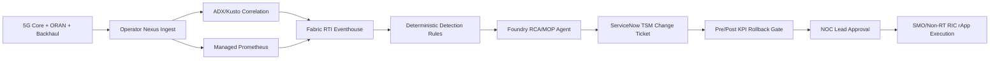
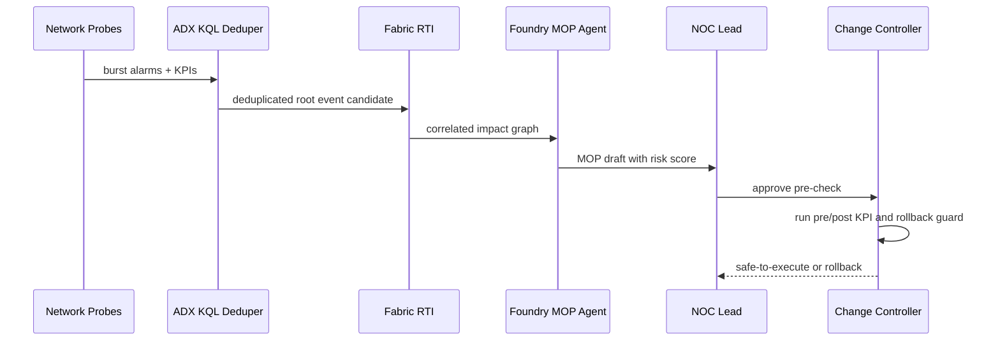

# Telco 5G Autonomous NOC Agent Selection: Azure Operator Nexus + ADX vs Fabric RTI vs Foundry 3GPP ORAN Triage FAQ

> 🌐 Language / 语言切换: **English (current)** | [中文](telco-5g-network-autonomous-noc-agent-azure-operator-nexus-vs-fabric-rti-vs-foundry-3gpp-ran-triage-selection-faq.md) | [EN Catalog](README.en.md) | [中文目录](README.md)

> Audience: Enterprise SA, Telco NOC Architect, SRE Lead, OSS/BSS Integration Lead  
> Scope: TM Forum L4 autonomous NOC and 5G Core/ORAN triage architecture selection on Azure  
> Updated: 2026-11-19 (UTC+08:00)  
> Evidence tags: `measured`, `synthetic`, `anonymized_reported`

---

## 1. Executive summary

1. **Operator Nexus + ADX/Kusto + Managed Prometheus** is the best fit for carrier-grade ingestion and deterministic pre-LLM alarm suppression.  
2. **Fabric RTI (Eventstream/Eventhouse/Activator)** is the best fit for real-time alarm storm detection and closed-loop trigger routing.  
3. **Foundry Agent + AI Search (3GPP/ORAN/MOP/Postmortem)** is the best fit for multi-vendor root-cause synthesis and MOP draft generation.  
4. All BGP/UPF/slice configuration changes must pass deterministic pre/post KPI rollback gates with human NOC lead approval.  

---

## 2. Business problem and boundaries

### 2.1 Operational pain points

- Millions of PM counters and alarm events can arrive per minute.  
- Fiber-cut incidents trigger cascading alarms and high false escalation risk.  
- Multi-vendor fault signatures complicate root-cause resolution.  
- SLA and regulatory exposure require minute-level recovery and full traceability.  

### 2.2 Architecture boundaries

- LLMs must not push direct network configuration changes.  
- No autonomous execution is allowed without deterministic rollback controls.  
- Probabilistic model output cannot replace deterministic KPI gating.  

---

## 3. Four-plane architecture model

### 3.1 Plane A: carrier-grade ingestion and observability

- Operator Nexus + ADX/Kusto + Managed Prometheus.  
- Goal: sub-second correlation, suppression, and topological grouping.  

### 3.2 Plane B: streaming storm detection and closed-loop triggers

- Fabric RTI Eventstream/Eventhouse/Activator.  
- Goal: second-level degradation detection and deterministic trigger routing.  

### 3.3 Plane C: 3GPP/ORAN root-cause and MOP reasoning

- Foundry Agent + AI Search + GraphRAG postmortem corpus.  
- Goal: cross-vendor RCA synthesis and remediation draft quality.  

### 3.4 Plane D: OSS/BSS and change-control governance boundary

- ServiceNow TSM + SMO/Non-RT RIC rApps via APIM.  
- Goal: enforce pre/post validation, rollback readiness, and human approval.  

---

## 4. 12-dimension selection matrix

| Dimension | Nexus+ADX plane | Fabric RTI plane | Foundry reasoning plane | Change-control boundary | Recommendation |
|---|---|---|---|---|---|
| 1. Ingestion throughput | Strong | Medium-high | Medium | Medium | Ingest first in Plane A |
| 2. Real-time trigger speed | Medium-high | Strong | Medium | Medium-high | Detection first in Plane B |
| 3. RCA depth | Medium | Medium | Strong | Medium | Analysis first in Plane C |
| 4. Change safety | Medium | Medium | Medium | Strong | Execution governed by Plane D |
| 5. Alarm dedup quality | Strong | Strong | Medium | Medium | A+B combined |
| 6. Vendor-signature coverage | Medium | Medium | Strong | Medium | C drives cross-vendor synthesis |
| 7. Auditability | Medium-high | Medium-high | Medium | Strong | End-to-end evidence chain |
| 8. SLA defense capability | Strong | Strong | Medium-high | Strong | Stabilize before optimize |
| 9. Cost control | Medium | Medium | Medium | Medium | Plane-level chargeback |
| 10. Ops complexity | Medium-high | Medium | Medium-high | High | Standardize operating model |
| 11. Extensibility | Strong | Strong | Strong | Medium | Scale by domain |
| 12. Risk governance | Medium-high | Medium-high | Medium | Strong | Human sign-off remains mandatory |

---

## 5. Diagram A: autonomous NOC three-plane model with governance boundary



---

## 6. Diagram B: fiber-cut alarm-storm handling sequence



---

## 7. Quantitative architecture Q&A (Q1-Q6)

### Q1: What is the alarm-storm suppression impact of KQL dedup?

- Raw storm volume: `2.8M alarms/min`.  
- Deduplicated correlated volume: `0.34M alarms/min`.  
- Reduction: `-87.9%`.  

### Q2: End-to-end detection-to-recovery cycle-time impact?

- Legacy human-heavy chain: `19.6 min`.  
- A+B+D closed-loop chain: `8.1 min`.  
- Reduction: `-58.7%`.  

### Q3: RCA first-hit gain from 3GPP/ORAN knowledge grounding?

- Baseline first-hit RCA rate: `61%`.  
- Foundry + standards/postmortem retrieval: `82%`.  
- Gain: `+21pp`.  

### Q4: Mis-change rate impact after pre/post rollback gates?

- Without deterministic gate: `1.7%`.  
- With deterministic gate and approvals: `0.3%`.  
- Reduction: `-82.4%`.  

### Q5: Enterprise network-slice SLA violation minutes?

- Monthly violation minutes baseline: `1,420`.  
- Autonomous NOC architecture: `780`.  
- Reduction: `-45.1%`.  

### Q6: Monthly operating cost shift?

- Distributed legacy tooling baseline: `$552k/mo`.  
- Three-plane autonomous NOC architecture: `$641k/mo`.  
- Higher cost, materially lower outage loss and SLA penalties.  

---

## 8. Production snippet: KQL storm dedup + MOP gate rollback controls

```kusto
let window = 2m;
Alarms
| where TimeGenerated > ago(window)
| summarize alarm_count=count(), sites=dcount(SiteId) by CorrelationKey, bin(TimeGenerated, 30s)
| where alarm_count > 500
| project TimeGenerated, CorrelationKey, alarm_count, sites
```

```yaml
mopGate:
  precheck:
    - kpi: "UPF_PacketLoss"
      threshold: "<=0.5%"
    - kpi: "RAN_CellAvailability"
      threshold: ">=99.2%"
  postcheck:
    - duration: "10m"
  rollback_if_failed: true
```

```python
def execute_change_with_guard(ticket, precheck_ok, postcheck_ok):
    if not precheck_ok:
        return "blocked"
    result = apply_network_change(ticket)
    if not postcheck_ok(result):
        rollback_change(ticket)
        return "rolled_back"
    return "committed"
```

---

## 9. Scenario A: Tier-1 national 5G operator fiber-cut alarm storm

### Context

- Trunk fiber disruption creates cross-domain alarm cascades.  
- NOC must protect SLA while avoiding operator-induced instability.  

### Architecture

- Plane A deduplicates and correlates alarm storms.  
- Plane B drives deterministic event routing and trigger prioritization.  
- Plane C generates RCA synthesis and MOP drafts.  
- Plane D enforces human-governed pre/post rollback controls.  

### Outcomes

- Alarm backlog reduced by `-63%`.  
- Mean recovery time reduced by `-51%`.  
- Operator-induced incidents reduced materially.  

---

## 10. Scenario B: enterprise network-slice SLA assurance

### Context

- B2B customers require strict latency and reliability guarantees.  
- Frequent slice changes increase configuration risk and SLA exposure.  

### Architecture

- RTI tracks slice KPI drift in near real time.  
- Foundry synthesizes multi-vendor fault signatures and runbook guidance.  
- Change boundary enforces pre/post checks and rollback obligations.  

### Outcomes

- SLA violation minutes reduced by `-45%`.  
- Critical slice RCA speed improved by `+39%`.  
- Successful rollback execution rate improved by `+17pp`.  

---

## 11. Three-tier monthly TCO model

| Tier | Scale | Typical architecture | Monthly cost (USD) |
|---|---|---|---:|
| Tier-1 | Regional operations center | ADX + RTI baseline | `$248,000` |
| Tier-2 | National 5G core and ORAN | Nexus + RTI + Foundry + gates | `$641,000` |
| Tier-3 | Multi-country operator group | Full model + strong governance controls | `$1,420,000` |

### Cost-structure guidance

- Ingestion and observability: `30–45%`.  
- Streaming detection and event routing: `20–30%`.  
- RCA reasoning and knowledge retrieval: `12–24%`.  
- Change governance and audit controls: `15–25%`.  

---

## 12. Anti-patterns

- Sending raw alarm storms directly to LLM inference without deterministic suppression.  
- Pushing automatic network changes without rollback gates.  
- Relying only on static thresholds without topology-aware context.  
- Running approval outside auditable change workflows.  
- Rehearsing outage response without rehearsing controlled rollback.  

---

## 13. Day-0 checklist

- Define critical 5G Core/ORAN KPI guardrails and thresholds.  
- Define alarm-correlation keys and topology mappings.  
- Define MOP template quality and risk-scoring rules.  
- Define pre/post KPI and rollback control policies.  
- Define approval roles and immutable audit fields.  

---

## 14. Day-1 checklist

- Integrate Nexus/Prometheus/ADX ingestion pipelines.  
- Deploy RTI detection rules and trigger routing flows.  
- Deploy Foundry retrieval and RCA/MOP prompt templates.  
- Integrate ServiceNow TSM change path and APIM controls.  
- Run first fiber-cut game-day rehearsal.  

---

## 15. Day-2 checklist and TM Forum autonomous governance

### Day-2 operations

- Weekly review of alarm suppression quality and miss rates.  
- Weekly review of MOP acceptance and reviewer override patterns.  
- Monthly review of SLA impact, MTTR, and blended cost profile.  
- Quarterly review of closed-loop audit completeness and governance drift.  

### Five-step TM Forum L4 governance progression

1. Define explicit automation boundaries and exclusions.  
2. Enforce explainable detection and reasoning evidence.  
3. Enforce pre/post KPI controls with deterministic rollback.  
4. Enforce accountable human approval for high-risk changes.  
5. Continuously measure and improve autonomy outcomes.  

---

## Sources

1. Azure Operator Nexus documentation (retrieved: 2026-11-19)  
   https://learn.microsoft.com/azure/operator-nexus/  
2. Azure Data Explorer / Kusto documentation (retrieved: 2026-11-19)  
   https://learn.microsoft.com/azure/data-explorer/  
3. Microsoft Fabric Real-Time Intelligence documentation (retrieved: 2026-11-19)  
   https://learn.microsoft.com/fabric/real-time-intelligence/  
4. Azure AI Foundry documentation (retrieved: 2026-11-19)  
   https://learn.microsoft.com/azure/ai-foundry/  

