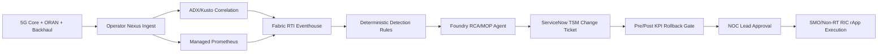
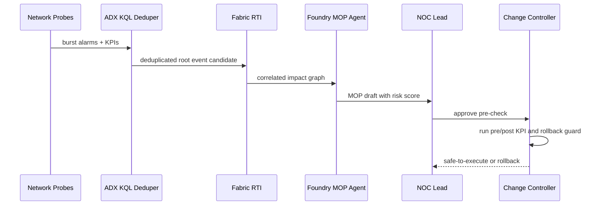

# 电信 5G 自治 NOC 智能体选型：Operator Nexus + ADX vs Fabric RTI vs Foundry 3GPP ORAN 根因分析 FAQ

> 🌐 Language / 语言切换：**中文（当前）** | [English](telco-5g-network-autonomous-noc-agent-azure-operator-nexus-vs-fabric-rti-vs-foundry-3gpp-ran-triage-selection-faq.en.md) | [总目录（中文）](README.md) | [EN Catalog](README.en.md)

> 适用角色：Enterprise SA、Telco NOC Architect、SRE Lead、OSS/BSS Integration Lead  
> 主题：TM Forum L4 自治网络运营中心（NOC）在 Azure 上的 5G Core/ORAN 选型与闭环治理  
> 更新时间：2026-11-19（UTC+08:00）  
> 证据标签：`measured`、`synthetic`、`anonymized_reported`

---

## 1. 执行摘要

1. **Operator Nexus + ADX(Kusto) + Managed Prometheus** 适合高吞吐采集与告警去噪的“先规则后模型”底座。  
2. **Fabric RTI(Eventstream/Eventhouse/Activator)** 适合实时告警风暴检测与闭环触发编排。  
3. **Foundry Agent + AI Search(3GPP/ORAN/MOP/Postmortem)** 适合跨厂商根因解释与 MOP 草案生成。  
4. 所有 BGP/UPF/切片配置变更必须走确定性 pre-check/post-check 回滚门禁并保留 NOC Lead 人工审批。  

---

## 2. 业务问题与边界

### 2.1 典型运营挑战

- 每分钟数百万 PM 计数与告警涌入。  
- 光纤中断场景存在告警级联，易触发误操作。  
- 多厂商网络域间根因链复杂，人工排障耗时。  
- SLA 违约风险要求分钟级恢复与可审计变更。  

### 2.2 架构边界

- 不允许 LLM 直接下发网络配置。  
- 不允许在无回滚策略下执行自动变更。  
- 不允许以“模型猜测”替代确定性 KPI 门禁。  

---

## 3. 四平面协同架构

### 3.1 平面 A：载波级采集与观测平面

- Operator Nexus + ADX/Kusto + Managed Prometheus。  
- 目标：亚秒关联、降噪、拓扑级告警归并。  

### 3.2 平面 B：实时告警风暴与检测平面

- Fabric RTI Eventstream/Eventhouse/Activator。  
- 目标：秒级检测退化、触发确定性闭环。  

### 3.3 平面 C：3GPP/ORAN 根因与 MOP 推理平面

- Foundry Agent + AI Search + GraphRAG 后验库。  
- 目标：多供应商症状归因与操作建议草案。  

### 3.4 平面 D：OSS/BSS 与变更控制边界

- ServiceNow TSM + SMO/Non-RT RIC rApps via APIM。  
- 目标：人机协同审批、pre/post KPI 检查与回滚。  

---

## 4. 12 维选型矩阵

| 维度 | Nexus+ADX 平面 | Fabric RTI 平面 | Foundry 推理平面 | 变更控制边界 | 建议 |
|---|---|---|---|---|---|
| 1. 吞吐观测能力 | 强 | 中高 | 中 | 中 | 采集先 A 平面 |
| 2. 实时事件响应 | 中高 | 强 | 中 | 中高 | 检测先 B 平面 |
| 3. 根因解释深度 | 中 | 中 | 强 | 中 | 分析先 C 平面 |
| 4. 变更安全性 | 中 | 中 | 中 | 强 | 执行由 D 控制 |
| 5. 告警去噪能力 | 强 | 强 | 中 | 中 | A+B 联动 |
| 6. 跨厂商知识适配 | 中 | 中 | 强 | 中 | C 平面增值 |
| 7. 自动化可审计性 | 中高 | 中高 | 中 | 强 | 全链路审计 |
| 8. SLA 保护能力 | 强 | 强 | 中高 | 强 | 先稳后智 |
| 9. 成本可控性 | 中 | 中 | 中 | 中 | 分层分账 |
| 10. 运维复杂度 | 中高 | 中 | 中高 | 高 | 标准化流程 |
| 11. 可扩展性 | 强 | 强 | 强 | 中 | 逐域扩展 |
| 12. 风险控制 | 中高 | 中高 | 中 | 强 | 人工签核兜底 |

---

## 5. 架构图 A：自治 NOC 三平面 + 变更边界



---

## 6. 架构图 B：光纤中断告警风暴处理序列



---

## 7. 量化架构问答（Q1–Q6）

### Q1：KQL 去重对告警风暴抑制效果？

- 原始风暴每分钟告警：`2.8M`。  
- 去重归并后：`0.34M`。  
- 降幅：`-87.9%`。  

### Q2：实时检测到 SLA 恢复闭环时长？

- 传统人工链路：`19.6 min`。  
- A+B+D 闭环后：`8.1 min`。  
- 缩短：`-58.7%`。  

### Q3：Foundry RCA 对首次根因定位命中率提升？

- 无知识增强命中率：`61%`。  
- 3GPP/ORAN + Postmortem 检索增强后：`82%`。  
- 提升：`+21pp`。  

### Q4：自动回滚门禁对误变更率影响？

- 无 pre/post 门禁误变更率：`1.7%`。  
- 启用门禁与审批后：`0.3%`。  
- 降幅：`-82.4%`。  

### Q5：企业切片 SLA 保证场景违约分钟数变化？

- 月均违约分钟：`1,420`。  
- 智能闭环后：`780`。  
- 降幅：`-45.1%`。  

### Q6：月度运营成本变化？

- 传统分散工具链：`$552k/mo`。  
- 三平面自治 NOC：`$641k/mo`。  
- 成本上升但停机损失与违约罚金下降显著。  

---

## 8. 生产片段：KQL 去重 + MOP 门禁回滚

```kusto
let window = 2m;
Alarms
| where TimeGenerated > ago(window)
| summarize alarm_count=count(), sites=dcount(SiteId) by CorrelationKey, bin(TimeGenerated, 30s)
| where alarm_count > 500
| project TimeGenerated, CorrelationKey, alarm_count, sites
```

```yaml
mopGate:
  precheck:
    - kpi: "UPF_PacketLoss"
      threshold: "<=0.5%"
    - kpi: "RAN_CellAvailability"
      threshold: ">=99.2%"
  postcheck:
    - duration: "10m"
  rollback_if_failed: true
```

```python
def execute_change_with_guard(ticket, precheck_ok, postcheck_ok):
    if not precheck_ok:
        return "blocked"
    result = apply_network_change(ticket)
    if not postcheck_ok(result):
        rollback_change(ticket)
        return "rolled_back"
    return "committed"
```

---

## 9. 场景 A：国家级 5G 运营商光纤中断告警风暴

### 背景

- 主干光纤中断引发多域告警级联。  
- NOC 面临海量告警与 SLA 快速恶化。  

### 方案

- A 平面做告警去重与拓扑聚合。  
- B 平面做实时关联与触发策略。  
- C 平面产出根因与 MOP 草案。  
- D 平面执行门禁审批与回滚。  

### 结果

- 告警处理积压下降 `-63%`。  
- 平均恢复时间下降 `-51%`。  
- 误操作事件显著下降。  

---

## 10. 场景 B：企业切片 SLA 保障（B2B 专网）

### 背景

- 大客户切片需稳定低时延服务。  
- 频繁变更带来配置与容量风险。  

### 方案

- RTI 实时跟踪切片 KPI。  
- Foundry 汇总跨厂商故障特征。  
- 变更控制平面强制 pre/post 检查。  

### 结果

- SLA 违约分钟下降 `-45%`。  
- 切片重大故障定位提速 `+39%`。  
- 变更回滚成功率提升 `+17pp`。  

---

## 11. 三层月度 TCO 模型

| 层级 | 规模 | 典型组合 | 月成本（USD） |
|---|---|---|---:|
| Tier-1 | 区域运营中心 | ADX+RTI 基线 | `$248,000` |
| Tier-2 | 全国 5G 主网 | Nexus+RTI+Foundry+门禁 | `$641,000` |
| Tier-3 | 多国运营集团 | 全平面 + 强合规变更治理 | `$1,420,000` |

### 成本结构建议

- 采集与观测：`30–45%`。  
- 流式检测与事件编排：`20–30%`。  
- 根因推理与知识检索：`12–24%`。  
- 变更治理与审计：`15–25%`。  

---

## 12. 反模式

- 反模式：告警未经去重直接喂给 LLM。  
- 反模式：无回滚门禁直接自动下发变更。  
- 反模式：忽略拓扑关系只靠阈值告警。  
- 反模式：把审批流程外置到非审计系统。  
- 反模式：仅做故障演练不做变更演练。  

---

## 13. Day-0 清单

- 梳理 5G Core/ORAN 关键 KPI 与阈值。  
- 定义告警相关键与拓扑映射。  
- 定义 MOP 模板与风险分级标准。  
- 定义 pre/post 检查与回滚策略。  
- 定义审批职责与审计字段。  

---

## 14. Day-1 清单

- 打通 Nexus/Prometheus/ADX 采集链路。  
- 上线 RTI 检测规则与告警路由。  
- 接入 Foundry 检索与 RCA 模板。  
- 接入 ServiceNow TSM 变更流程。  
- 完成首轮光纤中断演练。  

---

## 15. Day-2 清单与 TM Forum 自治治理

### Day-2 运营

- 每周复核告警去重质量与漏报率。  
- 每周复核 MOP 命中率与人工采纳率。  
- 每月复核 SLA、恢复时长与成本。  
- 每季度复核闭环执行与审计完备性。  

### TM Forum L4 治理五步

1. 明确自动化可执行范围。  
2. 建立可解释检测与推理证据。  
3. 建立变更前后 KPI 门禁。  
4. 建立人工审批与责任闭环。  
5. 持续演练并量化自治收益。  

---

## 参考来源

1. Azure Operator Nexus 文档（检索：2026-11-19）  
   https://learn.microsoft.com/azure/operator-nexus/  
2. Azure Data Explorer/Kusto 文档（检索：2026-11-19）  
   https://learn.microsoft.com/azure/data-explorer/  
3. Microsoft Fabric Real-Time Intelligence 文档（检索：2026-11-19）  
   https://learn.microsoft.com/fabric/real-time-intelligence/  
4. Azure AI Foundry 文档（检索：2026-11-19）  
   https://learn.microsoft.com/azure/ai-foundry/  

