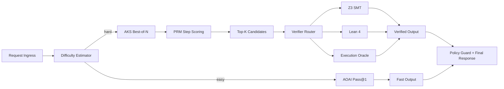
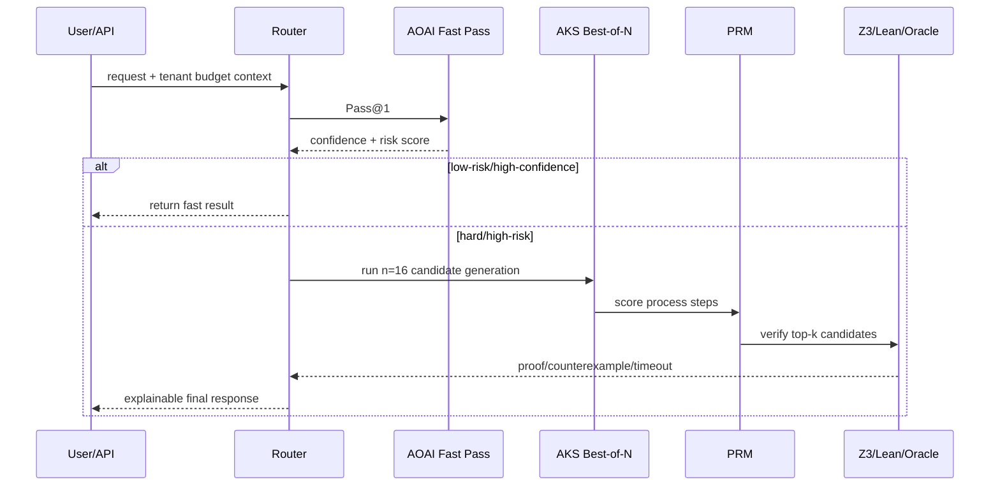

# Enterprise Test-Time Compute Selection: AOAI `o3/o4-mini/gpt-5` vs AKS `vLLM/SGLang Best-of-N + PRM` vs `Z3/Lean` Deterministic Verification FAQ
> Audience: Cloud & AI Solution Architects, inference platform owners, model governance leads, and high-assurance engineering teams.  
> Scope: inference-time accuracy scaling for high-stakes reasoning workflows where correctness, auditability, and bounded cost all matter.  
> Core question: how to combine serial reasoning effort, parallel candidate search, process reward models, and deterministic verifiers under Azure production constraints.  
## 1. Executive Summary: Accuracy Scaling Requires a Closed Loop, Not Just More Tokens
A frequent enterprise mistake is to treat test-time compute as a one-knob optimization.
Teams either increase `reasoning_effort` or increase `N` and expect monotonic quality gains.
Both tactics can help, but both also hit plateaus.
Without an external ground-truth mechanism, the system can become confidently wrong.
A production-grade pattern is a four-layer loop:
- Layer A: AOAI reasoning models for managed serial deep thinking;
- Layer B: AKS parallel candidate generation with prefix-shared KV cache;
- Layer C: step-level PRM scoring and early branch pruning;
- Layer D: deterministic verification via Z3, Lean, or execution oracles.
The economics are governed by selective escalation:
keep routine traffic on cheap fast paths,
and spend heavy compute only on difficult high-risk cases.
This guide therefore frames architecture as an adaptive control problem,
not as a model-vendor feature comparison.
## 2. Workload Boundary: Which Tasks Merit Test-Time Compute Expansion
Test-time compute is justified when three conditions hold:
- error cost is materially high;
- outputs can be objectively verified (formal or executable truth signals);
- task difficulty distribution is heavy-tailed.
Strong-fit scenarios include:
- zero-trust policy mutation validation before rollout;
- structured finance and actuarial constraint-heavy reasoning;
- high-risk IaC or SQL transformations requiring semantic preservation;
- regulated compliance workflows requiring proof-like traceability.
Weak-fit scenarios include:
- low-risk summarization and content polishing;
- ultra-low-latency user interactions where milliseconds dominate;
- open-ended tasks without any verifiable target condition.
If no reliable verifier exists,
larger candidate sets can increase cost faster than they increase truthfulness.
## 3. Four Architectural Routes and Their Operational Role
### Route A: AOAI reasoning models (`o3/o4-mini/gpt-5`) with effort control
This route is operationally simple and governance-friendly.
It is usually the fastest way to establish a production baseline.
However, hidden reasoning-token expansion can be substantial in difficult queries.
Observed cost multipliers can reach `4x–12x` versus visible output tokens.
### Route B: AKS `SGLang/vLLM` parallel sampling with PRM
This route explicitly explores multiple reasoning trajectories (`n=8..64`).
Prefix-sharing mechanisms reduce latency growth relative to naive parallelism.
Step-level PRM scoring enables early discard of low-quality branches.
Tradeoff: significantly higher platform and scheduling complexity.
### Route C: deterministic formal/execution verifiers (`Z3`, `Lean 4`, isolated oracles)
This route provides correctness anchors where constraints are formalizable.
It counteracts reward hacking and self-consistent hallucination.
Tradeoff: modeling overhead, solver timeout handling, and specialist skill requirements.
### Route D: adaptive compute-budget controller
This route determines the real production economics.
It routes easy requests to fast/cheap paths and escalates only hard cases.
Tradeoff: estimator quality directly influences both quality and cost outcomes.
## 4. 12-Dimension Comparison Matrix
| Dimension | AOAI effort scaling | AKS Best-of-N + PRM | Z3/Lean/Execution verifier | Adaptive budget controller |
|---|---|---|---|---|
| Time to first production rollout | High | Medium | Medium-low | Medium |
| Platform complexity | Low | High | High | Medium-high |
| Accuracy ceiling | Medium-high | High | Very high in verifiable domains | Depends on A/B/C quality |
| Latency predictability | Medium | Medium | Medium-low (solver variance) | Medium-high |
| Unit-cost controllability | Medium | Medium | Medium-low | High |
| Need for explicit ground truth | Low | Medium | High | Medium |
| Failure explainability | Medium | Medium | High | High |
| Elastic scaling behavior | High | High | Medium | High |
| Audit and compliance alignment | Medium | Medium-high | High | High |
| GPU dependence | Low to medium | High | Medium | Medium |
| Team skill requirement | Low to medium | High | High | Medium-high |
| Recommended role | Baseline fast path | Hard-case candidate expansion | Safety-critical correctness gate | End-to-end orchestration |
Matrix takeaway:
Route C is rarely a replacement for A/B.
It is the correctness governor for high-stakes subdomains.
Route D is what turns technical capability into sustainable operations.
## 5. Reference Architecture: Fast Path + Escalation Path + Verifier Feedback

This architecture enforces separation of concerns:
- cheap throughput path for routine requests;
- expensive accuracy path for hard requests;
- deterministic validation before final emission in critical domains.
The verifier layer must produce machine-readable reasons for failure.
Silent fallback without explanation is an anti-pattern in regulated workloads.
## 6. AOAI Reasoning-Effort Route: Value, Plateau, and Guardrails
AOAI reasoning models are operationally attractive for baseline deployment.
They reduce self-hosting overhead and simplify security/compliance integration.
For many enterprises, this route delivers the first meaningful quality jump quickly.
Yet it must be bounded by policy:
- per-tenant budget ceilings;
- maximum effort mode for non-critical traffic;
- explicit escalation triggers for high-risk tasks.
Empirically, `low -> medium` effort often yields substantial gains.
`medium -> high` can become expensive with diminishing returns on some tasks.
Wall-clock latency can expand from around `8s` toward `45s` in hard cases.
Without independent verification, higher effort can still produce wrong answers.
Therefore AOAI effort scaling should be treated as one stage in a larger control loop.
## 7. AKS `SGLang/vLLM` Parallel Route: Prefix Sharing, PRM Pruning, and Limits
Parallel candidate generation expands the hypothesis space explicitly.
With shared long prefixes, latency growth can be sublinear relative to `N`.
In practical settings, `n=16..32` can remain within acceptable latency envelopes.
PRM scoring then ranks trajectories by process quality, not just final text form.
Critical implementation patterns:
- run PRM scoring as a separate service tier;
- capture step-level reward traces for observability and drift analysis;
- enforce branch-pruning thresholds early to reduce unnecessary FLOPs.
A known failure mode appears when `N` is pushed too high without deterministic checks.
At large candidate counts, reward hacking likelihood increases.
This is where verifiers become mandatory rather than optional.
## 8. Deterministic Verifier Route: Correctness Anchor for High-Stakes Domains
Deterministic verification changes reliability economics.
Instead of "probable correctness," the system can return proof-like guarantees or explicit counterexamples.
`Z3` is effective for SMT-encodable constraints and policy equivalence checks.
`Lean 4` is effective for proof-carrying workflows where formal scripts are maintainable.
Execution oracles are effective where invariants can be validated by controlled computation.
Verifier engineering must include strict timeout governance.
A practical production bound is solver timeout `<= 2500ms` per check for online paths.
Unknown/timeout states should trigger controlled fallback, not indefinite blocking.
Verifier outputs should be fed back to candidate generation for targeted repair.
Counterexample-guided regeneration is far more efficient than blind resampling.
## 9. Adaptive Compute-Budget Controller: Economic Control Plane
The budget controller is the decisive production component.
It chooses when to stop at Pass@1 and when to escalate to expensive paths.
A typical decision chain:
- estimate difficulty and risk level;
- run fast path candidate;
- escalate only if confidence/risk thresholds fail.
Effective policy dimensions include:
- per-request cost ceilings;
- per-tenant daily spend caps;
- TPM-aware concurrency controls;
- verifier quota budgets for critical windows.
Without these controls,
hard-case traffic can starve live traffic and violate cost SLOs.
With these controls,
accuracy scaling becomes predictable rather than opportunistic.

## 10. Quantitative Q&A for Architecture Decision Gates
**Q1: How should KV memory be reasoned for `n=32` with shared 20K prefix and 2K divergent suffix on H100 80GB?**  
Use a two-part approximation: shared prefix KV + `N *` divergent suffix KV.
This highlights why prefix sharing can dramatically reduce memory growth versus naive replication.
It is the central reason `n=16..32` can be practical for selected workloads.
**Q2: Why does PRM reward hacking often emerge when `N >= 64` without deterministic verification?**  
Large candidate spaces increase the probability of finding trajectories that optimize the scorer but violate true intent.
Without an external verifier, these trajectories can dominate top-ranked outputs.
This creates apparent metric gains with hidden semantic regressions.
**Q3: How does serial `o3 high` compare with parallel `o4-mini/Qwen-32B n=16` in wall-clock terms?**  
Serial high-effort paths may have simpler orchestration but long single-path latency.
Parallel paths can reduce time-to-good-answer on hard tasks but add scoring/verification overhead.
Selection should be based on end-to-end success-per-dollar under task-specific risk constraints.
**Q4: Why enforce Z3 timeout at or below `2500ms`?**  
SMT solving can enter difficult branches unpredictably.
Hard time bounds prevent queue starvation and protect SLOs for mixed traffic.
Timeout outcomes should be modeled as first-class states in the policy engine.
**Q5: How should `maxRunningJobs` be tied to AOAI TPM budget?**  
A practical guardrail:
`maxRunningJobs <= floor((TPM_available * safety_factor) / tokens_per_job_per_min)`.
Safety factors around `0.6–0.8` preserve headroom for interactive traffic.
**Q6: Should verifier failure always trigger automatic re-sampling?**  
No.
Failure taxonomy matters:
constraint mismatch may trigger targeted regeneration,
timeout may trigger degraded-mode response,
critical-policy conflicts may require human escalation.
**Q7: Why capture step-level PRM traces rather than only final score?**  
Final scores hide where the trajectory diverged.
Step traces enable targeted prompt/PRM calibration and reduce repetitive failure modes.
They also improve post-incident explainability for auditors.
**Q8: When is verifier bypass acceptable?**  
Only for low-risk classes with historically stable behavior and enforced audit sampling.
Bypass must be policy-driven and observable, never ad hoc.
## 11. Production-Oriented Python: Best-of-N + Step-Level PRM Pruning Orchestrator
```python
from dataclasses import dataclass
from typing import List, Dict
@dataclass
class Candidate:
    text: str
    steps: List[str]
    prm_score: float = 0.0
def generate_candidates(prompt: str, n: int) -> List[Candidate]:
    # Real implementation calls vLLM/SGLang with shared-prefix sampling
    return [Candidate(text=f"cand-{i}", steps=["s1", "s2", "s3"]) for i in range(n)]
def score_steps_with_prm(cands: List[Candidate]) -> List[Candidate]:
    # Real implementation calls a co-located PRM service
    for i, c in enumerate(cands):
        c.prm_score = 0.96 - 0.01 * i
    return cands
def prune(cands: List[Candidate], keep: int) -> List[Candidate]:
    return sorted(cands, key=lambda x: x.prm_score, reverse=True)[:keep]
def orchestrate(prompt: str, n: int = 16, keep: int = 4) -> List[Candidate]:
    cands = generate_candidates(prompt, n=n)
    scored = score_steps_with_prm(cands)
    topk = prune(scored, keep=keep)
    return topk
if __name__ == "__main__":
    selected = orchestrate("prove policy equivalence")
    print([c.text for c in selected])
```
Production extensions should include:
- tenant and budget context propagation;
- candidate deduplication and diversity constraints;
- PRM drift monitoring and rollback controls;
- structured telemetry for every pruning decision.
## 12. Production-Oriented Python: Z3 Counterexample Feedback Loop
```python
from z3 import Solver, Bool, And, Not, sat, unsat
def verify_equivalence(rule_a: bool, rule_b: bool, timeout_ms: int = 2500):
    s = Solver()
    s.set(timeout=timeout_ms)
    A = Bool("A")
    B = Bool("B")
    s.add(And(A == rule_a, B == rule_b))
    s.push()
    s.add(Not(A == B))
    r = s.check()
    if r == unsat:
        return {"status": "equivalent", "proof": "UNSAT"}
    if r == sat:
        return {"status": "counterexample", "model": str(s.model())}
    return {"status": "timeout_or_unknown"}
def verifier_loop(candidate_rules):
    for cand in candidate_rules:
        verdict = verify_equivalence(cand["new"], cand["baseline"])
        if verdict["status"] == "equivalent":
            return {"decision": "accept", "detail": verdict}
    return {"decision": "fallback_or_human_review"}
```
Key operational requirements:
- hard timeout enforcement;
- explicit failure states and policy mapping;
- counterexample feedback to regeneration prompts;
- immutable audit logs for verifier outcomes.
## 13. Enterprise Scenario A: Zero-Trust Policy Mutation Verification for Cloud Security Platform
A cloud security and network platform needed to validate Firewall/NSG/IAM mutation proposals before deployment.
Manual review plus static linting missed non-obvious semantic regressions.
The organization introduced a layered TTC pipeline:
- AOAI for candidate generation;
- `n=16` parallel candidate expansion for hard cases;
- PRM ranking for intermediate trajectory quality;
- Z3 equivalence and reachability checks before approval.
Three-month outcomes:
- high-risk false approvals reduced by `72%`;
- median change-review cycle time reduced by `41%`;
- human escalation rate dropped to about `9%` with improved confidence quality.
This scenario demonstrates where deterministic verification directly reduces operational risk.
It also shows why candidate diversity plus formal checks outperforms single-path confidence.
## 14. Enterprise Scenario B: Quant Derivatives and Actuarial Desk with Parallel Synthesis + Oracle Validation
A quantitative derivatives and actuarial team processed exotic note structures with strict constraint profiles.
Single-pass reasoning produced unacceptable edge-case error rates.
They implemented:
- `n=16` parallel synthesis for hard contracts;
- PRM step scoring for trajectory prioritization;
- Monte Carlo and Python invariant oracle checks as deterministic execution gates;
- strict policy that failed verification triggers either regeneration or analyst escalation.
Program outcomes:
- acceptable-result rate improved from `68%` to `89%` on high-complexity subsets;
- mean per-request compute cost increased by about `1.7x`,
  but severe error exposure costs dropped substantially more;
- audit traceability improved with explicit candidate-score-verifier lineage.
This is a classic high-value domain where selective expensive compute is financially rational.
## 15. FinOps TCO and Day-0/Day-2 Checklist
### 15.1 FinOps and Throughput-Economics Comparison
| Metric | AOAI high-effort serial | AKS Best-of-N + PRM | + Z3/Lean verifier | Adaptive controller end-state |
|---|---:|---:|---:|---:|
| Typical latency range | 8-45s | 6-28s | 8-35s | 3-30s (tiered) |
| Unit request cost | 1x-4x | 1.4x-6x | 1.6x-7x | 1.1x-2.8x |
| Accuracy ceiling | Medium-high | High | Very high in verifiable domains | High and stable |
| Failure explainability | Medium | Medium | High | High |
| Production operability | High | Medium | Medium | High |
### 15.2 Day-0 / Day-2 Twelve-Item Checklist
| # | Validation Item | Phase |
|---:|---|---|
| 1 | Risk-tier taxonomy (low/medium/high) is explicitly defined | Day-0 |
| 2 | Fast-path vs escalation-path budget thresholds are configured | Day-0 |
| 3 | `reasoning_effort` policy caps exist per tenant and route | Day-0 |
| 4 | Maximum `N` limits are enforced for Best-of-N safety | Day-0 |
| 5 | PRM model versioning and drift alerts are operational | Day-0 |
| 6 | Verifier hard timeout (for example `2500ms`) is enforced | Day-0 |
| 7 | Verifier failure maps to explicit degrade/escalate actions | Day-2 |
| 8 | Trace schema includes candidate, PRM, and verifier metadata | Day-2 |
| 9 | Counterexample feedback loop is wired into regeneration logic | Day-2 |
| 10 | AOAI TPM, sampling concurrency, and queue limits are coupled | Day-2 |
| 11 | Fast-path verifier bypass traffic is sampled and audited | Day-2 |
| 12 | Cost and quality reporting are sliced by tenant and risk tier | Day-2 |
Operational addendum A: maintain a curated hard-case replay corpus.
The corpus should include prior incidents, boundary prompts, and known adversarial variants.
Weekly replay must report Pass@1, Best-of-N, and verifier outcomes side by side.
Without this, teams cannot localize which layer regressed.
Operational addendum B: avoid simultaneous large upgrades of generator and PRM.
Use staggered rollouts to isolate root cause when quality shifts occur.
A common pattern is generator first, PRM second after drift checks stabilize.
Operational addendum C: classify verifier failures explicitly.
At minimum separate modeling defects, solver timeout, and true counterexample outcomes.
Each class needs a different remediation path and escalation policy.
Operational addendum D: track “proof failed but executable oracle passed” cases separately.
These often indicate incomplete formal modeling rather than model-generation failure.
Accumulating this class improves verifier coverage over time.
Operational addendum E: implement tenant-level budget guard bands.
For example: 80% daily budget triggers fast-path bias,
90% triggers fast-path plus mandatory review,
100% disables expensive escalation paths.
Operational addendum F: isolate verifier capacity from primary generation capacity.
Verifier spikes should not starve customer-facing generation workers.
Dedicated pools reduce cascading latency failures.
Operational addendum G: standardize counterexample feedback payloads.
A schema such as `constraint_id / witness / failed_step / repair_hint`
enables deterministic remediation loops instead of ad hoc prompt patching.
Operational addendum H: use risk-tiered sampling for verifier bypass traffic.
Illustrative policy: 1% low-risk, 5% medium-risk, 20% high-risk audit sampling.
Elevate default route automatically when sampled failure rates rise.
Operational addendum I: monitor quality red lines, not only spend ceilings.
Example red lines include sustained verifier-failure spikes or abrupt counterexample surges.
These should trigger automatic degrade mode and on-call notification.
Operational addendum J: run quarterly chaos drills where verifier services are unavailable.
The objective is controlled degradation, not uncontrolled retry storms.
Operational addendum K: log decision rationale for route selection.
Record why fast path or escalated path was chosen, not only the final answer.
This improves regulatory auditability and post-incident accountability.
Operational addendum L: tie compute spend to business value class.
Reserve expensive reasoning and verification budgets for high-value high-risk requests.
Final takeaway:
test-time compute scaling is not about spending more tokens indiscriminately.
It is about spending compute where it raises verifiable correctness.
When sampling, scoring, verification, and budget control are integrated,
enterprises can materially improve high-stakes reasoning reliability
without surrendering latency or cost governance.
