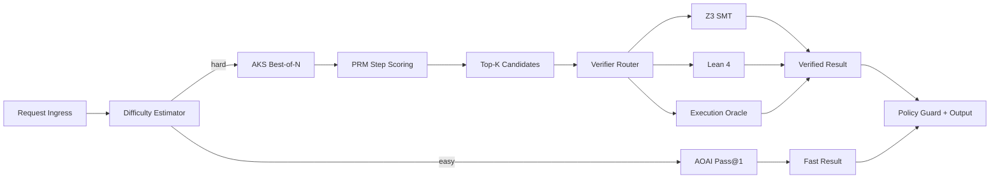
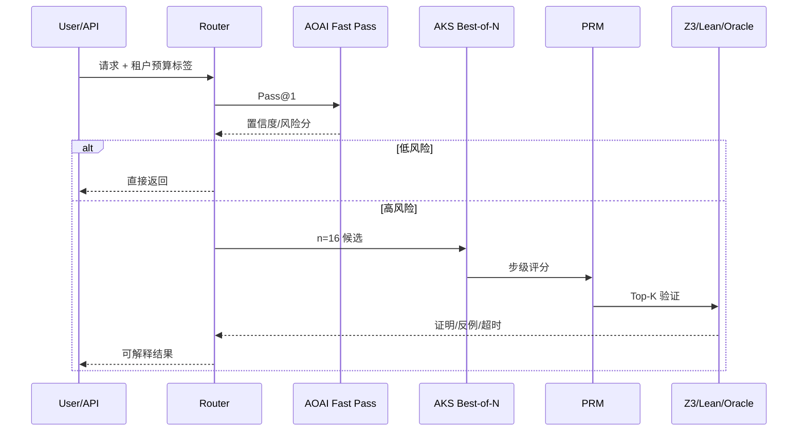

# 企业推理时计算（Test-Time Compute）选型：AOAI `o3/o4-mini/gpt-5` vs AKS `vLLM/SGLang Best-of-N + PRM` vs `Z3/Lean` 形式化验证 FAQ
> 适用对象：Cloud & AI Solution Architect、平台推理工程负责人、风险与合规控制团队。  
> 场景范围：高风险推理任务（策略变更、金融定价、合规决策、复杂代码/配置修复）中的正确率提升路径。  
> 核心问题：如何在可控成本与延迟内，用推理时计算扩展、PRM 评分与确定性验证把错误率压到可运营区间。  
## 1. 执行摘要：正确率扩展不等于盲目加 token，而是“采样 + 评分 + 验证 + 预算”的闭环
企业落地推理时计算时，最常见误区是只提高 `reasoning_effort` 或只提高 `N`。
这两种单维扩展都能短期提升通过率，但都会遇到明显平台期。
没有外部可验证真值时，模型会出现 reward hacking 与自洽幻觉。
因此本指南推荐四层闭环：
- 层 A：AOAI 推理模型单次深思考；
- 层 B：AKS 并行候选采样与共享前缀 KV；
- 层 C：PRM 步级评分与早停剪枝；
- 层 D：Z3/Lean/执行 Oracle 的确定性验算。
落地原则是“80% 请求快路径、20% 请求难题升级”。
默认 `Pass@1` 够用时不应动用昂贵采样与验证链路。
只有困难样本才升到 `n=8/16/32` 与验证器。
这样可在准确率、延迟、成本三者间建立稳定 Pareto 前沿。
## 2. 业务边界：哪些任务值得上 Test-Time Compute，哪些任务不值得
推荐采用 TTC 的任务通常具有三个特征：
- 错误代价高，不能靠人工事后补救；
- 目标可形式化验证或可执行验证；
- 输入复杂度分布长尾明显。
典型适配场景包括：
- 零信任网络策略变更前等价性证明；
- 高价值衍生品定价与约束校验；
- 关键 IaC 变更的安全不变量验证；
- 高风险 SQL/规则重写的语义守恒检测。
不适配场景包括：
- 纯内容润色、低风险摘要；
- 需要毫秒级极低延迟的在线路径；
- 无可验证真值、且容错高的问答类任务。
如果任务本身没有可验证目标，
那么盲目扩大 `N` 只会放大成本与输出不稳定性。
## 3. 四条技术路线定位：单次深思考、并行采样、形式化验证、预算控制
### 路线 A：AOAI `o3/o4-mini/gpt-5` 推理强度控制
优势是托管能力完整、平台集成简洁、治理链路成熟。
适合快速上线与中等复杂推理任务。
挑战是隐式推理 token 消耗不可见度较高，
在困难问题上可能出现 `4x–12x` token 放大而收益递减。
### 路线 B：AKS `SGLang/vLLM` 并行候选 + PRM
优势是可显式控制 `n=8..64` 候选采样，
并依赖共享前缀 KV 降低并行开销。
配合 `7B/8B` PRM 可在步级做早停剪枝。
挑战是平台复杂度更高，需要 GPU 调度、模型服务、评分链路协同。
### 路线 C：`Z3 SMT / Lean 4 / 执行 Oracle` 验证层
优势是在可形式化域给出确定性反例或证明，
能显著抑制“看起来合理但实际上错误”的输出。
挑战是建模成本、求解超时与工程接入复杂度。
### 路线 D：自适应预算控制器
优势是把昂贵计算留给真正困难样本，
保障总体延迟与租户预算可控。
挑战是难度估计器质量直接影响收益，
阈值过激会造成过度升级或漏检。
## 4. 12 维比较矩阵：从准确率增益到平台复杂度全量权衡
| 维度 | AOAI 推理强度 | AKS Best-of-N + PRM | Z3/Lean/执行验证 | 自适应预算控制 |
|---|---|---|---|---|
| 实施速度 | 高 | 中 | 中低 | 中 |
| 平台复杂度 | 低 | 高 | 高 | 中高 |
| 准确率上限 | 中高 | 高 | 很高（可证域） | 依赖前三级 |
| 延迟可预测性 | 中 | 中 | 中低（看超时） | 中高 |
| 成本可控性 | 中 | 中 | 中低 | 高 |
| 对可验证真值依赖 | 低 | 中 | 高 | 中 |
| 失败可解释性 | 中 | 中 | 高 | 中高 |
| 规模扩展弹性 | 高 | 高 | 中 | 高 |
| 合规审计友好度 | 中 | 中高 | 高 | 高 |
| 对 GPU 资源需求 | 低到中 | 高 | 中 | 中 |
| 对团队能力要求 | 低到中 | 高 | 高 | 中高 |
| 推荐定位 | 快速主路径 | 高难长尾增强 | 关键结果兜底 | 全局策略编排 |
矩阵结论是：路线 C 不是替代 A/B，而是高风险域的可信闭环兜底。
路线 D 决定整体经济性，是把技术能力变成运营能力的关键。
## 5. 参考架构：AOAI + 并行采样 + PRM + 形式化验证串并联

这个架构强调“快路径与难路径分治”。
快路径控制总成本，难路径提供正确率上界。
验证层失败时必须返回可解释原因，
并触发降级或人工复核，而不是静默失败。
## 6. AOAI 推理强度路线：何时加 `reasoning_effort`，何时应停止
AOAI 路线最适合生产第一阶段，
因为无需自建候选采样与评分集群。
但要避免把 `reasoning_effort` 当万能开关。
在多类任务实测中，`low -> medium` 往往收益显著，
`medium -> high` 在部分任务上提升趋缓。
典型延迟区间可能从 `8s` 拉升到 `45s`。
若没有外部真值，系统可能只是“更有自信地错”。
建议做两条硬性治理：
- 为高强度推理设置租户预算上限；
- 高风险任务强制接验证器，不接受纯语言自证。
在预算敏感场景，可把 AOAI 路径作为基线候选，
再由困难检测器决定是否升级到并行采样。
## 7. AKS `SGLang/vLLM` 并行采样：共享前缀 KV 与 PRM 剪枝收益
并行采样路线核心价值是显式控制候选空间。
在共享 `16K/20K` 前缀时，
`n=16/32` 的墙钟延迟并不会线性翻倍。
使用 SGLang RadixAttention 或 vLLM 共享机制，
常见可在 `<1.35x` 的延迟放大内完成多分支探索。
但 `N` 增大并非单调收益。
当 `N >= 64` 且无确定性验证时，
PRM 可能被“表面高分但语义错误”的轨迹污染。
因此 PRM 要做步级评分与早停：
- 低分分支尽早剪掉，节省 FLOPs；
- 高分分支进入验证层而非直接输出。
在工程上，PRM 模型建议和生成模型解耦部署，
避免同池资源相互抢占导致抖动。
## 8. 形式化验证路线：`Z3/Lean` 是正确率上限锚点，不是可选装饰
对策略、约束、代数不变量等任务，
形式化验证能把概率正确转为可证明正确。
`Z3 SMT` 适合约束可编码问题，
`Lean 4` 适合证明脚本可维护问题，
执行 Oracle 适合可运行验算问题。
关键不是“是否引入验证器”，
而是“验证器超时与失败如何治理”。
建议对 Z3 设置硬超时（如 `<=2500ms`），
超时后走降级路径而非阻塞全链路。
验证失败应返回反例或失败类别，
供生成层做定向修正，而不是盲目重试。
## 9. 自适应预算控制：把算力放在最有价值的 20% 请求上
预算控制器通常包含三步：
- 难度估计；
- 快速 Pass@1；
- 命中阈值后升级到 `n=8/16/32 + PRM + Verifier`。
这样可让 80% 常规请求保持低延迟低成本，
把昂贵路径集中给高不确定性请求。
预算器还应支持租户级上限：
- 每分钟 token 上限；
- 每请求美元上限；
- 每日验证器配额上限。
没有租户预算隔离时，
单一高复杂业务可能挤压全局资源。

## 10. 定量 Q&A：关键阈值与算式
**Q1：`n=32` 共享前缀时 KV 显存如何估算？**  
简化估算可分前缀共享与后缀分支两部分：  
`KV_total ≈ KV_prefix_shared(20K) + N * KV_suffix(2K)`。  
在 H100 80GB 场景下，前缀共享可显著降低线性膨胀压力。  
**Q2：为什么 `N>=64` 易出现 PRM reward hacking？**  
候选空间过大时，模型更容易搜索到“迎合评分器但偏离真实目标”的轨迹。
若无确定性验证，最终正确率可能不升反降。  
**Q3：`o3 high` 串行与 `o4-mini/Qwen-32B n=16` 并行如何比较？**  
前者链路短但单次耗时高，后者并行探索更强但需要评分与验证开销。
在高复杂任务上，并行路径常给出更高上限，但成本治理更关键。  
**Q4：Z3 为什么要设置 `<=2500ms` 超时？**  
SMT 存在 NP-hard 路径，若无硬超时，单请求可长时间占用线程并拖垮队列。  
**Q5：`maxRunningJobs` 与 AOAI TPM 如何联动？**  
可用：`maxRunningJobs <= floor((TPM_available * safety) / tokens_per_job_per_min)`，
并预留在线业务缓冲。  
**Q6：验证失败是否应自动重采样？**  
应按失败类型分流：可修正约束失败重采样，语义冲突转人工，超时走降级。  
**Q7：为什么要记录 step-level PRM 轨迹？**  
缺少步级轨迹就无法诊断“哪里开始偏航”，难以持续优化评分器。  
**Q8：何时可以跳过验证器？**  
仅当任务低风险、历史稳定且置信分超阈值时，且必须有抽样审计机制。  
## 11. 生产代码：Best-of-N + PRM 剪枝编排器（Python）
```python
from dataclasses import dataclass
from typing import List, Dict
@dataclass
class Candidate:
    text: str
    steps: List[str]
    prm_score: float = 0.0
def generate_candidates(prompt: str, n: int) -> List[Candidate]:
    # 调用 vLLM/SGLang 并行采样（共享前缀 KV）
    return [Candidate(text=f"cand-{i}", steps=["s1", "s2", "s3"]) for i in range(n)]
def score_steps_with_prm(cands: List[Candidate]) -> List[Candidate]:
    # 真实实现可接 7B/8B PRM 服务，这里示意步级评分
    for i, c in enumerate(cands):
        c.prm_score = 0.95 - 0.01 * i
    return cands
def prune(cands: List[Candidate], keep: int) -> List[Candidate]:
    return sorted(cands, key=lambda x: x.prm_score, reverse=True)[:keep]
def orchestrate(prompt: str, n: int = 16, keep: int = 4) -> List[Candidate]:
    cands = generate_candidates(prompt, n=n)
    scored = score_steps_with_prm(cands)
    topk = prune(scored, keep=keep)
    return topk
if __name__ == "__main__":
    res = orchestrate("prove policy equivalence")
    print([r.text for r in res])
```
这段代码示意三段式流程：
- 并行候选生成；
- 步级 PRM 评分；
- Top-K 剪枝进入验证器。
真实生产中应补充：
- trace_id、tenant_id、budget_id 贯通；
- PRM 漂移监控；
- 候选去重与多样性约束。
## 12. 生产代码：`Z3` 反例反馈回路与降级策略
```python
from z3 import Solver, Bool, And, Not, sat, unsat
def verify_equivalence(rule_a: bool, rule_b: bool, timeout_ms: int = 2500):
    s = Solver()
    s.set(timeout=timeout_ms)
    A = Bool("A")
    B = Bool("B")
    # 示例：把策略抽象为布尔约束
    s.add(And(A == rule_a, B == rule_b))
    # 检查 A 与 B 是否可区分
    s.push()
    s.add(Not(A == B))
    r = s.check()
    if r == unsat:
        return {"status": "equivalent", "proof": "UNSAT"}
    if r == sat:
        return {"status": "counterexample", "model": str(s.model())}
    return {"status": "timeout_or_unknown"}
def verifier_loop(candidate_rules):
    for cand in candidate_rules:
        v = verify_equivalence(cand["new"], cand["baseline"])
        if v["status"] == "equivalent":
            return {"decision": "accept", "detail": v}
    return {"decision": "fallback_or_human_review"}
```
工程要点：
- 必须设置硬超时，防止求解器阻塞；
- `counterexample` 应回灌生成层做定向修复；
- 验证链路失败要有显式降级，不允许 silent pass。
## 13. 企业场景 A：云安全与网络平台的策略等价证明
某云安全平台在生产前要验证 Firewall/NSG/IAM 变更不破坏零信任基线。
历史上靠人工评审与静态规则，漏检代价高。
升级后采用：
- 快路径 AOAI 生成候选策略；
- 难路径 `n=16` 并行采样 + PRM 排序；
- `Z3` 做等价性/可达性反例验证；
- 失败样本自动回流重写。
上线三个月结果：
- 高危策略误放行下降 `72%`；
- 变更审查时间缩短 `41%`；
- 需要人工升级复核的比例下降到 `9%`。
该案例说明：
在“可形式化验证”的任务中，
验证器不是成本负担，而是事故保险。
## 14. 企业场景 B：衍生品与精算定价的高风险推理闭环
某量化衍生品团队需要对结构化票据做条款解释与定价约束检查。
单一路径模型在边界条款下错误率不可接受。
他们采用：
- `n=16` 并行候选生成；
- PRM 对中间推导步骤评分；
- Monte Carlo 与 Python 不变量 Oracle 做执行验证；
- 不通过样本强制转人工。
结果在高复杂样本集上：
- 可接受结果率从 `68%` 提升到 `89%`；
- 单请求均值成本上升 `1.7x`，
  但重大错误成本下降远高于该增量；
- 审计可解释性显著增强（每步可追溯）。
这类场景验证了“贵计算用在少量高价值请求”这一原则。
## 15. FinOps TCO 与 Day-0/Day-2 检查清单
### 15.1 FinOps 成本与收益对比（示例区间）
| 指标 | AOAI 高强度单次 | AKS Best-of-N + PRM | + Z3/Lean 验证 | 自适应预算闭环 |
|---|---:|---:|---:|---:|
| 典型延迟 | 8-45s | 6-28s | 8-35s | 3-30s（分层） |
| 单请求成本 | 1x-4x | 1.4x-6x | 1.6x-7x | 1.1x-2.8x |
| 正确率上限 | 中高 | 高 | 很高 | 高且稳 |
| 失败可解释性 | 中 | 中 | 高 | 高 |
| 生产可运营性 | 高 | 中 | 中 | 高 |
### 15.2 Day-0 / Day-2 十二项检查
| # | 检查项 | 阶段 |
|---:|---|---|
| 1 | 任务分级（低/中/高风险）是否清晰 | Day-0 |
| 2 | 快路径与难路径预算阈值是否配置 | Day-0 |
| 3 | `reasoning_effort` 上限是否有租户策略 | Day-0 |
| 4 | Best-of-N 最大 `N` 是否受控（防止失控放大） | Day-0 |
| 5 | PRM 模型版本与评分漂移监控是否启用 | Day-0 |
| 6 | 验证器硬超时（如 `2500ms`）是否启用 | Day-0 |
| 7 | 验证失败是否有显式降级/人工复核路径 | Day-2 |
| 8 | 关键链路 trace 是否包含候选与评分元数据 | Day-2 |
| 9 | 反例反馈是否闭环到提示词与模型调优 | Day-2 |
| 10 | AOAI TPM 与并发采样配额是否联动 | Day-2 |
| 11 | 周期性抽检是否覆盖快路径跳过验证样本 | Day-2 |
| 12 | 成本报表是否按租户/任务级别拆分 | Day-2 |
补充治理建议 A：建立“难题样本池”并按周回放。
样本池应覆盖失败案例、边界条件与历史事故复盘输入。
每周回放时要同时记录 Pass@1、Best-of-N、Verifier 三层指标。
这样才能看见“哪一层在退化”，避免盲目调参。
补充治理建议 B：PRM 与主模型版本不要同步大步升级。
推荐采用交错升级节奏：先升级生成模型，再观察 PRM 打分漂移。
若同周双升，出现质量波动时很难定位根因。
补充治理建议 C：验证器错误必须可分类。
至少区分建模错误、求解超时、真实反例三类。
三类处理策略不同，混在一起会污染质量统计。
补充治理建议 D：把“证明失败但可运行通过”的样本单独标注。
这类样本常提示形式化建模不完整，而不是模型必然错误。
长期积累这类样本能显著提升验证器覆盖率。
补充治理建议 E：建立租户级成本保护带。
例如设定日预算 80% 触发“仅快路径”策略，
90% 触发“快路径 + 人工复核”，
100% 触发“暂停高成本路径”。
补充治理建议 F：把 verifier 资源池做独立隔离。
不要与在线生成池共享同一关键 GPU/CPU 资源。
否则验证尖峰会反向拖慢主生成链路。
补充治理建议 G：把反例回灌模板标准化。
建议统一反例 schema：`constraint_id / witness / failed_step / repair_hint`。
标准化后可直接驱动自动修复代理，不必人工翻译。
补充治理建议 H：对“跳过验证”的快路径做分层抽检。
例如低风险请求抽检 1%，中风险抽检 5%，高风险抽检 20%。
抽检命中异常即自动提升该类请求默认路径。
补充治理建议 I：设置质量红线告警而非仅成本告警。
例如连续 15 分钟 verifier 失败率升高或 counterexample 激增，
应触发自动降级与值班通知。
补充治理建议 J：季度演练“验证器不可用”的故障场景。
演练目标是确认系统会进入可控降级，
而不是持续重试导致队列雪崩。
补充治理建议 K：在审计日志中记录策略决策理由。
不仅要记结果，还要记“为什么走快路径或难路径”。
这对监管复盘和责任追踪非常关键。
补充治理建议 L：把单请求成本与业务价值挂钩。
对低价值请求限制高成本路径，
把高预算优先留给高价值高风险任务。
最终结论：
推理时计算扩展的核心不是“更多 token”，
而是“更多可验证正确性”。
只有把采样、评分、验证、预算四层联动，
企业才能在高风险推理场景把正确率提升转化为真实业务价值。
