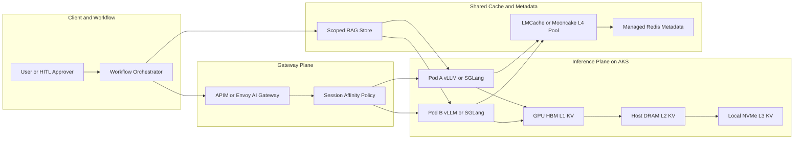
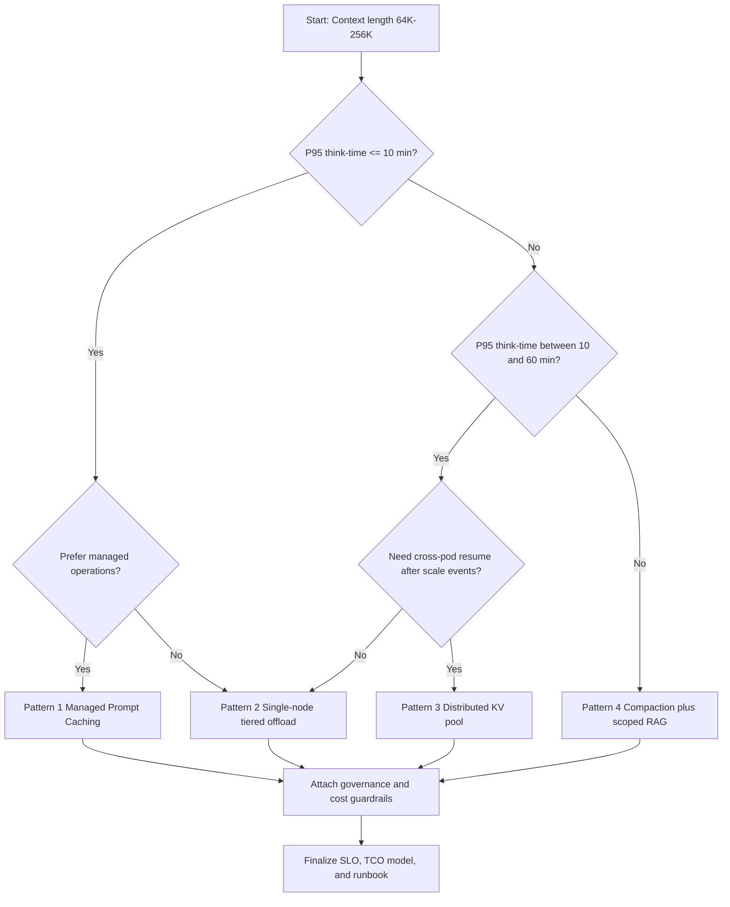

# Enterprise Tiered KV Cache Offloading Selection FAQ: Foundry Prompt Caching vs AKS vLLM/SGLang Single-Node DRAM+NVMe Tiering vs LMCache/Mooncake Distributed Pool vs Context Compaction + Scoped RAG Re-Hydration

> Audience: Cloud & AI Solution Architects, platform SRE leaders, FinOps teams, and enterprise agent platform owners.  
> Scope: multi-turn long-context agents (`64K–256K` tokens) across `5–45` minute human-in-the-loop gaps and cross-agent shared document prefixes.
## 1. Decision Boundary: The Real Cost Problem Is KV Residency Strategy, Not Model List Price

In production agent systems, long-context inefficiency is usually not caused by output tokens.
The hidden cost driver is repeated prefill after pause windows and cross-agent prefix duplication.
If every resume path recomputes the same `128K` context from scratch, GPU spend escalates quickly.

KV cache architecture is therefore a first-class platform decision.
It affects latency, scaling behavior, failure recovery, and cost attribution.
A single-node throughput benchmark is insufficient for enterprise design review.
Think-time distributions and resume paths must be modeled explicitly.

This guide evaluates four practical architecture options.
Pattern 1 is managed prompt caching.
Pattern 2 is single-node tiered offload.
Pattern 3 is distributed cross-pod KV pooling.
Pattern 4 is rolling compaction with scoped RAG re-hydration.

Each option can be a primary lane or a fallback lane.
The right answer depends on workload shape and operating model maturity.

Use these four metrics as architecture gate criteria.
- `TTFT P95` under realistic pause/resume behavior.  
- GPU goodput (effective tokens per GPU-second).  
- Session resume reliability after scale-in or eviction.  
- Blended cost per 1,000 sessions including cache and operations.

## 2. Workload Profiling First: Quantify Think-Time Before Picking a KV Topology

Without measured think-time histograms, KV design becomes guesswork.
Most enterprise workloads are bi-modal rather than uniform.
Short approval pauses dominate some channels, while long review pauses dominate others.

In approval-heavy copilots, `5–15` minute pauses often account for the majority of resumes.
In legal and M&A workflows, `20–45` minute pauses are common.
In cross-day workflows, pauses can reach `1–24` hours.
The third group almost always requires compaction-based recovery economics.

A practical baseline is to track three pause classes.
- `T1`: `0–10` minutes.  
- `T2`: `10–60` minutes.  
- `T3`: `>60` minutes.  

At the same time, measure prefix-sharing intensity.
For example, how many concurrent agents consume the same `128K` diligence room or codebase prefix.
High sharing intensity favors distributed pooling.
Low sharing intensity often favors local tiering.

Do not optimize for averages only.
Architecture outcomes are driven by `P90` and `P95`, because those tails determine user perception and budget risk.

## 3. Pattern 1: Azure OpenAI / Foundry Managed Prompt Caching

Pattern 1 provides the fastest route to production.
It minimizes platform operation overhead and exposes cache benefits through managed APIs.
When prefix matching succeeds, teams gain lower input token cost and better first-token latency.

This option is a strong fit when:
- platform staffing is limited,  
- release cadence is high,  
- teams prefer managed boundaries over custom cache control.

Key strengths:
- Zero cluster-side cache lifecycle management.  
- Typical discount band around `50%–75%` for eligible cached prefixes.  
- Clean integration with APIM governance and quota controls.

Key limits:
- Idle cache windows are usually minute-scale, not hour-scale.  
- Fine-grained cache placement and recovery logic are constrained by managed boundaries.  
- Explicit cross-agent prefix sharing orchestration is limited.

Recommended strategy:
Use Pattern 1 as the baseline lane.
Escalate to Pattern 2 or Pattern 3 when pause distributions lengthen or sharing complexity increases.
This preserves agility while enabling growth paths.

## 4. Pattern 2: AKS Single-Node Tiered KV Offload (HBM→DRAM→Local NVMe)

Pattern 2 is common in high-throughput self-hosted inference clusters.
The architecture moves KV across memory tiers by heat level.
Hot entries remain in GPU HBM.
Warm entries move to host DRAM.
Cool entries move to local NVMe.

On SKUs such as `ND96isr_H100_v5` or `NCads_H100_v5`,
host memory and local NVMe provide significant pause-window extension potential.
With stable session affinity, repeated prefill is reduced substantially.

Primary benefits:
- Short resume path inside one node boundary.  
- Strong economics for medium pause windows (`10–45` minutes).  
- Better control of per-node utilization and cache budgets.

Primary risks:
- Affinity policy quality directly impacts tail latency.  
- Node failure or aggressive scaling can invalidate local cache state.  
- Platform teams own more tuning and lifecycle operations.

Pattern 2 is usually most effective when tenant traffic is sticky,
pause windows are moderate,
and cross-pod sharing is not the dominant requirement.

## 5. Pattern 3: AKS Distributed KV Pool (LMCache/Mooncake + Redis Metadata)

Pattern 3 addresses cross-pod survivability and shared-prefix fan-out.
It upgrades cache from node-local asset to cluster-level reusable asset.
After KEDA scale-in, spot preemption, or pod relocation,
sessions can still hydrate from a shared pool.

This is highly valuable for workloads where multiple agents reuse identical long prefixes.
Typical examples include diligence-room analysis and large codebase review swarms.
In these cases, distributed pooling can prevent large amounts of duplicate prefill.

Strengths:
- Better elasticity for stateless inference replicas.  
- Higher resume resilience across pod movement events.  
- Meaningful goodput gains when prefix reuse is high.

Trade-offs:
- More moving parts and larger operational blast surface.  
- Requires careful capacity governance to avoid creating a remote bottleneck.  
- Network and metadata-path jitter must be managed with explicit SLOs.

Recommended use:
Adopt Pattern 3 where prefix sharing is both frequent and valuable.
For sparse and highly unique sessions, Pattern 2 may remain more economical.

## 6. Pattern 4: Rolling Context Compaction + Scoped RAG Re-Hydration

Pattern 4 is the long-pause strategy.
For hour-scale idle windows, retaining multi-GB KV tensors is often less economical than summary-based re-entry.
The system compacts conversational state into bounded structured context,
then rehydrates with scoped retrieval at resume time.

The critical quality factor is semantic fidelity, not compression ratio alone.
If compaction drops binding constraints, the resumed answer can become unsafe.
Structured checkpoints are therefore mandatory.
Examples include approval thresholds, legal clause IDs, and temporal constraints.

Pattern 4 is typically used with other patterns.
Short pauses hit cache tiers.
Medium pauses use local or distributed retention.
Long pauses switch to compaction and targeted retrieval.

Cost behavior is favorable in long-tail pauses.
But this path introduces extra summary tokens and retrieval cost.
Its value depends on pause distribution and prefix size.

## 7. End-to-End Tiered KV Architecture (L1 HBM / L2 DRAM / L3 NVMe / L4 Pool)



This diagram represents a layered control model, not an all-or-nothing deployment.
Teams can enable only required tiers.
What matters is explicit switching logic and observability across transitions.

## 8. SA Decision Tree by Context Length and Think-Time Profile



Document switch thresholds in the ADR.
For example:
- switch to Pattern 4 when `P95 think-time > 60 min`,  
- switch to Pattern 3 when shared-prefix hit rate exceeds `35%`.

Policy-based switching is safer than ad hoc manual tuning.

## 9. Deployable Snippet #1: AKS vLLM + LMCache Local NVMe and Redis Remote URL

```yaml
apiVersion: apps/v1
kind: Deployment
metadata:
  name: llm-inference-tiered-kv
  namespace: agent-inference
spec:
  replicas: 3
  selector:
    matchLabels:
      app: llm-inference-tiered-kv
  template:
    metadata:
      labels:
        app: llm-inference-tiered-kv
    spec:
      nodeSelector:
        accelerator: h100
      containers:
        - name: vllm
          image: ghcr.io/example/vllm-lmcache:stable
          args:
            - "--model=meta-llama/Llama-3.1-70B-Instruct"
            - "--max-model-len=131072"
            - "--gpu-memory-utilization=0.90"
            - "--enable-prefix-caching"
            - "--kv-transfer-config=/etc/lmcache/lmcache.yaml"
          env:
            - name: LMCACHE_LOCAL_BACKEND
              value: "nvme"
            - name: LMCACHE_LOCAL_PATH
              value: "/var/lib/lmcache"
            - name: LMCACHE_REMOTE_URL
              value: "redis://agent-kv.redis.cache.windows.net:6380/0?ssl=true"
            - name: LMCACHE_DRAM_BUDGET_GB
              value: "1536"
            - name: LMCACHE_NVME_BUDGET_GB
              value: "2800"
          volumeMounts:
            - name: nvme-cache
              mountPath: /var/lib/lmcache
      volumes:
        - name: nvme-cache
          hostPath:
            path: /mnt/nvme/lmcache
            type: DirectoryOrCreate
```

This config demonstrates:
- explicit long-context model-length targeting,  
- separate DRAM and NVMe budget controls,  
- mixed local+remote cache metadata strategy for resilience.

## 10. Deployable Snippet #2: KV Retention vs Compaction Re-Hydration Break-Even Calculator

```python
from dataclasses import dataclass

@dataclass
class KvEconomicsInput:
    active_sessions: int
    kv_gb_per_session: float
    cache_minutes: float
    gpu_hour_price: float
    nvme_gb_month_price: float
    summary_tokens_per_resume: int
    token_price_per_million: float
    resumes_per_month: int

def kv_retain_cost(i: KvEconomicsInput) -> float:
    gb_minutes = i.active_sessions * i.kv_gb_per_session * i.cache_minutes
    gpu_equivalent_hours = gb_minutes / 60.0 / 512.0
    gpu_cost = gpu_equivalent_hours * i.gpu_hour_price
    nvme_cost = i.active_sessions * i.kv_gb_per_session * i.nvme_gb_month_price
    return gpu_cost + nvme_cost

def compact_rehydrate_cost(i: KvEconomicsInput) -> float:
    token_millions = (i.summary_tokens_per_resume * i.resumes_per_month) / 1_000_000
    return token_millions * i.token_price_per_million

def breakeven_minutes(i: KvEconomicsInput) -> float:
    low, high = 1.0, 1440.0
    for _ in range(40):
        mid = (low + high) / 2
        probe = KvEconomicsInput(**{**i.__dict__, "cache_minutes": mid})
        if kv_retain_cost(probe) > compact_rehydrate_cost(probe):
            high = mid
        else:
            low = mid
    return round((low + high) / 2, 2)
```

Use this during architecture review to define switching thresholds.
Different tenant tiers can use different break-even limits.
High-value workflows may justify longer retention windows.
General workloads may switch earlier to compaction.

## 11. Twelve-Dimension Selection Matrix

| Dimension | Pattern 1 Managed Prompt Caching | Pattern 2 Single-Node Tiering | Pattern 3 Distributed KV Pool | Pattern 4 Compaction + Re-Hydration |
|---|---|---|---|---|
| 1. Delivery speed | High | Medium | Medium | Medium |
| 2. Operational complexity | Low | Medium-high | High | Medium |
| 3. `TTFT P95` control | Medium-high | High | Medium-high | Medium |
| 4. Cross-pod recovery | Low | Low | High | High |
| 5. Scale-in resilience | Medium | Medium | High | High |
| 6. Shared-prefix leverage | Medium | Medium | High | Medium |
| 7. Long-pause economics | Low | Medium | Medium | High |
| 8. GPU goodput lift | Medium | High | High | Medium |
| 9. FinOps transparency | High | Medium | Medium | High |
| 10. Failure-surface size | Small | Medium | Large | Medium |
| 11. Skill ramp requirement | Low | Medium | High | Medium |
| 12. Governance friendliness | Medium | Medium | Medium | High |

Most enterprises do not select one universal pattern.
A practical trajectory is:
Pattern 1 or 2 for default lanes,
Pattern 4 for long-tail pauses,
Pattern 3 for high-sharing clusters.

## 12. Quantitative Comparison: 128K TTFT, GPU Goodput, and Monthly TCO (10K and 120K Sessions)

> Assumptions: `128K` input context, `2K` output, peak concurrency 180, 22 business days/month.  
> Values are architecture planning references, not commercial quotations.  
> Units: `TTFT P95` in ms, goodput in effective token/s/GPU, TCO in USD/month.

| Pattern | Scale | `TTFT P95` | GPU goodput | Monthly TCO | Notes |
|---|---:|---:|---:|---:|---|
| Pattern 1 Foundry | 10K sessions | 1480 | 860 | 42,000 | Strong when cache hit stays high |
| Pattern 1 Foundry | 120K sessions | 1960 | 910 | 388,000 | Hit-rate drops with longer pauses |
| Pattern 2 Single-node | 10K sessions | 1240 | 1,120 | 55,000 | Affinity controls matter |
| Pattern 2 Single-node | 120K sessions | 1710 | 1,240 | 462,000 | Node failure handling impacts cost |
| Pattern 3 Distributed pool | 10K sessions | 1320 | 1,180 | 68,000 | Higher baseline platform cost |
| Pattern 3 Distributed pool | 120K sessions | 1580 | 1,430 | 418,000 | Best at high reuse intensity |
| Pattern 4 Compaction | 10K sessions | 1620 | 790 | 36,000 | Economical for long idle windows |
| Pattern 4 Compaction | 120K sessions | 1880 | 980 | 301,000 | Guard summary quality carefully |

Inflection guidance:
When `P95 think-time` exceeds about `55` minutes, Pattern 4 often beats persistent multi-GB KV retention.
When shared-prefix hit-rate exceeds about `35%`, Pattern 3 can outperform Pattern 2 at scale.

## 13. Enterprise Scenarios: Two Practical Blueprints

### Scenario A: M&A Dataroom Multi-Agent Collaboration

This workload has many agents reading the same long document set.
It also has frequent HITL pauses during legal and financial checks.
The platform goal is to reduce duplicate prefill while preserving responsiveness.

Recommended architecture:
- Primary: Pattern 3 distributed KV pool.  
- Entry control: APIM/Envoy affinity and policy governance.  
- Long-pause fallback: Pattern 4 compaction lane.  

Expected outcomes:
- Higher shared-prefix reuse,  
- better resume success after scale events.

### Scenario B: Secure Code Review and Release Approval Agents

This workload emphasizes predictable latency and simple operations.
Pause windows are typically in the `5–30` minute range.
Prefix sharing exists but is lower than diligence-room scenarios.

Recommended architecture:
- Default lane: Pattern 1 managed prompt caching.  
- Premium lane: Pattern 2 single-node tiered retention for high-value tenants.  
- Long-tail fallback: Pattern 4 with policy-driven threshold switch.  
- FinOps control: tenant-level max cache-residency budgets.

Expected outcomes:
- lower platform toil,  
- stable TTFT without forcing full distributed complexity.

## 14. Day-0 and Day-2 Checklist

### Day-0 (before go-live)

- Capture think-time distribution with `P50/P90/P95`.  
- Standardize event schema for cache hit, resume hit, and rehydrate path.  
- Configure session affinity and validate fallback behavior.  
- Set explicit mode-switch thresholds in policy.  
- Run spot-eviction resilience drills and measure resume success.  
- Enforce structured summary templates for compaction integrity.  
- Require canary rollout and rollback hooks for cache policy changes.

### Day-2 (operations)

- Review layer hit-ratio drift daily.  
- Correlate tenant complaints with `TTFT P95` weekly.  
- Measure post-compaction answer quality weekly.  
- Track cache-residency over-budget cases monthly.  
- Monitor network jitter to remote metadata and shared pools.  
- Publish post-incident resume-source distribution reports.  
- Maintain quarterly capacity planning tied to workload seasonality.

## 15. Quantitative FAQ (8 Distinct Questions)

**Q1: Which mode should I start with for `64K–256K` contexts?**  
A1: Start with Pattern 1 if managed simplicity is the top priority; start with Pattern 2 if predictable medium-pause retention on self-hosted AKS is required.

**Q2: How do I choose between Pattern 2 and Pattern 3 for `5–45` minute pauses?**  
A2: If shared-prefix hit-rate is below roughly `20%`, Pattern 2 is often sufficient; beyond about `35%` with frequent pod movement, Pattern 3 is usually stronger.

**Q3: When should I switch to Pattern 4 compaction and re-hydration?**  
A3: A common trigger is `P95 think-time` above `55–70` minutes, especially when retained KV economics exceed summary + retrieval economics.

**Q4: Where does Pattern 1 gain most of its cost advantage?**  
A4: From managed prefix-hit discounts and reduced operational labor, provided cache hit-rates remain healthy under real pause behavior.

**Q5: Is Pattern 3 always too complex for enterprise teams?**  
A5: Not always, but it should be targeted to high-reuse workloads; for low-reuse traffic, the extra surface area may not justify its benefits.

**Q6: What is the correct way to measure GPU goodput improvement?**  
A6: Use effective served tokens per GPU-second, excluding retries and wasted prefill, and segment by tenant and workload class.

**Q7: Should all tenants use the same cache strategy?**  
A7: Usually no; tier by tenant value, context length, and pause profile to reduce blended TCO while preserving critical-path latency.

**Q8: What is the minimum viable rollout path for a small platform team?**  
A8: Launch with Pattern 1 plus Pattern 4 guardrail first, then add Pattern 2 or Pattern 3 only where measured workload evidence justifies the added complexity.

