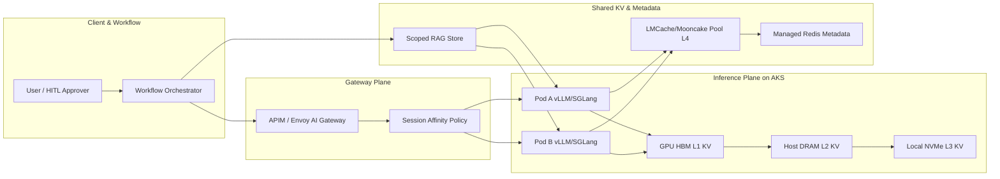
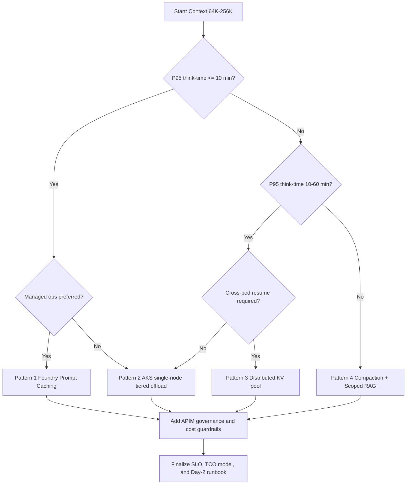

# 企业分层 KV Cache Offloading 选型 FAQ：Foundry Prompt Caching vs AKS vLLM/SGLang 单节点 DRAM+NVMe 扩展 vs LMCache/Mooncake 分布式共享池 vs 上下文压缩+Scoped RAG 再水合

> 适用对象：Cloud & AI Solution Architect、平台 SRE、FinOps 与企业智能体平台产品负责人。  
> 场景边界：多轮长上下文 Agent（`64K–256K` token）在 `5–45` 分钟人类审批空窗期和跨 Agent 共享前缀文档场景下，如何平衡 `TTFT P95`、GPU goodput、平台复杂度与月度 TCO。

## 1. 决策边界：长上下文成本问题，本质是“KV 驻留策略”问题

企业智能体进入生产后，最容易被低估的不是模型调用单价。
真正放大成本的是多轮会话之间的前缀重复与思考空窗。
如果每次都从零预填充 `128K` 上下文，GPU 会被大量无差别重算占满。

在架构层面，KV cache 不只是“推理优化开关”。
它是容量规划、会话调度、故障恢复与成本折扣的联合控制点。
只看单节点吞吐会得出偏差结论。
必须把人类审批间隔与会话恢复路径一起建模。

本指南聚焦四种企业可落地路径。
模式一是托管 Prompt Caching。
模式二是单节点分层 KV 下沉。
模式三是跨 Pod 分布式 KV 池。
模式四是超长停顿下的上下文压缩再水合。

每种路径都可做主路径或兜底路径。
关键在于你的工作负载分布和组织运维能力。

建议把以下四个指标作为架构评审入口。
- `TTFT P95`（交互首字节时延）。  
- GPU goodput（有效 token / GPU 秒）。  
- 会话恢复成功率（scale-in / 抢占后能否恢复）。  
- 每千会话综合成本（模型、缓存、网络、存储、运维）。

## 2. 负载画像：先量化 Think-Time，再做 KV 分层

若不先画出 Think-Time 分布图，KV 选型基本等于拍脑袋。
多数企业工作负载并非均匀。
通常会出现“短停顿高频 + 长停顿低频”的双峰结构。

在审批型业务里，`5–15` 分钟停顿占比常超过 50%。
在法务和投行尽调里，`20–45` 分钟停顿占比显著提高。
在跨天流程里，停顿可能达到 `1–24` 小时。
最后一类场景几乎总会触发上下文压缩路径。

建议在 Day-0 建立三段式统计。
- `T1`：`0–10` 分钟短停顿。  
- `T2`：`10–60` 分钟中停顿。  
- `T3`：`>60` 分钟长停顿。  

同时，记录前缀复用率。
例如同一份 `128K` 尽调包被多少并发 Agent 共享。
复用率高时，分布式 KV 池价值会明显提升。
复用率低时，单节点 DRAM/NVMe 可能更经济。

不要只看平均值，架构抉择更依赖 `P90` 与 `P95` 分位数。
尾部会直接决定用户“是否感知慢”，也决定是否需要第二条容灾路径。

## 3. 模式一：Foundry / Azure OpenAI Managed Prompt Caching（托管优先）

模式一的核心优势是零集群运维。
企业团队不需要维护 KV 生命周期组件。
只要前缀匹配命中，即可获得输入 token 折扣和更短首字节时延。

该模式特别适合以下团队。
- 业务迭代快，平台团队规模小。  
- 对可用性要求高，但不希望自建缓存池。  
- 以标准 API 编排为主，愿意接受托管 TTL 约束。  

优势清单如下。
- 平台简单，扩容策略由托管服务承接。  
- 常见折扣区间 `50%–75%`，可直接改善单位请求成本。  
- 对接 APIM 治理路径顺滑，便于做配额与审计。  

约束也很明确。
- 空闲 TTL 多在分钟级，超长停顿命中率会下降。  
- 缓存命中控制粒度受托管边界限制。  
- 对跨 Agent 显式共享前缀的可编排度较低。  

架构建议是把模式一作为默认入口层。
当命中率下滑或停顿延长时，再升级到模式二或模式三。
这样既保留了简单性，也保留了扩展弹性。

## 4. 模式二：AKS 单节点分层 KV（HBM→DRAM→本地 NVMe）路径

模式二在高吞吐自托管推理场景中非常常见。
其关键思路是让 KV 从昂贵层向便宜层分层下沉。
HBM 保留热会话。
主机 DRAM 承接中温会话。
本地 NVMe 承接较长停顿恢复。

当节点规格达到 `ND96isr_H100_v5` 或 `NCads_H100_v5` 级别时，
主机内存与本地盘可提供较大的缓存缓冲区。
配合会话粘性路由，可显著降低重复 prefill。

该模式的收益集中在两点。
- 单节点内恢复路径短，网络跳数低。  
- 对中等时长停顿（如 `10–45` 分钟）恢复效率好。  

风险点也要明确。
- 会话粘性要求严格，负载均衡策略不当会拉高尾延迟。  
- 节点故障或缩容时，本地缓存不可跨节点复用。  
- 运维团队需承担更多版本与参数治理责任。  

如果你的租户隔离策略以节点池为主，
且上下文热点主要落在单租户工作集，
模式二通常能在成本和性能之间取得较好平衡。

## 5. 模式三：AKS 分布式 KV 池（LMCache/Mooncake + Redis）路径

模式三主要解决“缓存跨 Pod 生存”和“多 Agent 共享前缀”问题。
它把 KV 从单节点局部资产升级为集群共享资产。
这样即使 KEDA 缩容、Spot 抢占、Pod 重调度，
仍可以通过远端池恢复会话上下文。

在 M&A dataroom、代码审查群体协作等场景，
大量 Agent 会读取同一份长前缀。
分布式 KV 池可显著减少重复预填充。
这类场景往往是模式三的主战场。

模式三优势包括：
- 无状态推理副本更容易横向扩展。  
- 跨 Pod 恢复能力更强，故障韧性更好。  
- 共享前缀复用率高时，GPU goodput 提升明显。  

对应代价包括：
- 系统组件增加，故障面扩大。  
- 需要精细容量门控，避免远端池成为新瓶颈。  
- 网络与缓存访问延迟波动需要额外 SLO 守护。  

建议把模式三放在“共享前缀密集 + 缩扩频繁”的集群。
如果业务是长尾低复用会话，模式三价值会下降。
这时模式二常更省成本。

## 6. 模式四：上下文滚动压缩 + Scoped RAG 再水合路径

模式四不是失败兜底，而是超长停顿主路径。
当停顿进入小时级，继续保存多 GB KV 往往不经济。
此时应把会话语义压缩成 `4K–12K` 的状态摘要，
在恢复时通过 scoped RAG 补充证据并重建推理上下文。

这种路径的关键是“压缩质量”而非“压缩比例”。
若压缩丢失关键约束，恢复后会产生错误决策。
因此必须保留结构化约束字段。
例如审批阈值、时间窗口、风险条款引用位点等。

模式四常与其他模式联合使用。
短停顿走缓存命中。
中停顿走分层下沉。
超长停顿走压缩再水合。
这种多策略切换比单策略硬撑更稳定。

成本层面，模式四可有效抑制长停顿尾部开销。
但它会引入额外摘要 token 与检索成本。
是否划算取决于停顿分布和上下文体量。

## 7. 端到端分层 KV 架构（HBM / DRAM / NVMe / 分布式池）



该拓扑强调四层缓存与再水合并存。
它不是强制全启。
你可按工作负载关闭部分层级。
关键是把切换策略显式化，而非隐式依赖默认参数。

## 8. SA 决策树：按上下文长度与停顿分布选择路径



建议在评审会把“模式切换阈值”写入 ADR。
例如 `P95 think-time > 60 分钟` 自动触发压缩再水合。
或 `shared-prefix hit-rate > 35%` 触发分布式池。
这样能避免运行期靠人工经验临时决策。

## 9. 可落地配置片段一：AKS vLLM + LMCache 本地 NVMe + Redis 远端元数据

```yaml
apiVersion: apps/v1
kind: Deployment
metadata:
  name: llm-inference-tiered-kv
  namespace: agent-inference
spec:
  replicas: 3
  selector:
    matchLabels:
      app: llm-inference-tiered-kv
  template:
    metadata:
      labels:
        app: llm-inference-tiered-kv
    spec:
      nodeSelector:
        accelerator: h100
      containers:
        - name: vllm
          image: ghcr.io/example/vllm-lmcache:stable
          args:
            - "--model=meta-llama/Llama-3.1-70B-Instruct"
            - "--max-model-len=131072"
            - "--gpu-memory-utilization=0.90"
            - "--enable-prefix-caching"
            - "--kv-transfer-config=/etc/lmcache/lmcache.yaml"
          env:
            - name: LMCACHE_LOCAL_BACKEND
              value: "nvme"
            - name: LMCACHE_LOCAL_PATH
              value: "/var/lib/lmcache"
            - name: LMCACHE_REMOTE_URL
              value: "redis://agent-kv.redis.cache.windows.net:6380/0?ssl=true"
            - name: LMCACHE_DRAM_BUDGET_GB
              value: "1536"
            - name: LMCACHE_NVME_BUDGET_GB
              value: "2800"
          volumeMounts:
            - name: nvme-cache
              mountPath: /var/lib/lmcache
      volumes:
        - name: nvme-cache
          hostPath:
            path: /mnt/nvme/lmcache
            type: DirectoryOrCreate
```

上述参数体现三类企业实践。
- 通过 `max-model-len` 对齐长上下文目标。  
- DRAM 与 NVMe 预算独立设置，便于 FinOps 管控。  
- 远端元数据服务与本地缓存共存，兼顾恢复与成本。

## 10. 可落地配置片段二：KV 占用与压缩再水合盈亏计算器（Python）

```python
from dataclasses import dataclass

@dataclass
class KvEconomicsInput:
    active_sessions: int
    kv_gb_per_session: float
    cache_minutes: float
    gpu_hour_price: float
    nvme_gb_month_price: float
    summary_tokens_per_resume: int
    token_price_per_million: float
    resumes_per_month: int

def kv_retain_cost(i: KvEconomicsInput) -> float:
    gb_minutes = i.active_sessions * i.kv_gb_per_session * i.cache_minutes
    gpu_equivalent_hours = gb_minutes / 60.0 / 512.0
    gpu_cost = gpu_equivalent_hours * i.gpu_hour_price
    nvme_cost = i.active_sessions * i.kv_gb_per_session * i.nvme_gb_month_price
    return gpu_cost + nvme_cost

def compact_rehydrate_cost(i: KvEconomicsInput) -> float:
    token_millions = (i.summary_tokens_per_resume * i.resumes_per_month) / 1_000_000
    return token_millions * i.token_price_per_million

def breakeven_minutes(i: KvEconomicsInput) -> float:
    low, high = 1.0, 1440.0
    for _ in range(40):
        mid = (low + high) / 2
        probe = KvEconomicsInput(**{**i.__dict__, "cache_minutes": mid})
        if kv_retain_cost(probe) > compact_rehydrate_cost(probe):
            high = mid
        else:
            low = mid
    return round((low + high) / 2, 2)
```

这段计算器用于评审会快速判断阈值。
当保留成本超过压缩再水合成本时，应切到模式四。
建议按租户等级维护不同阈值。
VIP 高价值租户可以采用更长缓存窗口。
普通租户可更早触发压缩再水合。

## 11. 12 维选型矩阵（性能、成本、复杂度与韧性）

| 维度 | 模式一 Foundry Prompt Caching | 模式二 AKS 单节点分层 | 模式三 分布式 KV 池 | 模式四 压缩 + RAG 再水合 |
|---|---|---|---|---|
| 1. 上线速度 | 高 | 中 | 中 | 中 |
| 2. 运行复杂度 | 低 | 中高 | 高 | 中 |
| 3. `TTFT P95` 控制 | 中高 | 高 | 中高 | 中 |
| 4. 跨 Pod 恢复 | 低 | 低 | 高 | 高 |
| 5. 缩容抗抖动 | 中 | 中 | 高 | 高 |
| 6. 共享前缀收益 | 中 | 中 | 高 | 中 |
| 7. 超长停顿经济性 | 低 | 中 | 中 | 高 |
| 8. GPU goodput 提升 | 中 | 高 | 高 | 中 |
| 9. FinOps 可解释性 | 高 | 中 | 中 | 高 |
| 10. 故障面大小 | 小 | 中 | 大 | 中 |
| 11. 团队学习门槛 | 低 | 中 | 高 | 中 |
| 12. 合规审计友好度 | 中 | 中 | 中 | 高 |

矩阵结论并不意味着“单一胜者”。
多数企业会选择“模式一/二作为主路径 + 模式四作为长停顿兜底”。
当共享前缀复用足够高，再引入模式三。
这种渐进路线通常能降低一次性复杂度。

## 12. 定量对比：`128K` TTFT、GPU goodput 与月度 TCO（10K / 120K 会话）

> 假设：输入上下文 `128K`，输出 `2K`，工作日内高峰并发 180，月度 22 个工作日。  
> 数值用于架构比较，不等同于采购报价。  
> 单位：`TTFT P95` 毫秒，goodput 为有效 token/s/GPU，TCO 为美元/月。

| 模式 | 规模 | `TTFT P95` | GPU goodput | 月度 TCO | 备注 |
|---|---:|---:|---:|---:|---|
| 模式一 Foundry | 10K 会话 | 1480 | 860 | 42,000 | 命中高时成本友好 |
| 模式一 Foundry | 120K 会话 | 1960 | 910 | 388,000 | 停顿拉长后命中下降 |
| 模式二 单节点分层 | 10K 会话 | 1240 | 1,120 | 55,000 | 粘性路由收益明显 |
| 模式二 单节点分层 | 120K 会话 | 1710 | 1,240 | 462,000 | 节点故障恢复成本上升 |
| 模式三 分布式池 | 10K 会话 | 1320 | 1,180 | 68,000 | 远端池初始成本较高 |
| 模式三 分布式池 | 120K 会话 | 1580 | 1,430 | 418,000 | 共享前缀多时最优 |
| 模式四 压缩再水合 | 10K 会话 | 1620 | 790 | 36,000 | 长停顿场景经济 |
| 模式四 压缩再水合 | 120K 会话 | 1880 | 980 | 301,000 | 小心摘要质量损失 |

从拐点看，当 `P95 think-time` 超过 `55` 分钟时，模式四通常比“持续保留大 KV”更经济。
当共享前缀命中率超过 `35%` 时，模式三在大规模场景的单位成本会反超模式二。

## 13. 企业场景：两类高价值业务蓝图

### 场景 A：并购尽调多 Agent 协作（共享 `128K` dataroom）

该场景特点是多个 Agent 共享同一长文档前缀。
并且有高频 HITL 审批停顿。
目标是降低重复 prefill 并维持稳定首字节时延。

推荐架构：
- 主路径：模式三分布式 KV 池。  
- 入口层：APIM/Envoy 会话路由策略。  
- 长停顿兜底：模式四压缩再水合。  

预期收益：
- 跨 Agent 前缀复用率提升。  
- Spot 抢占后恢复成功率提高。  
- GPU 重算占比下降。  

### 场景 B：代码审查与发布审批 Agent（`5–30` 分钟审批空窗）

该场景更强调稳定响应与运维简洁。
会话停顿中短为主。
共享前缀存在但强度低于并购场景。

推荐架构：
- 默认路径：模式一托管 Prompt Caching。  
- 高价值租户：模式二单节点分层 KV。  
- 超长停顿：模式四按阈值触发压缩恢复。  
- 预算治理：按租户设置最大缓存驻留分钟数。  

预期收益：
- 平台运维压力可控。  
- 在不引入过高复杂度下满足 TTFT SLO。

## 14. Day-0 / Day-2 落地清单

### Day-0（上线前）

- 统计 `think-time` 分布，至少保留 `P50/P90/P95`。  
- 定义 `cache hit`、`resume hit` 与 `rehydrate` 三类事件口径。  
- 配置会话粘性策略并验证失效回退路径。  
- 设定模式切换阈值，如 `P95 think-time > 60 min`。  
- 针对 Spot 抢占演练恢复流程并记录成功率。  
- 为压缩摘要定义结构化字段模板，避免语义丢失。  
- 对所有配置变更启用灰度发布与自动回滚条件。  

### Day-2（运行期）

- 每日核查四层缓存命中占比变化。  
- 每周复盘 `TTFT P95` 与租户投诉相关性。  
- 每周评估摘要再水合后的回答偏差率。  
- 每月检查缓存驻留时长是否超预算。  
- 持续跟踪 Redis 与远端池网络抖动告警。  
- 发生故障后输出恢复来源分布与原因分类。  
- 固化季度容量预测，避免临时扩容溢价。

## 15. 量化 FAQ（8 问 8 答）

**Q1：`64K–256K` 长上下文下，首选哪种模式？**  
A1：若团队追求最快上线且可接受托管 TTL，先用模式一；若共享前缀高且缩扩频繁，模式三通常更优。

**Q2：`5–45` 分钟审批停顿里，模式二和模式三怎么选？**  
A2：共享前缀命中率低于 `20%` 时模式二更常见；超过 `35%` 且跨 Pod 恢复要求高时模式三更有价值。

**Q3：什么时候应切到模式四压缩再水合？**  
A3：当 `P95 think-time` 超过约 `55–70` 分钟且 KV 保留成本高于摘要恢复成本时，应进入模式四。

**Q4：模式一的成本优势主要来自哪里？**  
A4：主要来自托管前缀命中折扣与运维人力节省，但要注意长停顿导致命中下降后折扣收益回落。

**Q5：模式三会不会把系统复杂度拉得过高？**  
A5：会增加复杂度，因此建议只在共享前缀密集业务启用，并保持可回退到模式二或模式四的策略。

**Q6：如何衡量 GPU goodput 是否真正提升？**  
A6：建议使用“有效输出 token / GPU 秒”并剔除重试与无效 prefill，按租户和场景分层统计。

**Q7：是否必须在所有租户启用同一种缓存策略？**  
A7：不建议统一策略；可按租户等级、上下文长度和审批时延分布做分层策略，以降低总体 TCO。

**Q8：最小可行落地路线是什么？**  
A8：可先“模式一 + 模式四”建立主干，再对高复用场景增量引入模式二或模式三，避免一次性复杂化。

