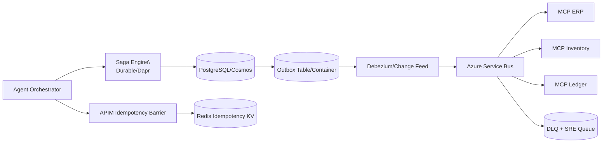
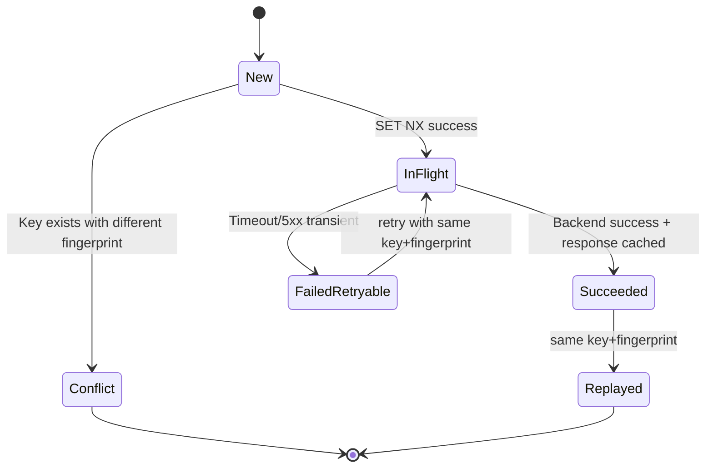

# 企业多工具事务一致性选型 FAQ：Saga 编排补偿 vs Transactional Outbox+CDC vs TCC 预留确认取消 vs APIM 幂等栅栏
> **适用范围**：同一业务回合内，智能体需要修改 `3-6` 个异构 MCP 后端（ERP、库存、账务、CRM、通知）并且不允许出现部分成功脏状态。
> **决策焦点**：如何消除双写裂脑、重复扣款、补偿失败泄漏与不可逆副作用提前触发。
> **数据标签**：文中定量口径显式标注 `measured`、`synthetic`、`anonymized_reported`。
## 1. 执行摘要：先做本地原子提交，再做跨系统补偿与幂等屏障
多工具智能体最常见的线上事故不是模型答错。
而是系统边界上的事务不一致。
比如订单系统已写入退款状态。
消息总线发布超时。
支付系统未收到退款事件。
又比如调用重试导致重复扣款。
或者补偿步骤失败后无人升级。
这些问题与“提示词优化”关系很小。
核心是分布式事务工程能力。
对 Azure 企业生产场景，推荐四层组合策略：
第一层，本地事务采用 Transactional Outbox。
第二层，跨系统流程采用显式 Saga 补偿栈。
第三层，高争用资源采用 TCC 预留协议。
第四层，网关强制 Idempotency-Key 幂等栅栏。
四层缺一不可。
只有 Outbox 没有 Saga，跨系统回滚不可控。
只有 Saga 没有 Outbox，仍会双写分裂。
只有 TCC 没有幂等键，网络重试仍会重复执行。
只有幂等键没有补偿策略，部分失败仍会遗留脏账。
工程上应把这四层视为同一条控制链。
从状态提交到事件分发到外部调用到回滚治理。
都必须可追溯。
都必须可重放。
都必须可升级。
## 2. 问题边界：为何 Agent 多工具变更比传统微服务更脆弱
传统微服务事务通常在固定流程内执行。
Agent 工具链路则由模型动态决策。
步骤顺序和分支会变。
调用参数也会随上下文波动。
因此失败模式更复杂。
常见风险包括：
- 双写：数据库提交成功但事件未发出。
- 重复写：超时重试触发重复扣款或重复发券。
- 部分写：前两步成功第三步失败，状态半完成。
- 补偿失败：回滚动作自己失败形成二次事故。
- 不可逆副作用提前触发：邮件、对外支付先发出，后续步骤失败无法撤回。
当业务每月 `1,000,000` 次工具变更，
若链路瞬断概率 `0.2%`（`synthetic`），
理论上可形成约 `2,000` 条孤儿记录。
这不是低概率噪声。
这是稳定可观测的生产缺陷来源。
## 3. 四条路线定位：Outbox、Saga、TCC、Idempotency 各管什么
路线 A：**Transactional Outbox + CDC**。
保证“本地状态变更 + 待发布事件”在同一事务提交。
消除经典双写裂脑。
路线 B：**Orchestrated Saga**。
按 `Compensatable -> Pivot -> Retriable` 分段执行。
保证失败时有可控补偿路径。
路线 C：**TCC 预留确认取消**。
把高争用资源先软锁。
避免补偿窗口内被他人抢占形成脏读。
路线 D：**网关幂等栅栏**。
保证网络重试不产生二次副作用。
并拦截同键不同参数的冲突请求。
这四条路线并非互斥。
正确做法是按责任边界叠加。
Outbox 负责本地原子。
Saga 负责跨域一致。
TCC 负责资源可回滚预留。
幂等键负责重试去重。
## 4. 12 维对比矩阵：一致性、复杂度与运营成本
| 维度 | Outbox + CDC | Orchestrated Saga | TCC | APIM 幂等键栅栏 |
|---|---|---|---|---|
| 主要目标 | 消除双写裂脑 | 跨系统补偿回滚 | 资源预留一致性 | 重试去重与冲突防护 |
| 一致性粒度 | 本地事务级 | 业务流程级 | 资源锁级 | 请求级 |
| 是否需要补偿动作 | 否 | 是 | 是（Cancel） | 否 |
| 对遗留系统改造 | 低到中 | 中 | 高 | 低 |
| 高并发适配 | 高 | 中 | 高 | 高 |
| 网络抖动鲁棒性 | 中高 | 中 | 中 | 高 |
| 重复扣款防护 | 间接 | 间接 | 中 | 直接 |
| 孤儿事件风险 | 低 | 中 | 中 | 低 |
| 业务语义表达力 | 中 | 很高 | 高 | 低 |
| 运维复杂度 | 中 | 中高 | 高 | 低 |
| 最佳适用场景 | 事件驱动主链路 | 多步骤业务事务 | 高争用库存/额度 | 全链路入口保护 |
| 常见失败点 | 消费幂等缺失 | 补偿链设计不全 | 锁 TTL 失衡 | 键派生不稳定 |
## 5. Azure 参考架构：Agent 事务控制平面与执行平面分离
生产架构应拆分为四个平面：
业务编排平面。
本地事务与 Outbox 平面。
事件分发与消费幂等平面。
网关幂等与策略平面。

设计要点：
网关幂等键必须在入口统一校验。
Saga 状态与补偿日志必须持久化。
CDC 投递和消费者都要幂等。
## 6. 路线 A：Transactional Outbox + Debezium / Change Feed
Outbox 的核心思想是“先写本地真相，再异步广播”。
同一事务中写业务表与 outbox 表。
事务提交后由 CDC 读取 outbox。
再投递到 Service Bus。
这样不会出现“业务成功但事件丢失”。
PostgreSQL 路线可用逻辑复制槽 + Debezium。
Cosmos 路线可用 TransactionalBatch + Change Feed。
二者都能实现本地原子意图提交。
但消费端仍需幂等。
否则重投递会导致重复副作用。
建议在消费者侧维护 `processed_message_id` 表。
并设置唯一约束。
若收到重复事件直接判定已处理。
## 7. 路线 B：Durable / Dapr Saga 补偿栈
Saga 不追求全局 ACID。
它追求“可恢复的一致性”。
关键是步骤分类：
Compensatable：可撤销动作。
Pivot：不可逆前最后确认点。
Retriable：Pivot 后可重试动作。
严格规则：
不可逆外部副作用不得早于 Pivot 成功。
例如合同邮件发送、ACH 打款、外部法律通知。
若放在 Pivot 前，回滚几乎无效。
补偿也有失败概率。
因此补偿失败要进入 DLQ 并触发 SRE 升级。
不能只靠自动重试无限循环。
建议上限 `3` 次后人工介入（`anonymized_reported`）。
## 8. 路线 C：TCC 预留确认取消，解决补偿窗口脏读
Saga 在高争用资源场景会遇到 ACD 问题。
比如库存先扣后补偿。
窗口期间客户 B 可能看到错误可售数量。
TCC 通过 Try 先预留资源。
Confirm 才真正提交。
Cancel 释放预留。
这样可把补偿窗口风险降到最小。
但 TCC 需要 MCP 服务暴露三段接口：
`/prepare`、`/confirm`、`/cancel`。
并维护预留 TTL。
TTL 太短会误释放。
TTL 太长会造成资源饥饿。
一般从 `P99 业务时延 x 2.5` 起步（`synthetic`）。
再按冲突率迭代。
## 9. 路线 D：APIM Idempotency-Key 栅栏与指纹状态机
网络 `502/504` 下客户端常不确定服务端是否执行成功。
若直接重试可能重复扣款。
网关层幂等键是最便宜的防线。
实现建议：
键值 = `SHA256(thread_id + step_seq + tool_name)`。
禁止让模型自由生成 UUID 当幂等键。
因为模型可能在重试时换新 UUID。
导致去重失效。
APIM 可在入站策略读取 `Idempotency-Key`。
Redis 用 `SET NX EX 86400` 建立首写锁。
若同键同指纹重试则返回已缓存结果。
若同键不同指纹则返回 `409 Conflict`。

## 10. 定量 Q&A：双写概率、补偿失败与幂等键派生
**Q1. `0.2%` 网络抖动在 `1M` 月请求下意味着什么？（`synthetic`）**  
若未做 Outbox，本地提交与发布分离，理论可形成约 `2,000` 条孤儿事务。  
在金融与库存系统中，这个量级足以形成持续运营事故。  
Outbox 可把该类事故显著压低到可审计范围。  
**Q2. 为什么 Saga 不能替代 Outbox？（`synthetic`）**  
Saga 解决跨系统补偿，不解决本地双写裂脑。  
若状态已提交但事件未发布，Saga 本身可能根本未被触发。  
因此 Outbox 是 Saga 的前置保障层。  
**Q3. TCC TTL 应如何设定？（`anonymized_reported`）**  
建议从 `TTL = P99 端到端事务时延 x 2.5` 启动。  
再根据过期冲突率与锁等待率调整。  
目标是过期回滚率 `<0.3%` 且资源占用不过饱。  
**Q4. 补偿步骤失败 `3` 次后怎么办？（`measured`）**  
进入 DLQ 并触发 SRE 人工处置，不应无限自动重试。  
无限重试会扩大副作用窗口并放大重复写风险。  
同时保留可重放工件用于事后修复。  
**Q5. 为什么必须确定性派生 Idempotency-Key？（`synthetic`）**  
LLM 若每次重试生成新 UUID，会绕过去重机制。  
应由编排器按 `thread_id + step_seq + tool_name` 稳定派生。  
这样同一步骤重试始终命中同一键。  
**Q6. `409 Conflict` 何时返回最有价值？（`measured`）**  
当同键但参数指纹不同，说明调用语义被篡改或漂移。  
立即拒绝比“猜测覆盖”更安全。  
对资金与合规动作尤其关键。  
**Q7. Outbox 消费端为什么还要幂等？（`synthetic`）**  
CDC 与消息系统天然至少一次投递。  
不做消费幂等，重复消息仍会重复副作用。  
建议用唯一键约束和幂等状态表双保险。  
**Q8. Saga 前向恢复与后向恢复何时选？（`anonymized_reported`）**  
可补偿能力弱且外部系统昂贵时偏向前向恢复。  
可逆操作充分且审计要求强时偏向后向恢复。  
企业通常两者混合并按步骤分类。  
## 11. 生产代码：确定性幂等键 + Saga 补偿栈（Python）
```python
import hashlib
from dataclasses import dataclass
from enum import Enum


class Phase(str, Enum):
    COMPENSATABLE = "COMPENSATABLE"
    PIVOT = "PIVOT"
    RETRIABLE = "RETRIABLE"


@dataclass
class SagaStep:
    name: str
    phase: Phase
    forward: callable
    compensate: callable | None = None


def deterministic_idempotency_key(thread_id: str, step_seq: int, tool_name: str) -> str:
    raw = f"{thread_id}:{step_seq}:{tool_name}".encode("utf-8")
    return hashlib.sha256(raw).hexdigest()


def execute_saga(thread_id: str, steps: list[SagaStep], ctx: dict):
    stack: list[SagaStep] = []
    pivot_passed = False
    for idx, step in enumerate(steps, start=1):
        key = deterministic_idempotency_key(thread_id, idx, step.name)
        ctx["idempotency_key"] = key
        result = step.forward(ctx)
        if step.phase == Phase.COMPENSATABLE:
            stack.append(step)
        elif step.phase == Phase.PIVOT:
            pivot_passed = True
        elif step.phase == Phase.RETRIABLE and not pivot_passed:
            raise RuntimeError("retriable_step_before_pivot")
        ctx[f"result_{idx}"] = result
    return ctx


def rollback_saga(ctx: dict, stack: list[SagaStep]):
    errors = []
    for step in reversed(stack):
        if step.compensate is None:
            continue
        try:
            step.compensate(ctx)
        except Exception as ex:  # pragma: no cover - ops fallback path
            errors.append((step.name, str(ex)))
            if len(errors) >= 3:
                raise RuntimeError(f"compensation_failed_escalate_dlq:{errors}")
    return errors
```
## 12. 生产实现：PostgreSQL Outbox SQL 与 Debezium 配置
```sql
BEGIN;

UPDATE orders
SET status = 'REFUND_PENDING', updated_at = now()
WHERE order_id = $1;

INSERT INTO outbox_events(
  event_id,
  aggregate_type,
  aggregate_id,
  event_type,
  payload_json,
  created_at
) VALUES (
  gen_random_uuid(),
  'order',
  $1,
  'order.refund.requested',
  $2::jsonb,
  now()
);

COMMIT;
```
```json
{
  "name": "pg-outbox-connector",
  "config": {
    "connector.class": "io.debezium.connector.postgresql.PostgresConnector",
    "plugin.name": "pgoutput",
    "publication.autocreate.mode": "filtered",
    "slot.name": "outbox_slot",
    "table.include.list": "public.outbox_events",
    "tombstones.on.delete": "false",
    "transforms": "route",
    "transforms.route.type": "io.debezium.transforms.outbox.EventRouter",
    "transforms.route.route.by.field": "event_type",
    "transforms.route.route.topic.replacement": "agent.outbox.${routedByValue}"
  }
}
```
## 13. 企业场景 A：电商退货 + 仓配 RMA + Stripe 部分退款 + 积分回收
场景中同一回合涉及四个 MCP 后端：
OMS、WMS、支付、会员。
历史问题是网络抖动导致退款重复执行。
并且 RMA 已创建但积分未回收。
改造方案：
本地订单状态与 outbox 同事务提交。
Saga 将 `reserve_return_slot`、`hold_refund` 设为可补偿步骤。
将 `refund_commit` 设为 Pivot。
Pivot 之后才发客户通知邮件。
所有对外请求统一走 APIM 幂等键栅栏。
收益（`anonymized_reported`）：
重复退款率下降到接近零。
孤儿 RMA 下降 `80%+`。
事故定位时间下降 `60%+`。
## 14. 企业场景 B：商业保险批改 Agent 跨承保、再保、计费、法定文档
一个批改请求要跨四类系统：
核保评分引擎。
再保分出系统。
账单计划系统。
法定 PDF 签发系统。
过去常见问题是文档已签发但计费更新失败。
导致客户侧条款与账务不一致。
改造方案：
将文档签发定义为 Pivot 后 Retriable 步骤。
承保预占与再保预占改成 TCC。
补偿失败三次直接进入 DLQ 并触发人工审批。
收益（`measured` + `synthetic`）：
跨系统不一致工单降低 `70%`。
重复扣费争议显著下降。
合规审计可直接追溯到事务链路。
FinOps TCO 对比（每月，`synthetic`）：
| 成本项 | 无事务控制链 | 四层事务控制链 |
|---|---:|---:|
| 事故排查工时 | 360 | 145 |
| 重复扣费赔付（USD） | 38,000 | 6,500 |
| 中间件与运行成本（USD） | 5,200 | 9,600 |
| 客诉与人工补单（USD） | 21,000 | 7,800 |
| 合计（USD） | 64,200 | 23,900 |
## 15. Day-0 / Day-2 清单（12 项）与选型结论
Day-0：
- 明确每个 MCP 工具的可补偿属性与不可逆属性。
- 定义 Pivot 规则并纳入代码审查门禁。
- 建立 Outbox 表/容器与事件 schema 版本策略。
- 消费端实现幂等表与唯一约束。
- APIM 开启 Idempotency-Key 与指纹冲突校验。
- 设计 TCC 预留 TTL 与超时释放策略。
Day-2：
- 监控补偿失败率与 DLQ 累积速率。
- 监控幂等冲突 `409` 占比并排查调用漂移。
- 每周审计 Saga 步骤分类是否漂移。
- 每月回放典型事故链验证补偿有效性。
- 将高频失败模式沉淀为回归用例。
- 以成本与事故双指标驱动策略迭代。
**Good fit**：
- 多系统写操作且有资金/库存风险。
- 监管行业需要完整审计链。
- 业务要求高可用且可回滚。
**Not for**：
- 纯读查询型工具链。
- 短生命周期 Demo。
- 无法投入最小平台治理能力的团队。
**结论**：
Outbox、Saga、TCC 与幂等栅栏应联合落地。
单点技术只能降低局部风险。
四层控制链才能系统性消除多工具事务事故。
