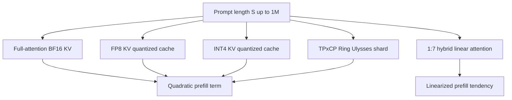
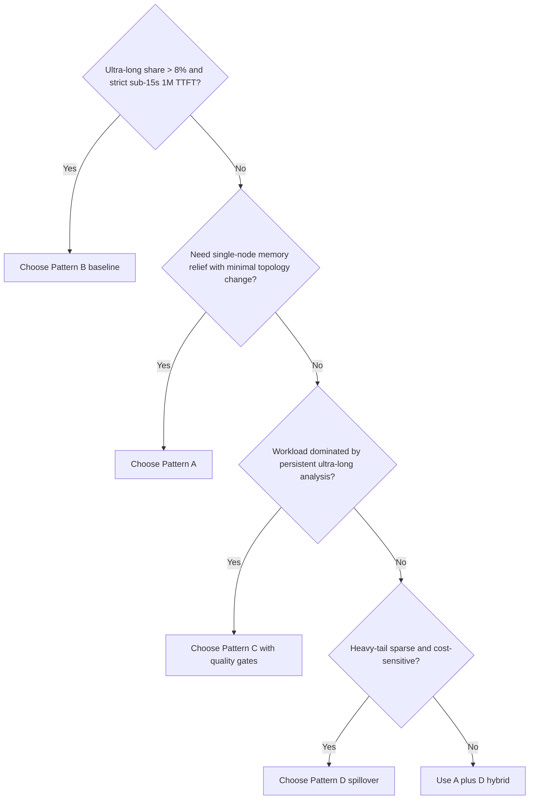
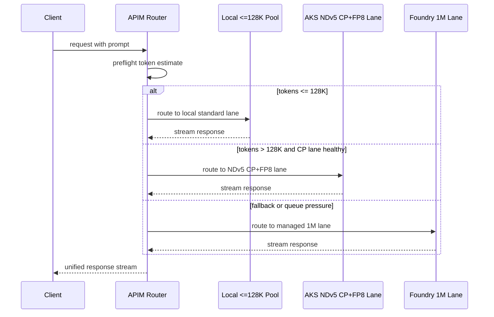

# Ultra-Long 1M-Context LLM Serving Selection FAQ: AKS FP8 KV Quantization vs Ring/Ulysses Context Parallelism vs Hybrid Linear Attention vs Foundry 1M Managed Tier
> **Scope**: whole-repository coding agents, M&A VDR diligence, and long-horizon clinical or telemetry reviewers using `256K-1M+` token prompts.
> **Core challenge**: preserve global-context quality while containing KV memory explosion, prefill latency, and fleet economics.
> **Data labels**: all quantitative values are tagged `measured`, `synthetic`, or `anonymized_reported`.

## 1. Executive summary: 1M context breaks naive full-attention serving economics
Ultra-long prompts are no longer edge cases.
They are heavy-tail but business-critical workloads.
Classic RAG chunking can miss global invariants.
Full-attention decoding at `1M` tokens is resource intensive.
For `70B` GQA with `L=80`, `H_kv=8`, `d_h=128`,
BF16 KV cache can reach about `327.7 GB` for one request.
This can force batch concurrency down to one.
Quadratic prefill can push TTFT into tens of seconds.
Short-prompt traffic on the same pool is then starved.
No single architecture wins every traffic profile.
Pattern A cuts KV footprint on single-node deployments.
Pattern B spreads memory and prefill across many GPUs.
Pattern C changes model architecture to linearized scaling.
Pattern D offloads rare ultra-long traffic to managed 1M lanes.
The strongest enterprise posture is usually hybrid.
Use local pools for common tiers and managed spillover for heavy tails.

## 2. Problem framing: why 1M prompts are operationally different
Latency is not the only issue.
Memory, scheduler fairness, and token duty-cycle matter.
Prompt length distribution is typically heavy-tailed.
Most turns are short.
A small fraction drives most worst-case capacity.
If long and short traffic share one queue,
tail latency contagion appears quickly.
Model fidelity also matters.
Quantization and architecture changes can impact numeric recall.
Governance must include quality gates for long-context truthfulness.
Capacity plans should separate common-path and tail-path workloads.
Routing control becomes as important as model serving speed.

## 3. Four contender patterns in enterprise deployment
Pattern A is calibrated KV quantization plus chunked prefill on AKS.
Pattern B is context parallelism with Ring and Ulysses across GPUs.
Pattern C is hybrid linear-attention or Mamba-like model families.
Pattern D is Foundry or AOAI managed `1M` context lane with APIM routing.
Each pattern optimizes a different bottleneck.
A optimizes memory per node.
B optimizes prefill wall-clock through distributed compute.
C optimizes algorithmic scaling behavior.
D optimizes utilization and capital efficiency for sparse heavy-tail demand.

## 4. Pattern A: FP8 or INT4 KV cache quantization on AKS
Pattern A targets memory pressure first.
Set `kv_cache_dtype` to `fp8_e4m3` or controlled INT4 variants.
Use per-head scaling for stability.
Combine with chunked prefill to smooth prefill memory spikes.
Approximate KV drop is `328GB -> 164GB` with FP8.
INT4-like schemes can approach `~82GB` (`synthetic` planning envelope).
No cross-node RDMA is required in baseline mode.
This keeps architecture simpler than multi-node CP.
Trade-off is quality sensitivity on long numeric chains.
RULER multi-needle and exact-citation gates are mandatory.
Pattern A is strongest when one node must host ultra-long turns economically.



## 5. Pattern B: Ring Attention and Ulysses context parallelism
Pattern B targets both memory and prefill throughput.
Sequence dimension is partitioned across `TP x CP` workers.
Ring attention exchanges partial states efficiently.
Ulysses reduces sequence bottlenecks with parallel sequence shards.
On `8-16` GPUs, `1M` prefill P95 can drop from `>75s` to `<12s` (`anonymized_reported`).
Memory per GPU drops because KV shards are distributed.
Trade-off is strong dependence on fabric quality.
NVLink and InfiniBand behavior directly impacts stability.
Reservation floor is high because multiple GPUs are pinned.
Pattern B is strongest for sustained ultra-long throughput demand.

## 6. Pattern C: hybrid linear-attention and SSM architectures
Pattern C changes model internals.
Only a subset of layers keep full attention.
Example ratio is `1:7` full to linear layers.
KV pressure can shrink by roughly `~85%` (`synthetic` envelope).
At `1M` context this can imply around `~41GB` KV memory footprint.
Prefill behavior trends toward linear scaling terms.
Trade-off is task-shape sensitivity.
Dense arbitrary-offset copy and exact associative recall can degrade.
Evaluation sets must include offset-jump and citation-stitch cases.
Pattern C is strongest when extreme context is first-class and persistent.

## 7. Pattern D: Foundry 1M managed lane with APIM length routing
Pattern D optimizes fleet economics.
Keep local pools for `<=128K` traffic.
Route `128K-1M` to managed 1M context endpoints.
This avoids idle overprovisioned NDv5 clusters.
It is attractive when ultra-long demand is less than `8%` of turns.
Managed lanes simplify operations and failover.
Trade-off is external dependency and per-turn managed pricing.
Latency variance can depend on regional queue conditions.
Pattern D is strongest for heavy-tail workloads with low duty-cycle.

## 8. Quantitative formulas for capacity and architecture choice
### 8.1 KV memory model
`KV_VRAM(S, b_kv, r_full) = 2 * L * H_kv * d_h * S * b_kv * r_full`

### 8.2 Prefill compute time
`T_prefill(S) = (2 * P * S + 4 * L * H_q * d_h * S^2) / (N_gpu * MFU * TFLOPS)`

### 8.3 Heavy-tail break-even duty cycle
`u* = C_managed_per_req / C_dedicated_hourly_capacity`

### 8.4 Effective shard memory with context parallelism
`KV_shard = KV_VRAM / (TP * CP)`

### 8.5 Quality-regression guard metric
`R_numeric = Wrong_numeric_citations / Total_numeric_needles`

### 8.6 Route-miss penalty
`C_miss = P_misroute * (Delta_TTFT + Delta_cost + Delta_quality_risk)`

These formulas should be tied to release and routing policies.
They should not remain static architecture notes.

## 9. Decision tree: prompt tail, SLA, and fidelity constraints


## 10. Execution sequence: APIM token-length preflight to three lanes


## 11. 12-dimension enterprise comparison matrix
| Dimension | A FP8 or INT4 KV | B TPxCP Ring/Ulysses | C Hybrid Linear Attention | D Foundry 1M Managed |
|---|---|---|---|---|
| Single-node memory relief | Highest | Medium | High | N/A |
| 1M prefill latency floor | Medium | Highest | High | Medium |
| Fabric dependency | Low | Highest | Medium | Low |
| Operational complexity | Medium | High | Medium-High | Low |
| Quality-risk sensitivity | Medium | Medium | High on offset recall | Low-Medium |
| Capex reservation floor | Medium | Highest | Medium | Lowest |
| Burst elasticity | Medium | Medium | Medium | Highest |
| Multi-tenant fairness | Medium | Medium-High | Medium | High |
| Routing flexibility | Medium | Medium | Medium | Highest |
| 3-year cost predictability | Medium | Medium | Medium | Medium-High |
| Recommended role | Baseline optimization | Throughput workhorse | Architecture shift | Tail spillover |
| Rollout order | 1 | 2 | 3 | 1 for sparse tails |

## 12. Production artifacts: deployment, calibration gate, and APIM policy
```yaml
apiVersion: apps/v1
kind: Deployment
metadata:
  name: vllm-1m-cp-fp8
spec:
  replicas: 1
  selector:
    matchLabels:
      app: vllm-1m-cp-fp8
  template:
    metadata:
      labels:
        app: vllm-1m-cp-fp8
    spec:
      nodeSelector:
        accelerator: nd_h100_v5
      containers:
        - name: vllm
          image: ghcr.io/vllm-project/vllm-openai:latest
          args:
            - "--model"
            - "contoso/longctx-70b"
            - "--tensor-parallel-size"
            - "4"
            - "--context-parallel-size"
            - "2"
            - "--kv-cache-dtype"
            - "fp8_e4m3"
            - "--max-model-len"
            - "1048576"
            - "--enable-chunked-prefill"
          resources:
            limits:
              nvidia.com/gpu: "8"
```

```python
from dataclasses import dataclass
from typing import List


@dataclass
class NeedleCase:
    prompt_id: str
    expected_value: str
    answer: str


def exact_numeric_hit(answer: str, expected: str) -> bool:
    return expected in answer


def ruler_gate(cases: List[NeedleCase], threshold: float = 0.97) -> float:
    if not cases:
        return 1.0
    hits = sum(1 for c in cases if exact_numeric_hit(c.answer, c.expected_value))
    score = hits / len(cases)
    if score < threshold:
        raise RuntimeError(f"numeric fidelity gate failed: {score:.3f} < {threshold:.3f}")
    return score
```

```xml
<policies>
  <inbound>
    <base />
    <set-variable name="tok" value="@(int.Parse(context.Request.Headers.GetValueOrDefault(&quot;x-estimated-tokens&quot;,&quot;0&quot;)))" />
    <choose>
      <when condition="@(context.Variables.GetValueOrDefault&lt;int&gt;(&quot;tok&quot;) <= 131072)">
        <set-backend-service base-url="https://local-128k.contoso.net" />
      </when>
      <when condition="@(context.Variables.GetValueOrDefault&lt;int&gt;(&quot;tok&quot;) <= 1048576)">
        <set-backend-service base-url="https://aks-cp-fp8.contoso.net" />
      </when>
      <otherwise>
        <set-backend-service base-url="https://foundry-1m.contoso.net" />
      </otherwise>
    </choose>
  </inbound>
  <backend><base /></backend>
  <outbound><base /></outbound>
  <on-error><base /></on-error>
</policies>
```

## 13. Scenario mapping by enterprise workload
Scenario one is whole-repository coding copilots.
Frequent 256K+ prompts favor A plus D hybrid routing.
Scenario two is M&A diligence and contract sweeps.
Cross-document consistency needs sustained long-context throughput.
B is often justified for dedicated deal windows.
Scenario three is clinical telemetry retrospectives.
C may unlock lower memory with careful numeric fidelity governance.
Scenario four is mixed enterprise traffic with short-turn majority.
D with APIM preflight routing preserves economics and fairness.

## 14. Q1 to Q6 architecture answers
### Q1: Why does BF16 KV cache collapse concurrency at 1M?
Because memory footprint scales directly with sequence length.
One request can occupy most node VRAM.

### Q2: Does FP8 KV quantization always preserve quality?
No.
Numeric citation and long-range retrieval must be gated.

### Q3: When is context parallelism worth the complexity?
When 1M-context throughput is sustained and latency SLO is strict.
Sporadic workloads rarely justify full CP reservation floor.

### Q4: Why not move everything to managed 1M endpoints?
Cost and control can suffer for common shorter traffic.
Hybrid routing usually provides better unit economics.

### Q5: What metric should block rollout of long-context optimizations?
Numeric-needle exact match and citation fidelity regressions.
Also block on unacceptable prefill or queue-latency drift.

### Q6: What determines dedicated vs managed break-even?
Heavy-tail duty cycle of ultra-long traffic.
Compare sustained utilization against managed per-request spend.

## 15. 3-year TCO and Day-0/Day-2 checklist
### 15.1 3-year TCO (`10K / 100K / 1M` ultra-long requests per month)
| Option | 10K req/mo | 100K req/mo | 1M req/mo | 3-year blended total |
|---|---:|---:|---:|---:|
| A FP8/INT4 KV on AKS | `$1.2M` | `$6.4M` | `$41.7M` | `$49.3M` |
| B TPxCP Ring/Ulysses | `$1.9M` | `$9.8M` | `$53.4M` | `$65.1M` |
| C Hybrid Linear Models | `$1.4M` | `$7.1M` | `$38.8M` | `$47.3M` |
| D Foundry 1M managed lane | `$0.9M` | `$6.9M` | `$59.2M` | `$67.0M` |
| Hybrid (A local + D spillover + B peak windows) | `$1.3M` | `$6.8M` | `$44.6M` | `$52.7M` |

### 15.2 Day-0
- Build prompt-length histogram and heavy-tail duty profile.
- Define APIM token-length routing thresholds and fallback order.
- Establish RULER and numeric-citation regression gates.
- Benchmark BF16 vs FP8 KV and chunked prefill under real traces.
- Reserve CP lane only where sustained demand justifies it.

### 15.3 Day-2
- Recompute break-even monthly as traffic shape shifts.
- Monitor queue fairness between short and ultra-long tiers.
- Track model-version drift on long-context needle benchmarks.
- Audit CP fabric telemetry for retransmit and tail jitter.
- Rotate routing policies with canary rings before full rollout.

Recommendation:
start with A for pragmatic memory relief,
add D for sparse heavy-tail spillover economics,
introduce B for sustained strict-latency ultra-long workloads,
and evaluate C when long-context is a first-class persistent business path.
