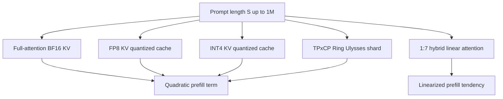
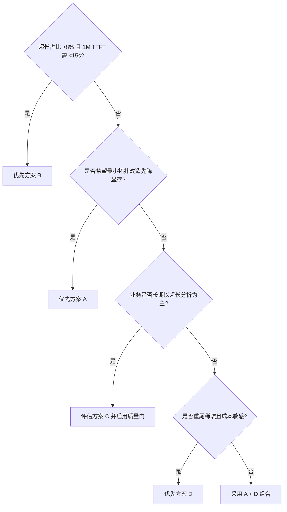
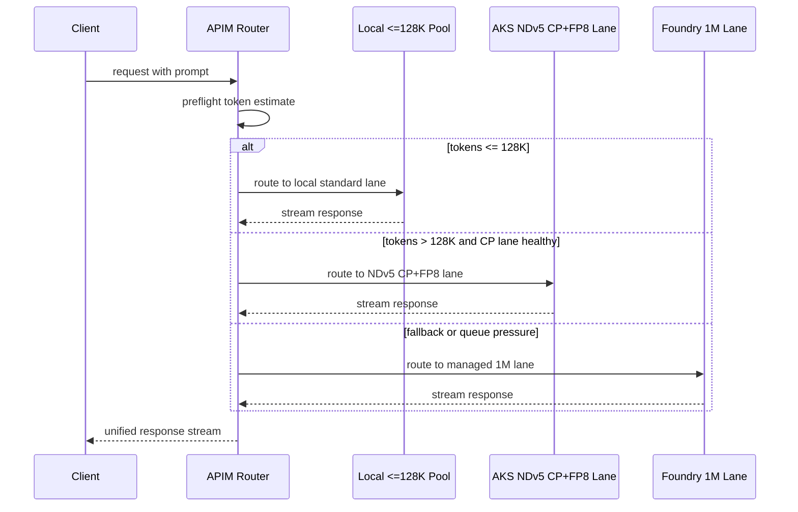

# 超长 1M Context LLM 托管选型 FAQ：AKS FP8 KV 量化 vs Ring/Ulysses Context Parallelism vs Hybrid Linear Attention vs Foundry 1M 托管通道
> **适用范围**：整仓代码智能体、并购尽调虚拟资料室、多小时临床或遥测日志复盘等 `256K-1M+` 超长提示词场景。
> **核心挑战**：在保留全局上下文质量前提下，控制 KV 内存膨胀、prefill 延迟和集群经济性。
> **数据标签**：文中定量数据均标注为 `measured`、`synthetic` 或 `anonymized_reported`。

## 1. 执行摘要：1M 上下文会击穿传统全注意力托管模型
超长提示词已不再是偶发边缘需求。
它通常是重尾流量中的高价值请求。
仅靠 RAG 切片常丢失跨文档全局约束。
全注意力模型在 `1M` 序列长度下成本陡增。
对 `70B` GQA，`L=80`、`H_kv=8`、`d_h=128`，
单次 BF16 KV 缓存约 `327.7GB`。
并发常被压缩到 `1`。
二次方 prefill 会把 TTFT 推高到几十秒。
同池短提示词请求会被连带饥饿。
没有单一方案可覆盖全部流量形态。
方案 A 优先解决单节点 KV 内存。
方案 B 优先解决跨卡 prefill 时延。
方案 C 从模型结构层面改变复杂度。
方案 D 用托管 1M 通道承接重尾流量。
企业通常需要组合策略。
短请求走本地池，超长尾请求走托管分流。

## 2. 问题定义：1M 请求与普通流量的运维本质不同
挑战不仅是慢。
还包括显存占用、公平调度与 duty-cycle。
提示词长度分布通常高度重尾。
大多数请求很短。
少量请求主导了最坏容量需求。
若长短流量共用同队列，
尾延迟会快速扩散。
质量维度也不能忽视。
量化或结构改造可能影响数值精确引用。
治理上必须引入超长上下文专属质量门。
容量规划应拆分常规路径与重尾路径。
路由控制与模型性能同等关键。

## 3. 四类候选方案的定位
方案 A 是 AKS 上 KV 量化 + chunked prefill。
方案 B 是 Ring + Ulysses 的上下文并行。
方案 C 是线性注意力或 SSM 混合架构。
方案 D 是 Foundry/AOAI 托管 1M 通道 + APIM 长度路由。
四者分别优化不同瓶颈。
A 优化单节点内存密度。
B 优化分布式 prefill 吞吐与墙钟时延。
C 优化算法复杂度曲线。
D 优化低占空比重尾场景的资本效率。

## 4. 方案 A：AKS 上 FP8/INT4 KV 量化与分块预填充
方案 A 首先解决显存约束。
将 `kv_cache_dtype` 设为 `fp8_e4m3` 或受控 INT4。
配合 per-head scaling 降低精度漂移风险。
再叠加 chunked prefill 平滑峰值显存。
FP8 常见可把 `328GB` 级 KV 压到 `164GB` 左右。
INT4 规划区间可接近 `~82GB`（`synthetic`）。
该方案无需跨节点 RDMA 才能落地。
拓扑复杂度低于大规模 CP。
代价是质量敏感度上升。
必须做 RULER 多针与精确数值引用门禁。
方案 A 适合先做“低侵入、快收益”的内存治理。



## 5. 方案 B：Ring/Ulysses Context Parallelism
方案 B 同时解决内存与 prefill 计算时间。
序列维度在 `TP x CP` 上分片。
Ring Attention 负责环形交换上下文状态。
Ulysses 降低长序列瓶颈。
在 `8-16` GPU 规模下，
`1M` prefill P95 可从 `>75s` 降到 `<12s`（`anonymized_reported`）。
每卡 KV 压力因分片而下降。
代价是对互联质量高度敏感。
NVLink 与 InfiniBand 抖动直接影响尾延迟。
同时，GPU 预留底座成本较高。
方案 B 适合超长流量占比高且 SLA 严格的场景。

## 6. 方案 C：Hybrid Linear Attention / SSM 模型
方案 C 从架构层降低复杂度。
仅部分层保留全注意力。
常见比例可设为 `1:7`。
KV 占用可下降约 `~85%`（`synthetic` 区间）。
`1M` 场景下可接近 `~41GB` KV 量级。
prefill 趋势更接近线性项。
代价是任务形态敏感。
在任意偏移复制与稠密关联检索任务上可能退化。
必须用偏移跳跃与精确引用数据集持续回归。
方案 C 适合“超长上下文是常态”的业务主路径。

## 7. 方案 D：Foundry 1M 托管通道 + APIM 长度分流
方案 D 重点优化经济性。
`<=128K` 留在本地池。
`128K-1M` 走托管 1M 通道。
这样可避免 NDv5 集群长期空转。
当超长请求占比 `<8%` 时尤其有效。
托管通道降低平台运维负担并提供弹性。
代价是外部依赖与按次计费波动。
区域队列状态会影响尾时延稳定性。
方案 D 适合重尾明显但占空比较低的企业流量。

## 8. 定量公式：容量、时延与经济性判定
### 8.1 KV 显存模型
`KV_VRAM(S, b_kv, r_full) = 2 * L * H_kv * d_h * S * b_kv * r_full`

### 8.2 Prefill 计算时间
`T_prefill(S) = (2 * P * S + 4 * L * H_q * d_h * S^2) / (N_gpu * MFU * TFLOPS)`

### 8.3 专用集群与托管通道重尾分界
`u* = C_managed_per_req / C_dedicated_hourly_capacity`

### 8.4 CP 分片后单卡 KV
`KV_shard = KV_VRAM / (TP * CP)`

### 8.5 数值引用回归率
`R_numeric = Wrong_numeric_citations / Total_numeric_needles`

### 8.6 路由误分配代价
`C_miss = P_misroute * (Delta_TTFT + Delta_cost + Delta_quality_risk)`

上述公式应绑定发布门禁与路由策略。
不能只作为离线估算。

## 9. 选型决策树：重尾占比、SLA 与质量门协同


## 10. 执行时序：APIM 长度预判到三通道路由


## 11. 12 维企业级对比矩阵
| 维度 | A FP8/INT4 KV | B TPxCP Ring/Ulysses | C Hybrid Linear | D Foundry 1M 托管 |
|---|---|---|---|---|
| 单节点内存缓解 | 最高 | 中 | 高 | N/A |
| 1M prefill 时延下限 | 中 | 最高 | 高 | 中 |
| Fabric 依赖 | 低 | 最高 | 中 | 低 |
| 运维复杂度 | 中 | 高 | 中高 | 低 |
| 质量敏感度 | 中 | 中 | 高 | 中低 |
| 预留成本底座 | 中 | 最高 | 中 | 最低 |
| 突发弹性 | 中 | 中 | 中 | 最高 |
| 多租户公平性 | 中 | 中高 | 中 | 高 |
| 路由灵活性 | 中 | 中 | 中 | 最高 |
| 三年成本可预测性 | 中 | 中 | 中 | 中高 |
| 典型角色 | 基线优化 | 吞吐主力 | 架构升级 | 重尾承接 |
| 推荐顺序 | 1 | 2 | 3 | 重尾场景可 1 |

## 12. 生产配置样例：部署、校准门与 APIM 策略
```yaml
apiVersion: apps/v1
kind: Deployment
metadata:
  name: vllm-1m-cp-fp8
spec:
  replicas: 1
  selector:
    matchLabels:
      app: vllm-1m-cp-fp8
  template:
    metadata:
      labels:
        app: vllm-1m-cp-fp8
    spec:
      nodeSelector:
        accelerator: nd_h100_v5
      containers:
        - name: vllm
          image: ghcr.io/vllm-project/vllm-openai:latest
          args:
            - "--model"
            - "contoso/longctx-70b"
            - "--tensor-parallel-size"
            - "4"
            - "--context-parallel-size"
            - "2"
            - "--kv-cache-dtype"
            - "fp8_e4m3"
            - "--max-model-len"
            - "1048576"
            - "--enable-chunked-prefill"
          resources:
            limits:
              nvidia.com/gpu: "8"
```

```python
from dataclasses import dataclass
from typing import List


@dataclass
class NeedleCase:
    prompt_id: str
    expected_value: str
    answer: str


def exact_numeric_hit(answer: str, expected: str) -> bool:
    return expected in answer


def ruler_gate(cases: List[NeedleCase], threshold: float = 0.97) -> float:
    if not cases:
        return 1.0
    hits = sum(1 for c in cases if exact_numeric_hit(c.answer, c.expected_value))
    score = hits / len(cases)
    if score < threshold:
        raise RuntimeError(f"numeric fidelity gate failed: {score:.3f} < {threshold:.3f}")
    return score
```

```xml
<policies>
  <inbound>
    <base />
    <set-variable name="tok" value="@(int.Parse(context.Request.Headers.GetValueOrDefault(&quot;x-estimated-tokens&quot;,&quot;0&quot;)))" />
    <choose>
      <when condition="@(context.Variables.GetValueOrDefault&lt;int&gt;(&quot;tok&quot;) <= 131072)">
        <set-backend-service base-url="https://local-128k.contoso.net" />
      </when>
      <when condition="@(context.Variables.GetValueOrDefault&lt;int&gt;(&quot;tok&quot;) <= 1048576)">
        <set-backend-service base-url="https://aks-cp-fp8.contoso.net" />
      </when>
      <otherwise>
        <set-backend-service base-url="https://foundry-1m.contoso.net" />
      </otherwise>
    </choose>
  </inbound>
  <backend><base /></backend>
  <outbound><base /></outbound>
  <on-error><base /></on-error>
</policies>
```

## 13. 业务场景映射建议
场景一是整仓代码 Copilot。
高频 `256K+` 请求适合 A + D 组合。
场景二是并购尽调与合同比对。
若窗口期吞吐要求高，B 更容易满足 SLA。
场景三是临床与遥测复盘。
C 在内存效率上有优势，但必须绑定质量门。
场景四是混合企业流量。
D 结合 APIM 预判分流可保持队列公平与成本弹性。

## 14. `Q1..Q6` 实战问答
### Q1: 为什么 1M BF16 KV 会把并发压到 1？
因为 KV 占用随序列长度线性放大。
单请求就可能吃满节点显存。

### Q2: FP8 KV 一定不会降质吗？
不是。
必须用数值针和精确引用门禁验证。

### Q3: 什么时候值得引入 CP？
当超长请求占比高且时延目标严格时。
低占空比场景常难回收其预留成本。

### Q4: 为什么不全部走托管 1M？
常规短请求走托管不一定经济。
混合路由通常更平衡。

### Q5: 超长优化上线阻断最关键看什么？
看数值引用精度与长上下文检索回归。
同时监控 prefill 与排队尾延迟漂移。

### Q6: 专用池与托管池分界由谁决定？
核心是重尾 duty-cycle。
比较持续利用率与按次成本即可得到分界。

## 15. 三年 TCO 与 Day-0/Day-2 清单
### 15.1 三年 TCO（`10K / 100K / 1M` ultra-long 请求/月）
| 方案 | 10K req/月 | 100K req/月 | 1M req/月 | 三年总计 |
|---|---:|---:|---:|---:|
| A FP8/INT4 KV on AKS | `$1.2M` | `$6.4M` | `$41.7M` | `$49.3M` |
| B TPxCP Ring/Ulysses | `$1.9M` | `$9.8M` | `$53.4M` | `$65.1M` |
| C Hybrid Linear Models | `$1.4M` | `$7.1M` | `$38.8M` | `$47.3M` |
| D Foundry 1M managed lane | `$0.9M` | `$6.9M` | `$59.2M` | `$67.0M` |
| 混合（A 本地 + D 分流 + B 峰值窗口） | `$1.3M` | `$6.8M` | `$44.6M` | `$52.7M` |

### 15.2 Day-0
- 先绘制提示词长度直方图与重尾占空比。
- 定义 APIM 长度路由阈值与故障回退顺序。
- 建立 RULER 与数值引用回归门禁。
- 在真实轨迹上对比 BF16 与 FP8 KV 与 chunked prefill。
- 仅在持续需求成立时预留 CP 资源池。

### 15.3 Day-2
- 每月重算专用池与托管池 break-even 分界。
- 持续监控短请求与超长请求队列公平性。
- 跟踪模型版本变更对长上下文精度影响。
- 监控 CP Fabric 重传、拥塞与尾抖动。
- 通过金丝雀分环逐步发布路由策略变更。

推荐路径：
先以 A 获取显存收益，
用 D 承接稀疏重尾请求，
在高占空比严格 SLA 场景引入 B，
当业务长期超长为主时再评估 C。
