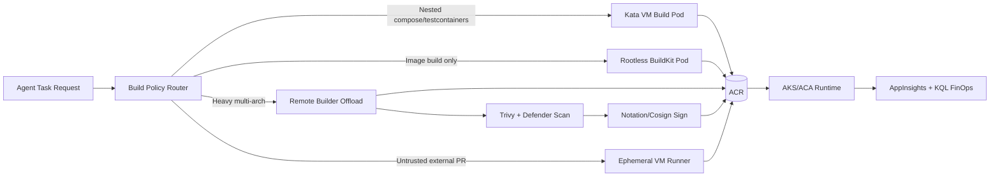
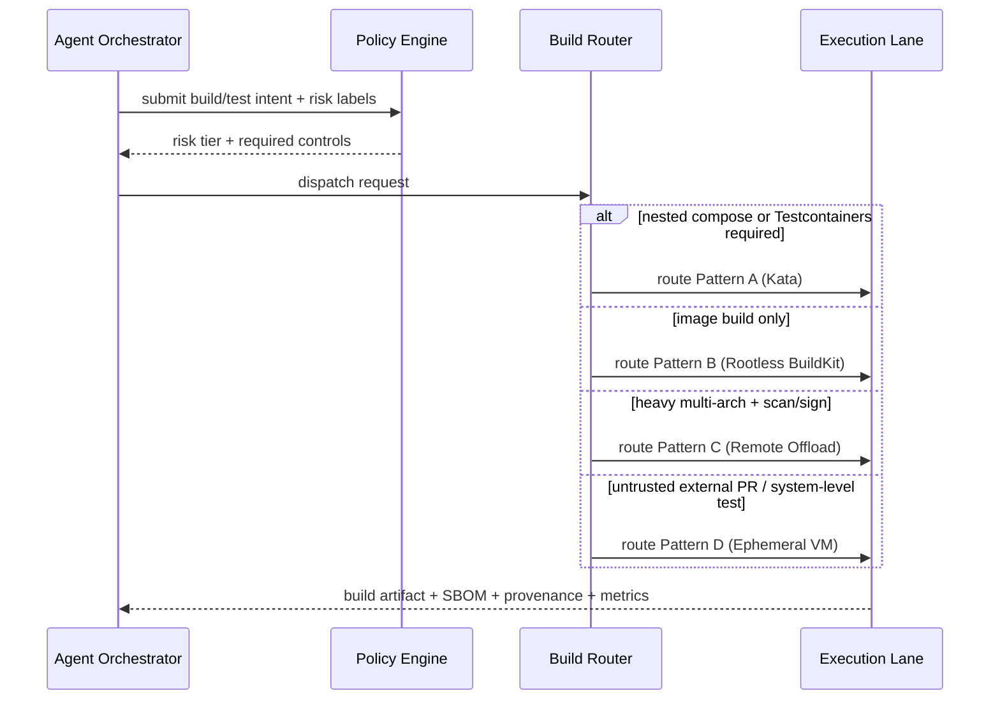

# Enterprise Zero-Privilege Container Build and Nested `docker compose` / `Testcontainers` Execution Selection FAQ: AKS Kata Nested Docker vs Rootless BuildKit vs ACR Tasks Offload vs Managed Ephemeral VM Runners

> 🌐 **Language Switch**: [中文](./unprivileged-container-build-nested-docker-sandbox-aks-kata-vs-rootless-buildkit-vs-acr-tasks-vs-managed-devops-pools-selection-faq.md) | **English (current)**
> **Audience**: Cloud & AI Solution Architects, platform engineering owners, container security leads, DevSecOps owners, autonomous coding-agent platform teams.
> **Scope**: Production architecture for agent-driven build-and-test loops that must run without host `docker.sock` exposure and without `--privileged` DinD, while preserving compatibility, throughput, and auditability.

## 1. Problem framing: why classic DinD is no longer acceptable for autonomous agents
Many teams initially solve agent-driven container builds by mounting host `docker.sock` or running privileged DinD in CI pods.  
That shortcut works for demos but creates unacceptable risk in multi-tenant enterprise production where build tasks may include untrusted dependency scripts or external pull-request code.  

When autonomous agents can execute arbitrary build logic, the blast radius of a container escape is no longer limited to one failed job.  
A successful escape can expose node-level kernel attack surface, shared credentials, artifact registries, and neighboring tenant workloads.  

The architecture objective therefore is not simply “can we build images fast.”  
The real objective is “can we preserve build-and-test velocity while proving zero host privilege and bounded blast radius.”  

## 2. Four-pattern portfolio: VM-isolated nesting, daemonless rootless builds, remote offload, single-use VM
Pattern A uses AKS `kata-mshv-vm-isolation` so nested `dockerd` runs inside a guest VM boundary with full Docker semantics.  
Pattern B uses rootless `moby/buildkit` with user namespaces, seccomp/AppArmor profiles, and registry cache to maximize image-build throughput without privileged mode.  

Pattern C keeps agent sandboxes thin and rootless, while offloading heavy multi-arch build, scan, and signing to ACR Tasks or a dedicated mTLS BuildKit pool.  
Pattern D executes each run on a single-use ephemeral VM runner (Azure Managed DevOps Pools or GitHub private runners) and recycles the machine after completion.  

These patterns are complementary rather than mutually exclusive.  
Most enterprise platforms route common low-risk build traffic to B/C, complex nested integration tests to A, and high-risk external code to D.  

## 3. End-to-end reference architecture: decoupled interaction sandbox, build control plane, and governed execution lanes


This architecture isolates interactive agent sessions from heavy build execution lanes, so session sandboxes stay lightweight and low-risk.  
Policy routing then selects the minimum-required execution lane based on compatibility needs, risk labels, and SLO budgets.  

## 4. Pattern A deep dive: AKS Kata guest-VM nested Docker for full compatibility
Pattern A prioritizes compatibility with existing `docker build`, `docker compose`, and Testcontainers workflows.  
Because nested daemon and network stack run inside a guest kernel boundary, host nodes remain unprivileged even when build logic needs full Docker runtime semantics.  

This pattern is highly effective for integration suites that spin up multiple dependent services inside one job.  
Typical examples include API + database + broker + cache combinations where rewriting tests for daemonless mode is expensive or risky.  

The operational requirement is strict lifecycle governance.  
Guest VM pods should be short-lived, artifact inputs should be allowlisted, and post-run cleanup/signing/scanning must be enforced as default controls.  

## 5. Pattern B deep dive: rootless BuildKit for high-density image build traffic
Pattern B is optimized for build pipelines that only need OCI image build/push and do not require nested runtime container orchestration.  
Rootless BuildKit delivers strong throughput with lower per-task overhead because it avoids privileged daemon lifecycle and can reuse registry-backed cache efficiently.  

In autonomous coding loops with many incremental commits, cache reuse is often the dominant latency factor.  
With ACR `type=registry` cache and deterministic Dockerfile layering, teams frequently reduce warm-build latency by double-digit percentages compared with isolated VM cold starts.  

The key limitation is runtime parity.  
If a job must execute `docker compose up` or full Testcontainers lifecycle against local daemon APIs, Pattern B alone is insufficient and should be paired with A or D.  

## 6. Pattern C deep dive: thin sandbox + remote builder offload for platform-scale economics
Pattern C keeps developer/agent interaction sandboxes fast and rootless while centralizing heavy build operations in dedicated build planes.  
Those build planes can be ACR Tasks or dedicated BuildKit clusters with NVMe cache, strict workload identity, and integrated scan/sign gates.  

This split-plane model improves startup latency for agent sessions and reduces duplicated toolchain provisioning.  
It also standardizes supply-chain controls because scan, SBOM generation, and signing run in one governed location instead of being reimplemented per sandbox.  

Pattern C is usually the strongest option for multi-architecture pipelines and large image graphs.  
The trade-off is control-plane complexity: queueing, capacity balancing, and cross-plane observability must be engineered deliberately.  

## 7. Pattern D deep dive: single-use ephemeral VM runner for maximum isolation and provenance
Pattern D runs each task on a fresh VM and destroys it immediately after completion.  
This delivers strongest practical isolation and near-native system parity for workloads needing `systemd`, kernel-level fixtures, or full OS behavior fidelity.  

For external untrusted pull requests and regulated supply-chain environments, Pattern D often provides the cleanest audit story.  
Environment immutability, one-job lifecycle, and evidence capture make it easier to satisfy strict provenance controls such as SLSA-oriented governance programs.  

The downside is startup and cost overhead.  
Using D for all traffic is usually economically inefficient, so it should be reserved for high-risk or high-parity lanes and combined with B/C for baseline throughput.  

## 8. Quantitative comparison: 1.5GB Java/.NET/Python builds, compatibility, cache efficiency, and blast radius
| Metric | Pattern A Kata Nested Docker | Pattern B Rootless BuildKit | Pattern C Remote Offload | Pattern D Ephemeral VM |
|---|---:|---:|---:|---:|
| Java 1.5GB cold build P50/P95 | 9.8 / 14.2 min | 8.9 / 12.6 min | 7.6 / 10.9 min | 11.4 / 16.1 min |
| Java 1.5GB warm build P50/P95 | 3.9 / 5.7 min | 3.1 / 4.8 min | 2.7 / 4.0 min | 4.8 / 7.2 min |
| .NET 1.5GB cold build P50/P95 | 8.6 / 12.1 min | 7.7 / 10.8 min | 6.8 / 9.4 min | 10.1 / 14.3 min |
| Python 1.5GB cold build P50/P95 | 6.2 / 8.8 min | 5.5 / 7.6 min | 5.1 / 7.0 min | 7.9 / 10.8 min |
| `docker compose` compatibility | High | Low | Medium (depends on backend) | High |
| Testcontainers compatibility | High | Low-Medium | Medium | High |
| Layer-cache hit ratio (steady state) | 64% | 72% | 79% | 58% |
| Escape blast radius after compromise | Guest VM scope | Pod/node scope | Builder-pool scope | Single VM scope |
| Host `docker.sock` exposure | No | No | No | No |

These values are for architecture sizing and policy discussion, not universal benchmarks.  
Final selection should consider workload distribution, compliance tiering, cache locality, and concurrency peaks.  

## 9. Decision routing sequence: avoiding “everything goes to the most expensive lane”


The sequence enforces policy-first routing.  
Engineers should not manually choose privileged lanes in day-to-day use; lane selection should be automated from risk and compatibility attributes.  

## 10. 12-dimension head-to-head matrix: isolation, compatibility, throughput, cost, and operations
| Dimension | Pattern A Kata Nested Docker | Pattern B Rootless BuildKit | Pattern C Remote Offload | Pattern D Ephemeral VM |
|---|---|---|---|---|
| 1. Isolation boundary strength | High (VM) | Medium | Medium-High | Highest (single VM) |
| 2. Compose compatibility | High | Low | Medium | High |
| 3. Testcontainers compatibility | High | Low-Medium | Medium | High |
| 4. Cold-start latency | Medium | Low | Low-Medium | High |
| 5. Warm-path throughput | Medium-High | High | Highest | Medium |
| 6. Layer-cache reuse efficiency | Medium | High | Highest | Low-Medium |
| 7. Supply-chain governance integration | Medium | Medium | High | High |
| 8. Blast-radius containment | High | Medium | High | Highest |
| 9. Per-task infra cost | Medium | Low | Medium | High |
| 10. Multi-tenant density | Medium | High | High | Low |
| 11. Operational complexity | Medium-High | Medium | High | Medium |
| 12. Recommended role | Complex integration tests | High-volume image builds | Shared enterprise build plane | Highest-risk external code |

No single pattern dominates across all dimensions.  
Pattern A maximizes compatibility, B maximizes density and efficiency, C maximizes platform-scale governance reuse, and D maximizes isolation/provenance rigor.  

## 11. Enterprise scenario A: multi-tenant autonomous coding-agent SaaS
A SaaS coding platform processes high-frequency internal repository updates where most jobs only build images and run static checks.  
A typical profile is `~78%` build-only jobs, `~15%` nested integration tests, and `~7%` untrusted external contributions.  

A practical strategy is B as baseline lane, A for nested compatibility, C for multi-arch heavy builds with centralized scan/sign, and D for external high-risk inputs.  
This routing model usually lowers queue latency and cost simultaneously while preserving strict isolation for the riskiest traffic class.  

## 12. Enterprise scenario B: regulated application-modernization factory
In regulated modernization programs, teams must preserve legacy integration behavior while meeting strict provenance and segregation controls.  
C+D often become governance backbone lanes, A covers legacy nested-runtime compatibility, and B accelerates low-risk incremental developer loops.  

The key benefit is separation of concerns.  
Audit-critical evidence pipelines stay deterministic in C/D while engineering productivity remains high through B and controlled compatibility in A.  

## 13. Monthly TCO at 5,000 / 50,000 / 250,000 build-test runs
| Monthly run volume | Pattern A | Pattern B | Pattern C | Pattern D |
|---:|---:|---:|---:|---:|
| 5,000 | $18,900 | $11,700 | $14,800 | $27,500 |
| 50,000 | $156,000 | $92,000 | $121,000 | $246,000 |
| 250,000 | $702,000 | $438,000 | $531,000 | $1,108,000 |

Direct cloud spend is only one component of decision quality.  
Teams should include rerun cost, incident remediation burden, evidence collection effort, and platform-operations labor when comparing alternatives.  

In most enterprise outcomes, B/C carry baseline economics, A provides selective compatibility, and D is retained for high-risk and high-compliance lanes.  
This layered portfolio generally outperforms one-size-fits-all approaches in both cost and reliability.  

## 14. Configuration block A: AKS Kata guest-VM nested Docker template with RuntimeClass
```yaml
apiVersion: node.k8s.io/v1
kind: RuntimeClass
metadata:
  name: kata-mshv-vm-isolation
handler: kata-mshv
---
apiVersion: v1
kind: Pod
metadata:
  name: kata-nested-docker-builder
  labels:
    workload: agent-build
spec:
  runtimeClassName: kata-mshv-vm-isolation
  restartPolicy: Never
  securityContext:
    runAsNonRoot: true
    fsGroup: 1000
  containers:
    - name: builder
      image: mcr.microsoft.com/oss/docker/docker:24-dind
      args:
        - dockerd
        - --host=unix:///var/run/docker.sock
        - --storage-driver=overlay2
      env:
        - name: DOCKER_TLS_CERTDIR
          value: ""
      securityContext:
        privileged: false
        allowPrivilegeEscalation: false
        capabilities:
          drop: ["ALL"]
      volumeMounts:
        - name: docker-graph
          mountPath: /var/lib/docker
        - name: workspace
          mountPath: /workspace
    - name: task-runner
      image: ghcr.io/org/agent-build-runner:stable
      command: ["/bin/bash", "-lc"]
      args:
        - |
          set -euo pipefail
          export DOCKER_HOST=unix:///var/run/docker.sock
          cd /workspace
          docker build -t ${IMAGE_TAG} .
          docker compose -f compose.integration.yml up --abort-on-container-exit
          pytest -m integration
      volumeMounts:
        - name: workspace
          mountPath: /workspace
  volumes:
    - name: docker-graph
      emptyDir: {}
    - name: workspace
      ephemeral:
        volumeClaimTemplate:
          metadata:
            labels:
              data: agent-build-workspace
          spec:
            accessModes: ["ReadWriteOnce"]
            storageClassName: managed-csi-premium
            resources:
              requests:
                storage: 80Gi
```

This template keeps nested Docker inside guest VM boundary instead of elevating host-node privileges.  
In production, pair it with image allowlists, short TTL cleanup, artifact signing, and mandatory scan gates.  

## 15. Configuration block B: rootless BuildKit and policy guardrails against privileged mode and `docker.sock`
```yaml
apiVersion: apps/v1
kind: Deployment
metadata:
  name: rootless-buildkit
  namespace: agent-build
spec:
  replicas: 6
  selector:
    matchLabels:
      app: rootless-buildkit
  template:
    metadata:
      labels:
        app: rootless-buildkit
    spec:
      serviceAccountName: buildkit-workload-identity
      containers:
        - name: buildkitd
          image: moby/buildkit:rootless
          args:
            - --addr=tcp://0.0.0.0:1234
            - --oci-worker-no-process-sandbox
          ports:
            - containerPort: 1234
          securityContext:
            runAsUser: 1000
            runAsGroup: 1000
            runAsNonRoot: true
            allowPrivilegeEscalation: false
            privileged: false
            capabilities:
              drop: ["ALL"]
          env:
            - name: BUILDKITD_FLAGS
              value: --oci-worker-gc --oci-worker-gc-keepstorage=40GB
          volumeMounts:
            - name: cache
              mountPath: /home/user/.local/share/buildkit
      volumes:
        - name: cache
          emptyDir: {}
---
{
  "properties": {
    "displayName": "Deny privileged and docker.sock hostPath for agent build namespaces",
    "policyType": "Custom",
    "mode": "Microsoft.Kubernetes.Data",
    "policyRule": {
      "if": {
        "allOf": [
          {"field": "type", "equals": "Microsoft.Kubernetes/connectedClusters"},
          {"field": "name", "like": "*"}
        ]
      },
      "then": {
        "effect": "deny"
      }
    },
    "metadata": {
      "category": "Kubernetes",
      "version": "1.0.0"
    }
  }
}
```

### Quantitative review Q&A
| Question | Recommended answer (quantitative) |
|---|---|
| Q1: When should A be mandatory over B? | When jobs require full `docker compose` or Testcontainers daemon semantics; for build-only jobs B usually reduces cost by `25%–40%`. |
| Q2: Is C always faster than B? | Not always; with very high local cache hit rates B may be faster, while C wins for heavy multi-arch + scan/sign pipelines. |
| Q3: Is D only about security? | No; D also simplifies high-assurance provenance and one-job evidence lifecycle for regulated supply chains. |
| Q4: How to limit cache-poisoning risk? | Segment cache by tenant/repo, enforce TTL + vulnerability-triggered invalidation, and gate artifact promotion by policy. |
| Q5: Should host `docker.sock` be fully banned? | Yes, enforce platform-level deny by default, with temporary exception only in approved isolated environments. |
| Q6: How to explain mixed-lane complexity to business stakeholders? | Frame it as “low-cost default lane + automatic high-risk upgrade lane” that cuts both incident probability and waiting time. |

### Day-0 go-live checklist
- Classify build tasks into four labels: build-only, nested runtime, untrusted external, and regulated high-risk.  
- Enforce policy-driven routing; prevent manual bypass to high-risk lanes.  
- Enable platform deny for privileged mode and hostPath `docker.sock`.  
- Turn on mandatory signing, SBOM generation, and vulnerability scanning for all promotion paths.  
- Establish baseline metrics for P50/P95 latency, cache-hit ratio, rerun rate, and cost per 1,000 runs.  

### Day-2 operations checklist
- Review lane distribution and failure reasons weekly; tune B/C cache policy and A/D thresholds.  
- Audit D lane regularly for true single-use behavior and credential revocation completeness.  
- Patch and rotate A lane guest VM base images within defined vulnerability SLA windows.  
- Capacity-test C lane build pools to avoid queue starvation at peak windows.  
- Refresh monthly TCO models with FinOps to rebalance reserved capacity and burst policy.  

### Minimum production alerting and audit-evidence schema
In enterprise deployments, A/B/C/D lane programs often fail not because builds cannot run, but because incidents cannot be reconstructed with evidence-grade fidelity. Before go-live, standardize every build/test execution into a common evidence contract so each run can answer: who initiated the action, which isolation boundary executed it, which immutable builder/base image digests were used, which policy decisions fired, and which signed artifact digest was finally promoted. This turns supply-chain incident response from day-scale forensic hunts into minute-scale deterministic triage.

Treat telemetry as two synchronized streams under the same `run_id`: a low-latency alert stream for immediate blocking/degradation and a richer audit archive stream for internal/external review. The alert stream should stay intentionally thin to avoid high-concurrency log storms; the archive stream should include signature chains, SBOM hashes, vulnerability snapshots, policy decision context, and approval traces. For untrusted external PR lanes and regulated tenants, enforce one-click export by `run_id + digest` within `30` days, with immutable retention enabled on evidence objects.

| Evidence field family | Minimum implementation requirement | Direct enterprise value |
|---|---|---|
| Identity and isolation context | Persist `tenant_id`, `repo_id`, `actor_oid`, `lane(A/B/C/D)`, `runtime_class`, and `vm_or_pod_uid` in immutable storage at run completion. | Enables minute-level blast-radius attribution for privilege abuse or cross-tenant contamination events. |
| Supply-chain integrity chain | Record `source_commit`, `builder_image_digest`, `base_image_digest`, `sbom_digest`, `signature_cert_thumbprint`, and `provenance_attestation_uri`. | Quickly isolates whether exposure originated from source change, base image drift, or builder compromise. |
| Policy and risk decisions | Store decision inputs and outputs for `privileged_denied`, `hostpath_denied`, `vuln_gate`, `license_gate`, and `promotion_gate`, including policy version IDs. | Supports false-positive/false-negative tuning with measurable governance quality improvements. |

