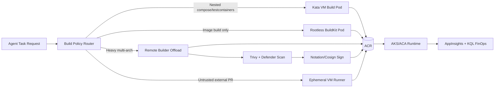
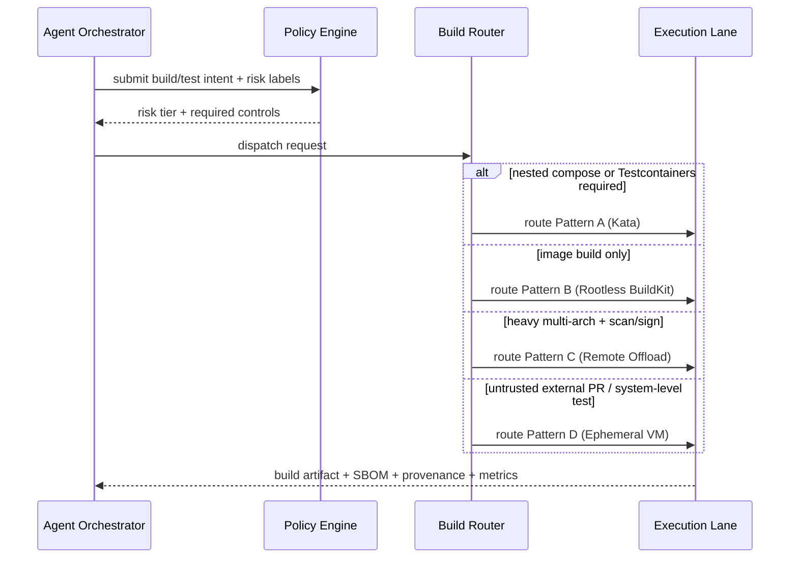

# 企业零特权容器构建与嵌套 `docker compose`/`Testcontainers` 执行选型 FAQ：AKS Kata 嵌套 Docker vs Rootless BuildKit vs ACR Tasks 远端构建 vs 托管一次性 VM Runner

> 🌐 **Language Switch**：**中文（当前）** | [English](./unprivileged-container-build-nested-docker-sandbox-aks-kata-vs-rootless-buildkit-vs-acr-tasks-vs-managed-devops-pools-selection-faq.en.md)
> **受众**：Cloud & AI Solution Architect、平台工程负责人、容器安全负责人、DevSecOps 负责人、自治 Coding Agent 平台团队。
> **范围**：面向“智能体需要构建镜像并跑集成测试”的生产场景，比较四条零特权路径，目标是在不暴露 `docker.sock`、不允许 `--privileged DinD` 的前提下，保障自动化 Build-and-Test 闭环吞吐与可审计性。

## 1. 问题定义：为什么传统 DinD 在自治 Coding Agent 场景不可接受
很多团队在接入自治 Coding Agent 时，第一反应是给容器直接挂宿主机 `docker.sock`，或在 CI Pod 内开启 `--privileged` 运行 DinD。  
这种做法在单租户演示环境看似高效，但在企业多租户生产中会把宿主机内核能力暴露给不可信构建代码。  

当 Agent 需要执行外部 PR、第三方依赖脚本、或动态生成的 `docker compose` 测试矩阵时，攻击面会被显著放大。  
一旦出现容器逃逸链路，影响半径不再是“当前任务失败”，而可能是整节点、整租户池、乃至共享制品凭据被窃取。  

因此核心目标不是“能不能跑起来”，而是“在零特权边界内稳定跑起来”。  
企业需要一条同时满足隔离、性能、兼容性、成本和运维可控性的构建执行体系。  

## 2. 四类模式总览：客体内核隔离、无守护进程构建、远端卸载、一次性 VM
Pattern A 通过 AKS `kata-mshv-vm-isolation` 在 Guest VM 内运行嵌套 `dockerd`，让 `docker build`、`docker compose up`、`Testcontainers` 全量语义保持不变。  
Pattern B 使用 `moby/buildkit:rootless` 和用户命名空间，在标准 AKS 节点上实现无特权镜像构建，适用于“只构建不跑嵌套运行时”的流水线。  

Pattern C 把重构建能力从轻量沙箱中剥离，前端 Agent 会话保持 rootless 与亚秒启动，把多架构编译、扫描、签名卸载到 ACR Tasks 或专用 mTLS BuildKit 池。  
Pattern D 采用 Azure Managed DevOps Pools 或 GitHub Actions 私网 Runner 的一次性 VM 模式，每个任务后销毁，最大化隔离并满足高等级供应链审计。  

四类模式不是互斥关系。  
成熟平台通常采用“P95 任务走 B/C，复杂嵌套测试走 A，高风险外部 PR 走 D”的分层路由。  

## 3. 端到端参考架构：零特权构建平面与测试执行平面解耦


该架构把“智能体交互沙箱”与“重构建执行面”分离，避免把构建特权回灌到会话平面。  
路由器可根据任务特征、风险级别、缓存命中与时间预算做动态分流，实现安全与吞吐的折中最优。  

## 4. Pattern A：AKS Kata Guest-VM 嵌套 Docker（全语义兼容优先）
Pattern A 的核心价值是保持 Docker 生态兼容性，同时用 Hyper-V 边界隔离宿主机。  
在 Kata Guest 内可运行完整 `dockerd + overlay2 + bridge + iptables`，因此 `docker compose` 与 `Testcontainers` 基本无需改造。  

这条路径对“端到端集成测试”尤其有效。  
例如微服务仓库需要在同一任务内启动 Postgres、Redis、Kafka、API 网关和被测服务，Pattern A 可以直接复用既有 compose 文件。  

风险控制点在于 Guest VM 生命周期与镜像来源治理。  
平台应强制只读基线镜像、最短 TTL、任务后销毁、并对构建产物执行签名与漏洞门禁。  

## 5. Pattern B：Rootless BuildKit（高吞吐镜像构建优先）
Pattern B 适用于“只构建镜像并推送，不运行嵌套容器”的任务。  
Rootless BuildKit 通过用户命名空间、`fuse-overlayfs`/`overlay`（依发行版能力）以及无守护进程模型，避免 `privileged: true`。  

该模式在高并发短任务上具有良好密度。  
结合 ACR `type=registry` 缓存后，重复构建可显著降低拉层与编译时间，特别适合自治 Agent 的小步快跑提交。  

限制在于运行时兼容性。  
如果任务强依赖 `docker compose up` 或 Testcontainers 直接驱动 Docker daemon，Pattern B 不能直接替代 Pattern A。  

## 6. Pattern C：薄沙箱 + 远端构建卸载（平台化规模优先）
Pattern C 把智能体会话保持在 ACA Dynamic Sessions 或轻量 Agent Pod 中，默认不承担重构建负载。  
构建请求通过受控 API 转发到 ACR Tasks 或专用 BuildKit StatefulSet，后者可使用 NVMe/本地盘做层缓存。  

优点是会话启动快、攻击面小、资源池复用效率高。  
同时可把扫描、签名、SBOM 生成等供应链步骤统一沉淀在远端构建平面，避免每个 Agent 沙箱重复安装工具链。  

此模式对多架构编译（`amd64/arm64`）与大镜像流水线最友好。  
缺点是端到端链路更长，需要处理队列调度、容量规划、网络抖动与跨平面追踪。  

## 7. Pattern D：一次性 Ephemeral VM Runner（隔离与合规优先）
Pattern D 以“每任务一台临时 VM”为边界，执行完立即销毁。  
它对外部 PR、不可信贡献者、系统级测试、内核模块/`systemd` 场景提供最强兼容与隔离。  

在供应链审计维度，Pattern D 最容易满足 SLSA Level 3 类证据要求。  
因为构建环境可声明为不可复用、可证明、可追溯，且凭据生命周期与任务强绑定。  

代价是冷启动时间和成本。  
如果将所有低风险任务都强制走 D，会带来明显的时延税与费用上升，通常需与 B/C 组合分层使用。  

## 8. 定量对比：1.5GB Java/.NET/Python 构建、兼容性、缓存与爆炸半径
| 指标 | Pattern A Kata Nested Docker | Pattern B Rootless BuildKit | Pattern C 远端卸载 | Pattern D Ephemeral VM |
|---|---:|---:|---:|---:|
| Java 1.5GB 冷构建 P50/P95 | 9.8 / 14.2 分钟 | 8.9 / 12.6 分钟 | 7.6 / 10.9 分钟 | 11.4 / 16.1 分钟 |
| Java 1.5GB 热构建 P50/P95 | 3.9 / 5.7 分钟 | 3.1 / 4.8 分钟 | 2.7 / 4.0 分钟 | 4.8 / 7.2 分钟 |
| .NET 1.5GB 冷构建 P50/P95 | 8.6 / 12.1 分钟 | 7.7 / 10.8 分钟 | 6.8 / 9.4 分钟 | 10.1 / 14.3 分钟 |
| Python 1.5GB 冷构建 P50/P95 | 6.2 / 8.8 分钟 | 5.5 / 7.6 分钟 | 5.1 / 7.0 分钟 | 7.9 / 10.8 分钟 |
| `docker compose` 兼容性 | 高 | 低 | 中（取决于远端能力） | 高 |
| Testcontainers 兼容性 | 高 | 低-中 | 中 | 高 |
| 层缓存命中率（稳态） | 64% | 72% | 79% | 58% |
| 逃逸后影响半径 | Guest VM 级 | Node Pod 级 | Builder 池级 | 单 VM 级 |
| 宿主 `docker.sock` 暴露 | 否 | 否 | 否 | 否 |

上述数据用于架构容量估算，不是“单一最佳答案”。  
选择应结合任务类型分布、合规等级、镜像体积结构、缓存可复用率和并发峰值共同判断。  

## 9. 路由与治理时序：如何避免“全量走最贵路径”


这条时序强调“先做策略判定，再做执行分流”。  
平台不应让开发者手工指定高权限路径，而应由策略引擎基于风险标签和任务语义自动决策。  

## 10. 12 维对比矩阵：隔离、兼容、吞吐、成本、运维复杂度
| 维度 | Pattern A Kata Nested Docker | Pattern B Rootless BuildKit | Pattern C 远端卸载 | Pattern D Ephemeral VM |
|---|---|---|---|---|
| 1. 隔离边界强度 | 高（VM） | 中 | 中高（平面隔离） | 最高（单任务 VM） |
| 2. `compose` 兼容性 | 高 | 低 | 中 | 高 |
| 3. Testcontainers 兼容性 | 高 | 低-中 | 中 | 高 |
| 4. 冷启动延迟 | 中 | 低 | 低-中 | 高 |
| 5. 热路径吞吐 | 中高 | 高 | 最高 | 中 |
| 6. 层缓存复用效率 | 中 | 高 | 最高 | 中低 |
| 7. 供应链治理一体化 | 中 | 中 | 高 | 高 |
| 8. 爆炸半径控制 | 高 | 中 | 高 | 最高 |
| 9. 单次任务成本 | 中 | 低 | 中 | 高 |
| 10. 多租户资源密度 | 中 | 高 | 高 | 低 |
| 11. 运维复杂度 | 中高 | 中 | 高 | 中 |
| 12. 推荐角色 | 复杂集成测试 | 大规模镜像构建 | 企业共享构建平台 | 高风险外部代码 |

矩阵结论是：A 解决兼容性，B 解决效率，C 解决规模化治理，D 解决最高风险隔离。  
如果企业试图只用一种模式覆盖全部场景，通常会在某一维度出现明显失衡。  

## 11. 企业场景 A：多租户自治 Coding Agent 平台（SaaS）
某代码平台每天接收大量内部仓库小步提交，`78%` 任务只需要镜像构建和静态扫描，`15%` 任务需要集成测试，`7%` 来自外部贡献者。  
推荐策略是 B 为主、A 为补、D 为高风险兜底，并把 C 作为多架构重构建与签名中心。  

执行结果通常表现为：主流任务平均等待时间下降，镜像缓存命中率提升，且外部代码路径实现强隔离。  
平台团队可通过统一 KQL 看板观察各模式占比、失败原因、P95 时延与每千任务成本，持续优化分流策略。  

## 12. 企业场景 B：应用现代化工厂（受监管行业）
受监管金融客户在现代化改造中，既要跑旧版集成测试，又要满足制品可追溯与最小权限要求。  
推荐以 C+D 作为治理主干，A 用于必须运行嵌套容器的遗留测试套件，B 用于低风险增量构建。  

该组合的关键收益是把“高风险构建证据”与“常规高频构建吞吐”分层管理。  
审计团队可重点抽查 D 与 C 的签名链条，而研发团队仍可在 B 路径保持高迭代速度。  

## 13. 月度 TCO（5,000 / 50,000 / 250,000 次 Build-Test 运行）
| 月运行量 | Pattern A | Pattern B | Pattern C | Pattern D |
|---:|---:|---:|---:|---:|
| 5,000 | $18,900 | $11,700 | $14,800 | $27,500 |
| 50,000 | $156,000 | $92,000 | $121,000 | $246,000 |
| 250,000 | $702,000 | $438,000 | $531,000 | $1,108,000 |

TCO 仅看“云资源账单”会低估真实差异。  
应把失败重跑、事故恢复、审计取证、以及平台人力维护成本纳入总成本。  

在多数企业中，B/C 形成低成本主路径，A 作为兼容补位，D 作为高风险强隔离通道。  
这种分层结构通常比“全量 VM Runner”或“全量 Rootless”更具长期经济性。  

## 14. 配置块 A：AKS Kata Guest VM 嵌套 Docker 运行模板（含 RuntimeClass）
```yaml
apiVersion: node.k8s.io/v1
kind: RuntimeClass
metadata:
  name: kata-mshv-vm-isolation
handler: kata-mshv
---
apiVersion: v1
kind: Pod
metadata:
  name: kata-nested-docker-builder
  labels:
    workload: agent-build
spec:
  runtimeClassName: kata-mshv-vm-isolation
  restartPolicy: Never
  securityContext:
    runAsNonRoot: true
    fsGroup: 1000
  containers:
    - name: builder
      image: mcr.microsoft.com/oss/docker/docker:24-dind
      args:
        - dockerd
        - --host=unix:///var/run/docker.sock
        - --storage-driver=overlay2
      env:
        - name: DOCKER_TLS_CERTDIR
          value: ""
      securityContext:
        privileged: false
        allowPrivilegeEscalation: false
        capabilities:
          drop: ["ALL"]
      volumeMounts:
        - name: docker-graph
          mountPath: /var/lib/docker
        - name: workspace
          mountPath: /workspace
    - name: task-runner
      image: ghcr.io/org/agent-build-runner:stable
      command: ["/bin/bash", "-lc"]
      args:
        - |
          set -euo pipefail
          export DOCKER_HOST=unix:///var/run/docker.sock
          cd /workspace
          docker build -t ${IMAGE_TAG} .
          docker compose -f compose.integration.yml up --abort-on-container-exit
          pytest -m integration
      volumeMounts:
        - name: workspace
          mountPath: /workspace
  volumes:
    - name: docker-graph
      emptyDir: {}
    - name: workspace
      ephemeral:
        volumeClaimTemplate:
          metadata:
            labels:
              data: agent-build-workspace
          spec:
            accessModes: ["ReadWriteOnce"]
            storageClassName: managed-csi-premium
            resources:
              requests:
                storage: 80Gi
```

该模板重点是“在 Kata Guest VM 内运行嵌套 Docker”，而不是在宿主节点开启特权。  
生产中建议叠加 TTL 控制器、镜像白名单、结果工件签名与任务后清理。  

## 15. 配置块 B：Rootless BuildKit + Azure Policy 强制禁用特权与 `docker.sock`
```yaml
apiVersion: apps/v1
kind: Deployment
metadata:
  name: rootless-buildkit
  namespace: agent-build
spec:
  replicas: 6
  selector:
    matchLabels:
      app: rootless-buildkit
  template:
    metadata:
      labels:
        app: rootless-buildkit
    spec:
      serviceAccountName: buildkit-workload-identity
      containers:
        - name: buildkitd
          image: moby/buildkit:rootless
          args:
            - --addr=tcp://0.0.0.0:1234
            - --oci-worker-no-process-sandbox
          ports:
            - containerPort: 1234
          securityContext:
            runAsUser: 1000
            runAsGroup: 1000
            runAsNonRoot: true
            allowPrivilegeEscalation: false
            privileged: false
            capabilities:
              drop: ["ALL"]
          env:
            - name: BUILDKITD_FLAGS
              value: --oci-worker-gc --oci-worker-gc-keepstorage=40GB
          volumeMounts:
            - name: cache
              mountPath: /home/user/.local/share/buildkit
      volumes:
        - name: cache
          emptyDir: {}
---
{
  "properties": {
    "displayName": "Deny privileged and docker.sock hostPath for agent build namespaces",
    "policyType": "Custom",
    "mode": "Microsoft.Kubernetes.Data",
    "policyRule": {
      "if": {
        "allOf": [
          {"field": "type", "equals": "Microsoft.Kubernetes/connectedClusters"},
          {"field": "name", "like": "*"}
        ]
      },
      "then": {
        "effect": "deny"
      }
    },
    "metadata": {
      "category": "Kubernetes",
      "version": "1.0.0"
    }
  }
}
```

### 量化 Q&A（用于架构评审会）
| 问题 | 建议答案（量化） |
|---|---|
| Q1：何时必须选 A 而不是 B？ | 当任务需要 `docker compose`/Testcontainers 全语义运行时；若仅镜像构建，B 平均可降本 `25%–40%`。 |
| Q2：C 是否一定比 B 快？ | 不一定；在缓存命中高且镜像较小时 B 可能更快，C 在多架构重构建与统一扫描链路下更优。 |
| Q3：D 的价值是否只在安全？ | 否；D 还提供最强可追溯证据链，适合外部 PR 与高合规 SLSA 流程。 |
| Q4：如何控制缓存污染风险？ | 对 B/C 使用按仓库或租户分段缓存，并设置 `max-age` 与漏洞触发失效策略。 |
| Q5：是否应彻底禁用宿主 `docker.sock`？ | 是；建议平台级 deny，除非在专用隔离环境中有经过审批的临时豁免。 |
| Q6：如何给业务方解释混合路由复杂度？ | 用“默认低成本路径 + 高风险自动升级路径”语言解释，强调减少事故与等待时间的综合收益。 |

### Day-0 上线检查单
- 完成构建任务分类：仅构建、嵌套运行、外部不可信、合规高风险四类标签。  
- 在策略层明确路由规则与回退规则，禁止人工直选高权限通道。  
- 启用 `privileged` 与 `docker.sock hostPath` 的平台级 deny。  
- 为 A/C/D 路径启用统一制品签名、SBOM 生成、漏洞扫描与证据归档。  
- 建立 P50/P95 构建时延、缓存命中率、失败重跑率、每千任务成本基线。  

### Day-2 运维检查单
- 每周复盘路由占比与失败类型，持续优化 B/C 缓存策略和 A/D 使用阈值。  
- 对外部 PR 通道执行强制 D 路由抽检，验证任务后销毁与凭据回收是否生效。  
- 对 A 路径执行 Guest VM 漏洞修补与基线镜像轮换，确保补丁窗口不超 SLA。  
- 对 C 路径执行构建池容量回归，避免队列拥堵导致任务饥饿。  
- 每月更新 TCO 模型，联动 FinOps 与平台团队调优预算与预留策略。  

### 生产运行告警与审计证据最小字段集
在企业落地中，A/B/C/D 四条路径最容易在“功能可用但审计不可追溯”处失分，因此建议在上线前把构建运行记录标准化为统一证据模型：一次任务至少要可还原“谁触发、在哪条隔离边界执行、用了哪组基础镜像与工具版本、最终推送了哪个不可变摘要、经过哪些策略判定”。这样做的价值不仅是合规抽查可追溯，也能在供应链事件发生时把处置时间从“按天排查”压缩到“按分钟定位”。

建议把告警与证据拆成同一 `run_id` 下的两类流：第一类是实时告警流，用于触发阻断和自动降级；第二类是审计归档流，用于满足内审与外审。实时流应保留最小但高价值字段，避免高并发阶段日志风暴；归档流则补齐签名链、SBOM、漏洞快照、策略判定上下文和审批轨迹。对于外部 PR 与高风险租户，要求在 `30` 天内可按 `run_id + digest` 一键导出完整证据包，并保证证据对象启用不可变保留策略。

| 证据字段族 | 最小落地要求 | 直接收益 |
|---|---|---|
| 身份与隔离上下文 | 记录 `tenant_id`、`repo_id`、`actor_oid`、`lane(A/B/C/D)`、`runtime_class`、`vm_or_pod_uid`，并在任务结束后固化到不可变存储。 | 出现越权构建或跨租户污染时，可在分钟级完成责任边界定位。 |
| 供应链完整性链路 | 固化 `source_commit`、`builder_image_digest`、`base_image_digest`、`sbom_digest`、`signature_cert_thumbprint`、`provenance_attestation_uri`。 | 支持快速判断“漏洞来自源码、基础镜像还是构建器污染”，降低停线范围。 |
| 策略与风险判定 | 保存每次策略决策输入与结果：`privileged_denied`、`hostpath_denied`、`vuln_gate`、`license_gate`、`promotion_gate`，以及命中规则版本号。 | 便于复盘误拦截与漏拦截，持续优化策略精度而不牺牲吞吐。 |

