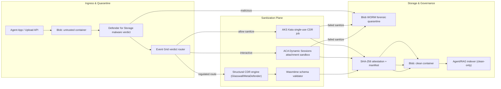
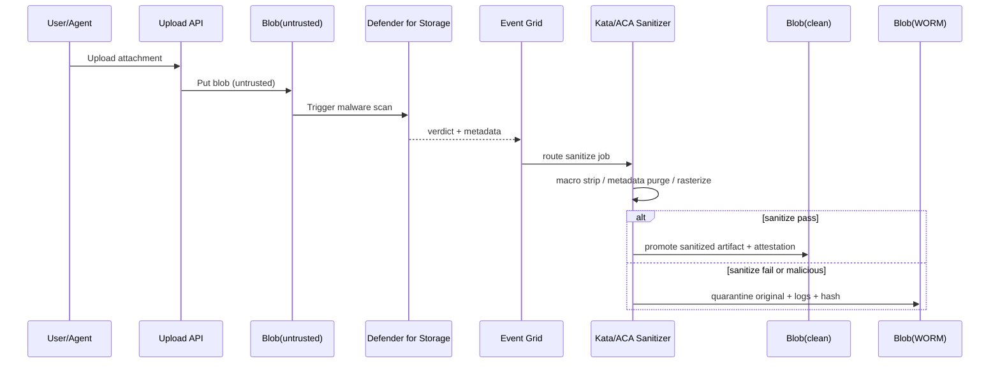
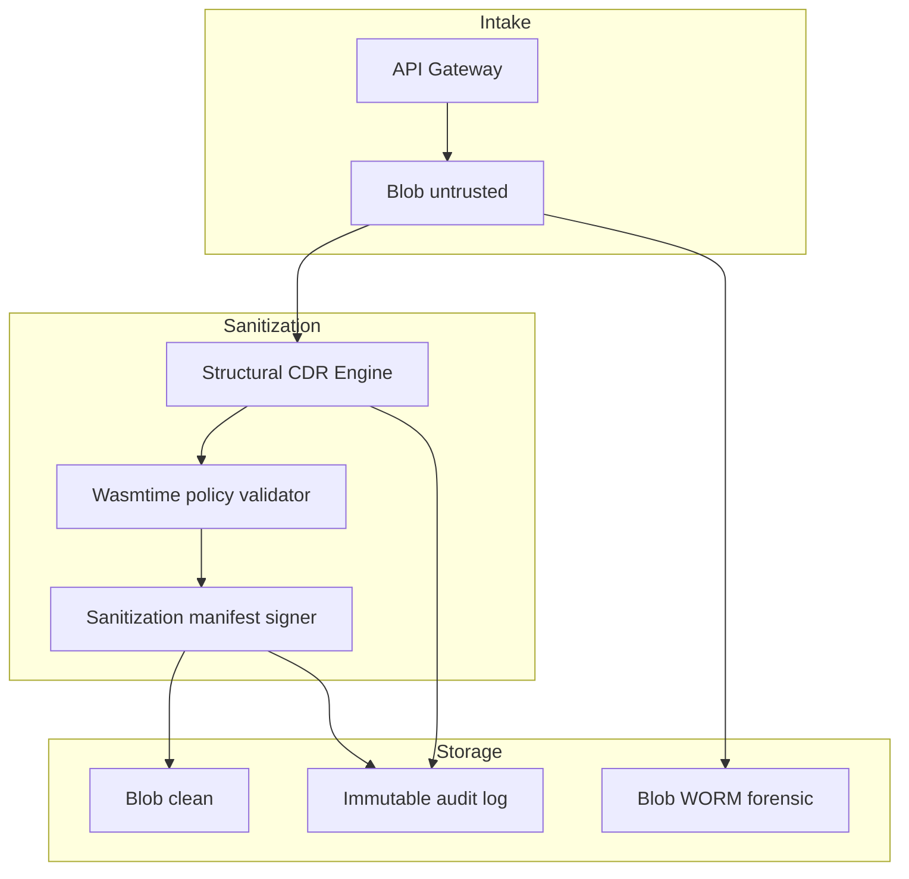

# Enterprise Untrusted File and Attachment Airlock Sandbox Selection FAQ: Defender+AKS Kata Zero-Egress CDR vs ACA Dynamic Sessions vs Managed Document Parsing vs Structural CDR + WORM

> 🌐 **Language Switch**: [中文](./untrusted-file-attachment-airlock-sandbox-defender-storage-cdr-aks-kata-vs-aca-dynamic-sessions-vs-managed-doc-parsing-selection-faq.md) | **English (current)**
> **Audience**: Cloud & AI Solution Architects, enterprise security platform teams, document-intelligence platform owners, compliance/legal teams, SOC and forensic operations.
> **Scope**: Production architecture decisions for enterprise AI agent upload intake, including dual-zone blob quarantine, Defender malware verdict routing, AKS Kata sanitization jobs, ACA per-upload hypervisor sessions, managed parsing pipelines, and sovereign-grade structural CDR with immutable forensic retention.

## 1. Problem framing: why “parse first, inspect later” fails in AI-era attachment ingestion
Once an enterprise agent platform allows user uploads of PDFs, Office documents, archives, and images, the upload endpoint becomes a high-risk execution boundary rather than a passive storage API because parser behavior itself can be the attack surface.
In AI workflows this risk amplifies quickly, since one malicious file can contaminate downstream extraction pipelines, retrieval corpora, and automated agent actions if untrusted bytes are processed before sanitization and policy gating.
Attack patterns now combine classic malware techniques with AI-specific payloads, including archive bombs, parser CVE triggers, OLE/XXE probes, hidden-layer prompt injection, and metadata channels that attempt to pivot into privileged internal endpoints.
At enterprise scale (`50K–25M` monthly attachments), even low pass-through rates can produce severe incident volume, so architecture must minimize malicious acceptance probability and provide deterministic evidence for every promotion decision.

## 2. Four architecture families and control-boundary ownership (A/B/C/D)
**Architecture A** combines dual-zone blob quarantine (`untrusted -> clean`), Defender for Storage verdict gates, and single-use AKS Kata zero-egress CDR workers for high-control enterprise sanitization.
**Architecture B** uses ACA Dynamic Sessions to create per-upload hypervisor-isolated attachment airlocks for interactive chat and code-interpreter scenarios where low latency and deterministic teardown are critical.
**Architecture C** routes Defender-cleared standard documents into managed parsing services (Document Intelligence / Content Understanding) to reduce native parser patching burden and operational attack surface.
**Architecture D** applies hardware-grade structural CDR engines plus Wasmtime schema validation and blob WORM quarantine for sovereign and regulated sectors requiring byte-level reconstruction guarantees.
Most enterprises deploy A as the baseline control plane, add B for conversational uploads, use C for standard high-volume parsing, and reserve D for highest-regulation business domains.

## 3. End-to-end reference architecture: quarantine, verdict routing, sanitization, attestation, and clean-only consumption

This architecture enforces a strict trust transition model in which no downstream AI component can read bytes that have not passed verdict routing, sanitization, and attestation controls.
By forcing clean-only indexing and preserving immutable forensic branches for failures, the platform gains both preventive protection and post-incident verifiability.

## 4. Architecture A deep dive: dual-zone blob quarantine with Defender gates and AKS Kata zero-egress CDR jobs
Architecture A is designed for organizations that need strong isolation, high programmability, and complete lifecycle control over file sanitization before promotion.
Files land first in `untrusted`, receive Defender verdict metadata, and then enter a single-use Kata job for macro stripping, metadata purge, controlled conversion, and policy-bound reconstruction.
`kata-mshv` VM boundaries combined with `NetworkPolicy deny-all`, temporary bounded storage, PID caps, and read-only root FS materially reduce parser-CVE blast radius and prevent outbound beaconing during processing.
To prevent sanitization infrastructure from becoming a persistent attack foothold, each job should process only one artifact scope, emit signed attestation, and terminate with no retained mutable state.
A is typically the primary production lane for high-volume and high-risk enterprise attachment intake.

## 5. Architecture B deep dive: interactive attachment airlock on ACA Dynamic Sessions
Architecture B is optimized for real-time conversational workflows where users upload files and expect immediate analysis in chat or agent-assisted coding contexts.
Per-upload or per-conversation Hyper-V isolated sessions deliver strong runtime boundaries with rapid startup when warm pools are maintained, making it suitable for synchronous UX-sensitive interactions.
Because B’s economics and orchestration model are session-centric, it is generally less efficient than A for very large asynchronous backlogs and should not replace dedicated batch sanitization lanes at scale.
A common pattern is B for immediate user interaction and triage, with automatic escalation of suspicious or complex artifacts into A or D for deep sanitization and forensic retention.

## 6. Architecture C deep dive: managed parsing pipeline to minimize native parser vulnerability management
Architecture C routes Defender-cleared files to managed extraction services so platform teams avoid operating fragile C/C++ parser stacks and their ongoing CVE patch cycles.
This model is highly effective for standard PDFs, Office files, and common image formats where extraction quality, SLA, and governance integration are already provided by managed services.
The control boundary must remain explicit: deeply nested archives, unusual container formats, and specialized macro execution scenarios often require custom handling outside managed parsing capabilities.
Therefore C should be treated as a standardized throughput lane, not as a universal replacement for enterprise sanitization controls in adversarial ingestion environments.

## 7. Architecture D deep dive: structural CDR with WORM quarantine for sovereign and financial regulatory workloads
Architecture D enforces a strict principle that original untrusted bytes are never forwarded downstream; only reconstructed sanitized artifacts can move into business processing lanes.
Structural CDR engines rebuild files based on safe grammar and policy templates, while Wasmtime validators ensure schema conformance and sanitizer manifest integrity before promotion.
In regulated sectors, the ability to prove sanitizer version, policy revision, input hash, output hash, and decision lineage is often as important as malware blocking itself.
D increases operational and licensing cost, but it is often economically justified where regulatory penalties and legal exposure from file-intake compromise are materially high.

## 8. 12-dimension comparison matrix: isolation, operability, economics, and evidentiary strength
| Dimension | A: Defender + AKS Kata CDR | B: ACA Dynamic Sessions | C: Managed parsing pipeline | D: Structural CDR + WORM |
|---|---|---|---|---|
| Isolation boundary strength | Very high | High | Medium | Very high |
| Interactive response latency | Medium | Very high | High | Medium-low |
| Large-batch throughput | Very high | Medium | High | High |
| Native parser ops burden | Medium-high | Medium | Very low | High |
| Deep format programmability | Very high | Medium | Medium-low | Very high |
| Macro/script sanitization control | Very high | High | Medium | Very high |
| Archive-bomb resilience | Very high | Medium-high | Medium | Very high |
| Regulatory evidentiary readiness | High | Medium-high | High | Very high |
| Cost efficiency at low duty cycle | Medium | High | Very high | Medium-low |
| Multi-tenant governance flexibility | Very high | High | Medium | High |
| Delivery complexity | Medium-high | Medium | Low | High |
| Recommended role | Core production lane | Interactive airlock lane | Standard document lane | Regulated critical lane |

## 9. Quantitative models: scan economics, expansion blast radius, queue scaling, and utilization breakpoints
Defender scan spend can be modeled as `C_scan = V_gb * p_scan`; with monthly intake `V_gb=18,000` and per-GB scanning price `p_scan=0.15 USD`, monthly scan cost is about `$2,700`, which should be treated as a first-class security operating cost.
Archive-bomb pressure can be estimated by `R_expand = size_unpacked / size_packed`; when packed payloads are tiny but projected expansion exceeds bounded scratch capacity, jobs must fail closed before extraction.
Queue-driven sanitization scaling can use `replicas = ceil(queued_files * avg_sanitize_sec / target_sla_sec)` to translate backlog into deterministic worker requirements under SLA commitments.
AKS versus ACA economics should be evaluated with utilization breakpoints (`u* = 1 - discount_pct`) and actual duty-cycle traces, because peak-driven assumptions routinely misrepresent annual all-in cost.

## 10. Reference diagram 1: upload-to-clean approval sequence with fail-closed quarantine

This sequence emphasizes that all trust transitions are explicit and policy-gated, and that failure branches are quarantined with evidence instead of retried into business lanes.

## 11. Reference diagram 2: regulated structural CDR with signed manifests and immutable forensic path

The topology is designed to satisfy evidentiary integrity requirements by binding sanitized outputs to immutable manifest records and preserving original artifacts only in controlled forensic retention.

## 12. Production configuration snippets: zero-egress Kata jobs, verdict routing, and dual-container storage controls
```yaml
apiVersion: batch/v1
kind: Job
metadata:
  name: cdr-sanitize-job
  namespace: file-airlock
spec:
  ttlSecondsAfterFinished: 120
  template:
    metadata:
      labels:
        app: cdr-sanitize
    spec:
      runtimeClassName: kata-mshv
      restartPolicy: Never
      securityContext:
        runAsNonRoot: true
      containers:
        - name: sanitizer
          image: contoso.azurecr.io/security/cdr-sanitizer:2026.11.23
          args: ["--input-blob","$(INPUT_BLOB)","--output-blob","$(OUTPUT_BLOB)"]
          env:
            - name: INPUT_BLOB
              valueFrom:
                fieldRef:
                  fieldPath: metadata.annotations['airlock/input']
          resources:
            limits:
              cpu: "2"
              memory: 4Gi
          securityContext:
            readOnlyRootFilesystem: true
            allowPrivilegeEscalation: false
            capabilities:
              drop: ["ALL"]
          volumeMounts:
            - name: scratch
              mountPath: /tmp/scratch
      volumes:
        - name: scratch
          emptyDir:
            sizeLimit: 2Gi
---
apiVersion: networking.k8s.io/v1
kind: NetworkPolicy
metadata:
  name: deny-all-egress
  namespace: file-airlock
spec:
  podSelector:
    matchLabels:
      app: cdr-sanitize
  policyTypes: ["Ingress","Egress"]
  ingress: []
  egress: []
```

```bicep
resource storage 'Microsoft.Storage/storageAccounts@2023-05-01' = {
  name: 'stairlockprod01'
  location: resourceGroup().location
  sku: { name: 'Standard_LRS' }
  kind: 'StorageV2'
}

resource untrustedContainer 'Microsoft.Storage/storageAccounts/blobServices/containers@2023-05-01' = {
  name: '${storage.name}/default/untrusted'
  properties: {
    publicAccess: 'None'
  }
}

resource cleanContainer 'Microsoft.Storage/storageAccounts/blobServices/containers@2023-05-01' = {
  name: '${storage.name}/default/clean'
  properties: {
    publicAccess: 'None'
  }
}

resource eventSub 'Microsoft.EventGrid/eventSubscriptions@2023-06-01-preview' = {
  name: 'ev-defender-verdict'
  scope: storage
  properties: {
    destination: {
      endpointType: 'WebHook'
      properties: {
        endpointUrl: 'https://airlock.contoso.com/events/defender'
      }
    }
    filter: {
      includedEventTypes: [
        'Microsoft.Security.MalwareScanningResult'
      ]
      subjectBeginsWith: '/blobServices/default/containers/untrusted/'
    }
  }
}
```
These snippets represent a minimal enforceable baseline for verdict-driven quarantine promotion and should be extended with strict RBAC separation, key rotation, and release-gated policy management in production.

## 13. Production Python example: archive bomb guard, macro/XXE/hidden-text sanitization, and SHA-256 attestation promotion
```python
import hashlib
import io
import json
import zipfile
from dataclasses import dataclass


MAX_ARCHIVE_FILES = 2000
MAX_EXPANDED_BYTES = 2 * 1024 * 1024 * 1024
MAX_DEPTH = 8


@dataclass
class SanitizeResult:
    sha256: str
    passed: bool
    reason: str
    manifest: dict


def sha256_bytes(data: bytes) -> str:
    return hashlib.sha256(data).hexdigest()


def guard_zip_bomb(blob: bytes) -> None:
    expanded = 0
    with zipfile.ZipFile(io.BytesIO(blob)) as zf:
        if len(zf.infolist()) > MAX_ARCHIVE_FILES:
            raise ValueError("too_many_entries")
        for info in zf.infolist():
            expanded += info.file_size
            if expanded > MAX_EXPANDED_BYTES:
                raise ValueError("expanded_size_exceeded")
            if info.filename.count("/") > MAX_DEPTH:
                raise ValueError("archive_depth_exceeded")


def sanitize_office_xml(text: str) -> str:
    lowered = text.lower()
    blocked_tokens = ["<vba", "ddeauto", "<!entity", "169.254.169.254", "<xmpmeta"]
    for token in blocked_tokens:
        lowered = lowered.replace(token, "[redacted]")
    return lowered


def sanitize_and_attest(blob: bytes, filename: str) -> SanitizeResult:
    if filename.endswith(".zip"):
        guard_zip_bomb(blob)
    text = blob.decode("utf-8", errors="ignore")
    cleaned = sanitize_office_xml(text).encode("utf-8")
    digest = sha256_bytes(cleaned)
    manifest = {
        "file_name": filename,
        "sha256_clean": digest,
        "pipeline_version": "airlock-2026.11.23",
        "actions": ["macro-strip", "xxe-redact", "hidden-text-redact"],
    }
    return SanitizeResult(sha256=digest, passed=True, reason="ok", manifest=manifest)


def promote_to_clean(result: SanitizeResult) -> str:
    if not result.passed:
        raise ValueError("sanitize_failed")
    return json.dumps(result.manifest, ensure_ascii=False)
```
The sequence “guard before parse, sanitize before promote, attest before index” should be treated as a hard invariant in enterprise ingestion architecture to prevent silent trust bypass.

## 14. Enterprise scenarios and 3-year TCO: insurance claims intake and sovereign public-service portals
### 14.1 Scenario A: insurance claims intake with high volume and heterogeneous file formats
An insurance provider processing around `2M` monthly claim attachments faced recurring parser instability and archive-bomb saturation risk during seasonal spikes, with incident investigations showing that early parsing of untrusted payloads was the dominant failure amplifier.
After implementing A+C, all artifacts were verdict-gated and deeply sanitized before managed extraction, reducing replayed failures and preventing raw untrusted content from entering claim-assistant indexing paths.
The team also improved incident response quality by linking each promoted file to signed sanitization manifests, shrinking forensic turnaround from day-scale to hour-scale operations.

### 14.2 Scenario B: sovereign and regulated submission portals with strict evidence requirements
A regulated public-sector intake channel required demonstrable proof that every accepted file passed deterministic sanitization controls and that original suspicious bytes remained immutable for legal review.
By adopting D, original artifacts were retained in WORM forensic storage while only reconstructed safe outputs were consumed by downstream systems, reducing legal ambiguity and improving audit defensibility.
This model also reduced policy disputes during regulator review because sanitizer version, hash lineage, and decision metadata were cryptographically traceable.

### 14.3 3-year TCO (`50K / 2M / 25M` monthly attachment tiers)
| 3-year cost item | A | B | C | D |
|---|---:|---:|---:|---:|
| Compute and execution runtime | `$1.84M` | `$1.26M` | `$0.92M` | `$2.21M` |
| Security verdict and scanning | `$0.73M` | `$0.69M` | `$0.71M` | `$0.75M` |
| Parser/sanitizer maintenance | `$0.88M` | `$0.62M` | `$0.31M` | `$1.34M` |
| Compliance and forensic operations | `$0.47M` | `$0.55M` | `$0.49M` | `$0.29M` |
| Incident containment and recovery | `$0.39M` | `$0.44M` | `$0.52M` | `$0.24M` |
| Total 3-year cost | `$4.31M` | `$3.56M` | `$2.95M` | `$4.83M` |

Pure cost ranking can favor C, but in high-regulation workloads D often wins on risk-adjusted value due to superior evidentiary guarantees and lower severe-incident exposure.

## 15. Worked quantitative Q&A (6) plus Day-0/Day-2 operational checklists
### 15.1 Worked quantitative Q&A (6)
**Q1: How should Defender scan cost be forecasted and budgeted?** Use `C_scan = V_gb * p_scan`; with monthly volume `18,000GB` and `p_scan=0.15 USD/GB`, monthly spend is `$2,700` and annualized spend is about `$32,400`, which must be included in baseline security operating cost models rather than treated as incidental.

**Q2: How are archive-bomb guardrails translated into deterministic reject policy?** Define `R_expand = size_unpacked / size_packed` and enforce bounded extraction with `B_cap = min(tmpfs_limit, expanded_limit)`; if projected expansion exceeds `B_cap`, reject before extraction and route artifact to forensic quarantine.

**Q3: How many AKS Kata sanitization workers are needed for a backlog SLA?** Apply `replicas = ceil(queued_files * avg_sanitize_sec / target_sla_sec)`; with `queued=8,000`, `avg=4.5s`, and `target=600s`, required replicas are around `60`, which provides a concrete pre-peak scaling baseline.

**Q4: How should ACA warm pool size be estimated for interactive upload lanes?** Use `warm_pool = ceil(arrival_rate_per_sec * p95_startup_sec * safety_factor)`; with `3.5/s`, `0.28s`, and `1.4`, warm pool requirement is approximately `2`, so practical provisioning should target `3–4` instances for burst tolerance.

**Q5: How is AKS versus ACA economic breakpoint evaluated for this workload class?** With utilization breakpoint `u* = 1 - discount_pct`, a `42%` effective commitment discount yields `u*=0.58`; above this sustained utilization, AKS usually provides better economics, while lower and bursty duty cycles favor ACA elasticity.

**Q6: How do we evaluate whether structural CDR’s added cost is justified?** Compute `NetBenefit = (Loss_avoided + Audit_savings) - CDR_extra_cost`; if annual avoided loss is `$0.9M`, audit savings are `$0.25M`, and incremental CDR cost is `$0.62M`, net annual benefit is about `$0.53M`, indicating positive risk-adjusted return.

### 15.2 Day-0 go-live checklist
1. Create strict `untrusted/clean/worm` container separation and deny business read access to `untrusted`.
2. Deploy Defender verdict event routing and enforce fail-closed policy transitions.
3. Enforce zero-egress Kata job runtime controls and bounded scratch resources.
4. Standardize signed attestation schema (hashes, policy revision, engine version, timestamps).
5. Enforce clean-only downstream indexing and retrieval ingestion contracts.

### 15.3 Day-2 operations checklist
1. Review verdict hit rate, sanitize failure rate, and false-positive drift weekly.
2. Patch parser/sanitizer dependencies and validate regression baseline monthly.
3. Continuously replay archive-bomb, macro, XXE, and hidden-text adversarial samples.
4. Verify WORM retention and audit-log completeness on schedule.
5. Execute capacity rehearsals and tune scaling thresholds before known traffic peaks.

### 15.4 Good fit vs Not for
This architecture family is a strong fit for enterprises with high-risk upload ingress, cross-system AI consumption paths, and strict compliance obligations because it enforces trust transitions at the earliest possible boundary.
It is not ideal to deploy full structural CDR everywhere for low-risk, low-volume internal-only document flows; those environments often benefit from a staged A/C approach with explicit upgrade paths to D where justified.

### 15.5 Audit field mapping (example)
| Field | Source layer | Governance purpose | Minimum retention |
|---|---|---|---|
| `upload_id` | API | Upload transaction identity | 3 years |
| `tenant_id` | API | Tenant attribution | 3 years |
| `source_ip` | Gateway | Ingress traceability | 1 year |
| `file_sha256_raw` | Ingress | Original artifact fingerprint | 5 years |
| `defender_verdict` | Defender | Malware decision evidence | 5 years |
| `verdict_timestamp` | Event Grid | Decision timeline evidence | 5 years |
| `sanitize_engine` | Worker | Engine attribution | 5 years |
| `sanitize_policy_version` | Worker | Policy revision evidence | 5 years |
| `file_sha256_clean` | Clean | Promoted artifact fingerprint | 5 years |
| `cdr_rebuild_flag` | CDR | Rebuild-path indicator | 5 years |
| `macro_strip_count` | Worker | Macro sanitization metric | 3 years |
| `xxe_block_count` | Worker | XXE sanitization metric | 3 years |
| `hidden_text_redact_count` | Worker | Hidden-layer cleanup metric | 3 years |
| `zip_expand_ratio` | Worker | Bomb-risk metric | 2 years |
| `tmpfs_peak_bytes` | Runtime | Resource pressure evidence | 2 years |
| `pids_peak` | Runtime | Process-fork pressure evidence | 2 years |
| `network_egress_bytes` | Runtime | Zero-egress compliance proof | 2 years |
| `promotion_result` | Airlock | Final disposition trace | 5 years |
| `worm_object_uri` | WORM | Forensic object locator | 7 years |
| `attestation_manifest_id` | Governance | Signed manifest linkage | 7 years |

### 15.6 Runtime alert dictionary (example)
| Alert key | Trigger condition | Immediate action | Primary owner |
|---|---|---|---|
| `verdict_delay_spike` | Verdict latency spike | Check Defender/Event Grid path | Security platform |
| `sanitize_fail_rate_high` | Sanitization failure rate above threshold | Roll back recent rule set | Platform SRE |
| `zip_bomb_detected` | Archive-bomb signature detected | Quarantine and escalate | SOC |
| `macro_injection_spike` | Macro injection surge | Raise ingress strictness | Threat analysis |
| `xxe_probe_detected` | XXE probe detected | Update parser guard policy | AppSec |
| `imds_probe_detected` | `169.254.169.254` probe found | Audit and block source | Network security |
| `egress_nonzero` | Non-zero egress from sanitizer | Immediate job isolation | Runtime security |
| `worm_write_fail` | WORM write failure | Switch to backup retention path | Storage team |
| `attestation_gap` | Missing signed manifest | Block promotion to clean | Compliance operations |
| `queue_backlog_growth` | Persistent queue growth | Scale and reprioritize workload | On-call operations |
| `cpu_throttle_high` | CPU throttling sustained high | Rebalance requests/limits | Platform engineering |
| `memory_pressure_high` | Memory pressure crossing threshold | Reduce parallelism and file limits | Platform engineering |
| `pids_limit_hit` | PID cap frequently hit | Inspect exploit patterns | Security on-call |
| `false_positive_rise` | False-positive trend increase | Tune rules and allowlist process | Security governance |
| `false_negative_suspect` | Suspected false negatives | Trigger human sampling review | Risk control |
| `policy_drift_detected` | Production policy drift | Trigger GitOps reconciliation | Release manager |
| `clean_access_violation` | Untrusted read by business principal | Revoke access immediately | IAM admin |
| `forensic_log_gap` | Forensic log coverage gap | Backfill logs and freeze release | Audit operations |
| `cost_outlier_scan` | Scan cost anomaly | Inspect duplicate uploads and abuse | FinOps |
| `incident_backlog_growth` | SOC case backlog growth | Increase shift coverage and automation | SOC lead |
