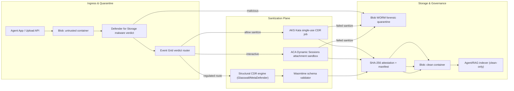
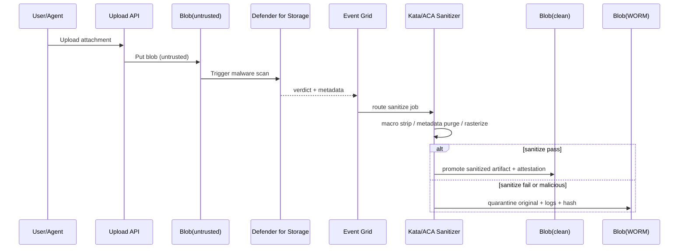
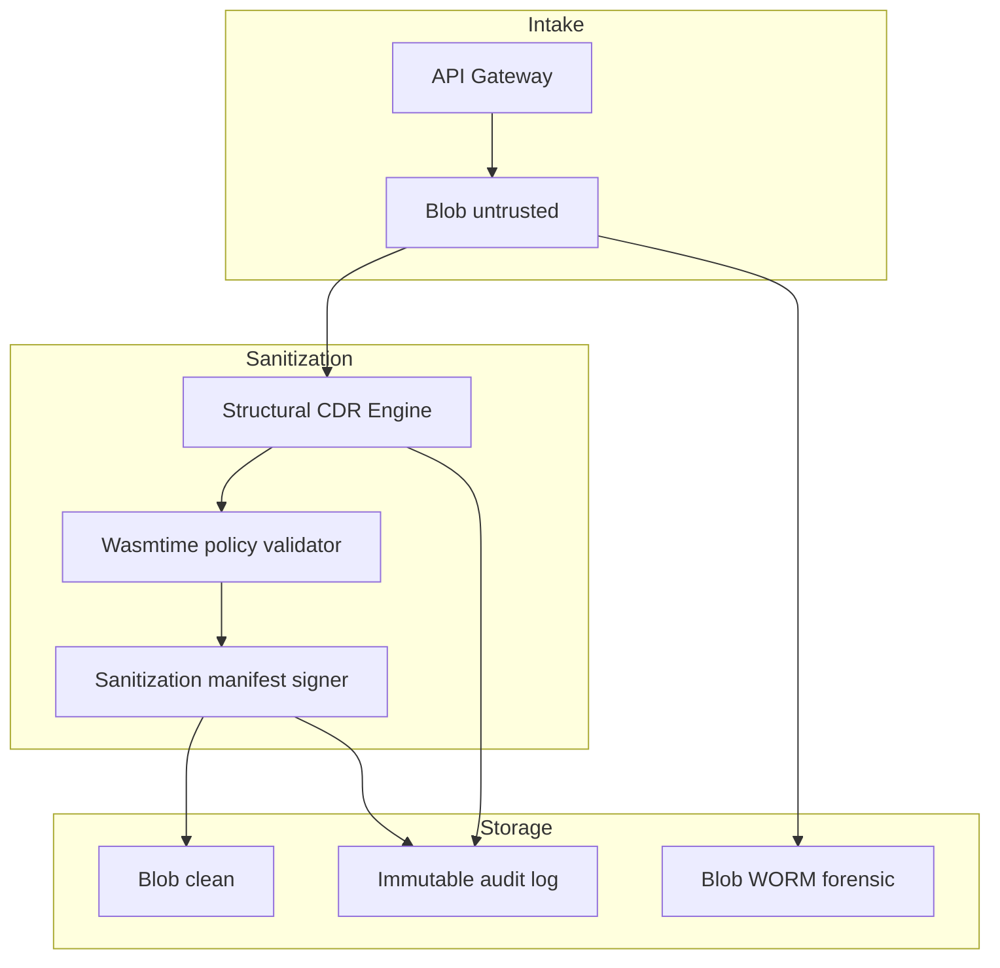

# 企业不可信文件与附件隔离净化沙箱选型 FAQ：Defender+AKS Kata CDR Airlock vs ACA Dynamic Sessions vs 托管文档解析 vs 结构化 CDR + WORM

> 🌐 **Language Switch**：**中文（当前）** | [English](./untrusted-file-attachment-airlock-sandbox-defender-storage-cdr-aks-kata-vs-aca-dynamic-sessions-vs-managed-doc-parsing-selection-faq.en.md)
> **受众**：Cloud & AI Solution Architect、企业安全平台团队、文档智能平台团队、合规与法务团队、SOC 与取证团队。
> **范围**：面向企业 AI Agent 文件上传入口，比较双区 Blob 隔离与 Defender 判定、AKS Kata 零出网 CDR、ACA Dynamic Sessions 会话隔离、托管文档解析链路、以及金融/政务级结构化 CDR 与 WORM 取证留存。

## 1. 问题定义：为什么“先解析再判断”会成为 AI 文件入口的系统性风险
企业 Agent 系统一旦允许用户上传 PDF、Office、ZIP、图像和邮件附件，上传入口就不再是简单存储接口，而是一个高风险代码与内容混合执行面，因为解析器本身就可能成为攻击链中的第一跳。

传统“收件后立即解析”模式在 AI 场景中风险被放大：一方面存在恶意归档炸弹、宏、XXE、嵌入式外链与隐藏文本注入，另一方面 Agent 与 RAG 流程会把解析结果继续传播到下游模型、索引与自动化执行系统，导致单次入口失守形成跨系统污染。

尤其在大规模企业应用中，文件入口每月可达 `50K–25M` 附件，攻击者只需较低命中率即可触发可观事件量，因此架构设计必须把“恶意样本通过率”压到极低，并确保每个文件的状态迁移、哈希和净化证据可审计、可复算、可追责。

本指南聚焦“文件先隔离、再判定、再净化、后放行”的生产级治理路径，避免把不可信字节直接暴露给业务 Agent、模型推理沙箱或索引流水线。

## 2. 四类架构路径与控制边界（A/B/C/D）
**Architecture A**：双容器 Blob（`untrusted -> clean`）+ Defender for Storage 上传判定 + Event Grid 审批门 + AKS Kata 单次作业净化器，核心是强隔离、强可控、强取证。

**Architecture B**：ACA Dynamic Sessions 按会话/附件启动 Hyper-V 隔离环境，适配交互式上传场景，强调低时延回馈和会话级生命周期销毁。

**Architecture C**：Defender 判定后走托管文档智能解析（Document Intelligence/Content Understanding），最大化减少自管原生解析器面，适配标准格式大规模处理。

**Architecture D**：Glasswall/MetaDefender 级结构化 CDR + Wasmtime 语义验证 + Blob WORM 取证区，面向金融、保险、政务等高监管场景，以“永不下发原始字节”为核心原则。

企业常见落地是 A 作为基础底座，B 覆盖交互式会话，C 覆盖标准文档批处理，D 覆盖监管敏感业务线。

## 3. 端到端参考架构：上传隔离、恶意判定、净化重建与安全放行闭环

该拓扑强调“解析与净化永远在隔离域内完成”，并且 `INDEX` 只接收 clean 区对象，从架构上消除未净化字节直接进入模型系统的路径。

在监管场景中，`WORM` 区与 `attestation` 清单是审计核心，既用于事件回放，也用于证明某文件是否经过了标准化净化流程与策略版本。

## 4. Architecture A：双区 Blob + Defender 判定 + AKS Kata 零出网 CDR 作业
A 路径适合高安全与高可编排需求企业，它把上传对象先写入 `untrusted`，等待 Defender verdict，再由 Event Grid 触发一次性 Kata Job 进行宏剥离、元数据清理、页面栅格化与格式重建。

Kata `kata-mshv` 提供硬件级 VM 边界，配合 `NetworkPolicy deny-all`、`emptyDir sizeLimit`、`pidsLimit` 和只读根文件系统，可显著降低解析器 CVE、归档炸弹和 SSRF 探测的横向扩散概率。

为了防止“净化过程本身”变成持久攻击驻点，作业必须做到单文件单实例、完成即销毁，并将所有中间产物限定在临时卷中，禁止写回共享持久卷。

该架构在 `2M+` 月上传规模下仍可通过队列分片与 KEDA 扩缩容维持稳定吞吐，且具备最完整的可观测与取证能力。

## 5. Architecture B：ACA Dynamic Sessions 会话级附件 Airlock
B 路径适用于聊天或交互式 Copilot 场景，用户上传后在 `conversation_id` 对应的 Hyper-V session 内同步执行轻量净化与解析，满足“快速反馈 + 隔离执行”的用户体验目标。

其优势是 warm pool 命中后可在亚秒级完成会话激活，且每次会话边界天然隔离，适合处理用户即时查看、临时分析和单次工具调用。

但它不应承担超大规模离线批处理主通道，因为 session 生命周期与成本模型更偏交互式；对于高峰批量处理，仍建议由 A 或 D 提供主生产线。

在工程实践中，B 常与 A 组合：交互式场景先在 B 进行预清洗与策略检查，再将可疑样本转入 A 的深度净化流水线。

## 6. Architecture C：托管文档解析链路（零自管原生解析器）
C 路径通过 Defender 判定后，把对象送往 Document Intelligence 或 Content Understanding 等托管能力，避免企业团队维护 Poppler、LibreOffice、ImageMagick 等高频 CVE 组件。

该模式显著降低二进制依赖维护成本，特别适合标准化 PDF/Office/图像解析与字段抽取场景，且能快速接入企业身份、审计和配额体系。

边界也必须清晰：对深层嵌套 ZIP、特定 MSG 容器、复杂自定义宏执行路径或专有格式重建，托管管线通常不提供完整可编程控制，这些场景仍需 A 或 D 兜底。

因此 C 更适合“标准文档规模化解析”而非“全格式全攻击面防护”，架构上应配合入口分流策略使用。

## 7. Architecture D：结构化 CDR + WORM 取证的监管级路径
D 路径要求“永不将原始不可信字节直接放行”，而是通过 CDR 引擎按格式规范重建安全文件，配合 Wasmtime 规则校验和哈希签名生成净化证明。

在金融与政务场景，监管关注的不只是是否拦截恶意样本，更关注“是否可证明每一次放行都经过同一套策略与引擎版本”，因此 D 的清单签名与 WORM 留存非常关键。

D 的代价是更高的基础设施与许可证成本，以及策略运维复杂度上升，但在高罚则行业，这些成本往往低于一次严重文件入口事故带来的合规和品牌损失。

建议把 D 作为高敏业务域专用通道，并通过统一路由网关确保可疑或高风险格式自动进入 D。

## 8. 12 维对比矩阵：隔离强度、可编排性、成本与合规审计能力
| 维度 | A：Defender + AKS Kata CDR | B：ACA Dynamic Sessions | C：托管文档解析 | D：结构化 CDR + WORM |
|---|---|---|---|---|
| 隔离边界强度 | 很高 | 高 | 中 | 很高 |
| 交互体验时延 | 中 | 很高 | 高 | 中低 |
| 大规模批处理吞吐 | 很高 | 中 | 高 | 高 |
| 原生解析器运维负担 | 中高 | 中 | 很低 | 高 |
| 深度格式可编程控制 | 很高 | 中 | 中低 | 很高 |
| 宏/脚本净化可控性 | 很高 | 高 | 中 | 很高 |
| 归档炸弹防护能力 | 很高 | 中高 | 中 | 很高 |
| 取证与监管可证明性 | 高 | 中高 | 高 | 很高 |
| 单位处理成本（低占空比） | 中 | 高 | 很高 | 中低 |
| 多租户治理灵活性 | 很高 | 高 | 中 | 高 |
| 上线复杂度 | 中高 | 中 | 低 | 高 |
| 推荐定位 | 生产主通道 | 交互会话通道 | 标准文档规模化 | 高监管专用通道 |

## 9. 定量模型：扫描成本、爆炸半径与扩缩容估算
Defender for Storage 扫描成本可近似 `C_scan = V_gb * p_scan`，若月上传体量 `V_gb=18,000` 且单 GB 扫描价 `p_scan=0.15 USD`，则月扫描成本约 `$2,700`；该成本应纳入总入口防护预算，而非归入“可忽略运营费”。

归档炸弹扩张比可定义为 `R_expand = size_unpacked / size_packed`，若 `42.zip` 类样本压缩后 `42KB`、解压后潜在 `4.5PB`，`R_expand` 远超系统阈值，必须在解压前执行目录深度、文件计数和总展开字节上限检查。

KEDA 队列扩容可按 `replicas = ceil(queued_files * avg_sanitize_sec / target_sla_sec)`，例如积压 `8,000` 文件、平均 `4.5s`、目标 `600s` 清空，则副本约 `60`；这类公式应固化进峰值应急预案。

AKS 与 ACA 的月度经济断点可用占空比估算：当持续利用率高于某阈值（例如 `u*>0.58`）时，AKS 预留容量通常更优；低占空比交互场景则 ACA 更具成本弹性。

## 10. 参考图一：上传文件从不可信区到 clean 区的审批时序

该时序强调所有安全决策都在“放行之前”完成，并且失败分支直接进入取证留存而不是重试放行，避免灰色状态文件进入业务链路。

## 11. 参考图二：监管级结构化 CDR 与策略签名拓扑

该拓扑使“净化策略版本、输出哈希、放行决策”形成完整链路证据，满足高监管行业对可证明性的要求。

## 12. 生产配置示例：Blob 双区权限、Event Grid Verdict 路由与 AKS Kata 零出网作业
```yaml
apiVersion: batch/v1
kind: Job
metadata:
  name: cdr-sanitize-job
  namespace: file-airlock
spec:
  ttlSecondsAfterFinished: 120
  template:
    metadata:
      labels:
        app: cdr-sanitize
    spec:
      runtimeClassName: kata-mshv
      restartPolicy: Never
      securityContext:
        runAsNonRoot: true
      containers:
        - name: sanitizer
          image: contoso.azurecr.io/security/cdr-sanitizer:2026.11.23
          args: ["--input-blob","$(INPUT_BLOB)","--output-blob","$(OUTPUT_BLOB)"]
          env:
            - name: INPUT_BLOB
              valueFrom:
                fieldRef:
                  fieldPath: metadata.annotations['airlock/input']
          resources:
            limits:
              cpu: "2"
              memory: 4Gi
          securityContext:
            readOnlyRootFilesystem: true
            allowPrivilegeEscalation: false
            capabilities:
              drop: ["ALL"]
          volumeMounts:
            - name: scratch
              mountPath: /tmp/scratch
      volumes:
        - name: scratch
          emptyDir:
            sizeLimit: 2Gi
---
apiVersion: networking.k8s.io/v1
kind: NetworkPolicy
metadata:
  name: deny-all-egress
  namespace: file-airlock
spec:
  podSelector:
    matchLabels:
      app: cdr-sanitize
  policyTypes: ["Ingress","Egress"]
  ingress: []
  egress: []
```

```bicep
resource storage 'Microsoft.Storage/storageAccounts@2023-05-01' = {
  name: 'stairlockprod01'
  location: resourceGroup().location
  sku: { name: 'Standard_LRS' }
  kind: 'StorageV2'
}

resource untrustedContainer 'Microsoft.Storage/storageAccounts/blobServices/containers@2023-05-01' = {
  name: '${storage.name}/default/untrusted'
  properties: {
    publicAccess: 'None'
  }
}

resource cleanContainer 'Microsoft.Storage/storageAccounts/blobServices/containers@2023-05-01' = {
  name: '${storage.name}/default/clean'
  properties: {
    publicAccess: 'None'
  }
}

resource eventSub 'Microsoft.EventGrid/eventSubscriptions@2023-06-01-preview' = {
  name: 'ev-defender-verdict'
  scope: storage
  properties: {
    destination: {
      endpointType: 'WebHook'
      properties: {
        endpointUrl: 'https://airlock.contoso.com/events/defender'
      }
    }
    filter: {
      includedEventTypes: [
        'Microsoft.Security.MalwareScanningResult'
      ]
      subjectBeginsWith: '/blobServices/default/containers/untrusted/'
    }
  }
}
```
上述配置展示了“零出网执行 + 事件判定路由 + 双区存储分层”的最小可落地骨架，生产环境应再叠加 RBAC 最小权限和密钥轮换策略。

## 13. 生产 Python 示例：归档炸弹防护、宏/XXE/隐藏文本净化与 SHA-256 晋升清单
```python
import hashlib
import io
import json
import zipfile
from dataclasses import dataclass


MAX_ARCHIVE_FILES = 2000
MAX_EXPANDED_BYTES = 2 * 1024 * 1024 * 1024
MAX_DEPTH = 8


@dataclass
class SanitizeResult:
    sha256: str
    passed: bool
    reason: str
    manifest: dict


def sha256_bytes(data: bytes) -> str:
    return hashlib.sha256(data).hexdigest()


def guard_zip_bomb(blob: bytes) -> None:
    expanded = 0
    with zipfile.ZipFile(io.BytesIO(blob)) as zf:
        if len(zf.infolist()) > MAX_ARCHIVE_FILES:
            raise ValueError("too_many_entries")
        for info in zf.infolist():
            expanded += info.file_size
            if expanded > MAX_EXPANDED_BYTES:
                raise ValueError("expanded_size_exceeded")
            if info.filename.count("/") > MAX_DEPTH:
                raise ValueError("archive_depth_exceeded")


def sanitize_office_xml(text: str) -> str:
    lowered = text.lower()
    blocked_tokens = ["<vba", "ddeauto", "<!entity", "169.254.169.254", "<xmpmeta"]
    for token in blocked_tokens:
        lowered = lowered.replace(token, "[redacted]")
    return lowered


def sanitize_and_attest(blob: bytes, filename: str) -> SanitizeResult:
    if filename.endswith(".zip"):
        guard_zip_bomb(blob)
    text = blob.decode("utf-8", errors="ignore")
    cleaned = sanitize_office_xml(text).encode("utf-8")
    digest = sha256_bytes(cleaned)
    manifest = {
        "file_name": filename,
        "sha256_clean": digest,
        "pipeline_version": "airlock-2026.11.23",
        "actions": ["macro-strip", "xxe-redact", "hidden-text-redact"],
    }
    return SanitizeResult(sha256=digest, passed=True, reason="ok", manifest=manifest)


def promote_to_clean(result: SanitizeResult) -> str:
    if not result.passed:
        raise ValueError("sanitize_failed")
    return json.dumps(result.manifest, ensure_ascii=False)
```
该示例展示了“先守门、再净化、后签名”的执行顺序，避免在未完成风险判定前直接把附件内容暴露给下游 Agent 工具链。

## 14. 企业场景与三年 TCO：保险理赔入口与政务公开材料通道
### 14.1 场景一：保险理赔上传入口（高并发、格式复杂）
某保险机构月均接收 `2M` 理赔附件，包含扫描件、压缩包和 Office 说明材料，历史上在促销季出现过归档炸弹导致解析集群阻塞。

引入 A + C 组合后，所有文件先经 Defender 判定和 AKS Kata 深度净化，再将标准化文档送入托管解析，恶意通过率与解析失败重试率均明显下降。

该机构通过 clean-only 索引策略把“未净化字节误入知识库”风险压到可接受范围，并将审计取证时间由天级缩短到小时级。

### 14.2 场景二：政务与金融监管通道（高合规、强取证）
某公共服务门户要求对外提交材料“可受理、可追溯、可核验”，并对每次文件净化保留策略版本、哈希和重建证明。

部署 D 路径后，原始样本仅进入 WORM 区，外部流程只消费重建后的 clean 文件，显著降低了下游系统遭受恶意样本二次传播的风险。

该模式使监管抽查时可直接提交净化清单链和签名证据，减少人工解释与争议成本。

### 14.3 三年 TCO（`50K/2M/25M` 月附件分层）
| 成本项（3 年） | A | B | C | D |
|---|---:|---:|---:|---:|
| 计算与执行环境 | `$1.84M` | `$1.26M` | `$0.92M` | `$2.21M` |
| 安全判定与扫描 | `$0.73M` | `$0.69M` | `$0.71M` | `$0.75M` |
| 解析/净化引擎维护 | `$0.88M` | `$0.62M` | `$0.31M` | `$1.34M` |
| 合规审计与取证 | `$0.47M` | `$0.55M` | `$0.49M` | `$0.29M` |
| 安全事件处置损耗 | `$0.39M` | `$0.44M` | `$0.52M` | `$0.24M` |
| 三年综合成本 | `$4.31M` | `$3.56M` | `$2.95M` | `$4.83M` |

从纯成本看 C 最低，但在高监管场景中 D 的“高可证明性”价值常超过其基础成本差异，企业应按风险与法规约束做组合决策。

## 15. 定量 Q&A（6 项）+ Day-0/Day-2 清单
### 15.1 定量 Q&A（6 项）
**Q1：如何估算 Defender 扫描成本并纳入预算？**可用 `C_scan = V_gb * p_scan`。若月体量 `18,000GB`、单价 `0.15 USD/GB`，则月成本约 `$2,700`，年成本约 `$32,400`。该值应与净化计算成本合并评估，避免只看 compute 忽略扫描费用。

**Q2：归档炸弹防护阈值如何定量设置？**可定义 `R_expand = size_unpacked / size_packed` 与 `B_cap = min(tmpfs_limit, expanded_limit)`。当 `R_expand` 远超阈值且 `size_unpacked > B_cap`，应直接拒绝并隔离。若 `tmpfs_limit=2GB`、`expanded_limit=2GB`，则任何预测展开超过 `2GB` 的样本都不进入解析流程。

**Q3：AKS Kata 批处理扩容如何估算副本数？**`replicas = ceil(queued_files * avg_sanitize_sec / target_sla_sec)`。例如 `queued=8,000`、`avg=4.5s`、`target=600s`，副本约 `60`。这个公式可用于峰值活动前压测计划和自动扩容上限校准。

**Q4：ACA 会话池应保留多少 warm 实例？**可用 `warm_pool = ceil(arrival_rate_per_sec * p95_startup_sec * safety_factor)`。若到达率 `3.5/s`、`p95_startup=0.28s`、`safety=1.4`，则 warm 池约 `2`，实际可取 `3–4` 以覆盖突发波动。

**Q5：AKS 与 ACA 的经济断点怎么判断？**可用占空比断点 `u* = 1 - discount_pct`。若承诺折扣 `42%`，则 `u*=0.58`；长期利用率高于 `58%` 常偏向 AKS，低于该值偏向 ACA 弹性模型。

**Q6：结构化 CDR 的“额外成本”如何衡量是否值得？**可定义 `NetBenefit = (Loss_avoided + Audit_savings) - CDR_extra_cost`。若年避免损失 `$0.9M`、审计节省 `$0.25M`、额外成本 `$0.62M`，净收益约 `$0.53M`，则在高监管业务线具备明确经济合理性。

### 15.2 Day-0 上线清单
1. 建立 `untrusted/clean/worm` 三类容器与最小权限 RBAC，禁止业务系统读取 untrusted 区。
2. 部署 Defender verdict 到 Event Grid 的路由过滤，确保恶意与待净化样本分流正确。
3. 为 AKS Kata 作业落地零出网策略、资源上限与临时卷限制。
4. 规范净化清单字段（哈希、策略版本、引擎版本、时间戳）并统一签名。
5. 将 RAG/Agent 索引器改为 clean-only 输入并加入前置校验。

### 15.3 Day-2 运行清单
1. 周度复盘恶意命中率、净化失败率、误报率和平均处理时延。
2. 月度轮换解析组件与策略规则，验证回归基线不退化。
3. 持续演练 ZIP 炸弹、宏注入、XXE 和隐藏文本攻击样本。
4. 定期核查 WORM 留存和审计日志完整性，防止证据链断裂。
5. 对高峰附件流量做容量演练，校准扩缩容阈值与预算告警。

### 15.4 Good fit vs Not for
该架构族特别适合存在高风险上传入口、跨部门 Agent 消费链路和明确审计要求的企业环境，因为它在入口阶段就切断了未净化字节的传播路径。

对于仅低量、低敏、标准格式的内部文档场景，直接构建 D 级结构化 CDR 可能过重，可先采用 C 或 A 组合并保留升级路径。

### 15.5 审计字段映射（示例）
| 字段 | 来源层 | 用途 | 最低保留期 |
|---|---|---|---|
| `upload_id` | API | 上传唯一标识 | 3 年 |
| `tenant_id` | API | 租户归属 | 3 年 |
| `source_ip` | Gateway | 入口追踪 | 1 年 |
| `file_sha256_raw` | Ingress | 原始样本指纹 | 5 年 |
| `defender_verdict` | Defender | 恶意判定结果 | 5 年 |
| `verdict_timestamp` | Event Grid | 判定时间证据 | 5 年 |
| `sanitize_engine` | Worker | 引擎归因 | 5 年 |
| `sanitize_policy_version` | Worker | 策略版本 | 5 年 |
| `file_sha256_clean` | Clean | 放行文件指纹 | 5 年 |
| `cdr_rebuild_flag` | CDR | 是否重建 | 5 年 |
| `macro_strip_count` | Worker | 宏剥离统计 | 3 年 |
| `xxe_block_count` | Worker | XXE 拦截统计 | 3 年 |
| `hidden_text_redact_count` | Worker | 隐藏文本净化统计 | 3 年 |
| `zip_expand_ratio` | Worker | 炸弹风险指标 | 2 年 |
| `tmpfs_peak_bytes` | Runtime | 资源压力证据 | 2 年 |
| `pids_peak` | Runtime | 进程爆炸监控 | 2 年 |
| `network_egress_bytes` | Runtime | 零出网合规校验 | 2 年 |
| `promotion_result` | Airlock | 放行/隔离结果 | 5 年 |
| `worm_object_uri` | WORM | 取证定位 | 7 年 |
| `attestation_manifest_id` | Governance | 清单链路追踪 | 7 年 |

### 15.6 运行告警字典（示例）
| 告警键 | 触发条件 | 处置动作 | 责任角色 |
|---|---|---|---|
| `verdict_delay_spike` | 判定时延突增 | 检查 Defender/Event Grid | 安全平台 |
| `sanitize_fail_rate_high` | 净化失败率超阈 | 回滚最近规则变更 | 平台 SRE |
| `zip_bomb_detected` | 炸弹样本命中 | 强制隔离并告警 | SOC |
| `macro_injection_spike` | 宏注入激增 | 提升入口拦截等级 | 威胁分析 |
| `xxe_probe_detected` | XXE 探针命中 | 更新解析器策略 | 应用安全 |
| `imds_probe_detected` | `169.254.169.254` 访问迹象 | 审计并封禁来源 | 网络安全 |
| `egress_nonzero` | 零出网策略被破坏 | 立即阻断作业 | 运行时安全 |
| `worm_write_fail` | WORM 写入失败 | 切换备援存储 | 存储团队 |
| `attestation_gap` | 清单缺失 | 阻断 clean 放行 | 合规团队 |
| `queue_backlog_growth` | 待处理队列持续增长 | 扩容并分级处理 | 运维值班 |
| `cpu_throttle_high` | CPU 节流超阈 | 调整资源请求 | 平台工程 |
| `memory_pressure_high` | 内存压力过高 | 降低并发与文件上限 | 平台工程 |
| `pids_limit_hit` | 进程上限频繁触发 | 排查恶意样本模式 | 安全值班 |
| `false_positive_rise` | 误报率上升 | 校正规则与白名单 | 安全治理 |
| `false_negative_suspect` | 可疑漏报 | 启动人工复核抽样 | 风险控制 |
| `policy_drift_detected` | 策略漂移 | 触发 GitOps 回正 | 发布经理 |
| `clean_access_violation` | 业务访问 untrusted 区 | 立即吊销权限 | IAM 管理员 |
| `forensic_log_gap` | 取证日志缺口 | 补采并锁定版本 | 审计平台主管 |
| `cost_outlier_scan` | 扫描成本异常 | 排查流量与冗余上传 | FinOps |
| `incident_backlog_growth` | 安全工单积压 | 增配值班与自动化 | SOC 主管 |
