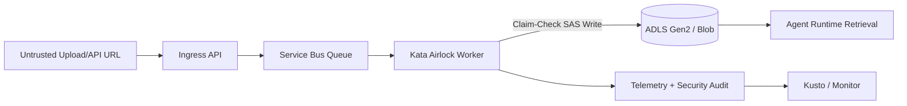
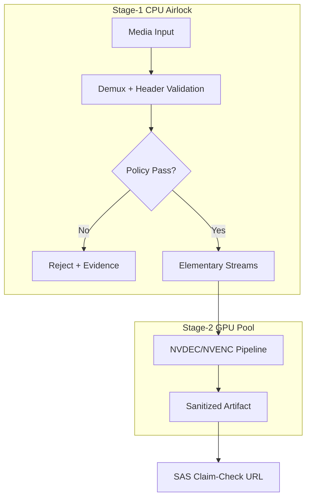

# Enterprise Untrusted Media Transcoding and Codec-Airlock Sandbox Selection FAQ (AKS Kata + FFmpeg/libvips vs NVENC GPU Pool vs ACA Dynamic Sessions)

> Audience: Cloud & AI Solution Architects, platform security leads, and media-processing service owners.
>
> Decision objective: enable multimodal agents to inspect, clip, normalize, and transform untrusted video/audio/image inputs without exposing control-plane hosts to codec-memory RCE or playlist-driven SSRF.

## 1. Executive summary

Many enterprise teams can build media automation quickly.

Far fewer can operate it safely at production scale.

The most common anti-pattern is direct media-tool execution in the orchestrator process:

- `ffmpeg -i <user_url>` inside the primary agent container,
- default `ImageMagick convert` with unrestricted delegates,
- direct `cv2.VideoCapture` on untrusted URLs while Managed Identity is still reachable.

This fails under real threat conditions for three reasons:

1. Codec and parser attack surfaces are large and historically active.
2. Network-capable decoders can be abused for `file://` and metadata SSRF.
3. Decompression and pixel-bomb payloads can kill co-located tenant sessions.

This guide compares four routes:

- **Route A**: AKS Kata zero-egress ephemeral codec airlock (CPU-first, strongest isolation boundary).
- **Route B**: Two-stage architecture with CPU pre-demux airlock and NVDEC/NVENC GPU throughput pool (best for large sustained minute volumes).
- **Route C**: ACA Dynamic Sessions (`EgressDisabled`) for lightweight interactive tooling and low concurrency.
- **Route D**: direct media processing in main orchestrator runtime (explicit anti-pattern).

Recommended strategy:

1. Start with Route A as baseline in regulated or unknown-input environments.
2. Introduce Route B when minute-volume and throughput economics cross the GPU break-even threshold.
3. Use Route C for short-lived interactive media micro-tasks where cluster operations overhead should be minimized.
4. Reject Route D in architecture governance.

## 2. Problem statement and threat model

### 2.1 Input profile

Enterprise media agents typically receive:

- long-form and short-form video (`MP4`, `MKV`, `HLS` variants),
- meeting and call audio (`WAV`, `Opus`),
- high-resolution images (`HEIC`, `WebP`, `TIFF`),
- batch archives with mixed media payloads.

Sources include:

- direct customer upload portals,
- partner ingestion channels,
- syndicated content feeds,
- API-submitted URLs and asynchronous import jobs.

### 2.2 Attack vectors

The dominant abuse classes are:

- malformed container/codec payloads targeting native parser memory safety,
- playlist-level SSRF chains that pivot to internal targets,
- image decompression bombs that trigger memory exhaustion and noisy-neighbor failures,
- delegate execution paths in imaging stacks that allow unsafe external calls.

### 2.3 Security outcomes required

The target architecture must guarantee:

- hard separation between untrusted decode paths and core orchestrator/control services,
- default-deny network posture for decode/transform workers,
- output handoff via claim-check reference (SAS URL) rather than large inline payload transport,
- auditable and replayable task provenance per request.

## 3. Route definitions

### 3.1 Route A: AKS Kata zero-egress ephemeral codec airlock

Design characteristics:

- one ephemeral Kata pod per media task,
- no external egress path by policy and runtime profile,
- protocol-restricted FFmpeg build and invocation (`file,pipe` only),
- locked-down image processing delegates via strict policy file,
- write-only scoped SAS for output publication.

Best fit:

- high-regulation sectors,
- uncertain or adversarial input ecosystems,
- organizations prioritizing containment over absolute peak throughput.

### 3.2 Route B: CPU pre-demux airlock + GPU NVDEC/NVENC throughput pool

Design characteristics:

- Stage-1 CPU airlock performs demux, structural checks, and policy gate evaluation,
- Stage-2 GPU workers process only validated elementary streams,
- autoscaling driven by queue depth and SLA telemetry,
- throughput-oriented design for minute-heavy workloads.

Best fit:

- high-volume clipping, stitching, and re-encoding operations,
- sustained 4K or multi-stream pipelines,
- cost-per-minute optimization at scale.

### 3.3 Route C: ACA Dynamic Sessions (`EgressDisabled`) lightweight tooling

Design characteristics:

- Hyper-V isolated burst sessions without full AKS control-plane burden,
- practical for frame sampling, waveform extraction, and short transformations,
- lower operational overhead for product teams with smaller platform capacity.

Best fit:

- low-concurrency interactive media tooling,
- session lengths typically under 30 seconds,
- rapid feature iteration with managed runtime ergonomics.

### 3.4 Route D: orchestrator-inline media execution anti-pattern

Anti-pattern indicators:

- untrusted URL decode in primary service runtime,
- unrestricted protocol handlers and delegates,
- shared identity/network surface with business-critical services,
- no isolated replay/audit chain around decode path.

Expected failure impact:

- elevated blast radius due to control-plane adjacency,
- tenant cross-impact under memory pressure events,
- poor forensic quality after incidents.

## 4. Quantitative engineering models

### 4.1 Decompression and pixel-bomb memory envelope

Approximate expanded memory:

`Mem_bytes = W × H × C × Bpp`

Operational controls:

- cap `W × H` per media class,
- cap expanded memory via runtime limits,
- cap per-job resident memory and decode duration,
- enforce pre-decode heuristic checks on compression ratio anomalies.

Practical interpretation:

- high-resolution payloads can exceed small-container memory quickly,
- naive buffering multiplies risk when multiple frames are retained simultaneously,
- memory envelope controls must exist before decode starts, not after.

### 4.2 CPU x264 versus GPU NVENC throughput-dollar crossover

Definitions:

- `M_day`: media minutes processed per day,
- `C_cpu_min`: effective CPU path cost per minute,
- `C_gpu_min`: effective GPU path cost per minute at target occupancy,
- `F_gpu_fixed`: fixed daily GPU pool floor.

Crossover:

`M_day* = F_gpu_fixed / (C_cpu_min - C_gpu_min)`

Interpretation:

- below crossover, CPU-centric route often wins,
- above crossover, GPU pool can dominate on unit economics,
- occupancy and queue shape are as important as nominal card price.

### 4.3 Claim-check SAS versus inline base64 gateway payload

Payload approximation:

- inline response: `Payload_inline ≈ 1.33 × media_bytes + metadata`,
- claim-check response: `Payload_claimcheck ≈ metadata + URL`.

Trade-off:

- inline payloads inflate gateway bandwidth, logs, and retry penalties,
- claim-check pattern keeps API payload stable and simplifies large-object retries,
- claim-check model usually improves observability and replayability.

### 4.4 Queue scaling and service-level backpressure model

For Route B:

- `Workers_needed ≈ ceil((Input_minutes_per_hour × Encode_factor) / Worker_capacity_minutes_per_hour)`,
- `Queue_wait_p95` must remain inside SLA reserve budget.

If queue growth slope remains positive during peak windows:

- increase Stage-2 worker pool,
- tune Stage-1 reject policy to reduce invalid workload bleed-through,
- evaluate codec profile normalization to reduce variance.

## 5. Twelve-dimension comparison matrix

| Dimension | Route A Kata Airlock | Route B GPU Pool | Route C ACA Sessions | Route D Anti-Pattern |
|---|---|---|---|---|
| Isolation strength | Very high | High | High | Low |
| Parser exploit exposure | Low | Medium | Medium | Very high |
| SSRF resistance | High | High | Medium-high | Very low |
| Cold-start latency | Medium | Medium | Low-medium | Low |
| Peak throughput | Medium | Very high | Medium-low | Medium |
| Cost/min at high scale | Medium | Low | High-medium | Unbounded |
| Platform ops effort | High | High | Low | Low (short-term) |
| Auditability | High | High | Medium-high | Low |
| Compliance explainability | High | High | Medium | Low |
| Tenant blast-radius control | High | High | Medium | Low |
| Elasticity quality | Medium-high | High | Medium | Low |
| Recommendation | ✅ | ✅ | ✅ (light use) | ⛔ |

## 6. Deep quantitative Q&A (Q1 to Q6)

### Q1: How should pixel limits be set without blocking legitimate 8K media?

Use dual-threshold controls:

- resolution threshold (`W × H`) per media class,
- expanded-memory threshold (`Mem_bytes`) mapped to runtime profile.

Then add:

- decompression-ratio anomaly gate,
- decode timeout caps,
- tenant-level concurrency guardrails.

This avoids both false permissiveness and false rejection.

### Q2: How do we justify Route B economics over Route A?

Compute:

`Throughput_gain = Throughput_B / Throughput_A`

`Cost_gain = CostPerMinute_A / CostPerMinute_B`

If sustained `Throughput_gain` and `Cost_gain` are both above governance thresholds, Route B becomes the preferred scaling lane.

### Q3: Why is two-stage architecture better than direct GPU ingest?

Because security and economics both improve:

- high-risk demux/parsing is isolated in cheaper CPU airlock,
- expensive GPU nodes receive already-validated streams,
- exploit surface near premium hardware remains minimal.

Risk representation:

`Risk_total = P_malicious × Impact_surface`

Stage separation reduces `Impact_surface` materially.

### Q4: Does claim-check increase API latency?

In most deployments, not meaningfully.

The API response remains metadata-sized.

Object transfer occurs directly against scoped storage endpoints.

Latency variance is moved to object I/O, where it can be scaled and observed independently from control APIs.

### Q5: When should Route C be upgraded to Route A/B?

Common upgrade triggers:

- sustained SLA breach under peak interactive demand,
- policy requirements for stricter syscall/protocol lockdown,
- monthly minute volume crossing managed-session cost envelope.

Upgrade policy should be explicit and automated where possible.

### Q6: How do we quantify Route D incident risk for governance?

Use expected-loss framing:

`E_loss = P_exploit × Blast_radius × Incident_cost`

Even moderate `P_exploit` values can become unacceptable when `Blast_radius` includes orchestrator identity, routing, or tenant context stores.

## 7. Reference architecture (Mermaid)





## 8. Production configuration example (Kata + FFmpeg/libvips)

```yaml
apiVersion: batch/v1
kind: Job
metadata:
  name: media-airlock-job
spec:
  ttlSecondsAfterFinished: 120
  template:
    spec:
      runtimeClassName: kata-cc
      restartPolicy: Never
      automountServiceAccountToken: false
      enableServiceLinks: false
      containers:
        - name: worker
          image: ghcr.io/example/media-airlock:stable
          securityContext:
            runAsNonRoot: true
            readOnlyRootFilesystem: true
            allowPrivilegeEscalation: false
            capabilities:
              drop: ["ALL"]
            seccompProfile:
              type: Localhost
              localhostProfile: profiles/ffmpeg-seccomp.json
          resources:
            limits:
              cpu: "4"
              memory: "8Gi"
          env:
            - name: OUTPUT_SAS_URL
              valueFrom:
                secretKeyRef:
                  name: sas-secret
                  key: output
          command:
            - /bin/sh
            - -lc
            - >
              ffmpeg -protocol_whitelist file,pipe
              -i /input/source.mkv
              -vf "fps=2,scale=1280:-2"
              -c:v libx264 -preset veryfast -crf 23
              /tmp/sanitized.mp4 &&
              vips copy /input/frame.heic /tmp/frame.png &&
              python /app/upload.py /tmp/sanitized.mp4 /tmp/frame.png "$OUTPUT_SAS_URL"
```

## 9. Hardening policy examples (`policy.xml` + seccomp)

```xml
<!-- /etc/ImageMagick-7/policy.xml -->
<policymap>
  <policy domain="delegate" rights="none" pattern="*"/>
  <policy domain="coder" rights="read|write" pattern="{PNG,JPEG,WEBP,TIFF,HEIC}"/>
  <policy domain="path" rights="none" pattern="@*"/>
  <policy domain="resource" name="memory" value="1GiB"/>
  <policy domain="resource" name="map" value="1GiB"/>
  <policy domain="resource" name="disk" value="2GiB"/>
</policymap>
```

```json
{
  "defaultAction": "SCMP_ACT_ERRNO",
  "architectures": ["SCMP_ARCH_X86_64"],
  "syscalls": [
    {"names": ["read","write","openat","close","fstat","mmap","munmap","brk","rt_sigaction","rt_sigprocmask","ioctl","lseek","getpid","clone3","execve","exit","exit_group","futex","clock_gettime"], "action": "SCMP_ACT_ALLOW"}
  ]
}
```

## 10. Enterprise scenarios (2+)

### Scenario A: auto-insurance dashcam and body-shop triage

Requirements:

- large daily inflow of short videos and high-resolution imagery,
- frame extraction, quality normalization, and OCR pre-processing,
- strict forensic replay and policy evidence retention.

Recommended pattern:

- Stage-1 Route A CPU airlock for all untrusted ingest,
- Stage-2 Route B GPU pool for minute-heavy approved transforms.

Benefits:

- strong containment with high production throughput,
- claim-check output model simplifies retries and dispute workflows.

### Scenario B: global marketing and podcast clipping factory

Requirements:

- multilingual long-form content slicing and packaging,
- bursty campaign windows with high concurrency spikes,
- unit-cost governance and SLA consistency.

Recommended pattern:

- bulk processing lane on Route B,
- editor-side short tasks on Route C,
- risk-tier routing through Route A for suspicious inputs.

Benefits:

- scalable throughput without sacrificing governance controls,
- reduced idle cost through route-specific workload placement.

### Scenario C: regulated enterprise knowledge media curation

Requirements:

- legal-compliant handling for external media submissions,
- strict separation between content processing and internal identity systems,
- traceable proof of output integrity.

Recommended pattern:

- mandatory Route A for all ingest and normalization,
- selective Route B acceleration for approved internal workloads,
- no direct outbound media fetch from orchestration layer.

Benefits:

- improved compliance posture,
- cleaner audit narratives for external review.

## 11. Three-tier 3-year TCO (`50K / 1M / 15M` minutes per month)

| Scale (minutes/month) | Route A Kata Airlock | Route B GPU Pool | Route C ACA Sessions | Recommended A+B Blend |
|---|---:|---:|---:|---:|
| 50K | 1,120,000 | 1,450,000 | 980,000 | 1,210,000 |
| 1M | 12,800,000 | 8,900,000 | 16,400,000 | 9,700,000 |
| 15M | 182,000,000 | 96,000,000 | 255,000,000 | 103,500,000 |

Interpretation:

- small-scale interactive use usually favors Route C on operational simplicity,
- medium/large sustained throughput typically favors Route B economics,
- blended A+B path often provides best risk-adjusted production profile.

## 12. Day-0 / Day-1 / Day-2 execution checklist

### Day-0 (baseline architecture)

- classify media classes and map risk tiers,
- define protocol and codec allowlists explicitly,
- enforce metadata-service and outbound-network deny posture,
- define claim-check contract and retry semantics,
- establish immutable evidence schema for policy outcomes.

### Day-1 (minimum production cut)

- deploy Route A baseline pipeline,
- instrument ingest fingerprint, policy verdict, and output hash telemetry,
- enforce strict memory/time limits for high-risk formats,
- run controlled pilot on one high-value workflow.

### Day-2 (scale and optimization)

- activate Route B for heavy minute workloads,
- tune queue-based autoscaling and SLA reserve policies,
- add replay-driven threat drills and red-team samples,
- formalize Route C promotion/escalation criteria.

## 13. Good fit vs Not for

### ✅ Good fit

- multi-tenant media workflows with untrusted inputs,
- organizations requiring both high throughput and strong isolation,
- teams needing audit-quality evidence chains for compliance and incident response.

### ⛔ Not for

- occasional low-risk media transformations with no strict governance needs,
- organizations unable to maintain minimal security baselines,
- environments where orchestrator-inline tooling is still considered acceptable.

## 14. Operational KPIs and alerting baseline

Recommended ongoing KPIs:

- `P95_job_latency_ms`,
- `reject_rate_by_policy`,
- `oom_kill_rate`,
- `gpu_utilization`,
- `cost_per_media_minute`,
- `sas_retry_rate`,
- `stage1_to_stage2_pass_ratio`,
- `invalid_protocol_attempt_rate`.

Alerting suggestions:

1. If `oom_kill_rate > 0.5%`, immediately tighten pixel and expansion thresholds and inspect payload clusters.
2. If policy reject rate drops unexpectedly, verify policy-bypass possibility and parser path drift.
3. If `cost_per_media_minute` rises for two consecutive reporting windows, re-evaluate GPU occupancy and encoding profiles.
4. If queue wait dominates P95 latency, prioritize Stage-1 gate efficiency and Stage-2 worker elasticity tuning.

## 15. Final recommendation and decision path

### 15.1 Default decision tree

- High-risk or regulated ingest: Route A mandatory baseline.
- Sustained high-minute production: Route B added on top of Route A.
- Lightweight interactive tooling: Route C as controlled lane.
- Direct orchestrator media execution: Route D rejected.

### 15.2 Practical rollout sequence

Phase 1:

- establish secure ingest and normalization baseline with Route A.

Phase 2:

- move heavy approved streams to Route B for throughput and cost optimization.

Phase 3:

- attach Route C for low-friction interactive tooling where appropriate.

### 15.3 Milestone acceptance criteria

Production maturity milestone can be declared when all four hold:

- security: no boundary-violation incident over rolling 90-day window,
- performance: P95 remains inside service SLO under representative peaks,
- economics: cost per minute remains within approved operating envelope,
- governance: every transform has traceable input-policy-output evidence.

### 15.4 One-sentence architecture conclusion

For enterprise multimodal agent workloads, the winning pattern is not “run FFmpeg faster in the orchestrator,” but “enforce a hardened untrusted-media airlock first, then apply GPU acceleration only to policy-cleared elementary streams.”

