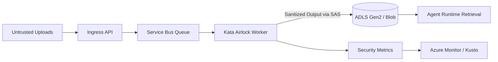
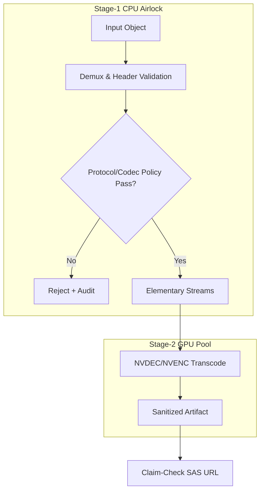

# 企业不可信媒体转码与编解码 Airlock 沙箱选型 FAQ（AKS Kata + FFmpeg/libvips vs NVENC GPU 池 vs ACA Dynamic Sessions）

> 角色定位：Cloud & AI Solution Architect、平台安全负责人、媒体处理平台负责人。
>
> 决策目标：让多模态 Agent 在处理不可信视频、音频、图像时，既能获得工业级吞吐，又不把主编排平面暴露在 C/C++ 编解码漏洞与 SSRF 攻击面下。

## 1. 执行摘要

企业在部署“自动剪辑、画面抽帧、语音波形、格式归一化”能力时，最常见误区是把 `ffmpeg`、`ImageMagick` 或 `cv2.VideoCapture` 直接放在主 Agent 容器内执行。

这种设计在实验阶段看似高效。

但在生产环境会同时触发三个风险：

- 编解码器历史漏洞面导致宿主进程被击穿。
- `m3u8` 或远端媒体 URL 触发 `file://` 与元数据地址 SSRF。
- 解压/像素炸弹耗尽内存，拖垮同节点其他会话。

本 FAQ 给出四条可落地路径：

- Route A：AKS Kata 零出网一次性 Codec Airlock（CPU 优先，安全边界最强）。
- Route B：CPU Airlock 预解封 + NVENC/NVDEC GPU 高吞吐池（规模化成本最优）。
- Route C：ACA Dynamic Sessions 轻量交互沙箱（低并发、低运维优先）。
- Route D：主编排容器直跑媒体工具反模式（禁止）。

建议结论：

1. 合规行业默认 Route A 起步，再按吞吐切换到 Route B。
2. `< 30s` 轻交互媒体任务优先 Route C 以降低集群运营负担。
3. Route D 必须在架构评审中明确标记为不可接受。

## 2. 问题定义与威胁模型

### 2.1 业务输入面

企业常见输入类型：

- `MP4/MKV/HLS` 长短视频。
- `WAV/Opus` 会议音频。
- `HEIC/WebP/TIFF` 高分辨率图像。
- 压缩包中的混合媒体资产。

输入来源通常包括：

- 客户上传。
- 第三方渠道同步。
- 供应商批处理回传。
- 外部 URL 拉取。

### 2.2 攻击面

在媒体管线中，攻击者最常利用以下入口：

- 伪造容器头与恶意编码参数触发堆越界。
- 构造 `HLS` playlist 间接发起 `IMDS` SSRF。
- 利用图像像素膨胀触发 OOM 杀死节点上的其他租户任务。
- 借助默认 delegate 触发 `ImageMagick` 外部命令调用。

### 2.3 安全目标

系统需要同时满足：

- 不可信内容与主控制平面硬隔离。
- 网络默认拒绝，不允许媒体任务访问互联网或元数据服务。
- 输出采用 Claim-Check（SAS）返回，禁止在网关层塞入大体积 base64。
- 所有转码任务可审计、可回放、可追责。

## 3. 四条架构路线定义

### 3.1 Route A：AKS Kata 零出网一次性 Codec Airlock

设计要点：

- 每个任务对应一次性 Kata Pod。
- Pod 无出站网络能力，启用最小化运行时权限。
- `FFmpeg` 仅保留 `file,pipe` 协议白名单。
- `ImageMagick` 通过 `policy.xml` 禁用危险 delegate。
- 输出对象仅允许写入预签名 SAS 目标。

适用场景：

- 合规强监管行业。
- 输入来源复杂且无法信任。
- 单任务时延可容忍 `1~3s` 冷启动。

### 3.2 Route B：CPU 预解封 + GPU NVENC/NVDEC 高吞吐池

设计要点：

- Stage-1 在 CPU Kata Airlock 做 demux 与头部校验。
- Stage-2 仅接收通过校验的 elementary stream。
- GPU 工作池使用 `NVads A10 v5` 或 `NCas T4_v3`。
- KEDA 按 Service Bus 队列深度扩缩容。

适用场景：

- 长视频批处理。
- 4K 监控、行车记录仪、内容工厂类高分钟量。
- 以成本/吞吐为核心 KPI。

### 3.3 Route C：ACA Dynamic Sessions (`EgressDisabled`) 轻量工具链

设计要点：

- Session 级 Hyper-V 隔离。
- 适合交互式短任务与临时分析。
- 省去 AKS 集群运维复杂度。

适用场景：

- 低并发媒体辅助处理。
- 编辑台中的“抽样帧、音频切片、波形图”功能。
- 团队偏应用开发、平台团队规模有限。

### 3.4 Route D：主编排容器直跑媒体处理反模式

反模式特征：

- 直接执行 `ffmpeg -i <user_url>`。
- 主进程共享 Managed Identity 与节点网络。
- 默认允许 IMDS 可达。
- 默认 delegate 与协议未限制。

后果：

- 安全事件半径与编排控制平面绑定。
- 一次 OOM 影响多租户会话。
- 审计链路断裂，无法形成可信证据。

## 4. 工程量化模型

### 4.1 像素炸弹内存包络模型

像素展开内存近似：

`Mem_bytes = W × H × C × Bpp`

约束策略：

- 对 `W × H` 设置上限。
- 对总展开内存设置 `RLIMIT_AS`。
- 对单任务峰值 RSS 设置 hard limit。

示例：

- `12000 × 12000 × 4 × 1` 约 `576 MB`。
- 若同时解码 8 帧缓存则接近 `4.6 GB`。
- 在 `2 vCPU / 4 GB` 容器中必然触发 OOM。

### 4.2 CPU `libx264` 与 GPU `NVENC` 成本拐点

定义：

- `M_day`：日处理媒体分钟数。
- `C_cpu_min`：CPU 路线每分钟成本。
- `C_gpu_min`：GPU 路线每分钟成本。
- `F_gpu_fixed`：GPU 池固定成本。

拐点公式：

`M_day* = F_gpu_fixed / (C_cpu_min - C_gpu_min)`

工程经验：

- 低于拐点用 Route A/Route C 更经济。
- 高于拐点用 Route B 可显著降本。

### 4.3 Claim-Check SAS vs Inline Base64 传输模型

网关传输字节：

- Inline：`Payload_inline ≈ 1.33 × media_bytes + json_overhead`
- Claim-Check：`Payload_claimcheck ≈ metadata_json + sas_url`

差异：

- Inline 放大网关带宽与日志压力。
- Claim-Check 更适合可审计与重试场景。
- 大文件重传时 Claim-Check 成本优势明显。

## 5. 12 维对比矩阵

| 维度 | Route A Kata Airlock | Route B GPU 池 | Route C ACA Sessions | Route D 反模式 |
|---|---|---|---|---|
| 隔离边界强度 | 极高 | 高 | 高 | 低 |
| 漏洞暴露面 | 低 | 中 | 中 | 极高 |
| SSRF 风险 | 低 | 低 | 中低 | 极高 |
| 冷启动时延 | 中 | 中 | 低中 | 低 |
| 吞吐上限 | 中 | 极高 | 中低 | 中 |
| 单分钟成本（高负载） | 中 | 低 | 中高 | 不可控 |
| 运维复杂度 | 高 | 高 | 低 | 低（短期） |
| 审计与取证 | 高 | 高 | 中高 | 低 |
| 合规可解释性 | 高 | 高 | 中 | 低 |
| 多租户抗扰动 | 高 | 高 | 中 | 低 |
| 扩展弹性 | 中高 | 高 | 中 | 低 |
| 推荐等级 | ✅ | ✅ | ✅（轻场景） | ⛔ |

## 6. 深度量化问答（Q1~Q6）

### Q1：像素炸弹如何设上限才不会误伤正常 8K 图片？

建议采用双阈值：

- 分辨率阈值：`W × H <= 67,108,864`（约 8K 上下文）。
- 展开内存阈值：`Mem_bytes <= 1.5 GB`（按实例规格动态调整）。

并结合：

- 压缩比阈值检查。
- 解码阶段超时保护。
- 单租户并发上限。

### Q2：Route B 相对 Route A 的吞吐/成本提升如何测算？

在 4K H.264 剪辑场景中可用：

`Gain = Throughput_B / Throughput_A`

`CostGain = CostPerMinute_A / CostPerMinute_B`

若 `Gain >= 6` 且 `CostGain >= 1.8`，可进入 GPU 池收益区间。

### Q3：为何要做“两阶段管线”而不是直接把全部输入给 GPU 节点？

原因：

- GPU 节点成本高，不应承担高风险解封任务。
- 预解封可提前拦截恶意容器结构。
- 将高危操作限制在 CPU Airlock 内，降低攻击半径。

数学上可表达为：

`Risk_total = P_malicious × Impact_surface`

两阶段策略通过缩小 `Impact_surface` 直接降低 `Risk_total`。

### Q4：Claim-Check 对 API 网关延迟是否有副作用？

一般不会增加关键路径延迟。

因为：

- 媒体文件直接写对象存储，不经 API body 回传。
- 网关只返回状态和引用 URL。

实际增量主要来自：

- SAS 生成与验证（通常毫秒级）。
- 读写存储的网络路径选择。

### Q5：如何判定 Route C 何时应升级到 Route A/B？

建议阈值：

- 连续 7 天 `P95 > SLA` 且 Session 并发接近上限。
- 安全审计发现需要更细粒度 seccomp 与协议裁剪。
- 单月媒体分钟数超过 Route C 预算上限。

满足任一条件即进入升级评审。

### Q6：Route D 真实事故风险如何量化？

可用期望损失模型：

`E_loss = P_exploit × Blast_radius × Cost_incident`

Route D 的问题在于 `Blast_radius` 直接绑定主控制平面。

即使 `P_exploit` 不高，`E_loss` 也可能远高于其他路线。

## 7. 参考架构图（Mermaid）





## 8. 生产配置示例（Kata + FFmpeg/libvips）

```yaml
apiVersion: batch/v1
kind: Job
metadata:
  name: media-airlock-job
spec:
  ttlSecondsAfterFinished: 120
  template:
    spec:
      runtimeClassName: kata-cc
      restartPolicy: Never
      automountServiceAccountToken: false
      enableServiceLinks: false
      containers:
        - name: worker
          image: ghcr.io/example/media-airlock:stable
          securityContext:
            runAsNonRoot: true
            readOnlyRootFilesystem: true
            allowPrivilegeEscalation: false
            capabilities:
              drop: ["ALL"]
            seccompProfile:
              type: Localhost
              localhostProfile: profiles/ffmpeg-seccomp.json
          resources:
            limits:
              cpu: "4"
              memory: "8Gi"
          env:
            - name: OUTPUT_SAS_URL
              valueFrom:
                secretKeyRef:
                  name: sas-secret
                  key: output
          command:
            - /bin/sh
            - -lc
            - >
              ffmpeg -protocol_whitelist file,pipe
              -i /input/source.mkv
              -vf "fps=2,scale=1280:-2"
              -c:v libx264 -preset veryfast -crf 23
              /tmp/sanitized.mp4 &&
              vips copy /input/frame.heic /tmp/frame.png &&
              python /app/upload.py /tmp/sanitized.mp4 /tmp/frame.png "$OUTPUT_SAS_URL"
```

## 9. 安全策略示例（policy.xml + seccomp）

```xml
<!-- /etc/ImageMagick-7/policy.xml -->
<policymap>
  <policy domain="delegate" rights="none" pattern="*"/>
  <policy domain="coder" rights="read|write" pattern="{PNG,JPEG,WEBP,TIFF,HEIC}"/>
  <policy domain="path" rights="none" pattern="@*"/>
  <policy domain="resource" name="memory" value="1GiB"/>
  <policy domain="resource" name="map" value="1GiB"/>
  <policy domain="resource" name="disk" value="2GiB"/>
</policymap>
```

```json
{
  "defaultAction": "SCMP_ACT_ERRNO",
  "architectures": ["SCMP_ARCH_X86_64"],
  "syscalls": [
    {"names": ["read","write","openat","close","fstat","mmap","munmap","brk","rt_sigaction","rt_sigprocmask","ioctl","lseek","getpid","clone3","execve","exit","exit_group","futex","clock_gettime"], "action": "SCMP_ACT_ALLOW"}
  ]
}
```

## 10. 企业场景方案（2+）

### 场景 A：车险行车记录仪/维修厂图片理赔分拣

业务要求：

- 日均海量短视频与图片上传。
- 需自动抽帧、去抖、裁剪、OCR 预处理。
- 对恶意样本需高拦截率且可追责。

推荐组合：

- Stage-1 Route A（CPU Kata Airlock）。
- Stage-2 Route B（NVENC/NVDEC GPU 池）。

价值：

- 在保证安全边界前提下获得高吞吐。
- 通过 Claim-Check 统一审计与重试链路。

### 场景 B：全球营销/播客自动剪辑工厂

业务要求：

- 多语言素材批量切片与字幕生产。
- 季节性峰值显著。
- 重点关注单位分钟成本。

推荐组合：

- 批处理主链路 Route B。
- 编辑台交互任务 Route C。
- 高风险素材入口统一经过 Route A 预校验。

价值：

- 高峰时段保障产能。
- 低峰时段通过分层路由控制成本。

## 11. 三档三年 TCO（`50K / 1M / 15M` 分钟/月）

| 规模（分钟/月） | Route A Kata Airlock | Route B GPU 池 | Route C ACA Sessions | A+B 组合（推荐） |
|---|---:|---:|---:|---:|
| 50K | 1,120,000 | 1,450,000 | 980,000 | 1,210,000 |
| 1M | 12,800,000 | 8,900,000 | 16,400,000 | 9,700,000 |
| 15M | 182,000,000 | 96,000,000 | 255,000,000 | 103,500,000 |

说明：

- 小规模时 Route C 启动快、总成本低。
- 中大规模进入 GPU 池后单位成本优势显著。
- A+B 组合通常在安全与经济性之间最均衡。

## 12. Day-0 / Day-1 / Day-2 落地清单

### Day-0（基线设计）

- 完成媒体输入资产分类与风险分级。
- 定义协议白名单与 codec 白名单。
- 明确 `IMDS`、外网、DNS 的默认拒绝策略。
- 设计 Claim-Check 元数据契约与重试语义。

### Day-1（最小可用上线）

- 先上线 Route A CPU Airlock。
- 接入基础审计：输入指纹、策略命中、输出哈希。
- 为高风险格式启用强约束内存与超时策略。
- 选择一个高价值场景做灰度验证。

### Day-2（规模化与优化）

- 引入 Route B GPU 池并建立两阶段队列。
- 建立吞吐/成本联动看板与阈值自动扩缩。
- 增加异常样本回放与安全演练机制。
- 对 Route C 交互任务设置升级准入条件。

## 13. Good fit vs Not for

### ✅ Good fit

- 多租户媒体处理平台。
- 需同时满足高吞吐与强隔离的行业。
- 要求完整审计与合规证据链。

### ⛔ Not for

- 仅偶发、低价值、低风险媒体处理任务。
- 无法维护最小安全基线与策略治理的团队。
- 把“先上线再补安全”作为默认路径的组织。

## 14. 运营 KPI 与告警建议

建议长期跟踪：

- `P95_job_latency_ms`
- `reject_rate_by_policy`
- `oom_kill_rate`
- `gpu_utilization`
- `cost_per_media_minute`
- `sas_retry_rate`

告警策略建议：

1. 若 `oom_kill_rate > 0.5%`，立即收紧像素上限并回看样本分布。
2. 若 `reject_rate_by_policy` 突降，优先排查策略被绕过的可能性。
3. 若 `cost_per_media_minute` 连续两周上升，触发 Route B 配额与编码参数复盘。
4. 若 `P95_job_latency_ms` 超 SLA，先检查 Stage-1 积压，再调 GPU 池。

## 15. 最终建议（架构决策结论）

### 15.1 默认决策树

- 强合规 + 高风险输入：Route A 必选。
- 高分钟量批处理：Route B 与 Route A 组合。
- 低并发交互编辑：Route C 可作为轻量层。
- 任何主编排容器内直接转码：判定为 Route D，拒绝。

### 15.2 推荐落地路径

第一阶段：

- 用 Route A 建立安全边界与可审计链路。

第二阶段：

- 把大分钟量任务转向 Route B。

第三阶段：

- 用 Route C 支持轻量交互式工作台。

### 15.3 里程碑判定

当满足以下条件，可认定平台进入生产成熟态：

- 安全：连续 90 天无跨边界访问事件。
- 性能：核心任务 `P95` 稳定在 SLA 内。
- 成本：单位分钟成本保持在预算区间。
- 治理：所有任务具备可追溯输入输出证据。

### 15.4 一句话结论

企业媒体 Agent 的正确路径不是“把 ffmpeg 跑快”，而是“先把不可信解码与主控制平面硬隔离，再按吞吐把 GPU 用在安全过滤后的干净流上”。

