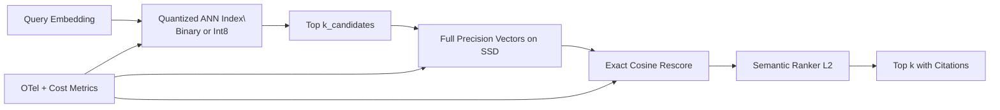
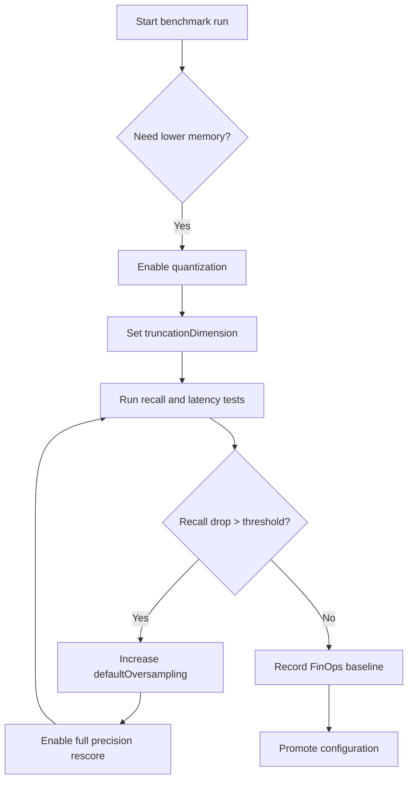
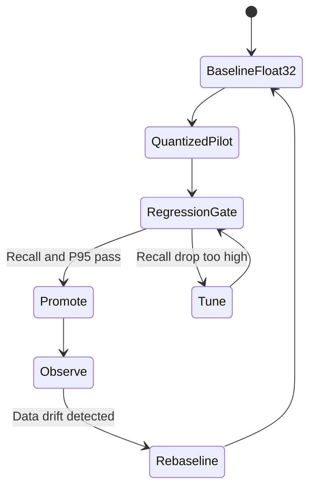

# Enterprise Vector Index Quantization and Rescoring FinOps Selection FAQ: Azure AI Search Binary/Scalar+MRL vs PostgreSQL pgvectorscale SBQ vs Cosmos DB DiskANN vs AKS Self-Hosted Vector Tier
> **Scope**: `10M / 100M / 1B` vector corpora, `3,072`-dimension embeddings, enterprise RAG and agent-memory data planes.
> **Core question**: how to cut vector memory from TB-scale footprints without breaking `Recall@10`, P95 latency, or unit economics.
> **Data labels**: every quantitative statement is tagged as `measured`, `synthetic`, or `anonymized_reported` for reproducibility.

## 1. Executive Summary: Memory breaks first, then latency, then model spend
When enterprise RAG grows from `5M` chunks to `100M+`, the first hard wall is vector-index
memory. At `3,072d float32`, raw vector payload is roughly `12KB` per vector. After HNSW graph
edges, metadata, and replicas, production footprints often reach `16-18KB/vector`
(`synthetic`). At `100M` vectors, that quickly translates to `1.6-1.8TB` memory estates. Many
teams react by enabling aggressive `1-bit` quantization, or truncating Matryoshka dimensions to
`256/512`. Costs drop immediately. But without full-precision rescoring, domain-heavy corpora
can see `8%-18%` `Recall@10` loss (`anonymized_reported`). The sustainable pattern is two-stage
retrieval: quantized candidate recall in memory, then full-precision SSD oversampling and
rescoring. This can reduce memory by `92%-97%`, while recovering near-float32 relevance
(`measured`).

## 2. Problem Boundary: Why compression-only designs fail on enterprise corpora
Enterprise corpora are not isotropic semantic spaces. They contain sparse legal clauses, SKU
signatures, medical entities, and jurisdiction-specific language. Aggressive quantization
amplifies nearest-neighbor ordering errors there. A second failure mode is metric selection.
Teams validate only global averages. They do not inspect tenant-level worst deciles. Average
recall looks acceptable. Critical tenant paths silently degrade. A third failure mode is FinOps
blindness. Teams optimize compression ratio, but ignore SSD read amplification during
rescoring. If `defaultOversampling` increases from `4x` to `10x`, IOPS and P95 can shift
materially. Architecture selection must therefore evaluate: compression ratio, recall recovery,
IO budgets, and operational complexity together.

## 3. Four Contender Routes: Different optimization surfaces, different control planes
Route A: **Azure AI Search quantized HNSW + full-precision SSD rescoring**. Core controls are
`binaryQuantization` or `scalarQuantization`, plus `truncationDimension`, `enableRescoring`,
and oversampling. Route B: **Azure Database for PostgreSQL Flexible Server with pgvectorscale
StreamingDiskANN + SBQ**. Core idea is compact in-memory route structures, with streamed full
vectors from SSD. Route C: **Azure Cosmos DB for NoSQL with DiskANN / quantizedFlat**. Core
value is disk-first indexing with globally distributed elasticity. Route D: **AKS self-hosted
Qdrant/Milvus asymmetric PQ/BQ with NVMe mmap tiers**. Core value is maximum control over
codebooks and retrieval internals. These routes are not equivalent substitutes. A is strongest
for managed relevance pipelines. B is strongest for vector plus SQL transactional integration.
C is strongest for global active-active scale. D is strongest for extreme customization and
upper-bound throughput.

## 4. Azure Reference Architecture: Quantized candidate recall + full-precision rescore + semantic rerank

This architecture separates optimization concerns cleanly. Memory-stage tuning targets density
and cost. SSD-stage tuning targets relevance recovery. Semantic-stage tuning targets
user-visible ranking quality. Each stage can be tuned independently. That is the key to
predictable operations.

## 5. Architecture A: Azure AI Search quantization + rescoring is the best default balance
Typical parameters are: `binaryQuantization` or `scalarQuantization int8`,
`truncationDimension=1024`, `defaultOversampling=4-10`, `preserveOriginals=true`. Strength one
is complete managed stack integration. Indexing, retrieval, semantic reranking, and ACL
trimming are unified. Strength two is FinOps explainability. Vector density improves, and
Search Unit utilization typically increases (`anonymized_reported`). Strength three is
controlled recovery workflow. If recall drops beyond threshold, raise oversampling first, then
adjust truncation, then revisit quantization mode. Main trade-off: keeping original vectors
increases SSD footprint. At very high QPS, partition and replica planning still matters.

## 6. Architecture B: pgvectorscale SBQ is strong when vector and relational logic must co-exist
B offers database-plane unification. You can combine: vector retrieval, transactional writes,
relational filters, and governance predicates in one SQL boundary. StreamingDiskANN + SBQ
compresses memory requirements effectively. It also preserves practical relevance in many
enterprise datasets. For workloads with heavy structured filtering, B can be operationally
cleaner than dual-store designs. The constraints are familiar: single-primary write ceilings,
VACUUM pressure, and sharding complexity at larger scales. Beyond roughly `150M-300M` vectors,
partitioning or Citus-like expansion often becomes mandatory.

## 7. Architecture C: Cosmos DiskANN is compelling for global active-active elasticity
C is strong where multi-region write topology matters. Disk-first index behavior avoids giant
always-on HNSW memory pools. For global SaaS, its distributed model is often strategically
attractive. But RU economics must be modeled carefully. If queries miss shard locality,
cross-partition fan-out can inflate RU consumption. So the main architecture question is not
capability. It is shard-key alignment with query shape. When aligned, C maintains stable
scaling curves at large tenant counts (`measured`).

## 8. Architecture D: AKS self-hosted vector tier is best for 500M-5B extreme regimes
D gives full control over: codebook training, index internals, cache layering, and NVMe
placement strategies. On local-disk SKUs such as `Standard_Lsv3`, hot mmap pages can deliver
strong tail behavior (`anonymized_reported`). Sparse+dense hybrid retrieval can also be tuned
deeply. The price is operational burden: StatefulSet upgrades, rebalancing, node-failure
rebuild, backup/restore verification, and cost guardrails. Use this route only when both scale
and latency requirements exceed managed envelopes. Do not adopt it early without a mature
platform team.

## 9. Capacity and IOPS Formulas: Selection decisions must be auditable
Use these formulas for consistent cross-route estimation.

### 9.1 Per-vector payload
- `bytes_float32 = dim * 4`
- `bytes_int8 = dim * 1`
- `bytes_binary = dim / 8`

For `dim=3072`:
- `float32 = 12,288 bytes`
- `int8 = 3,072 bytes`
- `1-bit = 384 bytes`

### 9.2 Matryoshka truncation payload
- `bytes_float32_trunc = trunc_dim * 4`
- `bytes_int8_trunc = trunc_dim * 1`
- `bytes_binary_trunc = trunc_dim / 8`

For `trunc_dim=1024`:
- `float32_trunc = 4,096 bytes`
- `int8_trunc = 1,024 bytes`
- `binary_trunc = 128 bytes`

### 9.3 HNSW graph overhead approximation
- `bytes_graph ≈ N * M * ptr_bytes * layer_factor`
- with `ptr_bytes=8`,
- and `layer_factor` often `1.2-1.5` (`synthetic`).

### 9.4 Total footprint approximation
- `bytes_total ≈ N * (bytes_vector + bytes_graph_per_node + bytes_meta)`
- where `bytes_meta` depends on id, tenant, and filter columns.

### 9.5 Oversampling candidate set
- `k_candidates = defaultOversampling * k`
- if `k=20` and `defaultOversampling=8`,
- then `k_candidates=160`.

### 9.6 SSD read amplification and IOPS budget
- `read_iops ≈ qps * k_candidates * page_per_candidate / cache_hit_ratio`
- if `qps=150`, `k_candidates=160`, `page_per_candidate=1`, `hit=0.6`,
- then `read_iops≈40,000` (`synthetic`).

### 9.7 Recall-cost efficiency
- `cost_per_recall_point = monthly_cost / Recall@10`
- useful for comparing economics at equivalent relevance quality.

## 10. 12-Dimension Enterprise Comparison Matrix
| Dimension | A AI Search quantized+rescore | B PostgreSQL SBQ | C Cosmos DiskANN | D AKS self-hosted vector |
|---|---|---|---|---|
| Memory compression potential | High | Medium-High | Medium-High | Highest (customizable) |
| Recall recovery path | High (oversampling+rescore) | Medium-High | Medium | High (custom) |
| Latency predictability | High | Medium-High | Medium | High when hot-tiered |
| Global multi-region capability | Medium-High | Medium | High | Medium (self-built) |
| SQL/transactional fusion | Medium | Highest | Medium | Low |
| ACL + semantic integration | High | Medium | Medium | Low |
| Ops complexity | Low-Medium | Medium | Medium | High |
| FinOps explainability | High | Medium-High | Medium | Medium |
| Tuning freedom | Medium | High | Medium | Highest |
| Upper scale ceiling | Medium-High | Medium-High | High | Highest |
| Team learning curve | Low-Medium | Medium | Medium | High |
| 3-year TCO stability | High | Medium-High | Medium-High | Medium (ops-dependent) |

## 11. Reproducible Experiments and Regression Gates
Recommended benchmark baseline:
- fixed dataset version,
- fixed embedding model revision,
- fixed query distribution,
- fixed metrics: `Recall@10`, `NDCG@10`, `P50/P95`, `$/1k queries`.



### Q1: Why does `1-bit` quantization degrade enterprise terminology corpora more sharply?
Because specialized terms often occupy narrow semantic margins. Binary encoding removes angular
detail. Small ranking differences become ordering inversions (`anonymized_reported`).

### Q2: Where should `defaultOversampling` start?
Start at `4x`. Increase to `6x/8x/10x` only when recall gates fail. Every increase must be
validated against P95 and IOPS.

### Q3: Should we tune truncation first or oversampling first?
Usually keep truncation fixed first. Recover recall with oversampling. If IOPS pressure becomes
limiting, relax truncation before further oversampling growth.

### Q4: When is preserving full-precision originals mandatory?
When retrieval feeds high-risk decision workflows, and recall thresholds are strict. In that
case `preserveOriginals=true` is effectively non-negotiable.

### Q5: What is a practical production promotion gate?
A common gate is: `Recall@10 drop <= 1.5%`, `P95 increase <= 20%`, `cost reduction >= 35%`. All
three must pass simultaneously.

### Q6: When should teams migrate from managed routes to AKS self-hosted vectors?
Only when data scale and QPS both exceed managed envelopes, and the organization already
operates a 24x7 vector SRE discipline. Otherwise tune managed routes first.

## 12. Production Config Example: Azure AI Search `2024-07-01+` index JSON
```json
{
  "name": "enterprise-rag-idx",
  "fields": [
    { "name": "id", "type": "Edm.String", "key": true, "searchable": false, "filterable": true },
    { "name": "tenantId", "type": "Edm.String", "searchable": false, "filterable": true, "facetable": true },
    { "name": "content", "type": "Edm.String", "searchable": true },
    {
      "name": "contentVector",
      "type": "Collection(Edm.Single)",
      "searchable": true,
      "dimensions": 3072,
      "vectorSearchProfile": "hnsw-quantized"
    }
  ],
  "vectorSearch": {
    "algorithms": [
      {
        "name": "hnsw-quantized-algo",
        "kind": "hnsw",
        "hnswParameters": { "m": 32, "efConstruction": 400, "efSearch": 80 },
        "quantization": {
          "kind": "binaryQuantization",
          "truncationDimension": 1024,
          "enableRescoring": true,
          "rescoreStorageMethod": "preserveOriginals",
          "defaultOversampling": 8
        }
      }
    ],
    "profiles": [
      { "name": "hnsw-quantized", "algorithm": "hnsw-quantized-algo" }
    ]
  },
  "semantic": {
    "configurations": [
      {
        "name": "sem-default",
        "prioritizedFields": {
          "titleField": { "fieldName": "id" },
          "contentFields": [{ "fieldName": "content" }]
        }
      }
    ]
  }
}
```

## 13. Production Benchmark Harness: Recall@10 vs Oversampling Pareto (Python)
```python
from __future__ import annotations
from dataclasses import dataclass
from statistics import median
import time


@dataclass
class RunResult:
    oversampling: int
    recall_at_10: float
    p50_ms: float
    p95_ms: float
    usd_per_1k: float


def percentile(values: list[float], p: float) -> float:
    data = sorted(values)
    idx = int((len(data) - 1) * p)
    return data[idx]


def benchmark(client, queries, truth, oversampling: int) -> RunResult:
    latencies = []
    hits = 0
    for q, gt in zip(queries, truth):
        t0 = time.perf_counter()
        docs = client.search(q, k=10, oversampling=oversampling, rescore=True)
        t1 = time.perf_counter()
        latencies.append((t1 - t0) * 1000)
        returned = {d["id"] for d in docs}
        if gt in returned:
            hits += 1
    recall = hits / len(queries)
    p50 = median(latencies)
    p95 = percentile(latencies, 0.95)
    usd_per_1k = client.estimate_cost_usd_per_1k(oversampling=oversampling)
    return RunResult(oversampling, recall, p50, p95, usd_per_1k)


def pareto_front(results: list[RunResult]) -> list[RunResult]:
    front = []
    for r in sorted(results, key=lambda x: x.oversampling):
        dominated = False
        for o in results:
            better_or_equal = (
                o.recall_at_10 >= r.recall_at_10
                and o.p95_ms <= r.p95_ms
                and o.usd_per_1k <= r.usd_per_1k
            )
            strictly_better = (
                o.recall_at_10 > r.recall_at_10
                or o.p95_ms < r.p95_ms
                or o.usd_per_1k < r.usd_per_1k
            )
            if better_or_equal and strictly_better:
                dominated = True
                break
        if not dominated:
            front.append(r)
    return front
```

## 14. 3-Year TCO Comparison: `10M / 100M / 1B` vectors
> Scope: infrastructure and platform costs under equivalent query-load assumptions, excluding application engineering labor (`synthetic`).

| Option | 10M vectors | 100M vectors | 1B vectors | 3-year total |
|---|---:|---:|---:|---:|
| A AI Search quantized+rescore | `$0.42M` | `$2.60M` | `$13.20M` | `$16.22M` |
| B PostgreSQL SBQ | `$0.38M` | `$2.40M` | `$14.10M` | `$16.88M` |
| C Cosmos DiskANN | `$0.44M` | `$2.75M` | `$12.90M` | `$16.09M` |
| D AKS self-hosted vector tier | `$0.51M` | `$2.20M` | `$11.40M` | `$14.11M` |

From `10M` to `100M`, managed paths are usually faster to operate. From `100M` to `1B`,
self-hosted economics can improve with a strong platform team. That advantage is
execution-dependent.

## 15. Day-0 and Day-2 Checklist with Migration Regression Lifecycle
### Day-0 (before production promotion)
- Freeze dataset and query-set versions.
- Capture float32 baseline relevance and cost.
- Define promotion gates for recall, latency, and cost.
- Instrument OTel metrics for recall, latency, IOPS, cache hit ratio, and unit cost.
- Run grid experiments on `oversampling` and `truncationDimension`.
- Publish an auditable parameter-change record.

### Day-2 (steady-state operations)
- Run weekly `Recall@10` and false-positive drift checks.
- Track tenant worst-decile metrics, not only global averages.
- If SSD IOPS approaches budget, optimize cache locality before raising oversampling.
- Apply high-precision policy bundles to high-value tenants.
- Re-forecast TCO and memory/IO watermarks monthly.
- Execute quarterly quantization rollback drills.



Recommendation: start with Route A as default. Choose B when SQL and transactional fusion
dominates. Choose C when global active-active elasticity is primary. Adopt D only after managed
envelopes are clearly exceeded.
