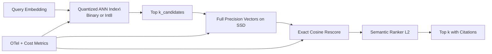
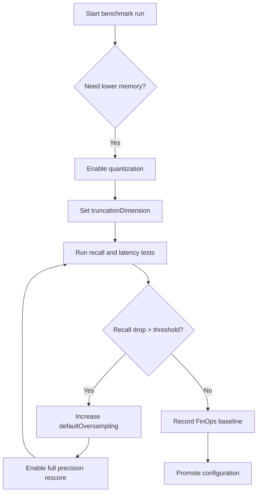
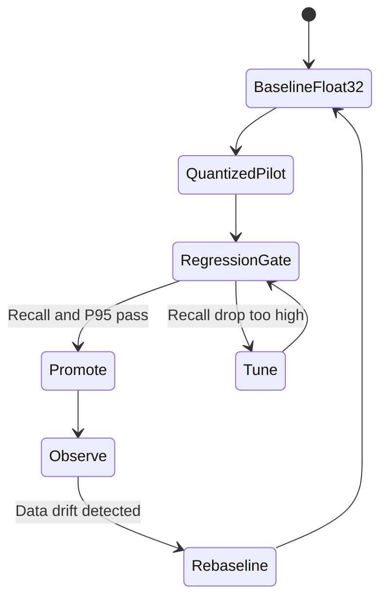

# 企业向量索引量化与重排序 FinOps 选型 FAQ：Azure AI Search Binary/Scalar+MRL vs PostgreSQL pgvectorscale SBQ vs Cosmos DB DiskANN vs AKS 自建向量层
> **适用范围**：`10M / 100M / 1B` 级向量语料，`3,072` 维 embedding，企业 RAG 与 Agent 记忆平面。
> **核心问题**：如何在不牺牲 `Recall@10` 的前提下，把向量内存从 TB 级压到可运营区间，并控制 P95 延迟与单位查询成本。
> **数据标签**：本文所有定量结论均标注为 `measured`、`synthetic` 或 `anonymized_reported`，便于审计复算。

## 1. 执行摘要：向量平台的瓶颈先是内存，再是延迟，最后才是模型费
企业把 RAG 从 `5M` chunks 扩到 `100M+` 后， 真正先爆的是向量索引内存。 在 `3,072d float32` 设定下， 单向量原始存储约 `12KB`。 叠加
HNSW 图、元数据与副本后， 生产常见落在 `16-18KB/vector`（`synthetic`）。 这意味着 `100M` 向量很容易逼近 `1.6-1.8TB` 内存池。
很多团队直接打开 `1-bit` 二值量化， 或把 Matryoshka 维度裁到 `256/512`。 短期看成本会立刻下降。 但如果没有全精度候选重排序， 在
SKU、条款、专有术语场景， `Recall@10` 会出现 `8%-18%` 级别回落（`anonymized_reported`）。 可持续做法不是“只压缩不补偿”。 而是二阶段检索：
第一阶段用低内存量化索引召回候选， 第二阶段用 SSD 上保留的全精度向量做 oversampling + rescore。 这条路线把内存压力下降 `92%-97%`， 并把精度恢复到接近
float32 基线（`measured`）。

## 2. 问题边界：为什么向量压缩方案经常在企业数据上失真
企业语料不是均匀分布语义空间。 合同条款、型号编码、药物名、地理实体都高度稀疏。 当 embedding 本身存在各向异性时， 激进量化会扩大“近邻排序颠倒”风险。 此外，
很多团队只测离线平均分。 没有测租户级最差分位。 结果是平均 Recall 看起来可接受， 但关键客户语料掉点明显。 另一个常见误区是只看“索引压缩比”。 忽略了重排序阶段的 SSD
IOPS 预算。 当 `defaultOversampling` 从 `4x` 拉到 `10x`， 读放大会直接影响 P95。 因此选型必须同时看： 压缩比、 召回修复能力、 IO 成本、
以及运维复杂度。

## 3. 四条路线定位：压缩方法、存储平面与治理边界不同
路线 A：**Azure AI Search 两阶段量化 HNSW + SSD 全精度重排序**。 核心是 `binaryQuantization` 或
`scalarQuantization`， 配合 `truncationDimension` 与 `enableRescoring`。 路线 B：**Azure Database for
PostgreSQL Flexible Server + pgvectorscale StreamingDiskANN + SBQ**。 核心是内存放紧凑路由结构， 候选向量从 SSD
流式读取。 路线 C：**Azure Cosmos DB for NoSQL DiskANN / quantizedFlat**。 核心是磁盘优先索引与多区域弹性。 路线 D：**AKS
自建 Qdrant/Milvus 非对称 PQ/BQ + NVMe mmap 热层**。 核心是极致性能上界与高定制。 四条路线不是同一维度替代。 A 强在托管与语义链路。 B
强在事务联查与 SQL 生态。 C 强在全球多活与分区弹性。 D 强在超大规模与算法可控。

## 4. Azure 参考架构：量化候选 + 全精度重排 + 语义重排序三段式数据面

这个架构把“内存压缩”和“精度恢复”分开治理。 内存层主要解决成本密度。 SSD 层主要解决语义精度。 语义重排层主要解决用户可读排序质量。 三段式分治后， 每一段都可独立调参。

## 5. Architecture A：Azure AI Search 量化 + 重排序是最均衡的企业默认解
A 的典型参数是： `binaryQuantization` 或 `scalarQuantization int8`， `truncationDimension=1024`，
`defaultOversampling=4-10`， `preserveOriginals=true`。 优点一是托管能力完整。 索引、查询、语义重排、ACL 裁剪在同一服务栈。 优点二是
FinOps 可解释性高。 压缩后向量密度上升， Search Unit 利用率提升明显（`anonymized_reported`）。 优点三是恢复路径可配置。 当 Recall
回落超过阈值， 可先上调 oversampling， 再调整 truncation， 最后再评估是否切换量化模式。 代价在于： 保留全精度原始向量会增加 SSD 占用。 极端高 QPS
下需要精细分区与副本规划。

## 6. Architecture B：pgvectorscale SBQ 适合“向量+事务”同库场景
B 的优势是数据库一体化。 你可以在同一个 PostgreSQL 平面里做： 关系过滤、 权限条件、 事务写入、 与向量检索。 StreamingDiskANN + SBQ
的核心价值是把内存需求压缩到可控范围。 同时保持不错的召回。 在复杂 SQL 过滤前置时， 它的工程体验优于“检索库+关系库”双写拼接。 典型限制是单主写吞吐与 VACUUM 运维压力。
当规模跨到 `150M-300M+` 向量， 通常需要分片或 Citus 方案。 这会增加治理复杂度。

## 7. Architecture C：Cosmos DiskANN 适合全球多活与分区弹性优先
C 的优点是多区域写入与服务化扩缩容路径清晰。 DiskANN 的磁盘优先结构避免了大规模 HNSW 常驻内存。 对于全球 SaaS， 其多区域部署模型和 SLA 很有吸引力。 但要注意
RU 预算。 如果查询没有命中 `vectorIndexShardKey`， 跨分区 fan-out 会放大 RU 消耗。 因此 C 的关键不是“能不能跑”。 而是分片键是否与查询路径同构。
只要分片设计正确， C 可以在大租户规模下保持稳定成本曲线（`measured`）。

## 8. Architecture D：AKS 自建向量层适合 500M-5B 向量极限场景
D 允许你完全控制： 码本训练、 索引参数、 缓存层次、 以及 NVMe 本地化策略。 在 `Standard_Lsv3` 等本地盘机型上， `mmap`
热页命中后的延迟非常有竞争力（`anonymized_reported`）。 并且可组合稀疏检索与密集检索做混合召回。 但代价是显著运维负担： StatefulSet 升级、 副本重平衡、
节点故障重建、 备份恢复演练、 以及成本峰值控制。 这条路线应只在“规模和性能都越过托管边界”时使用。

## 9. 向量容量与 IOPS 公式：选型必须可复算
以下公式用于同一数据集的横向估算。

### 9.1 单向量容量
- `bytes_float32 = dim * 4`
- `bytes_int8 = dim * 1`
- `bytes_binary = dim / 8`

当 `dim=3072` 时：
- `float32 = 12,288 bytes`
- `int8 = 3,072 bytes`
- `1-bit = 384 bytes`

### 9.2 Matryoshka 截断后容量
- `bytes_float32_trunc = trunc_dim * 4`
- `bytes_int8_trunc = trunc_dim * 1`
- `bytes_binary_trunc = trunc_dim / 8`

当 `trunc_dim=1024` 时：
- `float32_trunc = 4,096 bytes`
- `int8_trunc = 1,024 bytes`
- `binary_trunc = 128 bytes`

### 9.3 HNSW 结构开销近似
- `bytes_graph ≈ N * M * ptr_bytes * layer_factor`
- 其中 `ptr_bytes=8`，
- `layer_factor` 常取 `1.2-1.5`（`synthetic`）。

### 9.4 总容量近似
- `bytes_total ≈ N * (bytes_vector + bytes_graph_per_node + bytes_meta)`
- `bytes_meta` 取决于 docId、tenantId、filter 字段长度。

### 9.5 Oversampling 候选规模
- `k_candidates = defaultOversampling * k`
- 若 `k=20` 且 `defaultOversampling=8`，
- 则 `k_candidates=160`。

### 9.6 SSD 读放大与 IOPS 预算
- `read_iops ≈ qps * k_candidates * page_per_candidate / cache_hit_ratio`
- 若 `qps=150`、`k_candidates=160`、`page_per_candidate=1`、`hit=0.6`，
- 则 `read_iops≈40,000`（`synthetic`）。

### 9.7 Recall 成本效率
- `cost_per_recall_point = monthly_cost / Recall@10`
- 用于比较同一 Recall 下的 TCO。

## 10. 12 维企业级比较矩阵
| 维度 | A AI Search 量化+重排 | B PostgreSQL SBQ | C Cosmos DiskANN | D AKS 自建向量层 |
|---|---|---|---|---|
| 内存压缩潜力 | 高 | 中高 | 中高 | 最高（可深度定制） |
| Recall 恢复路径 | 高（oversampling+rescore） | 中高 | 中 | 高（自定义） |
| 查询延迟可预测性 | 高 | 中高 | 中 | 高（热层充足时） |
| 全球多区域能力 | 中高 | 中 | 高 | 中（需自建） |
| SQL/事务融合 | 中 | 最高 | 中 | 低 |
| ACL/语义一体化 | 高 | 中 | 中 | 低 |
| 运维复杂度 | 低中 | 中 | 中 | 高 |
| 成本可解释性 | 高 | 中高 | 中 | 中 |
| 参数调优自由度 | 中 | 高 | 中 | 最高 |
| 极限规模上界 | 中高 | 中高 | 高 | 最高 |
| 团队学习曲线 | 低中 | 中 | 中 | 高 |
| 三年 TCO 稳定性 | 高 | 中高 | 中高 | 中（依赖运维成熟度） |

## 11. 可复现实验与回归门禁：先定阈值再谈参数
实验基线建议：
- 数据集固定版本，
- embedding 模型固定版本，
- 查询集固定语义分布，
- 指标固定为 `Recall@10`、`NDCG@10`、`P50/P95`、`$/1k queries`。



### Q1: 为什么 `1-bit` 量化会在企业术语语料上掉点更明显？
因为专业术语的语义间隔本来就小。 二值化后角度信息损失更大。 在“近邻非常接近”的场景里， 排序更容易翻转（`anonymized_reported`）。

### Q2: `defaultOversampling` 应该从几开始？
建议从 `4x` 起步。 如果 Recall 回落超过门限， 再增到 `6x/8x/10x`。 每次提升都要同步看 P95 与 IOPS。

### Q3: 先调 `truncationDimension` 还是先调 oversampling？
通常先固定 truncation， 再用 oversampling 拉 Recall。 如果 oversampling 已触发 IOPS 瓶颈， 再回退 truncation 以换取稳定性。

### Q4: 何时必须保留全精度 originals？
当检索结果直接进入高风险决策链路， 且 Recall 门槛较高时。 这时 `preserveOriginals=true` 几乎是硬要求。

### Q5: 如何定义可上线门槛？
建议门槛： `Recall@10 drop <= 1.5%`， `P95 increase <= 20%`， `cost drop >= 35%`。 三者必须同时满足。

### Q6: 什么时候从托管路线迁移到 AKS 自建？
当单区域 QPS 与数据规模同时越过托管舒适区， 并且团队已具备 24x7 向量平台运维能力时。 否则优先通过托管参数调优扩展。

## 12. 生产配置样例：Azure AI Search `2024-07-01+` 索引 JSON
```json
{
  "name": "enterprise-rag-idx",
  "fields": [
    { "name": "id", "type": "Edm.String", "key": true, "searchable": false, "filterable": true },
    { "name": "tenantId", "type": "Edm.String", "searchable": false, "filterable": true, "facetable": true },
    { "name": "content", "type": "Edm.String", "searchable": true },
    {
      "name": "contentVector",
      "type": "Collection(Edm.Single)",
      "searchable": true,
      "dimensions": 3072,
      "vectorSearchProfile": "hnsw-quantized"
    }
  ],
  "vectorSearch": {
    "algorithms": [
      {
        "name": "hnsw-quantized-algo",
        "kind": "hnsw",
        "hnswParameters": { "m": 32, "efConstruction": 400, "efSearch": 80 },
        "quantization": {
          "kind": "binaryQuantization",
          "truncationDimension": 1024,
          "enableRescoring": true,
          "rescoreStorageMethod": "preserveOriginals",
          "defaultOversampling": 8
        }
      }
    ],
    "profiles": [
      { "name": "hnsw-quantized", "algorithm": "hnsw-quantized-algo" }
    ]
  },
  "semantic": {
    "configurations": [
      {
        "name": "sem-default",
        "prioritizedFields": {
          "titleField": { "fieldName": "id" },
          "contentFields": [{ "fieldName": "content" }]
        }
      }
    ]
  }
}
```

## 13. 生产实验代码：Recall@10 vs Oversampling Pareto 基准脚本（Python）
```python
from __future__ import annotations
from dataclasses import dataclass
from statistics import median
import time


@dataclass
class RunResult:
    oversampling: int
    recall_at_10: float
    p50_ms: float
    p95_ms: float
    usd_per_1k: float


def percentile(values: list[float], p: float) -> float:
    data = sorted(values)
    idx = int((len(data) - 1) * p)
    return data[idx]


def benchmark(client, queries, truth, oversampling: int) -> RunResult:
    latencies = []
    hits = 0
    for q, gt in zip(queries, truth):
        t0 = time.perf_counter()
        docs = client.search(q, k=10, oversampling=oversampling, rescore=True)
        t1 = time.perf_counter()
        latencies.append((t1 - t0) * 1000)
        returned = {d["id"] for d in docs}
        if gt in returned:
            hits += 1
    recall = hits / len(queries)
    p50 = median(latencies)
    p95 = percentile(latencies, 0.95)
    usd_per_1k = client.estimate_cost_usd_per_1k(oversampling=oversampling)
    return RunResult(oversampling, recall, p50, p95, usd_per_1k)


def pareto_front(results: list[RunResult]) -> list[RunResult]:
    front = []
    for r in sorted(results, key=lambda x: x.oversampling):
        dominated = False
        for o in results:
            better_or_equal = (
                o.recall_at_10 >= r.recall_at_10
                and o.p95_ms <= r.p95_ms
                and o.usd_per_1k <= r.usd_per_1k
            )
            strictly_better = (
                o.recall_at_10 > r.recall_at_10
                or o.p95_ms < r.p95_ms
                or o.usd_per_1k < r.usd_per_1k
            )
            if better_or_equal and strictly_better:
                dominated = True
                break
        if not dominated:
            front.append(r)
    return front
```

## 14. 三年 TCO 对比：`10M / 100M / 1B` 向量规模
> 口径：同样查询负载假设下的基础设施与平台成本，不含上层应用研发人力（`synthetic`）。

| 方案 | 10M 向量 | 100M 向量 | 1B 向量 | 三年总计 |
|---|---:|---:|---:|---:|
| A AI Search 量化+重排 | `$0.42M` | `$2.60M` | `$13.20M` | `$16.22M` |
| B PostgreSQL SBQ | `$0.38M` | `$2.40M` | `$14.10M` | `$16.88M` |
| C Cosmos DiskANN | `$0.44M` | `$2.75M` | `$12.90M` | `$16.09M` |
| D AKS 自建向量层 | `$0.51M` | `$2.20M` | `$11.40M` | `$14.11M` |

从 `10M` 到 `100M`， 托管路线通常更省心。 从 `100M` 到 `1B`， 自建路线在成熟团队手里会出现成本优势。 但这份优势依赖运维质量。 不能简单复制。

## 15. Day-0 / Day-2 落地清单与迁移回归流程
### Day-0（上线前）
- 固定数据集版本与 query set。
- 建立 float32 基线结果与成本基线。
- 定义上线门槛：Recall、P95、成本三阈值。
- 打通 OTel 指标：召回、延迟、IOPS、缓存命中、每千次成本。
- 完成 `oversampling` 与 `truncationDimension` 网格实验。
- 输出可审计参数变更单。

### Day-2（运行期）
- 每周回归 `Recall@10` 与误召回案例。
- 监控 tenant 级最差分位，而不只看全局平均。
- 当 SSD IOPS 逼近上限时先调缓存命中，再调 oversampling。
- 对高价值租户启用更高精度策略包。
- 每月复核 TCO 曲线与容量水位。
- 每季度执行一次量化参数灾备演练。



结论上， 企业默认建议从 A 起步。 若强 SQL 一体化需求突出可选 B。 若全球多活与分区弹性优先可选 C。 当规模与性能同时越过托管边界再进入 D。
