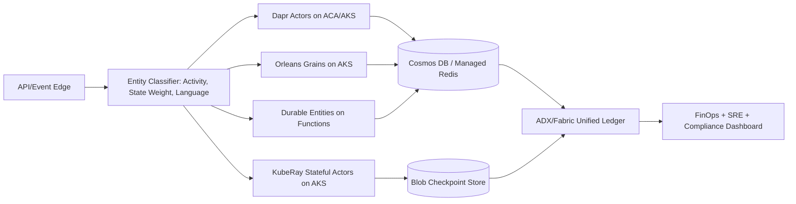

# Enterprise Virtual-Actor Agent Runtime Selection FAQ: Dapr Actors vs Orleans on AKS vs Durable Entities vs KubeRay
> 🌐 **Language Switch**: [中文](virtual-actor-agent-runtime-dapr-actors-vs-orleans-aks-vs-durable-entities-vs-kuberay-selection-faq.md) | **English (current)**  
> Audience: Cloud & AI Principal Solution Architects, platform reliability engineers, distributed runtime teams, and FinOps governance owners.  
> Scope: **Section 3.1 single-activation stateful virtual-actor compute substrates** for `100K–10M` per-entity agents, distinct from multi-step workflow orchestration topics such as #47 in Section 3.5.  
> Objective: Deliver a production decision framework for turn isolation, placement rebalancing, memory density, and operating economics across enterprise virtual-actor runtimes on Azure.  

## 1. Executive finding: virtual-actor architecture is primarily a concurrency-semantics and failure-semantics decision
Most teams begin by framing virtual actors as a persistence problem.
That framing is incomplete.
At enterprise scale, correctness and latency are dominated by runtime semantics.
Per-entity turn ordering becomes the key unit of safety.
Placement behavior becomes the key unit of stability.
State durability remains necessary.
It is no longer sufficient.
If the runtime does not guarantee single activation for a logical entity, external lock systems grow rapidly.
Teams then add Redis lock layers.
They add Cosmos optimistic retries.
They add compensating workflows.
Those additions usually increase complexity faster than throughput.
Virtual-actor runtimes reduce this complexity by making the entity itself the synchronization boundary.
However, each runtime does it differently.
Dapr optimizes for polyglot teams and fast adoption.
Orleans optimizes for .NET-native high-density grain meshes.
Durable Entities optimizes for extreme idle populations and scale-to-zero economics.
KubeRay optimizes for Python-heavy stateful compute and simulation workloads.
The recommended architecture is rarely a single choice.
It is usually a layered routing strategy by entity activity class and state weight.
This guide formalizes that layered strategy with quantitative checkpoints.

## 2. Problem definition: moving from request concurrency to entity concurrency changes architecture math
Traditional microservices optimize request throughput.
Virtual-actor systems optimize entity turn throughput.
That shift changes what capacity means.
Node sizing must account for active entity residency, not only HTTP connections.
Failure handling must account for activation migration, not only pod restart.
Queueing models must account for per-entity serial lanes, not global worker pools.
Without this shift, teams misread benchmark numbers.
They overestimate throughput under conflict-heavy workloads.
They underestimate long-turn head-of-line risk.
They underestimate rebalance pauses during autoscale events.
The mismatch becomes visible under LLM-assisted turn execution.
A single actor turn may await external streaming for `3–15s`.
If that await blocks the only activation slot, status and cancel operations queue behind it.
Business impact appears as control-plane unresponsiveness.
Architecture reviews must therefore evaluate runtime semantics and operational controls together.
Database benchmarks alone cannot answer this question.

## 3. Four-path architecture model for enterprise virtual-actor platforms
Path A is Dapr virtual actors on ACA or AKS.
Path B is Microsoft Orleans grains on AKS.
Path C is Azure Functions Durable Entities.
Path D is KubeRay stateful Ray actors on AKS.
Path A is strongest for polyglot teams.
Path B is strongest for .NET-heavy low-latency grain communication.
Path C is strongest for highly idle populations with bursty activation.
Path D is strongest for Python-native heavy state and simulation loops.
Route selection should begin with entity activity ratio.
Hot entities and cold entities should not run on identical substrate assumptions.
Route selection should then include state weight.
Light externalized state and heavy in-process state have different cost envelopes.
Route selection should finally include organizational language topology.
If multiple language teams must move together, Dapr can lower coordination cost.
If core domains are .NET and latency critical, Orleans often wins.
If 99% of entities are inactive most of the day, Durable Entities can dominate TCO.
If model-driven numeric state dominates, Ray actors can be the practical substrate.

## 4. Twelve-dimension comparison matrix for runtime selection
| Dimension | Dapr Actors on ACA/AKS | Orleans Grains on AKS | Durable Entities on Functions | KubeRay Stateful Actors |
|---|---|---|---|---|
| Single-activation turn isolation | High | High | High | Medium-high |
| Polyglot team support | High | Medium | Medium | High |
| Hot-path intra-runtime latency | Medium | High | Low-medium | Medium-high |
| Idle-population cost efficiency | Medium | Medium | High | Low-medium |
| Cold activation jitter profile | Medium | Medium | Medium-high | Medium |
| External state-store integration | High | High | High | Medium |
| Heavy in-memory state friendliness | Medium | Medium | Low | High |
| Operational complexity | Medium | Medium-high | Low-medium | High |
| Placement rebalance controllability | Medium | High | Medium | Medium |
| Governance consistency at scale | High | Medium-high | High | Medium-high |
| 10M entity operating pattern fit | Medium-high | High | High | Medium-high |
| Three-year TCO predictability | High | High | High | Medium |
This matrix is intentionally operational.
It should be paired with workload cohorts and compliance class.
Treat it as a routing design artifact, not a static ranking chart.

## 5. Path A deep dive: Dapr virtual actors for polyglot enterprise teams
Dapr virtual actors provide a language-neutral actor abstraction.
Python, TypeScript, and .NET teams can share one control plane.
Single-activation behavior reduces lock contention complexity.
Actor reminders provide native scheduled wake-up semantics.
This is useful for proactive maintenance and account re-evaluation patterns.
State can be externalized to Cosmos DB or Managed Redis depending on access profile.
On ACA, operational onboarding can be fast.
On AKS, platform teams gain finer control over scheduling and scaling.
The main trade-off is sidecar IPC overhead.
In chatty micro-turn patterns, sidecar hops become measurable.
Another practical trade-off is placement-ring turbulence during autoscale.
Rapid KEDA-driven scale changes can trigger short rebalance pauses.
Mitigation requires gradual scaling policy and pre-warmed pools for critical entities.
Dapr is usually excellent for multi-language organizations with moderate-to-high concurrency requirements.
It is less optimal when ultra-low in-process messaging latency is the top requirement.

## 6. Path B deep dive: Orleans grains for dense .NET-native actor meshes
Orleans is highly optimized for .NET actor communication.
In many enterprise profiles, grain-to-grain messaging is sub-millisecond.
This supports high-frequency control loops and status queries.
Memory density can be strong on general-purpose nodes.
`50,000–200,000` active grains per `D8ds_v5` node is a practical reference envelope.
The effective density depends on state footprint and timer mix.
Orleans provides explicit interleaving controls.
`[Reentrant]` and `[MayInterleave]` can preserve responsiveness under slow external calls.
They must be applied carefully.
Overly permissive interleaving can corrupt shared turn state.
A proven pattern is strict serial writes with selective interleaving for cancel and status.
Orleans also aligns well with distributed actor hosting patterns in Microsoft agent runtimes.
Trade-offs include language concentration and integration overhead for non-.NET teams.
Orleans is usually the preferred path where deterministic control-plane latency is critical.

## 7. Path C deep dive: Durable Entities for extreme idle-population economics
Durable Entities shift the optimization target.
They prioritize idle efficiency over in-memory hot-path latency.
This is valuable when millions of entities are mostly inactive.
Typical examples include customer accounts, IoT twins, and periodic compliance checks.
Processing is serialized through durable storage and queue semantics.
The latency profile is generally higher than in-memory actor meshes.
`40–150ms` additional dispatch and persistence overhead is common in practical workloads.
For asynchronous and low-interactivity paths, this can be acceptable.
For sub-10ms control loops, it is not.
The architecture value appears when active ratio drops below single-digit percentages.
Then scale-to-zero dramatically lowers standing cost.
Durable Entities therefore fit cold-entity heavy portfolios.
They are not a universal substitute for low-latency actor meshes.

## 8. Path D deep dive: KubeRay stateful actors for Python-heavy computational agents
KubeRay supports Python-native stateful actor systems.
It is practical where per-entity state includes numeric tensors or simulation context.
This includes quantitative research and large optimization domains.
Ray lineage and checkpointing offer recovery controls.
The recovery semantics differ from transparent virtual-actor reactivation.
Application logic typically carries more explicit lifecycle handling.
On AKS, mixed CPU and GPU pools can be managed with autoscaling controllers.
CPU pools host lightweight actors.
GPU pools host heavy model-state actors.
This path can achieve strong throughput in numeric-heavy domains.
Its risks are operational.
Object store growth and leaked actors can inflate cost quickly.
Strong observability and cleanup policy are mandatory.
KubeRay is best treated as a specialized lane, not a default lane.

## 9. Quantitative Q&A: eight hard questions for architecture reviews
**Q1: How does stateless pod + Cosmos ETag retry amplification compare to single-activation actor turns.**  
A1: Under same-entity concurrent writes, ETag retries can multiply operation attempts by `2x–3x`; moving contention into single-activation lanes commonly cuts effective retry inflation and stabilizes P95 turn latency.  
**Q2: Why is a `12s` LLM await a critical head-of-line trap in actor systems.**  
A2: If the activation lock is held across the await, control requests queue behind the same turn; cancellation and status checks can be delayed by the full await window unless turn-splitting is implemented.  
**Q3: What memory sizing heuristic is useful for `2M` entities with `80K` active concurrently.**  
A3: At `~60KB` runtime footprint per active entity, hot state is `~4.8GB`; with framework and cache overhead multipliers (`2.0–2.8x`), practical allocatable memory should target roughly `9.6–13.4GB` plus safety margin.  
**Q4: What density gap is typical between Orleans and Dapr in small-message .NET-heavy lanes.**  
A4: In many profiles Orleans achieves `15%–35%` higher active-entity density per node than sidecar-heavy paths, though workload mix and serialization cost materially affect this spread.  
**Q5: When do Durable Entities outperform always-on actor hosts on cost.**  
A5: When active ratio falls below about `1%` and strict low-latency interaction is not required, added dispatch latency can be traded for major standing-cost reduction, often above `50%` in cold-heavy portfolios.  
**Q6: How should Dapr placement rebalance pause risk be estimated during aggressive autoscale.**  
A6: A practical upper-bound model is migration batch count times average reactivation cost per batch; lowering batch size and pre-warming critical partitions reduces visible pause windows.  
**Q7: How should slow-turn control responsiveness targets be defined.**  
A7: Separate write-turn SLA from control-turn SLA; for example keep status/cancel paths under `5ms–20ms` by allowing interleaving or out-of-band control grains while long inference runs asynchronously.  
**Q8: How should checkpoint cadence be selected for KubeRay actors.**  
A8: Derive interval from maximum acceptable replay window; too frequent checkpoints raise storage and I/O cost, too sparse checkpoints increase recovery lag and lost-work exposure.  
Quantitative gates should be tied to replayable load tests.
Static assumptions should be retired after each major traffic-shape change.

## 10. Reference architecture diagram for multi-runtime virtual-actor substrate

The architecture emphasizes route-by-entity characteristics.
It also centralizes audit and cost telemetry for cross-runtime governance.

## 11. Sequence diagram for non-blocking turn split with control responsiveness
```mermaid
sequenceDiagram
  participant Client
  participant Actor as Virtual Actor
  participant Queue as Work Queue
  participant Worker as LLM Worker
  participant Reminder as Reminder Callback

  Client->>Actor: StartTurn(entityId, payload)
  Actor->>Queue: enqueue async inference task
  Actor-->>Client: accepted(correlationId)
  Worker->>Queue: pull task
  Worker-->>Actor: completion event
  Actor->>Reminder: schedule finalize tick
  Reminder->>Actor: finalize callback
  Actor-->>Client: state=ready / notify
```
This sequence prevents long awaits from monopolizing activation slots.
Control operations remain responsive while work continues asynchronously.

## 12. Production code sample: Python Dapr actor and .NET Orleans turn-split pattern
```python
from dapr.actor import Actor, actormethod
from dapr.actor.runtime.context import ActorRuntimeContext
from dapr.clients import DaprClient
import json


class AccountGuardrailActor(Actor):
    def __init__(self, ctx: ActorRuntimeContext, actor_id: str):
        super().__init__(ctx, actor_id)

    @actormethod(name="StartTurn")
    async def start_turn(self, payload: dict) -> dict:
        s = await self._state_manager.try_get_state("turn")
        turn = s.value if s.exists else {"status": "idle"}
        turn["status"] = "queued"
        turn["corr"] = payload["corr"]
        await self._state_manager.set_state("turn", turn)
        await self._state_manager.save_state()
        with DaprClient() as c:
            c.publish_event(pubsub_name="entity-bus", topic_name="llm-turn-jobs", data=json.dumps(payload))
        await self.register_reminder("finalize", b"", due_time="10s", period="0s")
        return {"accepted": True, "corr": payload["corr"]}

    @actormethod(name="GetTurnState")
    async def get_turn_state(self) -> dict:
        s = await self._state_manager.try_get_state("turn")
        return s.value if s.exists else {"status": "missing"}
```
```csharp
public interface IPortfolioGrain : IGrainWithStringKey
{
    Task<StartResult> StartTurn(TurnRequest request);
    Task<TurnStateDto> Query();
    Task Cancel(string correlationId);
}

[Reentrant]
public sealed class PortfolioGrain : Grain, IPortfolioGrain, IRemindable
{
    private readonly IPersistentState<PortfolioState> _state;

    public async Task<StartResult> StartTurn(TurnRequest request)
    {
        _state.State.CorrelationId = request.CorrelationId;
        _state.State.Status = "queued";
        await _state.WriteStateAsync();
        await GrainFactory.GetGrain<ITurnWorkerGrain>(request.CorrelationId).Run(request);
        await RegisterOrUpdateReminder("finalize", TimeSpan.FromSeconds(8), TimeSpan.FromMilliseconds(-1));
        return new StartResult(request.CorrelationId, true);
    }

    [MayInterleave(nameof(IsControl))]
    public Task<TurnStateDto> Query() => Task.FromResult(new TurnStateDto(_state.State.Status, _state.State.CorrelationId));

    public async Task Cancel(string correlationId)
    {
        if (_state.State.CorrelationId == correlationId)
        {
            _state.State.Status = "cancelled";
            await _state.WriteStateAsync();
        }
    }

    public async Task ReceiveReminder(string reminderName, TickStatus status)
    {
        if (reminderName == "finalize" && _state.State.Status == "queued")
        {
            _state.State.Status = "ready";
            await _state.WriteStateAsync();
        }
    }

    public static bool IsControl(InvokeMethodRequest req)
        => req.MethodName is nameof(Query) or nameof(Cancel);
}
```
The implementation principle is explicit turn split.
Long-running inference is externalized.
Actor control semantics remain responsive and deterministic.

## 13. Production IaC sample: Dapr actor state store and runtime deployment controls
```yaml
apiVersion: dapr.io/v1alpha1
kind: Component
metadata:
  name: actor-statestore
  namespace: virtual-actors
spec:
  type: state.azure.cosmosdb
  version: v1
  metadata:
    - name: url
      value: https://virtual-actor-cosmos.documents.azure.com:443/
    - name: database
      value: actorDb
    - name: collection
      value: actorState
    - name: actorStateStore
      value: "true"
    - name: contentType
      value: application/json
auth:
  secretStore: kubernetes
```
```yaml
apiVersion: apps/v1
kind: Deployment
metadata:
  name: dapr-virtual-actor-service
  namespace: virtual-actors
spec:
  replicas: 8
  selector:
    matchLabels:
      app: dapr-virtual-actor-service
  template:
    metadata:
      labels:
        app: dapr-virtual-actor-service
      annotations:
        dapr.io/enabled: "true"
        dapr.io/app-id: "entity-guardrail-actor"
        dapr.io/app-port: "8080"
        dapr.io/config: "actor-runtime-config"
    spec:
      containers:
        - name: actor-service
          image: ghcr.io/example/entity-guardrail-actor:stable
          env:
            - name: ACTOR_IDLE_TIMEOUT
              value: "20m"
            - name: ACTOR_SCAN_INTERVAL
              value: "30s"
            - name: MAX_INFLIGHT_TURNS
              value: "2000"
            - name: PLACEMENT_REBALANCE_MODE
              value: "gradual"
```
These controls prioritize rebalance safety and predictable activation behavior.
They should be paired with rollout guardrails and canary traffic policies.

## 14. Enterprise scenarios and FinOps model
### Scenario A: connected fleet and smart-grid operator with `1.8M` digital-twin entities
Each vehicle and inverter is represented by a per-entity agent.
Telemetry bursts are highly uneven across time windows.
The platform uses Dapr for hot entities and Durable Entities for long-idle cohorts.
Reminders trigger proactive maintenance checks.
Conflict retries decline because turn isolation is native.
Cold populations no longer consume always-on compute budgets.
The operator gains predictable capacity planning for seasonal peaks.
### Scenario B: retail brokerage and wealth platform with `400K` active portfolio guardrail agents
Per-account turn ordering must be strict.
Cancel-on-barge-in must remain under `5ms` for control responsiveness.
The platform uses Orleans for core account grains.
Slow LLM work is split into worker grains and asynchronous callbacks.
Control queries use constrained interleaving.
State mutation remains serial for correctness.
The platform meets low-latency control targets without sacrificing consistency.
### FinOps TCO comparison table for runtime planning
| Metric | Dapr-primary lane | Orleans-primary lane | Durable-primary lane | KubeRay-primary lane |
|---|---:|---:|---:|---:|
| Typical active entity density per node | 30K–90K | 50K–200K | N/A | 5K–40K |
| Idle-cost efficiency | Medium | Medium | High | Low-medium |
| Platform operations staffing level | Medium | Medium-high | Low-medium | High |
| Control-plane latency fitness | Medium-high | High | Low-medium | Medium |
| Heavy in-memory state suitability | Medium | Medium | Low | High |
| Three-year TCO predictability | High | High | High | Medium |
| Rebalance/upgrade turbulence risk | Medium | Medium | Low | Medium-high |
| Polyglot organization onboarding friction | Low | Medium-high | Medium | Medium |
Use this table as a planning baseline.
Then calibrate with environment-specific measurements and governance overhead.

## 15. Day-0 and Day-2 checklist for virtual-actor production readiness
- Standardize entity identity schema and idempotency-key contract.
- Define turn timeout, cancellation, and retry policy per runtime lane.
- Enforce asynchronous turn-split pattern for long LLM calls.
- Separate state-mutating methods from control-query methods.
- Set actor idle timeout and scan interval with measured baselines.
- Track per-entity queue length and wait-time distributions.
- Track placement rebalance duration and migration failure rates.
- Add bounded retry policy for reminder delivery failures.
- Implement hot/cold entity routing with explicit migration criteria.
- Run failure replay drills to validate reactivation correctness.
- Bind cost dashboards to active-entity distribution by lane.
- Execute canary rebalance stress tests before every runtime upgrade.
Each item should map to an accountable owner.
Each item should produce auditable evidence.
This is the minimum discipline required for sustained enterprise operations.
