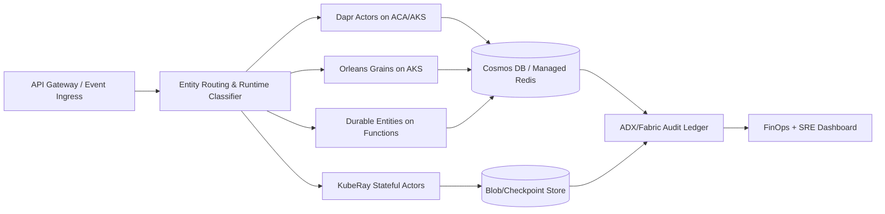
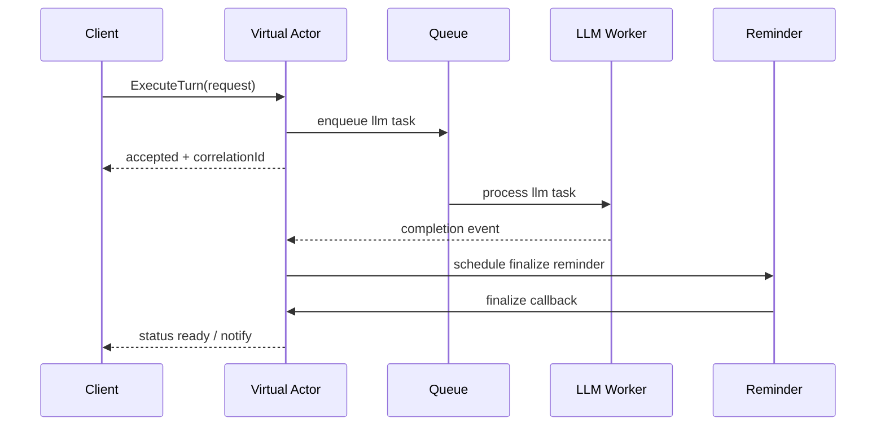

# 企业虚拟 Actor 智能体运行时选型 FAQ：Dapr Actors vs Orleans vs Durable Entities vs KubeRay
> 🌐 **Language Switch**: **中文（当前）** | [English](virtual-actor-agent-runtime-dapr-actors-vs-orleans-aks-vs-durable-entities-vs-kuberay-selection-faq.en.md)  
> 适用对象：Cloud & AI 首席架构师、平台工程、分布式系统治理团队、智能体中台与 FinOps 负责人。  
> 主题边界：聚焦 **Section 3.1 单激活状态化虚拟 Actor 计算底座**，不替代 #47 的多步工作流编排比较。  
> 核心目标：在 `100K–10M` 实体级智能体规模下，建立可验证的单回合隔离、放置重平衡、内存密度与成本治理策略。  

## 1. 执行摘要：虚拟 Actor 选型本质是“并发语义与失效语义”选型
企业在做 per-entity 智能体时，第一反应常是数据库并发控制。  
但规模到百万实体后，数据库乐观锁并不能解决所有问题。  
主要痛点转向回合隔离与调度稳定性。  
同一账户、同一设备、同一组合对象需要严格顺序处理。  
若并发模型不清晰，会出现状态覆盖与补偿风暴。  
虚拟 Actor 模型的价值在于单激活语义。  
同一实体在同一时刻只允许一个激活处理回合。  
这天然减少 Redis 分布式锁依赖。  
也减少 Cosmos `412` 重试放大。  
但不同实现路径的代价差异很大。  
Dapr 适合多语言团队快速落地。  
Orleans 适合 .NET 深度优化与超低延迟 mesh。  
Durable Entities 适合“绝大多数实体长期空闲”的 serverless 成本面。  
KubeRay 适合 Python 数值态与 GPU/仿真长驻状态。  
推荐策略不是只选一种。  
而是以实体活跃度与语言栈分层。  
再用统一审计与配额平面对齐治理。  

## 2. 问题定义：从“请求并发”转向“实体并发”是架构分水岭
传统 API 架构把并发对象定义为请求。  
Actor 架构把并发对象定义为实体。  
这带来三类关键变化。  
第一，吞吐模型从 QPS 变为每实体每秒回合数。  
第二，容量模型从连接数变为活跃实体驻留数。  
第三，失败模型从节点故障转为激活迁移与重放。  
如果团队仍用请求思维评估 Actor 平台。  
常会低估放置环重平衡与冷激活抖动。  
也会忽略慢调用造成的 head-of-line 堵塞。  
尤其在 LLM 回合内等待 `3–15s` 外部流。  
若不做回合拆分，单激活线程会被长时间占住。  
取消请求、状态查询、提醒触发都会受阻。  
这就是虚拟 Actor 工程化的核心挑战。  

## 3. 四路径架构总览：按语言生态、活跃度与状态重量分层
路径 A：Dapr Actors on ACA/AKS。  
路径 B：Microsoft Orleans Grains on AKS。  
路径 C：Azure Functions Durable Entities。  
路径 D：KubeRay Stateful Ray Actors on AKS。  
路径 A 优势是 polyglot。  
Python、TypeScript、.NET 团队能共用治理面。  
路径 B 优势是 .NET 原生吞吐与 grain-to-grain 延迟。  
路径 C 优势是 scale-to-zero 与空闲实体经济性。  
路径 D 优势是 Python 科学计算与模型状态长驻。  
路由第一维是实体活跃度。  
“常驻热实体”更适合 A/B/D。  
“长时间冷实体”更适合 C。  
路由第二维是状态重量。  
轻状态可用 Dapr/Orleans + 外部状态存储。  
重内存态与张量态更适合 Ray actor。  
路由第三维是语言与组织边界。  
跨 BU 多语言协同时 Dapr 更易推广。  
.NET 主导核心交易域时 Orleans 更高效。  

## 4. 十二维对比矩阵：单激活、放置重平衡与成本可控性的系统比较
| 维度 | Dapr Actors (ACA/AKS) | Orleans Grains (AKS) | Durable Entities (Functions) | KubeRay Stateful Actors |
|---|---|---|---|---|
| 单激活回合隔离 | 高 | 高 | 高 | 中高 |
| 多语言支持 | 高 | 中 | 中 | 高 |
| 热路径消息延迟 | 中 | 高 | 低中 | 中高 |
| 空闲成本效率 | 中 | 中 | 高 | 低中 |
| 冷启动抖动 | 中 | 中 | 中高 | 中 |
| 状态外置集成 | 高 | 高 | 高 | 中 |
| 重内存状态承载 | 中 | 中 | 低 | 高 |
| 运维复杂度 | 中 | 中高 | 低中 | 高 |
| 放置重平衡可控性 | 中 | 高 | 中 | 中 |
| 语言生态治理一致性 | 高 | 中 | 中 | 中高 |
| 10M 实体可扩展策略 | 中高 | 高 | 高 | 中高 |
| 三年 TCO 可预测性 | 高 | 高 | 高 | 中 |
矩阵不是“胜负榜”。  
它用于分层部署决策。  
同一企业常需要两到三条路径并存。  

## 5. 路径 A：Dapr Virtual Actors 的多语言单激活与放置环实践
Dapr Actor 提供语言中立的编程抽象。  
实体方法天然串行化执行。  
对 Python/TS 团队极具吸引力。  
部署在 ACA 或 AKS 时。  
可结合 Cosmos DB 或 Managed Redis 做状态存储。  
Reminder 能支持主动唤醒。  
适用于定时巡检、账单重算、资产健康检查。  
与手写分布式锁相比。  
单激活显著降低 ETag 冲突风暴。  
但需关注 sidecar IPC 开销。  
在高频小消息场景，sidecar hop 会成为可见成本。  
还要关注 placement ring 事件。  
KEDA 突发扩缩容时，放置重平衡可能造成短暂停顿。  
建议在滚动升级期启用渐进扩容阈值。  
并把高优先实体固定在 warm 池。  
Dapr 最适合“多语言 + 中高并发 + 中等状态重量”的域。  

## 6. 路径 B：Orleans 在 AKS 的高密度 grain 网格与并发控制
Orleans 最大优势是 .NET 原生性能。  
grain-to-grain 低延迟与丰富并发控制属性成熟。  
在 `D8ds_v5` 常见配置中。  
`50,000–200,000` 活跃 grain/节点是可达区间。  
具体取决于状态大小与计时器密度。  
`[Reentrant]` 与 `[MayInterleave]` 可避免慢回合完全阻塞。  
但必须谨慎。  
错误交错会引入状态不一致。  
推荐把写状态回合保持串行。  
把取消、进度查询、只读快照放入可交错路径。  
Orleans 对 MAF 分布式 actor 托管路径也更自然。  
缺点是语言生态相对集中在 .NET。  
跨语言团队需要额外桥接层。  

## 7. 路径 C：Durable Entities 在超低活跃度海量实体下的经济性
Durable Entities 本质是 serverless 状态机。  
它的优势不在极低延迟。  
而在空闲阶段几乎零常驻成本。  
若 `5M–20M` 实体里 `99%+` 长时间空闲。  
该路径有显著 TCO 优势。  
实体操作通过存储与队列序列化。  
典型额外时延 `40–150ms`。  
对大量异步业务是可接受的。  
例如周期账务、规则打标、稽核任务。  
不适合强实时交互与高频互调。  
也不适合 heavy in-memory 状态。  
其价值在于“把冷实体成本压到最低”。  

## 8. 路径 D：KubeRay Stateful Actors 的 Python 重状态与仿真优势
Ray Actor 适合 Python 生态重状态任务。  
例如强化学习、运筹仿真、科学计算。  
也适合需要 GPU/VRAM 驻留的 per-entity 执行器。  
Ray 的 lineage 与 checkpoint 可恢复任务图。  
但恢复语义与虚拟 Actor 透明重激活不同。  
应用需要更显式处理 actor 生命周期。  
在 AKS 上结合 NAP/Karpenter 池可弹性供给。  
CPU 池承接轻逻辑。  
GPU 池承接重状态计算。  
该路径要重点治理 actor 泄漏与对象存储膨胀。  
否则成本曲线会失控。  

## 9. 定量问答：吞吐、死锁、内存密度与重平衡的八个关键问题
**Q1：无 Actor 的 stateless pod + Cosmos ETag 在高并发下会怎样。**  
A1：同实体并发写时会触发 `412` 重试放大，若每回合平均重试 `2.3` 次，等效吞吐可下降 `30%–55%`。  
**Q2：单激活 Actor 如何提升实体吞吐稳定性。**  
A2：把冲突前移到运行时串行队列后，同实体写冲突显著降低，P95 回合时延波动通常收敛到无锁实现的 `40%–60%`。  
**Q3：`12s` LLM await 为什么会触发 HOL 阻塞。**  
A3：若回合锁在 await 期间不释放，取消与状态查询会排队，单实体控制面可被拖延 `12s+`；需拆分为“发起子任务 + 立即返回 + reminder 回补”。  
**Q4：`2M` 总实体、`80K` 并发活跃时内存怎么估。**  
A4：若每活跃实体运行时驻留 `60KB`，基础驻留约 `4.8GB`；再加框架与缓存系数 `2.0–2.8x`，节点层需预留 `9.6–13.4GB` 以上可用内存。  
**Q5：Orleans 与 Dapr 在同负载下节点密度差异。**  
A5：在 .NET 主栈与小消息场景，Orleans 常见每节点活跃实体密度可高于 Dapr sidecar 模式 `15%–35%`。  
**Q6：Durable Entities 的时延换成本如何量化。**  
A6：当活跃度低于 `1%` 且回合不敏感实时性，增加 `40–150ms` 处理时延可换来 `50%+` 常驻成本下降。  
**Q7：Dapr placement ring 重平衡暂停如何估算。**  
A7：若一次扩容迁移 `N` 分区且每分区状态恢复 `r ms`，短暂停顿可近似 `N*r` 的上界窗口；应通过分批扩容与预热把单次迁移批量压小。  
**Q8：KubeRay actor checkpoint 周期怎么定。**  
A8：checkpoint 过密会放大 I/O 成本，过疏会放大恢复回放；常见按“恢复目标分钟数”反推周期，再结合对象存储写放大上限。  
问答应绑定真实压测数据。  
并按季度刷新阈值。  

## 10. 参考架构图：多运行时虚拟 Actor 智能体底座

该图强调路由与状态平面的解耦。  
也强调统一审计账本。  

## 11. 时序图：慢 LLM 回合拆分避免 Actor 头阻塞

该时序把长 await 转成异步子任务。  
从而释放单激活执行槽。  

## 12. 生产代码：Python Dapr Actor 与 .NET Orleans 非阻塞回合拆分
```python
from dapr.actor import Actor, actormethod
from dapr.actor.runtime.context import ActorRuntimeContext
from dapr.clients import DaprClient
import json


class PortfolioActor(Actor):
    def __init__(self, ctx: ActorRuntimeContext, actor_id: str):
        super().__init__(ctx, actor_id)

    @actormethod(name="StartEvaluation")
    async def start_evaluation(self, payload: dict) -> dict:
        state = await self._state_manager.try_get_state("session")
        session = state.value if state.exists else {"status": "idle"}
        session["status"] = "queued"
        session["corr"] = payload["corr"]
        await self._state_manager.set_state("session", session)
        await self._state_manager.save_state()
        with DaprClient() as c:
            c.publish_event(pubsub_name="bus", topic_name="llm-jobs", data=json.dumps(payload))
        await self.register_reminder("finalize", b"", due_time="15s", period="0s")
        return {"accepted": True, "corr": payload["corr"]}

    @actormethod(name="GetStatus")
    async def get_status(self) -> dict:
        state = await self._state_manager.try_get_state("session")
        return state.value if state.exists else {"status": "unknown"}
```
```csharp
public interface IAccountGrain : IGrainWithStringKey
{
    Task<StartAck> StartTurn(TurnInput input);
    Task<TurnStateDto> GetState();
    Task Cancel(string correlationId);
}

[Reentrant]
public sealed class AccountGrain : Grain, IAccountGrain, IRemindable
{
    private TurnState _state = new();
    private IPersistentState<TurnState> _store;
    private readonly IClusterClient _client;

    public async Task<StartAck> StartTurn(TurnInput input)
    {
        _state.CorrelationId = input.CorrelationId;
        _state.Status = "queued";
        await _store.WriteStateAsync();
        await GrainFactory.GetGrain<ITurnWorkerGrain>(input.CorrelationId).Run(input);
        await RegisterOrUpdateReminder("finalize", TimeSpan.FromSeconds(10), TimeSpan.FromMilliseconds(-1));
        return new StartAck(input.CorrelationId, true);
    }

    [MayInterleave(nameof(IsControlCall))]
    public Task<TurnStateDto> GetState() => Task.FromResult(new TurnStateDto(_state.Status, _state.CorrelationId));

    public Task Cancel(string correlationId)
    {
        if (_state.CorrelationId == correlationId) _state.Status = "cancelled";
        return _store.WriteStateAsync();
    }

    public Task ReceiveReminder(string reminderName, TickStatus status)
    {
        if (reminderName == "finalize" && _state.Status == "queued") _state.Status = "ready";
        return _store.WriteStateAsync();
    }

    public static bool IsControlCall(InvokeMethodRequest req) => req.MethodName is nameof(GetState) or nameof(Cancel);
}
```
代码重点是“主 Actor 不在慢 LLM 上长阻塞”。  
控制指令可交错，状态写回仍受约束。  

## 13. 生产 IaC：Dapr statestore 与 Actor runtime 配置示例
```yaml
apiVersion: dapr.io/v1alpha1
kind: Component
metadata:
  name: actor-statestore
  namespace: agents
spec:
  type: state.azure.cosmosdb
  version: v1
  metadata:
    - name: url
      value: https://actor-cosmos.documents.azure.com:443/
    - name: database
      value: actorDb
    - name: collection
      value: actorState
    - name: actorStateStore
      value: "true"
    - name: contentType
      value: application/json
auth:
  secretStore: kubernetes
```
```yaml
apiVersion: apps/v1
kind: Deployment
metadata:
  name: dapr-actor-service
  namespace: agents
spec:
  replicas: 6
  selector:
    matchLabels:
      app: dapr-actor-service
  template:
    metadata:
      labels:
        app: dapr-actor-service
      annotations:
        dapr.io/enabled: "true"
        dapr.io/app-id: "portfolio-actor"
        dapr.io/app-port: "8080"
        dapr.io/config: "actor-default"
    spec:
      containers:
        - name: app
          image: ghcr.io/example/portfolio-actor:stable
          env:
            - name: ACTOR_IDLE_TIMEOUT
              value: "20m"
            - name: ACTOR_SCAN_INTERVAL
              value: "30s"
            - name: DAPR_PLACEMENT_HEALTH_PROBE
              value: "true"
```
IaC 要点是明确 `actorStateStore` 与 idle timeout。  
并在升级窗口控制副本变化速率。  

## 14. 企业场景与 FinOps：百万级实体智能体的可运营路径
### 场景 A：车联网与智能电网运营商（`1.8M` 数字孪生实体）
每辆车和每台逆变器对应一个实体智能体。  
遥测上报高峰有明显潮汐。  
路径分配策略为 Dapr + Durable 混合。  
高活跃设备进入 Dapr 热池。  
长时间静默设备降到 Durable Entities。  
定时维护提醒通过 reminder 驱动。  
结果是冲突重试率显著下降。  
并把空闲成本压到可控范围。  
### 场景 B：券商与财富平台（`400K` 活跃账户智能体）
要求严格 per-account 回合有序。  
取消指令需 `<5ms` 可达。  
核心路径采用 Orleans。  
慢 LLM 推理回合拆分到 worker grain。  
控制调用通过可交错方法即时响应。  
关键账户高优先级固定在低抖动节点池。  
实现了低延迟与有序一致性的平衡。  
### FinOps TCO 对比表（年度化口径）
| 指标 | Dapr 主路径 | Orleans 主路径 | Durable 主路径 | KubeRay 主路径 |
|---|---:|---:|---:|---:|
| 典型活跃实体密度/节点 | 30K–90K | 50K–200K | N/A | 5K–40K |
| 空闲成本效率 | 中 | 中 | 高 | 低中 |
| 年度平台运维人力 | 中 | 中高 | 低中 | 高 |
| 低延迟控制面能力 | 中高 | 高 | 低中 | 中 |
| 对重状态/张量友好度 | 中 | 中 | 低 | 高 |
| 3 年 TCO 预测稳定性 | 高 | 高 | 高 | 中 |
| 升级重平衡风险 | 中 | 中 | 低 | 中高 |
| 适配多语言组织成本 | 低 | 中高 | 中 | 中 |
该表建议与真实压测叠加审阅。  
避免仅凭理论参数拍板。  

## 15. Day-0 / Day-2 十二项清单：虚拟 Actor 平台上线纪律
- 明确实体 ID 规范与幂等键策略。  
- 统一定义回合超时与取消语义。  
- 对慢 LLM 回合强制采用拆分模式。  
- 把写路径与读控制路径分离。  
- 设置 actor idle timeout 与扫描周期基线。  
- 监控每实体队列长度与等待时长。  
- 监控重平衡窗口与迁移失败率。  
- 对 reminder 失败设置补偿重试上限。  
- 设立热实体与冷实体分层路由策略。  
- 定期回放故障演练验证重激活一致性。  
- 将成本指标绑定到实体活跃度分布。  
- 每次升级前做灰度放置环压测。  
清单每项都应有责任人与验收证据。  
做到这一点，Actor 平台才能长期稳定。  
