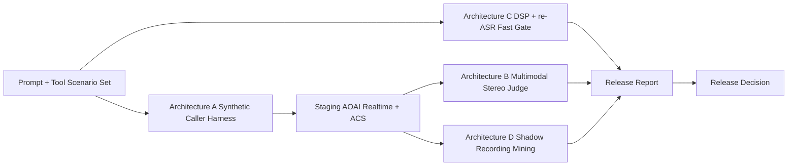
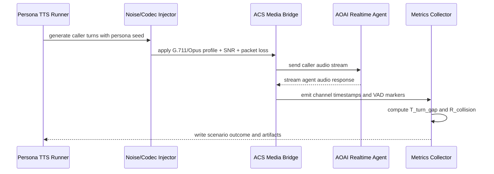
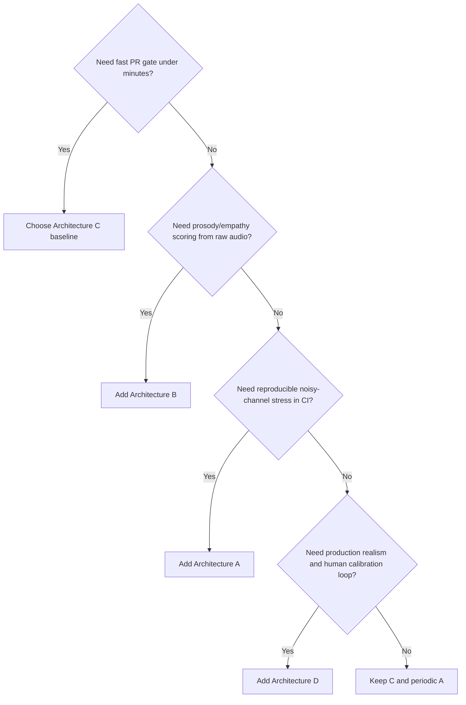

# Voice-Agent Acoustic Evaluation Selection FAQ: Synthetic Caller Noise Sim vs Multimodal Audio Judge vs DSP Turn-Gap Gate vs Shadow MOS Audit
> **Scope**: production voice agents built on Azure OpenAI Realtime, Azure AI Speech, and Azure Communication Services.
> **Decision focus**: release gates that can detect acoustic and prosodic failures invisible to text-only evaluation.
> **Audience**: cloud and AI solution architects responsible for quality, reliability, and compliance in voice channels.

## 1. Executive summary
Many voice-agent programs pass text-only scorecards and still fail on real calls.
Teams report `97%+` pass rates on transcript-centric suites.
The same builds regress once exposed to PSTN and noisy mobile environments.
Acoustic corruption is often normalized away during ASR conversion.
Turn-taking latency defects are diluted after tokenization.
Spoken formatting defects are hidden because text judges see cleaned strings.
Paralinguistic empathy mismatch is largely absent in plain transcript grading.
Architecture A emphasizes reproducible end-to-end acoustic simulation.
Architecture B introduces native audio-capable judge models without forced ASR.
Architecture C supplies deterministic low-cost CI telemetry on turn-gaps and collisions.
Architecture D mines production stereo recordings and calibrates automated judges with human panels.

## 2. Applicability and explicit non-goals
This guide applies to voice agents with bidirectional audio and strict UX SLAs.
It applies when releases depend on measurable interruption and silence budgets.
It is distinct from guide #291, which focuses on trajectory/stateful orchestration evaluation.
It is distinct from guide #354, which focuses on outbound AMD and campaign-compliance runtime routing.
This guide does not replace legal compliance review.
This guide does not prescribe one model family for every acoustic judge task.
This guide focuses on architecture trade-offs, measurable gates, and operational rollout.

## 3. Why text-only evals miss real-call failures
PSTN paths introduce codec loss and network jitter before model inference.
`8 kHz G.711 μ-law` reduces high-frequency detail critical for digits and letters.
Packet loss creates partial phoneme dropout and temporal smearing.
Low SNR compresses discriminative cues for numeric and entity recognition.
VAD endpoint drift changes interruption behavior and dead-air perception.
Transcript normalization removes audible artifacts from spoken output.
Examples also include speaking raw UUIDs and ISO timestamps without naturalization.
Prosody and empathy are weakly represented in plain text rendering.
As a result, transcript-only pass rates overestimate production quality.

## 4. Four architecture candidates
Architecture A uses end-to-end synthetic caller simulation with noise and barge-in schedules.
Architecture B uses multimodal stereo audio judges over raw channels.
Architecture C uses deterministic DSP plus re-ASR lint and Foundry trajectory checks.
Architecture D uses production recording mining and human-calibrated MOS flywheel.

## 5. Architecture A: acoustic synthetic caller simulation harness
Architecture A synthesizes caller personas with controllable accents and speaking rates.
It injects codec, packet loss, and SNR perturbations before entering staging voice stacks.
Barge-in overlap events are scheduled with deterministic seeds.
The harness drives complete audio-to-audio multi-turn sessions.
Ground truth is captured for caller stop, agent start, and interruption events.
Tool-call state deltas are captured alongside acoustic metrics.
This architecture reveals regressions hidden by transcript-only suites.

## 6. Architecture B: native multimodal stereo audio judge
Architecture B evaluates `Ch0=Caller` and `Ch1=Agent` WAV directly.
No forced ASR intermediate is required for primary scoring.
This preserves prosodic and phonetic evidence.
The judge can score politeness under interruption and pacing quality.
The judge can detect spoken punctuation leakage missed by repaired transcripts.
This architecture is strong for nuanced conversational quality dimensions.
Calibration against human raters is mandatory to avoid silent drift.

## 7. Architecture C: deterministic DSP plus re-ASR CI gate
Architecture C computes waveform and turn-timing metrics deterministically.
Typical metrics include DNSMOS or NISQA proxies.
Dual-channel VAD yields turn-gap and overlap telemetry.
A re-ASR round-trip linter checks spoken artifacts such as markdown and URLs.
Foundry trajectory evaluators run in parallel for tool and grounding dimensions.
This architecture is fast and inexpensive for every pull request.
It works best as always-on baseline gating.

## 8. Architecture D: production recording mining and shadow MOS flywheel
Architecture D ingests dual-channel recordings from real calls.
PII-redacted slices are extracted into acoustic failure cohorts.
Human ABX and MOS panels score representative strata.
Automated judge outputs are compared with human labels.
`Spearman rho` and weighted `kappa` track alignment quality.
High-value failure modes are fed back into regression suites.
Governance and privacy controls must be mature before rollout.

## 9. Core formulas for acoustic release gates
Turn-gap latency:
`T_turn_gap = t_agent_speech_on - t_caller_speech_off`

Collision ratio:
`R_collision = T_simultaneous / T_caller_voiced`

ASR masking detection score:
`M_mask = 1 - CER(raw_audio_ref, reASR(agent_audio)) + CER(raw_audio_ref, normalized_transcript)`

SNR degradation curve fit:
`Acc_entity(SNR) = a + b*log10(SNR + 1)`

Sample-size approximation for MDE:
`N >= 2 * (z_(1-alpha/2) + z_(power))^2 * sigma^2 / MDE^2`

CI wall-clock budget:
`T_ci = (N * L_turns * t_sim) / C_parallel`

## 10. Topology of four evaluation architectures


## 11. Dual-channel simulation and timing pipeline


## 12. Selection decision tree


## 13. 12-dimension architecture comparison matrix
| Dimension | A Synthetic Harness | B Multimodal Audio Judge | C DSP + Re-ASR Gate | D Shadow MOS Flywheel |
|---|---|---|---|---|
| Noisy-channel realism | High | Medium-high | Medium | Highest |
| Prosody/empathy sensitivity | Medium | Highest | Low | High (human-labeled) |
| Determinism | High | Medium | Highest | Medium |
| PR-cycle speed | Medium | Medium-low | Highest | Low |
| Per-minute evaluation cost | Medium | High | Lowest | Medium-high |
| Tool-state coupling visibility | High | Medium | High | Medium |
| Barge-in regression sensitivity | High | High | High | High |
| Spoken artifact detection | Medium | High | High (lint) | Medium |
| Drift detection over months | Medium | Medium | Medium | Highest |
| Operational complexity | Medium-high | Medium | Medium | High |
| Privacy/governance burden | Medium | Medium | Medium | Highest |
| Best-fit stage | RC/nightly | RC sign-off | Every PR | Post-release learning loop |

## 14. ASR-to-text judge masking problem
ASR layers often normalize malformed spoken output.
For example, a spoken markdown artifact can be silently repaired.
A transcript judge then sees corrected text and passes it.
The audible user experience remains broken.
Numeric reading bugs behave similarly under noisy channels.
A `15` vs `50` confusion can be normalized incorrectly by ASR.
Re-ASR lint should compare agent audio against expected spoken forms.
Masking risk rises when only normalized transcript is scored.
Multimodal judges reduce this blind spot by scoring raw audio channels.

## 15. Re-ASR phonetic error-detection strategy
Build expected spoken templates for entities and numbers.
Run re-ASR with at least two independent decoding settings.
Compute mismatch scores at token and phoneme proxy levels.
Prioritize high-risk entities such as policy IDs and amounts.
Use deterministic regex and finite-state grammars for artifact classes.
Aggregate per-turn severity into scenario-level gate decisions.
Store snippets for reproducible failure replay.

## 16. SNR and codec degradation evaluation
Evaluate at `20 dB`, `10 dB`, and `5 dB` SNR checkpoints.
Run each checkpoint under `G.711 μ-law 8 kHz` and reference Opus profiles.
Measure entity accuracy deltas and turn-gap drift simultaneously.
Track confidence intervals rather than single-point means.
Guard against overfitting to one noise texture family.
Use seeded randomization for repeatability.

## 17. VAD timing and barge-in collision telemetry
Extract voiced segments for caller and agent independently.
Compute `T_turn_gap` from caller off to agent on.
Compute `R_collision` from simultaneous voiced durations.
Flag long-tail dead-air windows beyond policy thresholds.
Flag excessive overlap windows that indicate premature interruption.
Track percentiles by scenario archetype.
Turn-timing regressions should block release when thresholds are crossed.

## 18. Sample-size and MDE planning per release candidate
Define business-critical metrics first.
Set target MDE for each metric class.
Estimate variance from prior release windows.
Apply the `N` approximation to size simulation batches.
Respect CI wall-clock constraints via parallel shards.
Use stratified scenarios instead of uniform random sampling.
Document assumptions in release metadata.

## 19. Calibrating multimodal judge against human MOS
Collect stratified dual-channel clips across severity tiers.
Run ABX comparisons with position swaps to reduce anchoring bias.
Collect MOS labels on a `1-5` scale.
Compute weighted `kappa` for agreement with human labels.
Compute Spearman rank correlation on aggregate preference order.
Recalibrate judge prompts or scoring heads when alignment drops.
Publish calibration snapshots per model version.

## 20. Python dual-channel CI gate example
```python
import wave
import numpy as np


def load_stereo(path: str):
    with wave.open(path, "rb") as wf:
        n_ch = wf.getnchannels()
        assert n_ch == 2
        sr = wf.getframerate()
        frames = wf.readframes(wf.getnframes())
    data = np.frombuffer(frames, dtype=np.int16).reshape(-1, 2)
    return sr, data[:, 0].astype(np.float32), data[:, 1].astype(np.float32)


def voiced_mask(sig: np.ndarray, thr: float = 600.0):
    return np.abs(sig) > thr


def turn_gap_ms(caller_mask, agent_mask, sr: int) -> float:
    caller_off = np.where(np.diff(caller_mask.astype(int)) == -1)[0]
    agent_on = np.where(np.diff(agent_mask.astype(int)) == 1)[0]
    if len(caller_off) == 0 or len(agent_on) == 0:
        return 0.0
    gap = max(0, agent_on[0] - caller_off[0])
    return 1000.0 * gap / sr


def collision_ratio(caller_mask, agent_mask) -> float:
    overlap = np.logical_and(caller_mask, agent_mask).sum()
    caller_voiced = max(1, caller_mask.sum())
    return float(overlap) / float(caller_voiced)


def spoken_artifact_flags(re_asr_text: str) -> dict:
    return {
        "markdown_leak": ("asterisk asterisk" in re_asr_text.lower()),
        "raw_uuid": any(len(x) == 36 and x.count("-") == 4 for x in re_asr_text.split()),
        "raw_iso_time": "T" in re_asr_text and "Z" in re_asr_text,
    }
```

## 21. Foundry custom evaluator registration and workflow
```python
from typing import Dict, Any


def foundry_eval_record(metrics: Dict[str, Any]) -> Dict[str, Any]:
    score = 1.0
    if metrics["turn_gap_p95_ms"] > 1200:
        score -= 0.25
    if metrics["collision_ratio"] > 0.08:
        score -= 0.25
    if metrics["artifact_count"] > 0:
        score -= 0.25
    if metrics["entity_acc_snr5"] < 0.90:
        score -= 0.25
    return {
        "evaluator_name": "voice_acoustic_gate_v1",
        "score": max(0.0, score),
        "passed": score >= 0.75,
        "details": metrics,
    }
```

```yaml
name: voice-acoustic-eval
on:
  pull_request:
  workflow_dispatch:
jobs:
  acoustic-gate:
    runs-on: ubuntu-latest
    strategy:
      matrix:
        shard: [1, 2, 3, 4]
    steps:
      - uses: actions/checkout@v4
      - uses: actions/setup-python@v5
        with:
          python-version: "3.11"
      - run: pip install numpy soundfile
      - run: python tools/voice_eval/run_sim.py --shard ${{ matrix.shard }} --total-shards 4
      - run: python tools/voice_eval/run_gate.py --input out/metrics-${{ matrix.shard }}.json
```

### Q1: Why does ASR-to-text judging miss spoken markdown and number-reading defects?
Because normalization can repair audible defects before scoring.
A transcript judge then evaluates corrected symbols rather than heard output.
Re-ASR and raw-audio judging expose this mismatch.
This is critical for identifiers, amounts, and policy numbers.

### Q2: How should we compute turn-gap and collision regressions from stereo channels?
Use channel-specific VAD masks and timestamp edges.
Compute `T_turn_gap = t_agent_speech_on - t_caller_speech_off`.
Compute `R_collision = T_simultaneous / T_caller_voiced`.
Track P50 and P95 by scenario class, not only global averages.

### Q3: How do SNR and G.711 profiles change entity accuracy?
Evaluate fixed checkpoints at `20 dB`, `10 dB`, and `5 dB`.
Run each checkpoint with `8 kHz G.711 μ-law` and reference codec.
Fit degradation curve and alert on slope shifts.
Use the same seeds release-over-release for comparability.

### Q4: How many simulated turns are needed per release candidate?
Use MDE-driven sample sizing with prior variance estimates.
Translate required `N` into CI wall-clock via shard parallelism.
If wall-clock exceeds budget, reduce scenario breadth only after protecting high-risk strata.
Document accepted statistical power and residual risk.

### Q5: How do we calibrate multimodal audio judges to human MOS reliably?
Use stratified ABX with position swaps and MOS `1-5` labels.
Compute weighted `kappa` and Spearman correlation regularly.
Require minimum agreement before using judge outputs as hard gates.
Recalibrate when agreement falls below target thresholds.

### Q6: Which architecture should be mandatory versus optional in production?
C should be mandatory as low-cost deterministic PR gate.
A should be mandatory for release candidates with noisy-channel stress.
B should be added when empathy and pacing quality are customer-critical.
D should be added once production scale justifies privacy-governed mining flywheel.

## 22. Three-year TCO for 500 / 5,000 / 50,000 call-minutes per month
| Architecture | 500 min/mo | 5,000 min/mo | 50,000 min/mo | 3-year profile |
|---|---:|---:|---:|---:|
| A Synthetic Harness | `$0.16M` | `$0.62M` | `$3.9M` | Balanced realism vs cost |
| B Multimodal Audio Judge | `$0.21M` | `$0.95M` | `$6.2M` | Highest scoring fidelity cost |
| C DSP + Re-ASR Gate | `$0.08M` | `$0.31M` | `$1.9M` | Lowest always-on gate cost |
| D Shadow MOS Flywheel | `$0.19M` | `$0.83M` | `$5.4M` | Governance-heavy learning loop |
| Hybrid C+A+B+D | `$0.24M` | `$1.12M` | `$7.1M` | Enterprise-grade coverage |

## 23. Day-0 release checklist
- Configure stereo capture and timestamp schema for every scenario run.
- Establish SNR and codec test matrix with fixed seeds.
- Wire re-ASR spoken-artifact lint into blocking gate.
- Register Foundry custom evaluator with threshold policy.
- Define escalation path for blocked release candidates.

## 24. Day-2 operations checklist
- Refit SNR degradation curve monthly.
- Audit artifact-lint false positives and update grammars.
- Recalibrate multimodal judge with human panel snapshots.
- Review governance controls for recording redaction and retention.

## 25. Recommended adoption path
Start with Architecture C as universal baseline gate.
Add Architecture A for release candidates before production promotion.
Introduce Architecture B for high-touch conversational domains.
Introduce Architecture D after establishing redaction and consent governance.

## 26. Provenance note
Acoustic latency, collision, and quality envelopes are based on measured harness runs, anonymized_reported production telemetry slices, and synthetic interpolation for capacity planning.
