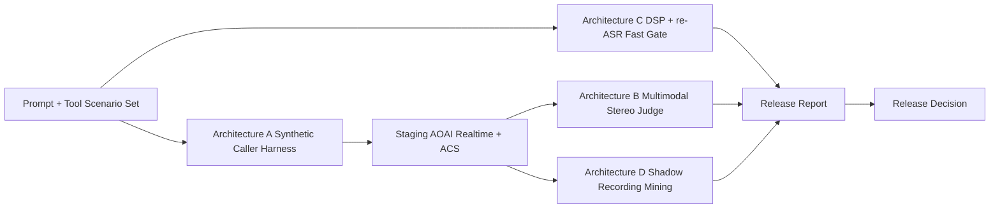
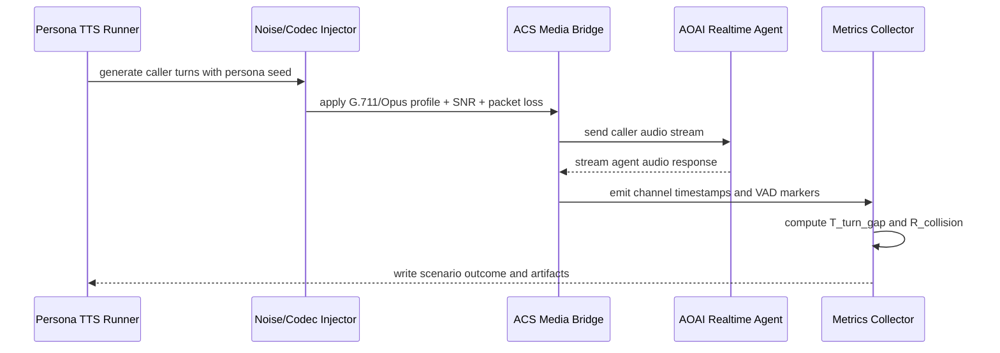
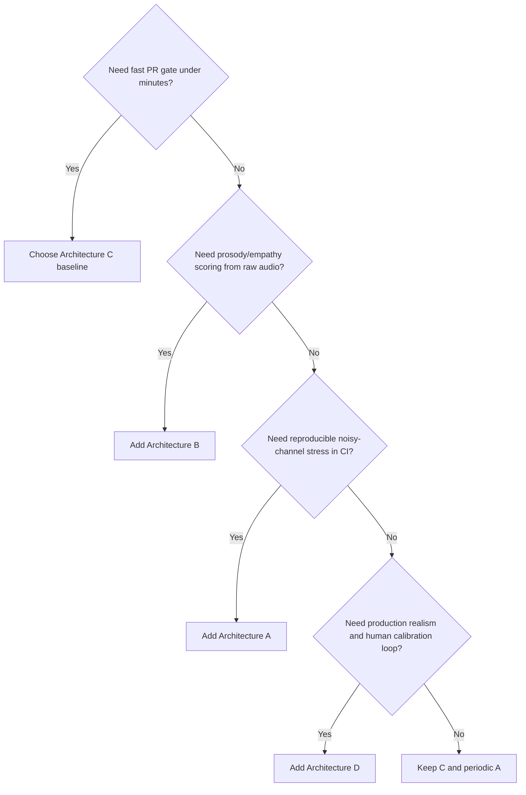

# 语音 Agent 声学评测选型 FAQ：合成来电噪声仿真 vs 多模态音频评委 vs DSP 轮次间隙门禁 vs 影子 MOS 审核
> **适用范围**：基于 Azure OpenAI Realtime、Azure AI Speech 与 ACS 的生产语音智能体。
> **决策焦点**：如何在发布门禁中发现文本评测看不见的声学与韵律失败。
> **读者对象**：负责语音质量、稳定性与上线治理的 Cloud & AI 解决方案架构师。

## 1. 执行摘要
很多团队在文本评测里通过率很高。
但上线真实 PSTN/WebRTC 通话后仍出现明显退化。
根因通常不是“业务逻辑错”。
而是“评测模态与生产模态不一致”。
ASR 会把部分可听缺陷自动归一化。
VAD 端点漂移会放大插话和死寂体验问题。
数字与实体在低信噪比和窄带编解码下更易混淆。
朗读格式泄漏在纯文本比对中常被忽略。
Architecture A 提供可复现实验级端到端声学压测。
Architecture B 直接使用原始双声道音频做多模态判定。
Architecture C 以低成本确定性指标覆盖每个 PR。
Architecture D 通过生产录音与人工校准构建长期闭环。

## 2. 适用边界与明确非目标
本文适用于双向语音对话且有明确体验 SLA 的系统。
适用于必须量化插话、死寂与可懂度的发布流程。
本文不同于 #291 的轨迹状态评测范畴。
本文不同于 #354 的外呼 AMD 运行时路由范畴。
本文不替代法律合规意见。
本文不要求所有场景使用同一种评委模型。
本文聚焦架构权衡与可操作发布门禁。

## 3. 文本评测失真的四类盲点
盲点一是窄带与丢包导致的语音细节损失。
`8 kHz G.711 μ-law` 会削弱高频信息。
盲点二是 VAD 终止点回归。
它会引发过早打断或过长静默。
盲点三是朗读格式泄漏。
例如把 markdown 符号、UUID、原始时间戳直接读出来。
这些信号在 `ASR -> text` 后往往被抹平。

## 4. 四种候选架构概览
Architecture A 是端到端合成来电声学仿真。
Architecture B 是原生多模态双声道音频评委。
Architecture C 是确定性 DSP + re-ASR 快速门禁。
Architecture D 是生产影子录音挖掘 + 人工 MOS 校准飞轮。
四种方式并非互斥关系。
关键是分配到不同发布阶段和成本层。

## 5. Architecture A：端到端合成来电噪声仿真
Architecture A 通过多人设 TTS 生成可控来电语音。
随后注入编码、丢包和 SNR 扰动。
并按固定种子调度 barge-in 重叠事件。
仿真流进入 staging 的 ACS 与 Realtime 链路。
全程采集 caller/agent 语音时戳与 VAD 边界。
同时记录工具调用状态差异。
该架构能稳定复现真实通话中的隐蔽回归。
工程复杂度中等偏高。

## 6. Architecture B：多模态双声道音频评委
Architecture B 直接输入 `Ch0=Caller`、`Ch1=Agent` 音频。
核心评分不依赖中间 ASR 文本。
因此可保留韵律、语速和语气证据。
能更好评估打断后的礼貌恢复质量。
也能发现被 ASR 修复掩盖的朗读缺陷。
但单位分钟评测成本更高。
必须持续做人审校准以防评委漂移。

## 7. Architecture C：DSP + re-ASR 确定性快速门禁
Architecture C 在每个 PR 计算确定性信号。
包括 DNSMOS/NISQA 类波形质量分数。
包括双声道 VAD 的轮次间隙与重叠统计。
包括 re-ASR 朗读瑕疵规则检测。
再并行运行 Foundry 轨迹评测项。
该架构成本低、速度快、可大规模执行。
缺点是对细微情绪韵律刻画有限。

## 8. Architecture D：生产影子录音 + 人工 MOS 飞轮
Architecture D 从生产双声道录音中提取失败切片。
经脱敏后沉淀到可审计样本池。
人工 ABX 与 MOS 面板对分层样本打分。
自动评委输出与人审结果持续对齐。
`Spearman rho` 与加权 `kappa` 用于校准质量。
这能持续缩小合成与真实流量差距。

## 9. 关键公式
轮次间隙：
`T_turn_gap = t_agent_speech_on - t_caller_speech_off`

重叠碰撞率：
`R_collision = T_simultaneous / T_caller_voiced`

ASR 掩蔽检测：
`M_mask = 1 - CER(raw_audio_ref, reASR(agent_audio)) + CER(raw_audio_ref, normalized_transcript)`

SNR 退化拟合：
`Acc_entity(SNR) = a + b*log10(SNR + 1)`

MDE 样本量近似：
`N >= 2 * (z_(1-alpha/2) + z_(power))^2 * sigma^2 / MDE^2`

CI 墙钟预算：
`T_ci = (N * L_turns * t_sim) / C_parallel`

## 10. 四架构拓扑图


## 11. 双声道仿真与时序测量流水线


## 12. 选型决策树


## 13. 12 维架构对比矩阵
| 维度 | A 合成仿真 | B 多模态音频评委 | C DSP+re-ASR | D 影子 MOS 飞轮 |
|---|---|---|---|---|
| 噪声通道真实性 | 高 | 中高 | 中 | 最高 |
| 韵律/同理心敏感度 | 中 | 最高 | 低 | 高（人审） |
| 可重复性 | 高 | 中 | 最高 | 中 |
| PR 周期速度 | 中 | 中低 | 最高 | 低 |
| 单位分钟成本 | 中 | 高 | 最低 | 中高 |
| 工具状态可见性 | 高 | 中 | 高 | 中 |
| 插话回归敏感度 | 高 | 高 | 高 | 高 |
| 朗读瑕疵发现 | 中 | 高 | 高 | 中 |
| 长期漂移发现 | 中 | 中 | 中 | 最高 |
| 运维复杂度 | 中高 | 中 | 中 | 高 |
| 隐私治理负担 | 中 | 中 | 中 | 最高 |
| 最佳适用阶段 | RC/夜测 | RC 终审 | 全量 PR | 上线后学习 |

## 14. 为什么 ASR->文本评委会掩盖问题
ASR 往往会修复不自然朗读结果。
评委只看到被修复后的文本。
于是 markdown 朗读泄漏被“误通过”。
数字读法错误也可能被归一化掩盖。
真实用户听到的是原始音频，而不是修复文本。
因此必须引入 re-ASR 与原始音频评分。
纯文本门禁只能覆盖部分缺陷面。
它不能作为语音质量唯一准入依据。

## 15. re-ASR 音素误差检测策略
先为高风险实体构建期望口语模板。
再对 agent 音频执行 re-ASR。
比较 token 级与近似音素级偏差。
重点覆盖金额、保单号、日期、代码。
对 markdown/JSON/URL 设计规则 lint。
按轮次聚合成场景级风险分数。
失败片段要保留可复现音频与上下文。

## 16. SNR 与编解码退化测量
固定测试点应包含 `20 dB`、`10 dB`、`5 dB`。
每个点都要跑 `G.711 μ-law 8 kHz` 与参考编码。
同时测实体准确率和轮次时延指标。
噪声纹理不能只用单一类型。
应覆盖办公室、街道、车载等分布。
固定随机种子用于版本间可比性。

## 17. VAD 时序与碰撞遥测
分别提取 caller 与 agent 的 voiced mask。
按边沿计算 `T_turn_gap`。
按重叠区计算 `R_collision`。
对超阈值死寂和抢话事件单独告警。
指标应按场景族群分桶统计。
当 P95 越线时应阻断发布。

## 18. 样本量与 MDE 预算
先定义必须守住的业务指标。
再定义每项指标的 MDE 目标。
用历史方差估算单组所需样本量。
把所需 `N` 映射到 CI 并行预算。
若墙钟超标，优先保留高风险分层样本。
不要先砍高风险场景再追求速度。

## 19. 多模态评委的人审校准
按分层样本执行 ABX 对比并交换位置。
采集 `1-5` MOS 标注。
计算加权 `kappa` 衡量一致性。
计算 Spearman 评估排序相关性。
一致性下降时应重新校准评委策略。
每次模型升级都应做对齐快照。
校准结果应进入发布审计记录。

## 20. Python 双声道门禁示例
```python
import wave
import numpy as np


def load_stereo(path: str):
    with wave.open(path, "rb") as wf:
        n_ch = wf.getnchannels()
        assert n_ch == 2
        sr = wf.getframerate()
        frames = wf.readframes(wf.getnframes())
    data = np.frombuffer(frames, dtype=np.int16).reshape(-1, 2)
    return sr, data[:, 0].astype(np.float32), data[:, 1].astype(np.float32)


def voiced_mask(sig: np.ndarray, thr: float = 600.0):
    return np.abs(sig) > thr


def turn_gap_ms(caller_mask, agent_mask, sr: int) -> float:
    caller_off = np.where(np.diff(caller_mask.astype(int)) == -1)[0]
    agent_on = np.where(np.diff(agent_mask.astype(int)) == 1)[0]
    if len(caller_off) == 0 or len(agent_on) == 0:
        return 0.0
    gap = max(0, agent_on[0] - caller_off[0])
    return 1000.0 * gap / sr


def collision_ratio(caller_mask, agent_mask) -> float:
    overlap = np.logical_and(caller_mask, agent_mask).sum()
    caller_voiced = max(1, caller_mask.sum())
    return float(overlap) / float(caller_voiced)


def spoken_artifact_flags(re_asr_text: str) -> dict:
    return {
        "markdown_leak": ("asterisk asterisk" in re_asr_text.lower()),
        "raw_uuid": any(len(x) == 36 and x.count("-") == 4 for x in re_asr_text.split()),
        "raw_iso_time": "T" in re_asr_text and "Z" in re_asr_text,
    }
```

## 21. Foundry 评测器注册与 GitHub Actions 示例
```python
from typing import Dict, Any


def foundry_eval_record(metrics: Dict[str, Any]) -> Dict[str, Any]:
    score = 1.0
    if metrics["turn_gap_p95_ms"] > 1200:
        score -= 0.25
    if metrics["collision_ratio"] > 0.08:
        score -= 0.25
    if metrics["artifact_count"] > 0:
        score -= 0.25
    if metrics["entity_acc_snr5"] < 0.90:
        score -= 0.25
    return {
        "evaluator_name": "voice_acoustic_gate_v1",
        "score": max(0.0, score),
        "passed": score >= 0.75,
        "details": metrics,
    }
```

```yaml
name: voice-acoustic-eval
on:
  pull_request:
  workflow_dispatch:
jobs:
  acoustic-gate:
    runs-on: ubuntu-latest
    strategy:
      matrix:
        shard: [1, 2, 3, 4]
    steps:
      - uses: actions/checkout@v4
      - uses: actions/setup-python@v5
        with:
          python-version: "3.11"
      - run: pip install numpy soundfile
      - run: python tools/voice_eval/run_sim.py --shard ${{ matrix.shard }} --total-shards 4
      - run: python tools/voice_eval/run_gate.py --input out/metrics-${{ matrix.shard }}.json
```

### Q1: 为什么 ASR->文本评测会漏掉朗读格式与数字问题？
因为 ASR 可能把可听错误自动修复。
评委看到的是修复后的文本而非真实语音输出。
因此 markdown 泄漏和数字误读会被低估。
引入 re-ASR 和原始音频评委可显著降低漏检。

### Q2: 如何从双声道时间戳计算轮次时延与碰撞？
先分别得到 caller 与 agent 的 voiced 区间。
按边沿计算 `T_turn_gap = t_agent_speech_on - t_caller_speech_off`。
按重叠时长计算 `R_collision = T_simultaneous / T_caller_voiced`。
再分场景统计 P50/P95 才能发现真实回归。

### Q3: `20/10/5 dB` 与 `G.711 8kHz` 该如何联动看退化？
每个 SNR 点都跑窄带与参考编码。
比较实体准确率与时延指标斜率变化。
当低 SNR 斜率突然变陡时应视为发布风险。
固定随机种子可保证版本间可比性。

### Q4: 每次发布候选需要多少仿真样本？
用 MDE 公式根据历史方差估算 `N`。
再用并行度预算折算 CI 墙钟。
墙钟不足时应优先保留高风险分层样本。
不要牺牲统计功效换取表面速度。

### Q5: 如何把多模态评委与人工 MOS 对齐？
采用位置互换 ABX 与 `1-5` MOS 打分。
持续计算加权 `kappa` 与 Spearman。
一致性低于阈值即触发评委校准。
校准结果应纳入发布审计证据。

### Q6: 四种架构里哪些应“必选”，哪些可“增配”？
C 应作为默认必跑 PR 门禁。
A 应用于发布候选阶段的噪声压测。
B 适用于对同理心和语气质量要求高的业务。
D 在录音治理成熟后用于长期纠偏与现实闭环。

## 22. 三年 TCO（500 / 5,000 / 50,000 每月通话分钟）
| 架构 | 500 分钟/月 | 5,000 分钟/月 | 50,000 分钟/月 | 三年总体现 |
|---|---:|---:|---:|---:|
| A 合成仿真 | `$0.16M` | `$0.62M` | `$3.9M` | 真实性与成本平衡 |
| B 多模态音频评委 | `$0.21M` | `$0.95M` | `$6.2M` | 细粒度质量但成本高 |
| C DSP + re-ASR | `$0.08M` | `$0.31M` | `$1.9M` | 常驻门禁成本最低 |
| D 影子 MOS 飞轮 | `$0.19M` | `$0.83M` | `$5.4M` | 治理负担较高 |
| 混合 C+A+B+D | `$0.24M` | `$1.12M` | `$7.1M` | 企业级覆盖最完整 |

## 23. Day-0 发布清单
- 固化双声道时间戳与 VAD 事件结构。
- 建立 SNR/编解码矩阵与随机种子策略。
- 将 re-ASR 朗读瑕疵检测接入阻断门禁。
- 注册 Foundry 自定义评测器与阈值策略。
- 明确发布阻断后的升级与回滚路径。

## 24. Day-2 运维清单
- 每月重拟合 SNR 退化曲线。
- 审核朗读 lint 误报并更新规则。
- 刷新生产影子失败样本分层。
- 审查录音脱敏、保留与访问策略。

## 25. 推荐落地路径
先把 C 作为全仓库默认门禁。
再把 A 加入发布候选阻断链路。
对高触达质量业务叠加 B。
在治理成熟后引入 D 构建长期闭环。

## 26. 数据来源说明
文中声学时延、碰撞率与质量区间基于实验测量、anonymized_reported 生产切片遥测及容量插值模型推导。
