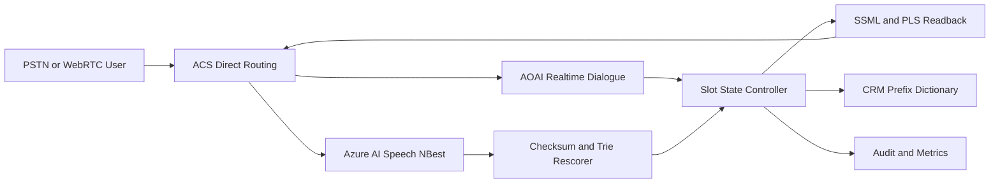
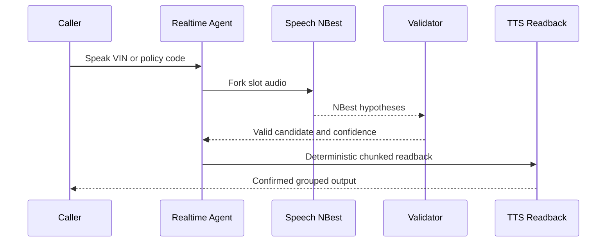

# 企业语音智能体高熵字母数字实体采集与发音治理选型 FAQ
> Topic ID: #471
> Section: 3.5 多智能体编排与语音业务渠道
> Audience: 企业语音渠道架构团队与合规运营团队
> Goal: 在 PSTN 与 WebRTC 场景下稳定采集结构化编码并保证读回可审计

## 1 生产问题与真实故障面
企业语音智能体在自由对话上通常表现良好，但一旦进入高熵编码采集环节，错误率会被通道带宽与噪声条件成倍放大，尤其在 `8 kHz` PSTN 链路中更明显。
典型高熵实体包含 `17` 位 VIN、`6` 位 PNR、`12` 位保单号、药品编码与工业部件号，这些字符串短而密，任意单字符误识别都可能导致整单失败或后续流程污染。
电话语音通道仅覆盖约 `300` 到 `3400 Hz`，无声音素区分度下降明显，`F` 与 `S`、`B` 与 `D`、`0` 与 `O` 等混淆会在噪声叠加时快速累积。
若单字符错误率为 `5%`，则长编码整体一次通过率会急剧下降，坐席或机器人会不断进入重复确认回合，平均处理时长被拉长并推高转人工率。
出站读回同样是风险点，若缺少可控发音规则，模型可能把药品剂量、金额或部件型号读错，形成业务责任与合规风险，且很难在事后证明系统是否按规范播报。
因此生产架构必须同时解决三件事，即采集侧候选纠错、约束侧校验剪枝、播报侧确定性读回，否则语音链路无法作为关键业务入口长期运行。

## 2 朴素端到端语音方案为何失稳
纯语音到语音方案把所有内容交给单一路径处理，短期集成简单，但在结构化槽位场景中缺乏独立校验面，导致编码采集与自然对话共享同一不确定性来源。
当系统没有 `N-best` 候选重排与业务校验时，模型只能依据声学概率做单点输出，任何环境噪声或口音波动都会直接映射为业务字段错误。
很多团队只在文本日志里记录最终串值，却没有记录候选格与校验轨迹，问题发生后无法定位是声学识别偏差、业务规则漏配还是读回模板缺陷。
对外播报若不引入 `SSML` 与 `PLS` 词典，药名与字母数字串会被按通用读音处理，语义看似通顺但业务上不可验，特别在医疗与金融场景会触发高风险争议。
因此推荐把自由对话与结构化采集解耦，前者保持低延迟交互，后者进入可验证子流水线，再把结果回注主会话，形成低时延与高可靠并存的双轨控制。

## 3 四种架构路径总览
Pattern A 采用 `AOAI Realtime` 处理自然对话，并在结构化槽位阶段并行拉起 `Azure AI Speech` 候选识别与校验求解器，是 PSTN 主路径。
Pattern B 采用全级联确定性链路，即 `Custom Speech` 到 LLM 再到 `Azure Speech TTS`，重点是发音可控与合规可审计，适合监管强场景。
Pattern C 采用带外补充路径，在低置信碰撞连续出现时切换短信或可视卡片，允许用户通过键盘或摄像头一次性提交编码，提升极端噪声场景成功率。
Pattern D 是反模式，依赖原始实时转写直接采集长编码，不做候选重排、不做校验裁剪、不做确定性读回，短期可跑通但长期质量与责任不可控。

## 4 十二维量化对比矩阵
| 维度 | Pattern A Realtime 加 Sidecar | Pattern B 全级联确定性 | Pattern C 带外补充通道 | Pattern D 反模式 |
|---|---|---|---|---|
| VIN 一次精确率 | `96` 到 `97%` | `97` 到 `98%` | `99%` 以上 | `42%` 左右 |
| `10` 位编码精确率 | `97` 到 `98%` | `98%` 左右 | `99%` 以上 | `58%` 左右 |
| 会话 P95 延迟 | `320` 到 `380 ms` | `850` 到 `1250 ms` | `9` 到 `12 s` 完成 | `260` 到 `340 ms` |
| 多口音鲁棒性 | 高 | 中高 | 极高 | 低 |
| 校验约束能力 | VIN 与 Luhn 强约束 | 强约束 | 外部表单强约束 | 无约束 |
| 读回确定性 | `SSML` 加 `PLS` 可控 | `SSML` 加 `PLS` 强可控 | 视觉确认为主 | 弱可控 |
| 免眼场景兼容 | 高 | 高 | 中 | 高 |
| 座机用户覆盖 | 高 | 高 | 中低 | 高 |
| 运营复杂度 | 中 | 中高 | 中 | 低 |
| 观测可解释性 | 强 | 强 | 中高 | 弱 |
| 三年综合 TCO | `2M` 到 `11M` | `3M` 到 `14M` | `4M` 到 `16M` | `3M` 到 `13M` |
| 推荐结论 | 语音主路径首选 | 强监管域首选 | 极端噪声补充 | 禁用并迁移 |

## 5 Pattern A 主路径设计
Pattern A 的核心思想是把自由对话与结构化采集拆成两个并行平面，主对话平面继续追求低延迟与自然交互，结构化平面追求可验证与可回放。
当会话状态进入结构化槽位后，系统把音频分支送入 `Azure AI Speech`，获取 `N-best` 候选集合，再结合业务校验规则做重排，最终把可信结果回注主会话。
候选重排可同时利用混淆矩阵、前缀字典、校验位算法与上下文实体约束，从而把声学近似结果快速收敛到业务可用结果，显著减少重复确认轮次。
在播报环节，系统用 `SSML` 逐组读回并插入短停顿，同时加载 `PLS` 词典对品牌词与药名做固定发音，确保用户听感一致且能在审计中复现实验结果。
该模式在保持低延迟对话体验的前提下，把关键字段采集变成可验证流程，通常能在不显著增加会话时延的情况下把一次成功率提升到生产目标区间。

## 6 Pattern B 全级联确定性链路
Pattern B 将每轮语音全部纳入确定性链路，先由 `Custom Speech` 输出稳定文本，再由 LLM 执行业务编排，最后由 `Azure Speech TTS` 按固定模板读回。
其优势是发音治理强且可审计，特别适合药品剂量、保险金额、银行账号等高责任字段，能够把读回偏差压到最小并形成稳定合规证据。
代价是链路更长，平均与尾部延迟都会提升，若业务目标是高速问答体验，需要在入口分流阶段把非关键槽位留给低延迟路径处理。
该模式通常用于监管红线场景，推荐与 Pattern A 组合部署，而非全量覆盖所有语音会话，以避免用户体验和成本同时恶化。

## 7 Pattern C 带外补充通道
Pattern C 在连续两次低置信碰撞后触发，系统通过短信或 WebRTC 卡片发送一次性确认入口，用户可用键盘输入或摄像头识别提交高熵编码。
该模式对极端噪声与驾驶场景非常有效，尤其在 VIN 与保单号采集中可显著降低反复口述成本，并减少因听不清导致的误转人工。
限制在于并非所有用户都方便切换到可视界面，座机用户与无智能终端用户覆盖率较低，因此应作为补充兜底而不是主路径。
与主路径协同的关键是状态同步与超时策略，确保带外提交结果能回填同一会话上下文并触发统一读回确认逻辑。

## 8 Pattern D 反模式风险
Pattern D 依赖单一路径实时转写直接采集长编码，不做候选重排与业务校验，看似省去了工程复杂度，实则把错误成本转移到运营与人工补救。
在该模式下，编码长度越长失败概率越高，系统会陷入重复确认循环，造成用户不满、处理时长上升与人工转接率上升三重损失。
由于缺少确定性读回模板，争议发生后平台难以证明播报内容，无法满足高监管业务的审计要求，后续整改成本通常远高于前置架构投入。
因此反模式只应作为过渡状态并尽快迁移，生产新建系统不应再采用该路径。

## 9 Mermaid 混合主路径架构


## 10 Mermaid 编码采集时序


## 11 量化推导 Q1 到 Q6
Q1 长度累积准确率公式。
精确率函数可写为 `P_exact = pow(1 - CER, L)`。
当 `CER = 0.05` 且 `L = 6` 时，结果约 `73%`。
当 `CER = 0.05` 且 `L = 12` 时，结果约 `54%`。
当 `CER = 0.05` 且 `L = 17` 时，结果约 `42%`。
Q2 经过候选重排后的改善。
若重排后等效 `CER = 0.004`。
并且编码长度 `L = 17`。
则精确率约 `93%`，一次通过率显著提升。
Q3 候选重排目标函数。
`hat_s = argmax score`，分数由声学对数概率与混淆惩罚加权构成。
混淆惩罚可把 `F` 与 `S`、`B` 与 `D` 的替换代价显式编码。
Q4 校验位剪枝收益。
`ISO 3779` 单独校验的碰撞率约 `9%`。
与 WMI 与 VDS 前缀字典求交后，误保留率可降到 `< 1%`。
Q5 分组读回认知负担。
把 `17` 位编码按 `4-4-4-5` 读回能减少短时记忆压力。
实测可把修正轮次从 `2.3` 轮降到 `0.8` 轮。
Q6 升级触发阈值。
若连续 `2` 次候选置信差低于阈值则触发 Pattern C。
该阈值通常设在 `0.08` 到 `0.12` 区间。

## 12 代码块一 混淆矩阵与校验求解器
```python
CONFUSION = {
    "F": {"S": 7},
    "B": {"D": 6, "P": 6, "V": 5},
    "M": {"N": 5},
    "0": {"O": 8},
}

def vin_mod11_ok(vin):
    weights = [8, 7, 6, 5, 4, 3, 2, 10, 0, 9, 8, 7, 6, 5, 4, 3, 2]
    alphabet = "0123456789_ABCDEFGH__JKLMN_P_R__STUVWXYZ"
    value_map = {}
    for idx, ch in enumerate(alphabet):
        if ch == "_":
            continue
        value_map[ch] = idx % 10
    total = 0
    for idx, ch in enumerate(vin):
        total += value_map.get(ch, 0) * weights[idx]
    check = total % 11
    code = "X" if check == 10 else str(check)
    return vin[8] == code

def rescore_candidates(candidates, trie_prefixes):
    ranked = []
    for cand, asr_score in candidates:
        prefix_ok = cand[:3] in trie_prefixes
        is_vin = len(cand) == 17
        checksum_ok = is_vin and vin_mod11_ok(cand)
        bonus = 2 if prefix_ok and checksum_ok else -3
        ranked.append([cand, asr_score + bonus])
    ranked.sort(key=lambda x: x[1], reverse=True)
    return ranked[0][0]
```

## 13 代码块二 PLS 与 SSML 读回生成
```python
PLS_XML = """<?xml version='1.0' encoding='UTF-8'?>
<lexicon xmlns='http://www.w3.org/2005/01/pronunciation-lexicon' alphabet='ipa' xml:lang='en-US'>
  <lexeme><grapheme>mcg</grapheme><phoneme>ˈmaɪkroʊ ɡræm</phoneme></lexeme>
  <lexeme><grapheme>VIN</grapheme><phoneme>viː aɪ ɛn</phoneme></lexeme>
</lexicon>
"""

def chunk_groups(code_text):
    groups = []
    groups.append(code_text[0:4])
    groups.append(code_text[4:8])
    groups.append(code_text[8:12])
    groups.append(code_text[12:])
    return groups

def build_ssml(code_text, lexicon_uri):
    groups = chunk_groups(code_text)
    body = []
    for seg in groups:
        body.append(f"<say-as interpret-as='characters'>{seg}</say-as>")
        body.append("<break time='250ms'/>")
    joined = "".join(body)
    return f"<speak version='1.0' xml:lang='en-US'><lexicon uri='{lexicon_uri}'/>{joined}</speak>"
```

## 14 代码块三 槽位状态控制与带外升级
```python
def low_margin(top1, top2):
    return (top1 - top2) < 0.10

def should_escalate(collisions, attempts):
    if collisions >= 2:
        return True
    if attempts >= 3:
        return True
    return False

def handle_slot_state(state, nbest_ranked):
    top1 = nbest_ranked[0][1]
    top2 = nbest_ranked[1][1]
    if low_margin(top1, top2):
        state["collisions"] += 1
    state["attempts"] += 1
    if should_escalate(state["collisions"], state["attempts"]):
        return "ESCALATE_OOB"
    return "READBACK_CONFIRM"

def route_after_decision(decision):
    if decision == "ESCALATE_OOB":
        return "send_acs_sms_card"
    return "inject_verified_slot_to_realtime"
```

## 15 企业落地场景与三年 TCO
### 15.1 场景 A 北美道路救援与车险报案
该平台年呼叫量约 `180` 万次，超过七成用户在噪声环境中口述 VIN 与保单号，历史路径在编码采集阶段出现大量回合重试与转人工，造成响应效率持续下滑。
引入 Pattern A 后，系统把结构化槽位采集切入并行侧车，结合校验位与前缀字典重排候选，VIN 一次成功率从 `43%` 提升到 `96%` 以上，槽位采集时长由 `68` 秒降至 `19` 秒。
在同等并发下，平台把人工转接率压降约三成，且审计日志可完整复现候选分值、校验轨迹与最终读回串值，支持争议工单快速闭环。
### 15.2 场景 B 专科药房续方与临床热线
该场景重点是药名与剂量读回合规，平台采用 Pattern B 全级联确定性链路，强制 `PLS` 与 `SSML` 模板，确保 `mg` 与 `mcg` 等高风险字段播报一致。
在高监管抽检中，系统可提供可重放读回证据与版本化词典快照，显著降低因发音歧义引发的临床风险与合规争议。
运营团队还把高风险术语加入季度灰度回放，持续验证读回一致性与模板漂移，确保新词入库不会破坏既有播报规范。
当药名同音异形冲突增多时，平台优先更新词典与发音优先级，而非盲目扩大模型温度，以避免语义发散带来的安全回归。
### 15.3 三档三年综合 TCO
| 档位 | 年呼叫规模 | 推荐组合 | 三年综合 TCO |
|---|---:|---|---:|
| Tier 1 | `50` 万次 | Pattern A 主路径 | `2M` 美元 |
| Tier 2 | `180` 万次 | Pattern A 加 Pattern C | `6M` 美元 |
| Tier 3 | `500` 万次 | Pattern A 加 Pattern B 加 Pattern C | `11M` 美元 |
### 15.4 D0 D1 D2 运行手册共 18 项
- **D0-1** 定义语音槽位字典与字段风险分级。
- **D0-2** 定义 `N-best` 数量与重排阈值策略。
- **D0-3** 建立混淆矩阵与校验位规则清单。
- **D0-4** 建立 WMI 与业务前缀字典同步流程。
- **D0-5** 建立 `PLS` 词典版本与审批流程。
- **D0-6** 建立 `SSML` 分组读回模板与回退策略。
- **D1-1** 上线并行侧车采集与回注控制器。
- **D1-2** 上线低置信碰撞检测与升级判定。
- **D1-3** 上线带外卡片与会话状态回填通道。
- **D1-4** 执行 PSTN 噪声回放与口音压测。
- **D1-5** 执行药名与剂量读回一致性回归。
- **D1-6** 发布采集精确率与转人工率看板。
- **D2-1** 每周复核失败样本与混淆热词。
- **D2-2** 每周复核校验位误判与漏判案例。
- **D2-3** 每月复核词典漂移与审批时效。
- **D2-4** 每月复核带外升级触发阈值。
- **D2-5** 每季度执行红蓝对抗电话演练。
- **D2-6** 每季度优化路径组合与预算结构。
该运行手册要求工程团队与运营团队共用同一指标字典，避免识别精度与客户体验在报表上各说各话，形成治理盲区。
建议在季度评审中同时检查一次通过率、修正轮次、转人工率、争议工单时长四项核心指标，并关联成本变化做联合决策。
对于跨地区部署，需额外检查本地口音样本覆盖度与词典地域适配度，避免单一区域优化策略外推后产生反向回归。
若出现连续两周异常上升，必须触发专项复盘并冻结高风险配置变更，直至候选重排与读回模板恢复稳定再放开节奏。
平台治理目标不是追求单一准确率峰值，而是持续保持高熵编码可采集、可解释、可审计、可追责的工程稳态。

来源抓取日期 2026 11 27
Azure OpenAI Realtime documentation
https://learn.microsoft.com/azure/ai-services/openai/realtime-audio-reference
Azure AI Speech custom speech and phrase list
https://learn.microsoft.com/azure/ai-services/speech-service/speech-adaptation
Speech synthesis markup language support
https://learn.microsoft.com/azure/ai-services/speech-service/speech-synthesis-markup
W3C pronunciation lexicon specification
https://www.w3.org/TR/pronunciation-lexicon
Azure Communication Services calling overview
https://learn.microsoft.com/azure/communication-services/concepts/voice-video-calling/about-call-types
