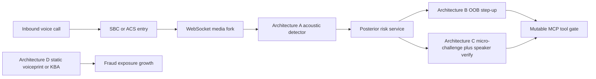
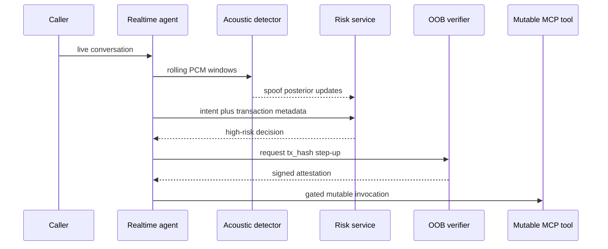
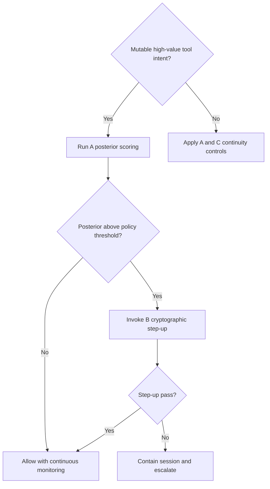

# Enterprise voice-agent deepfake defense selection FAQ: SBC acoustic liveness detector vs OOB passkey step-up vs conversational micro-challenge
> **Audience**: Cloud and AI Solution Architects, voice platform owners, fraud leaders, identity teams, and privacy governance officers.
> **Core decision**: how to contain synthetic-voice fraud in real-time sessions without collapsing user experience or compliance posture.

## 1. Executive Summary
Voice fraud has shifted from replay-only attacks to low-latency cloning and virtual-cable injection during live sessions.
Architecture A performs inline acoustic anti-spoof scoring from SBC or ACS media forks on sliding PCM windows.
Architecture B introduces cryptographic out-of-band step-up only when risk or transaction value crosses policy thresholds.
Architecture C adds dynamic micro-challenges and enrolled speaker verification to preserve session continuity assurance.
Architecture D relies on static voiceprints or KBA and is structurally weak against modern clone quality and leaked personal data.
Most regulated enterprises converge on A as baseline, B for mutable high-value actions, and C as contextual reinforcement.

## 2. Problem Definition
Contact-center voice channels combine degraded telephony audio, emotional speech variance, and adversarial prompt scripting.
Single-shot identity checks at call start are insufficient because fraud attempts often happen at mid-call tool invocation points.
A practical architecture must optimize detection latency, spoof resilience, customer friction, legal exposure, and evidence traceability.
Any strategy that optimizes only EER while ignoring base-rate effects and operational escalation cost will fail in production.
Decision quality must be evaluated at transaction level, not just at utterance classification level.

## 3. Architecture Panorama


## 4. Architecture A: Inline Acoustic Liveness and Deepfake Detection
A uses SBC or ACS media-fork streams and runs anti-spoof models such as Wav2Vec2-AASIST or RawNet3 on AKS GPU nodes.
The important implementation objective is stable posterior quality within sub-800ms windows rather than single-window confidence spikes.
Production-grade detectors need dedicated PSTN `8 kHz` calibration because narrowband channels suppress high-frequency vocoder artifacts.
Risk service responses should include posterior confidence, feature explainability handles, and temporal trend vectors.
A offers low user friction and broad coverage, but requires ongoing adaptation against vocoder drift and channel-shift effects.

## 5. Architecture B: Risk-Triggered OOB Cryptographic Step-Up
B links friction to risk by invoking passkey or Verified ID verification only when policy detects elevated spoof likelihood or sensitive intent.
Transaction-bound `tx_hash` payloads should include beneficiary, amount, expiry, and device context to prevent relay and replay abuse.
Step-up channels need independent availability SLOs and fallback controls for unreachable mobile endpoints.
B provides the strongest non-repudiation and audit posture for mutable actions, with bounded incremental user effort.
The architectural trade-off is orchestration complexity across telephony, identity, and tool-governance planes.

## 6. Architecture C: Conversational Micro-Challenge with Speaker Verification
C issues context-aware prompts that require live semantic adaptation and measures response fidelity with TDNN or ECAPA embeddings.
Challenge design must avoid static templates, otherwise attackers can precompute responses with low-latency synthesis pipelines.
C improves continuity assurance inside long calls where trust decays over time and task criticality changes mid-session.
Because C can involve biometric templates, it demands strict lifecycle governance, consent controls, and data minimization.
C is best positioned as reinforcement between A and B rather than as a standalone control.

## 7. Architecture D Anti-Pattern
D assumes KBA or static voiceprint checks remain sufficient despite widespread personal data leakage and rapid clone model progress.
This approach often delays fraud discovery until post-transaction reconciliation, increasing restitution and legal overhead.
In regulated environments, D fails to provide robust transaction-linked assurance and weakens defensibility during audits.

## 8. 12-Dimension Horizontal Selection Matrix
| Dimension | A Acoustic Liveness | B OOB Passkey or VID | C Micro-Challenge plus Voice Biometrics | D Static Voiceprint or KBA |
|---|---|---|---|---|
| Detection latency | Medium-low | Medium | Medium | Low but weak |
| Zero-shot TTS/VC EER resilience | Medium-high | Very high | Medium-high | Low |
| PSTN G.711 8kHz robustness | Medium | High | Medium | Low |
| Elderly/noisy-line FRR | Medium-high risk | Low-medium | Medium-high | Low apparent / high false accept |
| Virtual-cable replay defense | Medium | High | Medium | Low |
| Caller friction | Low | Medium-high only on risk | Medium | Low |
| PCI-DSS v4.0 / FFIEC / PSD3 alignment | Medium-high | High | Medium | Low |
| `gpt-realtime` tool-gate integration | High | High | Medium-high | Low |
| GDPR Art.9 / BIPA liability | Medium | High due no biometric template | Medium-low | Low compliance confidence |
| Vocoder drift resilience | Medium with retraining | High | Medium | Low |
| SIEM forensics quality | High | High | Medium-high | Low |
| 3-year TCO per 1M calls | Medium | Medium-high | Medium | Superficially low / operationally costly |

## 9. Mid-Call Tool-Gate and OOB Step-Up Sequence


## 10. Quantitative Selection Decision Tree


## 11. Python: Bayesian Posterior, Sliding LLR, and MCP Tool-Gate
```python
def posterior(prior_spoof: float, tpr: float, fpr: float) -> float:
    numerator = tpr * prior_spoof
    denominator = numerator + fpr * (1 - prior_spoof)
    return numerator / denominator if denominator else 0.0

def llr(spoof_logp: float, bona_logp: float) -> float:
    return spoof_logp - bona_logp

def sliding_decision(scores: list[float], threshold: float) -> bool:
    window = scores[-5:] if len(scores) >= 5 else scores
    return (sum(window) / len(window)) >= threshold if window else False

def gate_action(posterior_spoof: float, intent: str, mutable: bool) -> str:
    if not mutable:
        return 'allow_monitor_only'
    if posterior_spoof >= 0.35:
        return 'require_step_up'
    if intent in {'wire_transfer', 'beneficiary_change'} and posterior_spoof >= 0.15:
        return 'require_step_up'
    return 'allow_with_trace'
```

## 12. YAML/Bicep Style Deployment Snippet
```yaml
apiVersion: apps/v1
kind: Deployment
metadata:
  name: voice-antispoof-aks
spec:
  replicas: 3
  template:
    spec:
      containers:
        - name: antispoof-onnx
          image: ghcr.io/example/voice-antispoof:stable
          env:
            - name: ACS_MEDIA_WEBSOCKET
              value: "wss://acs-fork.internal/stream"
            - name: ENTRA_VERIFIED_ID_WEBHOOK
              value: "https://id-gate.internal/stepup"
            - name: WINDOW_MS
              value: "800"
```

### Q1: How does G.711 `3.4 kHz` band-limiting affect vocoder artifact detection
Narrowband telephony removes spectral cues that many anti-spoof models rely on in lab-grade audio.
This forces dedicated channel-conditioned calibration and often a different threshold family for PSTN legs.
Robust programs fuse temporal consistency and phase instability features to offset lost high-frequency information.
Operationally, teams should monitor per-channel drift rather than a single global EER dashboard.

### Q2: What is the latency-versus-EER trade-off for sliding windows
Short windows improve responsiveness but increase variance and can destabilize real-time gate decisions.
Long windows reduce variance but may miss the transaction decision deadline in high-value intents.
A practical compromise is an 800ms base window with multi-window smoothing and intent-aware confirmation.
High-risk actions should use early warning plus final confirmation instead of single-threshold hard stops.

### Q3: Why base-rate math at `0.2%` attack prevalence favors `A -> B` over hard-drop
At low prevalence, even strong detectors can produce many false positives relative to true attacks.
Hard-drop policies convert those false positives into immediate customer harm and avoidable abandonment.
Using A as triage and B as cryptographic confirmation preserves safety while containing friction to risky sessions.
This architecture optimizes expected business utility, not just classifier-centric metrics.

### Q4: How virtual-cable injection is contained by transaction-bound `tx_hash` passkey verification
Virtual-cable attacks can replace upstream voice without breaking conversational fluency cues.
If mutable tools accept session trust alone, attackers can execute transfer or profile-change operations mid-call.
Binding beneficiary, amount, and expiry to `tx_hash` and requiring passkey signatures blocks relay amplification.
The control shifts assurance from voice likeness to cryptographic transaction intent proof.

### Q5: Why `A+B` often has lower GDPR Art.9 and BIPA exposure than `A+C`
A+B can avoid long-term biometric template storage while still enforcing strong step-up on sensitive operations.
A+C can be effective but introduces template lifecycle obligations across consent, revocation, deletion, and transfer.
Multinational programs often prefer zero-template paths for globally consistent legal defensibility.
Where C is used, strict minimization, retention boundaries, and transparent user controls are mandatory.

### Q6: How to gate mutating MCP tools in live `gpt-realtime` sessions
Separate conversation orchestration from execution authorization so mutable tools require policy tokens.
When posterior risk increases, pause mutable tools and request step-up instead of terminating the entire session.
Every gate decision should emit SIEM events with threshold state, model version, and rationale fields.
This creates a closed loop for fraud forensics, threshold tuning, and governance audits.

## 13. Enterprise Scenarios
### Scenario A: Private wealth wire-transfer desk at 1.8M calls per month
Fraud severity per incident is high, so mutable transfer tools require deterministic cryptographic confirmation.
Recommended pattern is A for continuous scoring, B for all monetary mutations, and C for disputed continuity checks.
### Scenario B: Healthcare PBM and pharmacy contact center at 4.5M calls per month
Traffic is large and heterogeneous, with frequent sensitive data access and occasional payment actions.
Recommended pattern is A by default, B for sensitive extraction and payment paths, and C for anomaly escalations.

## 14. Three-Year TCO per 1M Calls
| Pattern | Annualized Cost Range | Fraud-Loss Reduction | UX Friction |
|---|---:|---:|---|
| A only | `$0.42M-$0.58M` | Medium | Low |
| A + B | `$0.57M-$0.79M` | High | Medium on risk-triggered paths |
| A + C | `$0.61M-$0.86M` | Medium-high | Medium |
| D baseline | `$0.28M-$0.36M` | Low | Low apparent / high hidden cost |
Across regulated financial and healthcare environments, blended risk-adjusted economics usually favor A+B.

## 15. Day-0 and Day-2 Go-Live Checklist
Day-0: validate media-fork throughput, posterior calibration, OOB fallback behavior, and rollback readiness.
Day-0: verify SIEM schema completeness for threshold state, model lineage, gate action, and user outcome.
Day-0: complete legal sign-off on biometric boundaries, consent posture, retention, and deletion controls.
Day-2: review FAR and FRR by channel, plus step-up trigger rate and mutable-tool containment statistics.
Day-2: refresh spoof corpora monthly to cover new vocoder families and cross-language cloning patterns.
Day-2: run quarterly red-team drills for virtual-cable injection, relay abuse, and fallback bypass attempts.

## 16. Operational KPI Baseline and Threshold Governance
Post-launch failures are usually caused by governance drift rather than by raw model quality collapse.
Programs that track only aggregate AUC often miss the gap between conversation-level detection and transaction-level safety outcomes.
A practical control plane should separate session risk telemetry from mutable-action authorization metrics.
Threshold changes must keep approval lineage, rollback checkpoints, and explicit blast-radius scope.
Regional deployments should maintain policy packs by number range, channel quality profile, and customer segment.
Policy-pack lifecycle stages should include candidate, canary, stable, and retirement with health gates at every transition.
Peak-hour freeze windows prevent ad-hoc threshold edits that can amplify fraud or customer-impact volatility.
The matrix below is a minimal Day-2 operating set used by mature fraud-control teams.

| KPI Domain | Metric | Target Band | Observation Cadence | Default Response |
|---|---|---|---|---|
| Acoustic detection | `spoof_posterior_p95` | `< 0.35` | 15 minutes | run model-regression comparison |
| Acoustic detection | `window_decision_latency_p95` | `< 900ms` | 5 minutes | switch to lower-complexity model path |
| Transaction gating | `stepup_trigger_rate` | `1.5%-4.5%` | 1 hour | inspect threshold strictness |
| Transaction gating | `stepup_success_rate` | `> 96%` | 1 hour | check OOB channel availability |
| Experience quality | `false_reject_complaint_rate` | `< 0.08%` | daily | trigger policy and script review |
| Experience quality | `contain_without_drop_rate` | `> 90%` | daily | optimize graceful session downgrade |
| Compliance evidence | `evidence_completeness` | `100%` | daily | block policy release on failure |
| Compliance evidence | `policy_change_traceability` | `100%` | weekly | roll back to previous validated policy |
| Adversarial resilience | `virtual_cable_detect_precision` | `> 92%` | weekly | add adversarial replay corpora |
| Adversarial resilience | `vocoder_drift_retrain_cycle` | `<= 30 days` | monthly | open model-governance incident |

## 17. Compliance Mapping and Data-Boundary Design
In banking and healthcare, many transformations fail because data boundaries are under-specified.
Audio streams, acoustic features, risk posteriors, identity credentials, and transaction metadata need distinct retention rules.
When A+C is enabled, biometric templates should be isolated from account identifiers to reduce lateral exposure.
Cross-border operations need explicit classification of what can replicate and what must remain in sovereign domains.
Mutable-tool invocations should log a five-part tuple: intent, risk state, identity proof, approval decision, and execution receipt.
Sensitive logs should apply least-disclosure storage and controlled decryption for regulated replay workflows.
The mapping below supports joint review by legal, security, and platform governance teams.

| Compliance Concern | Technical Control | Evidence Artifact | Failure Mode |
|---|---|---|---|
| Biometric minimization | prefer A+B zero-template path | data-flow map plus field inventory | privacy litigation exposure |
| Explicit consent and revocation | dual confirmation before template activation | consent and revocation logs | unverifiable consent trail |
| Non-repudiation on mutable actions | `tx_hash` plus passkey signature | signed assertion and verification output | weak dispute defensibility |
| Explainable risk decisions | posterior score plus feature summary | SIEM decision timeline | audit replay failure |
| Cross-border boundary | regional routing with field masking | routing and masking audit log | data sovereignty violation |
| Incident response timeliness | severity-based auto-containment | ticket trail with MTTR stamps | fraud spread window expansion |

## 18. Implementation Drift Patterns and Corrective Actions
The first drift pattern is treating thresholds as static constants despite channel and seasonality changes.
The second drift pattern verifies caller identity but fails to bind what action is being authorized.
The third drift pattern hard-drops all anomalous sessions, creating avoidable customer-loss cascades.
The fourth drift pattern omits policy-version lineage in logs, making historical decision reconstruction impossible.
Corrective action should combine canary rollout, counterfactual replay, and shared business sign-off.
Counterfactual replay should compare prior and candidate policy outcomes on anonymized production-like samples.
High-risk tools can start in soft-containment mode with manual adjudication before hard-enforcement rollout.
Organizations without dedicated voice-fraud engineering capacity should centralize model governance in a platform team.
Quarterly red-team routines should include clone synthesis, virtual-cable injection, channel hijack, and relay abuse.
The objective is not perfect instantaneous detection; it is sustained suppression of high-loss fraud paths.

## 19. Final Recommendation
Adopt A as real-time foundation, enforce B at high-value mutation points, and use C as contextual reinforcement.
Do not treat any single score as truth; production safety depends on layered evidence and policy orchestration.
When fraud telemetry, customer impact, legal posture, and cost signals share one control plane, voice-agent deployment can scale safely.
