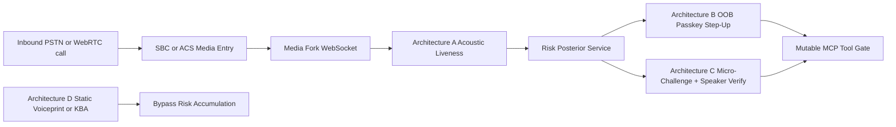
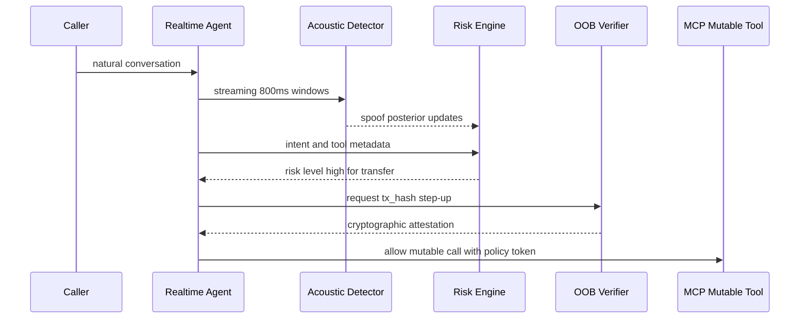
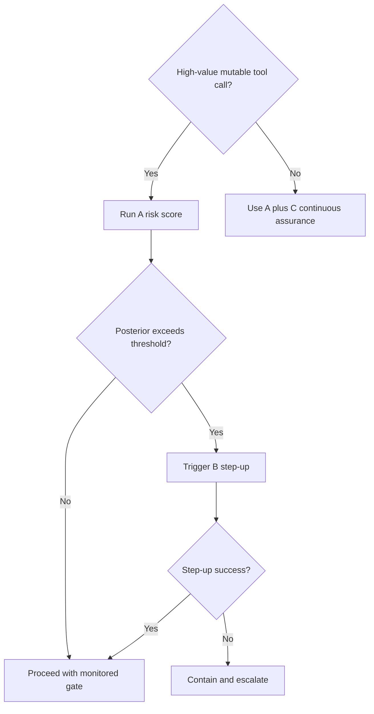

# 企业语音 Agent 深伪防护选型 FAQ：SBC 声学活体检测 vs OOB Passkey 升级验证 vs 生物声纹微挑战
> **适用对象**：Cloud & AI Solution Architect、语音联络中心平台负责人、金融反欺诈团队、身份治理与隐私合规团队。
> **问题焦点**：在实时语音会话中如何兼顾反深伪准确率、客户体验、监管合规与可运营成本。

## 1. Executive Summary
实时语音 Agent 面临的核心风险已经从传统重放转向零样本 3 秒克隆与虚拟声线注入。
Architecture A 将检测放在媒体面，利用 SBC/ACS media-fork 抽取 PCM 窗口并在 AKS GPU 侧做声学反欺诈。
Architecture B 不在每通电话都增加摩擦，而是在高风险工具调用点触发 OOB 加密升级验证。
Architecture C 通过动态语音微挑战与已登记声纹相似度判定补强会话内身份连续性。
Architecture D 依赖静态声纹或 KBA，面对公开数据泄漏与现代克隆模型时防线明显不足。
生产级最佳实践通常是 A 作为底座、B 作为高价值动作闸门、C 作为会话补偿层。

## 2. Problem Definition
语音欺诈链路已经形成工业化分工：语音采样、声纹克隆、脚本引导、交易落地几乎可自动化。
传统“听起来像本人”不再是可靠证据，因为 PSTN 压缩和环境噪声本就会掩盖部分细节。
如果系统只在呼入时做一次认证，攻击者可在中途通过工具调用转移资产或窃取敏感信息。
架构评审应把“检测延迟、误拒率、会话摩擦、法律责任、可观测证据”放在同一决策平面。
任何只强调单点 EER 的方案，都会在真实业务里被体验和合规问题反向抵消收益。

## 3. Architecture Panorama


## 4. Architecture A 深入：Inline SBC/ACS 声学活体与深伪检测
媒体面分叉可在不改动主业务对话流的前提下建立独立风控判定通道。
模型侧通常采用 Wav2Vec2-AASIST 或 RawNet3，并针对 `8 kHz`/`16 kHz` 双采样链路做并行特征提取。
实现上重点不是追求极低 EER，而是在 `< 800 ms` 窗口内形成稳定后验概率并可连续更新。
风险服务应输出“可信区间 + 解释特征 + 历史轨迹”，避免单次波动触发误阻断。
该路径对中老年语音、设备回声、嘈杂环境的适配需要单独标定，否则 FRR 会在业务高峰升高。
A 的优势是被动检测、无额外客户动作；弱点是对新型 vocoder 漂移需要持续模型更新。

## 5. Architecture B 深入：风险触发 OOB 加密升级验证
B 的核心设计思想是把用户摩擦与交易风险绑定，而不是对所有通话一刀切二次认证。
当系统判定进入高风险区间或检测到敏感工具调用时，触发 FIDO2 passkey 或 Verified ID 流程。
交易绑定 `tx_hash` 必须覆盖收款账户、金额、有效时间窗和设备上下文，防止重放与中继。
OOB 通道的可用性需要独立 SLO，并在手机不可达场景提供受限替代流程。
B 的优势在于法律与审计可证明性强；代价是高风险会话中的用户操作步骤增加。

## 6. Architecture C 深入：会话微挑战 + 注册声纹验证
C 通过语义相关的动态问答与短语复述，迫使攻击者在实时语境下完成语音生成。
声纹层可采用 TDNN 或 ECAPA-TDNN，结合余弦相似度和时间连续性分数构建联合判定。
微挑战文案不能固定模板，必须与上下文和业务动作关联以降低脚本化绕过概率。
该路径能提升会话内连续身份确认，但需要严格处理生物特征模板存储与最小化留存策略。
C 最适合作为 A 与 B 之间的弹性缓冲层，而不是独立单点方案。

## 7. Architecture D 反模式：静态声纹或 KBA
D 依赖呼入前一次性鉴别，忽略会话中途的身份漂移与工具调用风险。
KBA 信息在 OSINT 与历史泄漏环境下已不具备可靠秘密属性。
静态声纹在高质量克隆和虚拟音频线注入场景中容易被规避。
该路径会把欺诈发现时点推迟到事后审计，形成高昂补救成本。

## 8. 12-Dimension Horizontal Selection Matrix
| 维度 | A 声学活体检测 | B OOB Passkey/VID | C 微挑战+声纹 | D 静态声纹/KBA |
|---|---|---|---|---|
| Detection Latency | 中低（窗口级） | 中（触发后） | 中（交互级） | 低（但弱） |
| Zero-Shot TTS/VC EER | 中高防护 | 极高（交易绑定） | 中高（依赖挑战质量） | 低 |
| PSTN G.711 8kHz Resilience | 中（需专门标定） | 高（与音频无关） | 中 | 低 |
| Elderly/Noisy-Line FRR | 中高风险 | 低到中 | 中高 | 低（但误放行高） |
| Replay / Virtual Cable Defense | 中 | 高 | 中 | 低 |
| Caller UX Friction | 低 | 中高（仅高风险） | 中 | 低 |
| PCI-DSS/FFIEC/PSD3 Alignment | 中高 | 高 | 中 | 低 |
| `gpt-realtime` Tool Gate Fit | 高 | 高 | 中高 | 低 |
| GDPR Art.9 / BIPA Liability | 中（需模板治理） | 高（零生物模板） | 中低（模板敏感） | 低 |
| Vocoder Drift Robustness | 中（持续训练） | 高 | 中 | 低 |
| SIEM Forensics Traceability | 高 | 高 | 中高 | 低 |
| 3-Year TCO per 1M Calls | 中 | 中高 | 中 | 低表面/高隐性 |

## 9. Mid-Call Tool-Gate & OOB Step-Up Sequence


## 10. Selection Decision Tree


## 11. Python：贝叶斯后验 + 滑窗 LLR + MCP 工具闸门
```python
import math

def bayes_posterior(prior_spoof: float, tpr: float, fpr: float) -> float:
    numerator = tpr * prior_spoof
    denominator = numerator + fpr * (1 - prior_spoof)
    return numerator / denominator if denominator else 0.0

def llr_score(spoof_logp: float, bona_logp: float) -> float:
    return spoof_logp - bona_logp

def sliding_window_decision(scores: list[float], threshold: float) -> bool:
    if not scores:
        return False
    recent = scores[-5:]
    return sum(recent) / len(recent) >= threshold

def tool_gate(posterior: float, intent: str, mutable: bool) -> str:
    if mutable and posterior >= 0.35:
        return 'step_up_required'
    if mutable and posterior >= 0.15 and intent in {'wire_transfer', 'beneficiary_change'}:
        return 'step_up_required'
    if posterior >= 0.60:
        return 'contain_session'
    return 'allow_with_monitoring'
```

## 12. YAML/Bicep：ACS 媒体流 + AKS 反欺诈部署 + Verified ID 回调
```yaml
apiVersion: apps/v1
kind: Deployment
metadata:
  name: voice-antispoof-inference
spec:
  replicas: 3
  selector:
    matchLabels:
      app: antispoof
  template:
    metadata:
      labels:
        app: antispoof
    spec:
      containers:
        - name: onnx-runtime
          image: ghcr.io/example/antispoof-onnx:stable
          env:
            - name: ACS_MEDIA_STREAM_URL
              value: "wss://acs-media-fork.internal/stream"
            - name: VERIFIED_ID_WEBHOOK
              value: "https://identity-gate.internal/stepup"
            - name: WINDOW_MS
              value: "800"
```

### Q1: G.711 `3.4 kHz` 带宽限制如何影响 vocoder 痕迹
窄带编码会弱化高频伪影，使部分频谱特征不再稳定可见。
因此模型必须在 PSTN 样本上单独训练，而不是直接复用宽带会议语料。
工程上建议并行提取相位扰动、瞬态包络与跨窗稳定性指标，降低单一特征脆弱性。
在真实联络中心中，线路抖动与回声会叠加误差，所以阈值应按通道类型动态分层。

### Q2: 滑窗长度、决策延迟与 EER 的平衡如何设定
窗口越短，反馈越快，但统计方差更大，误判概率会上升。
窗口越长，判定更稳，但高风险动作前可用时间被压缩，影响工具闸门时效。
建议以 800ms 为基础窗，叠加最近 5 窗平均分，形成延迟与稳定性折中。
高价值动作可启用“提前预警 + 最终确认”双阶段策略，避免单点阈值抖动。

### Q3: 先验攻击率仅 `0.2%` 时为何 `A->B` 优于 `A->硬拒绝`
当攻击基率极低时，即便检测器 TPR 很高，阳性后验也可能被 FPR 显著稀释。
直接硬拒绝会把大量正常用户推入失败路径，带来体验损失与业务流失。
把 A 作为筛选器、B 作为加密确认器，可以在低基率条件下显著提升净决策质量。
该策略把误报成本转化为可控摩擦，而不是不可逆的交易阻断。

### Q4: 虚拟音频线注入为何必须绑定 `tx_hash` 的 FIDO2 验证
虚拟音频线能在会话中替换上行语音，绕过仅基于声学特征的单层检测。
若工具调用缺少交易绑定签名，攻击者可在会话后段发起资金或权限变更。
将收款人、金额、过期时间写入 `tx_hash` 并要求 passkey 签名，可有效切断中继链。
这也是把“会话可信”提升为“交易可信”的关键工程步骤。

### Q5: `GDPR Art.9` / `BIPA` 下为什么 `A+B` 的法务风险低于 `A+C`
A+B 路径可在不长期存储生物模板的情况下完成高风险动作认证。
A+C 若保存声纹模板，需要额外处理告知、同意、撤回、删除和跨境传输责任。
在多司法辖区运营时，零模板策略通常更容易满足最严格地区的监管底线。
因此很多跨国企业把 C 限制在特定业务域，并保留严格的模板生命周期治理。

### Q6: `gpt-realtime` 会话中如何闸控可变更型 MCP 工具
关键原则是把对话层和执行层分离，执行层只接受带风险令牌的工具调用。
当后验风险上升时，系统应暂停 mutating 工具并提示 step-up，而非中断全部会话。
闸控决策需写入 SIEM：触发时间、阈值、模型版本、用户动作、放行依据。
这样既能支持事后取证，也能为阈值调优提供闭环数据。

## 13. Enterprise Scenarios
### 场景 A：Private Wealth Wire-Transfer Desk（1.8M calls/mo）
业务特征是高净值转账与受益人变更集中，单次欺诈损失高。
建议策略：A 全量启用，B 绑定所有资金变更动作，C 仅在争议会话触发补充验证。
### 场景 B：Healthcare PBM & Pharmacy Contact Center（4.5M calls/mo）
业务特征是高并发问询、处方续配与身份敏感信息访问频繁。
建议策略：A 常态检测，B 限定在敏感数据导出与支付动作，C 用于异常通话复核。

## 14. 3-Year TCO per 1M Calls
| 方案 | 年化成本区间 | 欺诈损失压降 | 体验摩擦 |
|---|---:|---:|---|
| A only | `$0.42M-$0.58M` | 中 | 低 |
| A + B | `$0.57M-$0.79M` | 高 | 中（风险触发） |
| A + C | `$0.61M-$0.86M` | 中高 | 中 |
| D baseline | `$0.28M-$0.36M` | 低 | 低表面/高隐性 |
综合欺诈损失与合规罚责后，多数金融与医疗客户在三年维度上会选择 A+B 作为主路径。

## 15. Day-0 / Day-2 Go-Live Checklist
Day-0：完成媒体分叉链路压测、风险阈值标定、step-up 可用性演练与回切策略演练。
Day-0：确认 SIEM 字段完整，确保每次闸控决策可回放到模型版本和策略版本。
Day-0：完成法务审阅，明确生物特征处理边界、同意管理、删除策略与保留期限。
Day-2：按业务线复盘 FRR/FAR、step-up 触发率、工具阻断率和误拦截投诉。
Day-2：按月更新深伪样本库与模型基线，覆盖新型 vocoder 与跨语言克隆模式。
Day-2：每季度执行红队演练，验证虚拟音频线注入与跨通道中继的防御闭环。

## 16. 运营指标与阈值治理基线
语音反欺诈上线后，最常见失败不是模型精度不够，而是阈值治理与响应编排不一致。
风控团队如果只看总体 AUC，往往会忽略业务高价值路径的误拦截与放行差异。
建议把“会话检测”与“交易放行”拆成两套 KPI，并在同一周会中联合审阅。
指标定义必须写入平台控制面，而不是散落在多个报表工具中。
当阈值变更发生时，系统应保留审批链、回滚点和灰度范围，避免一次性全域漂移。
跨区域部署时需要按国家号码段、线路质量、客户分层维护差异化策略包。
策略包生命周期建议包含候选、灰度、稳定、回收四阶段，并绑定自动健康门禁。
高峰期应启用阈值冻结窗口，防止运维临时调参放大业务风险。
下表可作为 Day-2 周期运营的最小可行指标框架。

| 指标域 | 指标定义 | 目标区间 | 观测粒度 | 响应动作 |
|---|---|---|---|---|
| 声学检测 | `spoof_posterior_p95` | `< 0.35` | 15 分钟 | 超阈值触发模型回归对比 |
| 声学检测 | `window_decision_latency_p95` | `< 900ms` | 5 分钟 | 超阈值切换低复杂度模型 |
| 交易闸控 | `stepup_trigger_rate` | `1.5%-4.5%` | 1 小时 | 超上限审查阈值是否过严 |
| 交易闸控 | `stepup_success_rate` | `> 96%` | 1 小时 | 降低时检查 OOB 通道可用性 |
| 体验质量 | `false_reject_complaint_rate` | `< 0.08%` | 每日 | 触发客服话术与策略复盘 |
| 体验质量 | `contain_without_drop_rate` | `> 90%` | 每日 | 低于阈值优化会话降级逻辑 |
| 合规审计 | `evidence_completeness` | `100%` | 每日 | 缺失即阻断策略发布 |
| 合规审计 | `policy_change_traceability` | `100%` | 每周 | 缺失则回滚至上版策略 |
| 安全对抗 | `virtual_cable_detect_precision` | `> 92%` | 每周 | 低于阈值补充对抗样本 |
| 安全对抗 | `vocoder_drift_retrain_cycle` | `<= 30 天` | 每月 | 超期触发模型治理告警 |

## 17. 合规映射与数据边界建议
在金融与医疗环境，技术方案往往先败在数据边界，而不是算法本身。
语音流、声学特征、后验分数、身份凭据、交易元数据必须分层存储并明确保留期。
若组织选择 A+C 路径，生物模板应独立托管并与业务账户解耦映射，减少横向暴露半径。
跨境业务应预先定义哪些字段可跨域复制，哪些字段只能保留在本地监管域。
所有可变更型工具调用都应记录“请求语义、风险状态、身份证明、审批结果、执行回执”五元组。
敏感字段应在日志层做最小披露，审计回放时通过受控解密提供必要细节。
以下映射可用于法务、安全与平台团队的联合评审。

| 合规要点 | 技术控制 | 证据输出 | 失败后果 |
|---|---|---|---|
| 生物特征最小化 | 优先 A+B 零模板路径 | 数据流图与字段清单 | 触发隐私诉讼风险 |
| 明示同意与撤回 | 模板启用前双重确认 | 同意日志与撤回轨迹 | 同意证明缺失 |
| 交易不可抵赖 | `tx_hash` + passkey 签名 | 签名票据与验签结果 | 交易争议难举证 |
| 风险决策可解释 | 后验分数 + 特征摘要 | SIEM 风险决策记录 | 审计不可复盘 |
| 跨境传输边界 | 区域策略与字段掩码 | 区域路由与脱敏日志 | 违反数据主权要求 |
| 事件响应时效 | 分级告警与自动隔离 | 告警工单与处置时间 | 欺诈扩散窗口扩大 |

## 18. 实施阶段常见偏差与纠偏路径
第一类偏差是把模型阈值当成固定常数，忽略季节性、活动日和渠道结构变化。
第二类偏差是 OOB 设计只验证“用户是谁”，却没有验证“用户正在授权什么动作”。
第三类偏差是把所有异常会话直接挂断，导致正常用户投诉集中爆发。
第四类偏差是日志采集缺失策略版本信息，后续无法还原当时决策上下文。
纠偏时应采用“小步灰度 + 反事实回放 + 业务共识签署”的三段机制。
反事实回放建议保留匿名化样本，并在新旧策略上并行计算净收益差异。
对高风险工具可先启用“软阻断”模式，通过人工复核评估误伤后再转硬阻断。
当组织缺乏专职语音风控工程能力时，应优先把复杂模型治理交给集中平台团队。
季度演练应覆盖语音克隆、虚拟线注入、通道劫持、身份中继四类典型攻击链。
最终目标不是把所有攻击都即时发现，而是将高损失路径的成功概率降到可接受阈值以下。

## 19. Final Recommendation
把 A 作为实时底座，把 B 作为高价值动作的密码学锚点，把 C 作为会话补偿层。
避免把任何单一检测分数当作最终真相，生产系统必须依赖分层证据与分层决策。
当风控、体验、合规与运营证据统一到同一控制面时，语音 Agent 才能规模化上线。
