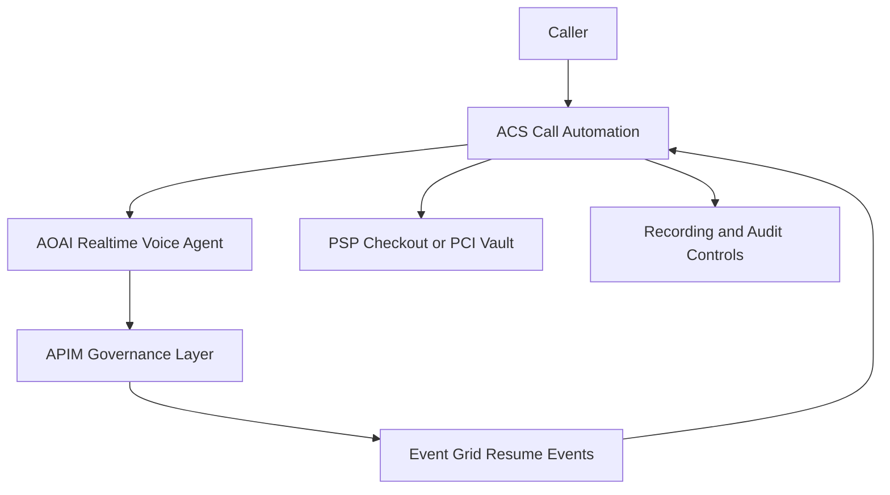
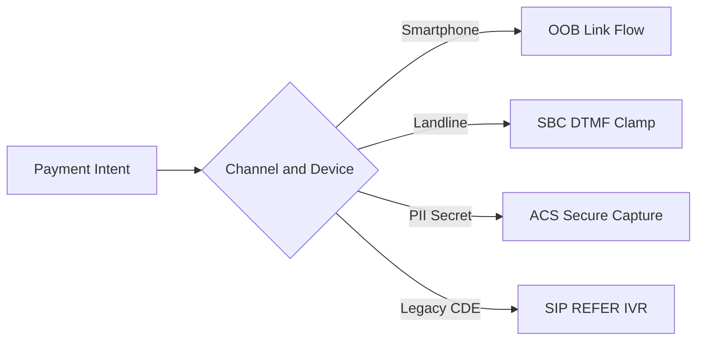
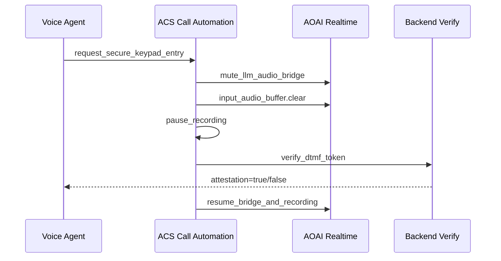

# Enterprise Voice Agent PCI-DSS and PII Descoping FAQ: SBC DTMF Clamping vs ACS Mute Bridge vs OOB Payment Link vs SIP REFER IVR

> 🌐 **Language Switch**: [中文](./voice-agent-pci-dss-pii-descoping-sbc-dtmf-clamping-vs-acs-mute-bridge-vs-oob-payment-link-vs-sip-refer-ivr-selection-faq.md) | **English (current)**
> **Audience**: Cloud & AI Solution Architects, voice platform teams, payment security teams, contact-center architects, and compliance governance stakeholders.
> **Context**: Enterprises want to preserve live AI voice experiences while keeping PAN collection outside the Azure AI and LLM estate to reduce PCI CDE scope.

## 1. Why live voice continuity and payment compliance conflict by default

Realtime voice agents optimize for uninterrupted dialogue and low latency, while PCI controls demand strict handling boundaries.

If card data touches model audio context, even briefly, PCI CDE scope can expand across AI components.

If controls over-isolate and force call breaks, abandonment rises and conversion drops.

A production architecture must optimize compliance boundary, user experience, endpoint coverage, and operating economics together.

## 2. Four architecture patterns and fit boundaries

Architecture A uses out-of-band payment links while keeping the caller on the line.

Architecture B strips RFC 4733 and acoustic DTMF at carrier/SBC edge for universal device coverage.

Architecture C uses ACS native secure capture for non-PAN secrets under PII/HIPAA controls.

Architecture D transfers to an existing PCI-certified IVR and later returns with tokenized receipt.

Start by deciding target audit boundary, then choose how much transfer latency and orchestration complexity is acceptable.

## 3. Global payment-in-voice orchestration topology



Split dialogue plane from payment plane and rejoin via signed, idempotent events.

Only minimal attestations should return to AI context, such as payment status booleans or opaque tokens.

## 4. Architecture A: OOB payment link with live-call resume

A sends signed checkout links over SMS or WhatsApp and lets PSP-hosted pages capture PAN.

The voice agent remains connected and resumes business dialogue after webhook confirmation, often under `<400ms`.

This pattern can keep AOAI Realtime, Foundry workloads, logs, and recordings out of PCI CDE scope.

It performs best when smartphone penetration is high, but still needs `12%–25%` fallback for landline and feature phones.

Key controls include signed-link expiry, replay defense, and out-of-order event handling.

## 5. Architecture B: edge DTMF clamping and tokenization

B intercepts RFC 4733 payloads and acoustic DTMF tones before Azure media ingress.

SBC sends PAN directly to PSP or PCI vault and returns network tokens to downstream systems.

This path supports nearly all caller devices, including non-smartphone segments.

Its strength is conversion stability plus strict AI-tier descoping, with higher telecom integration complexity.

Multi-country deployments require continuous interoperability regression across carrier profiles.

## 6. Architecture C: ACS secure capture with AOAI bridge muting

C is designed for non-PAN secrets such as member PIN, DOB, SSN fragments, or one-time passcodes.

On `request_secure_keypad_entry`, the control plane issues `mute_llm_audio_bridge`, `pause_recording`, and `input_audio_buffer.clear`.

ACS `StartRecognizing(Dtmf)` captures keypad input and only an attestation outcome is passed to prompt context.

This greatly reduces leakage windows for PII/HIPAA fields, while explicitly not serving as a PAN PCI path.

C is highly valuable for identity and entitlement workflows in regulated service operations.

## 7. Architecture D: SIP REFER to certified PCI IVR

D transfers calls to existing PCI Level-1 IVR stacks after intent and cart preparation.

After payment completion, signed UUI or webhook events return tokenized receipt to the agent flow.

It minimizes new PCI work for AI tiers and leverages already-certified contact-center assets.

Tradeoffs include `2.5–6.0s` leg-switch latency and `8%–14%` transfer abandonment risk.

Operational success depends on seamless context handoff and transfer observability.

## 8. Core formulas for audit scope, conversion, and leakage risk

PCI scope reduction: `Reduction = (Assets_before - Assets_after) / Assets_before`.

Annual QSA delta: `Delta_QSA = (Scope_before - Scope_after) * Cost_per_scope_unit`.

Hybrid conversion: `Conv = p_smart*conv_oob + (1-p_smart)*conv_dtmf`.

Acoustic leak risk factor: `LeakRisk = P(barge-in) * Window_ms`.

Transfer loss impact: `Loss = Calls * AOV * TransferDropRate * Margin`.



## 9. Twelve-dimension quantitative matrix

| Dimension | A OOB Link | B SBC Clamp | C ACS Secure Capture | D SIP REFER IVR |
|---|---|---|---|---|
| PCI descoping strength | High (SAQ-A target) | High | Medium (non-PAN) | High (reuse existing CDE) |
| Endpoint coverage | Medium-High | High | High | High |
| Smartphone dependency | High | Low | Low | Low |
| Payment resume latency | `<400ms` | `500–900ms` | `350–700ms` | `2.5–6.0s` transfer |
| Conversion stability | Medium-High | High | Medium-High | Medium |
| Delivery complexity | Medium | High | Medium | Medium-High |
| Voice leakage control | High | High | High | Medium |
| Recording compliance control | High | High | High | Depends on legacy stack |
| Operational observability | High | Medium-High | High | Medium |
| Legacy dependency | Low | Medium | Low | High |
| Audit prep effort | Low | Medium | Medium | Low (inherited) |
| 3-year TCO competitiveness | High | Medium-High | High | Medium |

## 10. Secure-capture state machine and bridge gating



The machine should be idempotent with deterministic timeout recovery to avoid stuck mute states.

Every transition should emit auditable events for forensic replay and compliance evidence.

## 11. Production snippets: Bicep, APIM webhook policy, Python secure controller

```bicep
param location string = 'eastus2'

resource callAutomation 'Microsoft.Communication/communicationServices@2023-04-01' = {
  name: 'acs-voice-payments'
  location: location
  kind: 'CommunicationServices'
  properties: {}
}

resource apim 'Microsoft.ApiManagement/service@2023-09-01-preview' = {
  name: 'apim-voice-governance'
  location: location
  sku: { name: 'Premium', capacity: 1 }
  properties: { publisherEmail: 'ops@example.com', publisherName: 'platform' }
}
```

```xml
<policies>
  <inbound>
    <base />
    <validate-jwt header-name="Authorization" failed-validation-httpcode="401" />
    <set-variable name="eventType" value="@(context.Request.Body.As<JObject>()?["eventType"]?.ToString())" />
    <choose>
      <when condition="@(context.Variables.GetValueOrDefault<string>("eventType") == "payment.confirmed")">
        <set-header name="x-voice-resume" exists-action="override"><value>true</value></set-header>
      </when>
    </choose>
  </inbound>
  <backend><base /></backend>
  <outbound><base /></outbound>
</policies>
```

```python
from dataclasses import dataclass

@dataclass
class CaptureState:
    recording_paused: bool = False
    bridge_muted: bool = False

class SecureCaptureController:
    def mute_llm_audio_bridge(self) -> None:
        self.bridge_muted = True

    def pause_recording(self) -> None:
        self.recording_paused = True

    def send_realtime_event(self, event_type: str) -> None:
        print({'type': event_type})

    def secure_capture(self, dtmf_value: str) -> bool:
        self.mute_llm_audio_bridge()
        self.pause_recording()
        self.send_realtime_event('input_audio_buffer.clear')
        verified = dtmf_value.isdigit() and 4 <= len(dtmf_value) <= 8
        self.recording_paused = False
        self.bridge_muted = False
        return verified
```

## 12. Enterprise scenarios and KPI table

Scenario 1: Tier-1 retail bank with `1M` annual voice payment calls and strict fraud plus audit controls.

Using A+B, smartphone users follow OOB while landline users follow SBC-protected DTMF, improving conversion and descoping.

Scenario 2: global airline IRROPS and ancillary checkout with `10M` annual calls and peak transfer pressure.

Using A+D, the airline keeps existing certified IVR while moving smartphone cohorts to OOB to reduce transfer congestion.

| KPI | Retail Bank A+B | Global Airline A+D |
|---|---:|---:|
| Payment completion | `86.2%` | `79.4%` |
| Mean resume latency | `620ms` | `3.8s` |
| Transfer abandonment | `3.1%` | `10.6%` |
| Audit-scope asset reduction | `-57%` | `-44%` |
| Cost per 1k calls | `$42` | `$38` |

### 3-year TCO (100K / 1M / 10M annual payment calls)

| Architecture path | 100K calls/year | 1M calls/year | 10M calls/year | 3-year total |
|---|---:|---:|---:|---:|
| A OOB Link | `$0.38M` | `$1.86M` | `$11.90M` | `$14.14M` |
| B SBC Clamp | `$0.52M` | `$2.10M` | `$12.44M` | `$15.06M` |
| C ACS Secure | `$0.34M` | `$1.72M` | `$10.80M` | `$12.86M` |
| D SIP REFER | `$0.30M` | `$1.58M` | `$10.52M` | `$12.40M` |
| A+B hybrid | `$0.44M` | `$1.98M` | `$12.12M` | `$14.54M` |
| A+D hybrid | `$0.36M` | `$1.76M` | `$11.10M` | `$13.22M` |

## 13. Day-0 / Day-1 / Day-2 rollout checklist

### Day-0

1. Finalize PCI, PII, and HIPAA field boundaries with explicit no-LLM lists.

2. Implement device-aware routing policy for smartphone, landline, and feature-phone cohorts.

3. Configure signed-link TTL, replay prevention, and revocation flow for OOB checkout.

4. Validate recording pause and resume controls against legal retention requirements.

5. Build idempotent payment webhook handling with out-of-order event tolerance.

6. Stress-test SIP transfer chains and fallback behavior under peak call loads.

### Day-1

1. Monitor completion and failure distributions by device segment every day.

2. Track OOB click-through, expiry rate, and resend ratio daily.

3. Audit recording pause/resume integrity daily for compliance integrity.

4. Review DTMF clamp misses weekly with sampled acoustic inspection.

5. Review SIP transfer latency and abandonment trend weekly.

6. Sync fraud and false-reject findings with risk teams weekly.

### Day-2

1. Recompute routing weights monthly across conversion, risk, and operational load.

2. Rebuild QSA evidence packs monthly and track preparation hours.

3. Evaluate new channel contribution to OOB completion uplift monthly.

4. Review carrier compatibility and rollout versions quarterly.

5. Refresh payment-failure rescue scripts and human fallback quarterly.

6. Run tabletop continuity drills quarterly for peak-season incidents.

## 14. Quantitative Q&A (Q1 to Q6)

### Q1: How do we quantify PCI scope reduction and annual QSA cost impact?

If scoped assets drop from `120` to `52`, reduction is `(120-52)/120 = 56.7%`.

At `$7,500` annual audit cost per scoped asset unit, savings are roughly `(120-52)*7,500 = $510,000`.

### Q2: How is hybrid smartphone OOB plus landline DTMF conversion computed?

With smartphone share `78%`, OOB completion `88%`, non-smartphone share `22%`, DTMF completion `81%`.

Total completion is `0.78*0.88 + 0.22*0.81 = 86.46%`, higher than either path alone in mixed populations.

### Q3: How does `input_audio_buffer.clear` reduce barge-in leak window risk?

If barge-in probability is `4%` and unmitigated leak window is `420ms`, risk factor is `16.8`.

After clearing input buffer to `90ms`, factor becomes `3.6`, a `78.6%` reduction.

### Q4: What is the revenue effect of SIP hairpin transfer abandonment?

For `1,000,000` annual calls, `$6.2` gross margin per conversion, and `9.8%` incremental abandonment.

Estimated gross-margin loss is `1,000,000 * 6.2 * 0.098 = $607,600` per year.

### Q5: When should teams favor A+B versus A+D?

Use A+B when terminal diversity is high and landline coverage is required with strong descoping.

Use A+D when certified IVR assets already exist and edge-clamping rollout is not yet feasible.

### Q6: How do we prevent C from being misused for PAN capture?

Enforce policy so C accepts only predefined non-PAN fields and auto-routes payment intents to A, B, or D.

Record field classification and route decisions in immutable audit logs to prove boundary integrity.

## 15. Good fit, not-for, and runtime alert dictionary

Good fit: enterprises balancing live voice continuity with strict payment compliance and cross-team operational governance.

Not for: voice bots with no payment or sensitive secret capture requirements.

| Alert key | Trigger | Immediate action | Owner |
|---|---|---|---|
| `oob_link_expiry_spike` | OOB expiry ratio rises | Reduce dispatch delay and issue signed-link resend | Channel Operations |
| `dtmf_clamp_miss` | DTMF leakage detected | Switch to strict mode and run acoustic inspection | Voice Platform Team |
| `secure_capture_timeout` | Secure-capture state exceeds timeout | Force bridge recovery and guide user retry | Application Team |
| `recording_pause_drift` | Pause and resume states diverge | Lock recording policy and repair audit stream | Compliance Engineering |
| `sip_refer_abandonment_high` | Transfer abandonment above threshold | Lower transfer share and prioritize OOB | Contact Center Ops |
| `payment_resume_lag` | Resume exceeds `400ms` target | Trace webhook and event-bus path latency | Platform Engineering |
| `tokenization_failure_rate` | Tokenization failures increase | Enable PSP fallback and retry orchestration | Payments Team |
| `pci_scope_regression` | New assets enter CDE scope | Trigger architecture review and change freeze | Security Governance |

### References (retrieved on 2026-11-24)

1. Azure Communication Services Call Automation: https://learn.microsoft.com/azure/communication-services/concepts/call-automation/call-automation

2. Azure OpenAI Realtime API: https://learn.microsoft.com/azure/ai-services/openai/realtime-audio-reference

3. APIM policy reference: https://learn.microsoft.com/azure/api-management/api-management-policies

4. Event Grid overview: https://learn.microsoft.com/azure/event-grid/overview

5. PCI DSS overview: https://www.pcisecuritystandards.org/standards/pci-dss/

6. RFC 4733 DTMF events: https://www.rfc-editor.org/rfc/rfc4733

These references anchor payment-boundary, realtime resume, and compliance evidence design choices.

Thresholds should be recalibrated quarterly using live call mix, regulatory requirements, and fraud trend data.
