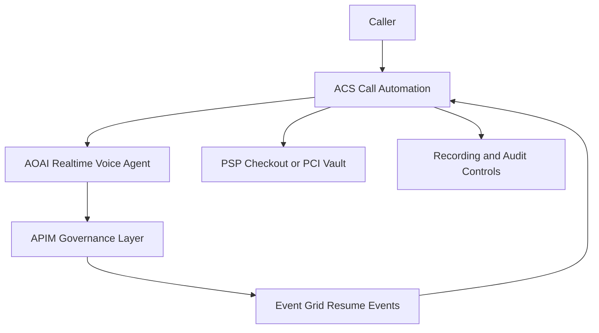
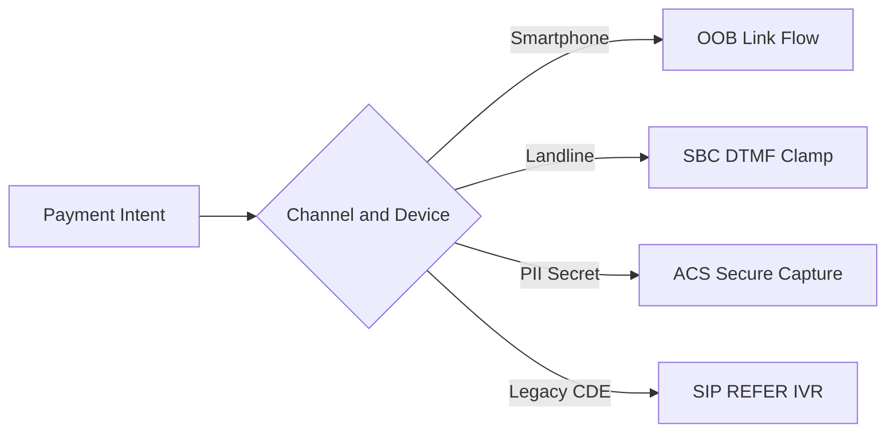
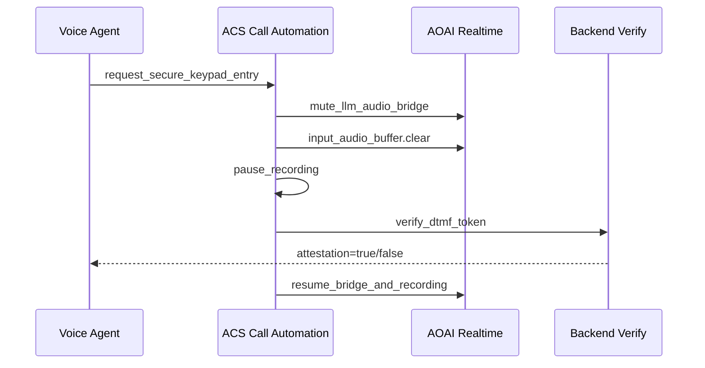

# 企业语音 Agent PCI-DSS 与 PII 去范围化选型 FAQ：SBC DTMF Clamping vs ACS Mute Bridge vs OOB 支付链接 vs SIP REFER IVR

> 🌐 **Language Switch**：**中文（当前）** | [English](./voice-agent-pci-dss-pii-descoping-sbc-dtmf-clamping-vs-acs-mute-bridge-vs-oob-payment-link-vs-sip-refer-ivr-selection-faq.en.md)
> **适用对象**：Cloud & AI Solution Architect、语音平台团队、支付安全团队、联络中心架构组与合规治理团队。
> **问题背景**：企业希望保留实时语音智能体体验，同时把 PAN 支付数据排除在 Azure AI 与 LLM 栈之外，降低 PCI CDE 审计负担。

## 1. 为什么“语音在场 + 支付合规”是多目标冲突问题

语音智能体追求连续对话和低时延，但支付合规要求对敏感输入链路进行严格隔离。

如果把银行卡号音频送入模型上下文，哪怕仅用于瞬时识别，也会扩大 PCI CDE 范围。

如果过度隔离导致用户被迫中断通话，又会拉高放弃率并损害转化。

真正可落地的方案必须同时优化合规边界、呼叫体验、渠道覆盖与运营成本。

## 2. 四类参考架构与典型适配边界

Architecture A 用 OOB 数字支付链接让语音保持在线，同时把支付动作放到 PSP 托管页面。

Architecture B 在运营商/SBC 边缘剥离 DTMF 与声学音，面向全量固话与功能机群体。

Architecture C 依赖 ACS 原生 DTMF 与音桥静音，适合 HIPAA/PII 秘密输入而非 PAN。

Architecture D 通过 SIP REFER 回切既有 PCI Level-1 IVR，复用历史认证资产。

选型时建议先确定审计范围目标，再决定是否接受转接时延和接通流失。

## 3. 全局语音与支付编排总览



核心设计点是把语音对话与支付采集拆成两个边界明确的平面，再用事件回执实现毫秒级恢复。

支付面应生成最小必要凭据，例如 `tok_xxx` 或支付完成布尔态，而非明文卡号相关数据。

## 4. Architecture A：OOB 支付链接 + 在线语音恢复

A 让用户在短信/WhatsApp 收到签名链接，进入 PSP 托管结账页完成支付。

语音 Agent 保持通话并等待支付回执，正常可在 `<400ms` 内恢复业务对话。

该路径能把 AOAI Realtime、Foundry 工作负载、应用日志与录音文件排除在 PCI CDE 外。

它非常适合智能机占比较高的人群，但必须预留 `12%–25%` 非智能机回退路径。

A 的关键运营点是链接签名有效期、重放防护与回执乱序处理。

## 5. Architecture B：SBC 边缘 DTMF Clamping + Tokenization

B 在 PSTN 边界拦截 `RFC 4733` 事件与声学 DTMF 音，向上游只输出舒适噪音或占位音。

SBC 将 PAN 直接送往 PSP 或 PCI Vault，返回网络令牌，Azure AI 侧仅见令牌引用。

该模式可覆盖几乎全部终端类型，包括固话与功能机，不依赖短信链路。

B 的优势是转化稳定且 PCI 去范围强，代价是边缘设备与电信互通工程复杂度更高。

如果多国家运营商协议差异大，需要提前规划 DTMF 编码兼容回归测试。

## 6. Architecture C：ACS DTMF 安全捕获 + AOAI 音桥静音

C 适合非 PAN 敏感信息，如会员 PIN、DOB、一次性验证码等受 HIPAA/PII 约束的字段。

当触发 `request_secure_keypad_entry` 时，系统执行 `mute_llm_audio_bridge`、`pause_recording`，并发送 `input_audio_buffer.clear`。

DTMF 输入经 ACS `StartRecognizing(Dtmf)` 捕获后，仅把校验结果布尔值写入模型上下文。

此路径可显著降低语音泄露窗口，但必须明确说明其不等价于 PAN PCI CDE 处理路径。

C 的价值在于在同一语音会话内安全处理健康、身份或权益类敏感信息。

## 7. Architecture D：SIP REFER 转接既有认证 PCI IVR

D 在语音 Agent 完成意图识别和购物车准备后，把呼叫转给既有 Level-1 IVR。

支付成功后通过签名 UUI 或 webhook 回传令牌与状态，再转回智能体流程。

该方案几乎不增加 AI 层合规改造，尤其适合已有大型联络中心体系的企业。

但转接过程通常带来 `2.5–6.0s` 额外时延，并可能引入 `8%–14%` 转接放弃率。

D 的成败取决于跨平台转接体验、语义上下文保持与回切可观测性。

## 8. 关键公式：审计范围、转化率与泄露窗口

PCI 范围缩减率可估算为 `Reduction = (Assets_before - Assets_after) / Assets_before`。

年度 QSA 成本变化可写作 `Delta_QSA = (Scope_before - Scope_after) * Cost_per_scope_unit`。

混合路由转化率：`Conv = p_smart*conv_oob + (1-p_smart)*conv_dtmf`。

语音泄露窗口风险：`LeakRisk = P(barge-in) * Window_ms`，可用清空音缓冲降低窗口长度。

SIP 转接收入损失：`Loss = Calls * AOV * TransferDropRate * Margin`。



## 9. 12 维定量矩阵（中文）

| 维度 | A OOB Link | B SBC Clamp | C ACS Secure Capture | D SIP REFER IVR |
|---|---|---|---|---|
| PCI 去范围强度 | 高（SAQ-A 目标） | 高 | 中（非 PAN） | 高（复用现有 CDE） |
| 终端覆盖率 | 中高 | 高 | 高 | 高 |
| 智能机依赖度 | 高 | 低 | 低 | 低 |
| 支付恢复时延 | `<400ms` 回执恢复 | `500–900ms` | `350–700ms` | `2.5–6.0s` 转接 |
| 转化率稳定性 | 中高 | 高 | 中高 | 中 |
| 落地复杂度 | 中 | 高 | 中 | 中高 |
| 语音泄露控制 | 高 | 高 | 高 | 中 |
| 录音合规控制 | 高 | 高 | 高 | 依赖旧系统 |
| 运营可观测性 | 高 | 中高 | 高 | 中 |
| 对既有平台依赖 | 低 | 中 | 低 | 高 |
| 审计准备工作量 | 低 | 中 | 中 | 低（沿用） |
| 三年 TCO 竞争力 | 高 | 中高 | 高 | 中 |

## 10. 安全捕获状态机与音桥门控



这类状态机必须具备幂等性和超时恢复逻辑，防止中途异常导致长时间静音或录音停摆。

推荐把每一次状态切换写入审计事件流，以便事后追踪和合规取证。

## 11. 生产片段：Bicep + APIM webhook policy + Python 安全捕获

```bicep
param location string = 'eastus2'

resource callAutomation 'Microsoft.Communication/communicationServices@2023-04-01' = {
  name: 'acs-voice-payments'
  location: location
  kind: 'CommunicationServices'
  properties: {}
}

resource apim 'Microsoft.ApiManagement/service@2023-09-01-preview' = {
  name: 'apim-voice-governance'
  location: location
  sku: { name: 'Premium', capacity: 1 }
  properties: { publisherEmail: 'ops@example.com', publisherName: 'platform' }
}
```

```xml
<policies>
  <inbound>
    <base />
    <validate-jwt header-name="Authorization" failed-validation-httpcode="401" />
    <set-variable name="eventType" value="@(context.Request.Body.As<JObject>()?["eventType"]?.ToString())" />
    <choose>
      <when condition="@(context.Variables.GetValueOrDefault<string>("eventType") == "payment.confirmed")">
        <set-header name="x-voice-resume" exists-action="override"><value>true</value></set-header>
      </when>
    </choose>
  </inbound>
  <backend><base /></backend>
  <outbound><base /></outbound>
</policies>
```

```python
from dataclasses import dataclass

@dataclass
class CaptureState:
    recording_paused: bool = False
    bridge_muted: bool = False

class SecureCaptureController:
    def mute_llm_audio_bridge(self) -> None:
        self.bridge_muted = True

    def pause_recording(self) -> None:
        self.recording_paused = True

    def send_realtime_event(self, event_type: str) -> None:
        # send websocket event to realtime endpoint
        print({'type': event_type})

    def secure_capture(self, dtmf_value: str) -> bool:
        self.mute_llm_audio_bridge()
        self.pause_recording()
        self.send_realtime_event('input_audio_buffer.clear')
        verified = dtmf_value.isdigit() and 4 <= len(dtmf_value) <= 8
        self.recording_paused = False
        self.bridge_muted = False
        return verified
```

## 12. 企业场景与 KPI（零售银行 / 全球航司）

场景一：Tier-1 零售银行语音支付与账单分期场景，年语音支付呼叫 `1M`，需维持低欺诈与低审计负担。

采用 A+B 组合后，智能机用户走 OOB，固话用户走 SBC DTMF，总体转化提升并保持 PCI 去范围目标。

场景二：全球航司 IRROPS 与增值服务结账，年语音支付 `10M`，高峰时段转接压力显著。

采用 A+D 组合后，保留既有 IVR 认证资产，并把智能机客群更多导向 OOB 降低转接拥塞。

| KPI 指标 | 零售银行 A+B | 全球航司 A+D |
|---|---:|---:|
| 支付完成率 | `86.2%` | `79.4%` |
| 平均恢复时延 | `620ms` | `3.8s` |
| 转接放弃率 | `3.1%` | `10.6%` |
| 审计范围资产数降幅 | `-57%` | `-44%` |
| 每千通话成本 | `$42` | `$38` |

### 三年 TCO（100K / 1M / 10M 年语音支付呼叫）

| 架构路径 | 100K calls/year | 1M calls/year | 10M calls/year | 三年总成本 |
|---|---:|---:|---:|---:|
| A OOB Link | `$0.38M` | `$1.86M` | `$11.90M` | `$14.14M` |
| B SBC Clamp | `$0.52M` | `$2.10M` | `$12.44M` | `$15.06M` |
| C ACS Secure | `$0.34M` | `$1.72M` | `$10.80M` | `$12.86M` |
| D SIP REFER | `$0.30M` | `$1.58M` | `$10.52M` | `$12.40M` |
| A+B 混合 | `$0.44M` | `$1.98M` | `$12.12M` | `$14.54M` |
| A+D 混合 | `$0.36M` | `$1.76M` | `$11.10M` | `$13.22M` |

## 13. Day-0 / Day-1 / Day-2 落地清单

### Day-0

1. 确认 PCI、PII、HIPAA 三类数据边界与禁止进入 LLM 的字段字典。

2. 设计设备识别与路由策略，区分智能机、固话、功能机路径。

3. 配置 OOB 链接签名、过期时间、重放防护与撤销机制。

4. 配置录音暂停与恢复策略并验证法务保留要求。

5. 接入支付回执 webhook，定义幂等键与乱序处理窗口。

6. 对既有 IVR 转接链路执行端到端压测与失败演练。

### Day-1

1. 每日核对支付完成率与失败原因分布，区分设备类型。

2. 每日监控 OOB 链接点击率、过期率与二次发送率。

3. 每日审计录音暂停段与恢复段完整性，防止漏录或越界录制。

4. 每周复核 DTMF clamping 漏拦截告警并抽样听检。

5. 每周复核 SIP REFER 转接耗时和放弃率趋势。

6. 每周与风控团队同步欺诈命中与误拒数据。

### Day-2

1. 每月重算路由权重，平衡转化、合规与客服负载。

2. 每月复盘 QSA 证据包完整性与审计准备耗时。

3. 每月评估新渠道（RCS/WhatsApp）对 OOB 完成率提升贡献。

4. 每季度复盘跨地域运营商兼容问题与版本计划。

5. 每季度更新支付失败补救脚本与人工兜底流程。

6. 每季度执行桌面推演验证高峰故障恢复与业务连续性。

## 14. 六个量化问答（Q1~Q6）

### Q1: PCI CDE 审计范围与 QSA 年成本如何量化？

若现状纳入审计资产 `120` 项，目标方案降到 `52` 项，范围降幅 `(120-52)/120=56.7%`。

设单资产审计工作量折算 `$7,500`，年成本可下降约 `(120-52)*7,500=$510,000`。

### Q2: 智能机 OOB 与固话 DTMF 混合路由转化怎么算？

设智能机占比 `78%`、OOB 完成率 `88%`，非智能机占比 `22%`、DTMF 完成率 `81%`。

总体完成率 `0.78*0.88 + 0.22*0.81 = 86.46%`，优于单一路径策略。

### Q3: 语音泄露窗口与 `input_audio_buffer.clear` 缓解效果如何估算？

若 barge-in 触发概率 `4%`，未清缓冲窗口 `420ms`，风险因子近似 `0.04*420=16.8`。

执行清缓冲后窗口降至 `90ms`，风险因子降为 `3.6`，下降约 `78.6%`。

### Q4: SIP hairpin 转接对收入影响如何估算？

设年呼叫 `1,000,000`、客单毛利 `$6.2`、转接放弃增量 `9.8%`。

年毛利损失约 `1,000,000*6.2*0.098=$607,600`，应纳入 D 路径总拥有成本。

### Q5: 何时优先 A+B，何时优先 A+D？

终端异构且固话占比高时，A+B 能兼顾去范围目标与全渠道完成率。

若企业已有成熟 Level-1 IVR 且短期不愿改造边缘网络，A+D 更易快速落地。

### Q6: C 路径如何避免被误用为 PAN 处理链路？

在策略层强制 C 仅允许非 PAN 字段枚举，遇到支付意图立即切换 A、B 或 D。

同时在审计日志中记录字段分类与路由决策，以便持续证明边界未被突破。

## 15. Good fit / Not for 与运行告警字典

Good fit：需要在语音体验连续性与支付合规之间平衡，且具备跨团队治理能力的企业联络中心。

Not for：无支付场景或无需处理敏感输入的纯信息播报类语音机器人。

| 告警键 | 触发条件 | 立即动作 | 责任团队 |
|---|---|---|---|
| `oob_link_expiry_spike` | OOB 链接过期率突升 | 缩短发送延迟并重发签名链接 | 渠道运营 |
| `dtmf_clamp_miss` | DTMF 漏拦截命中 | 切换保守策略并启动听检 | 语音平台团队 |
| `secure_capture_timeout` | 安全捕获状态超时 | 强制恢复音桥并引导重试 | 应用团队 |
| `recording_pause_drift` | 暂停/恢复状态不一致 | 锁定录音策略并补采审计事件 | 合规工程 |
| `sip_refer_abandonment_high` | 转接放弃率超阈值 | 降低转接占比并启用 OOB 优先 | 联络中心运营 |
| `payment_resume_lag` | 支付后恢复超 `400ms` | 排查 webhook 与事件总线延迟 | 平台工程 |
| `tokenization_failure_rate` | 令牌化失败率上升 | 启动 PSP 旁路与重试策略 | 支付团队 |
| `pci_scope_regression` | 新增资产进入 CDE | 触发架构评审与变更冻结 | 安全治理团队 |

### 参考来源（抓取日期：2026-11-24）

1. Azure Communication Services Call Automation: https://learn.microsoft.com/azure/communication-services/concepts/call-automation/call-automation

2. Azure OpenAI Realtime API: https://learn.microsoft.com/azure/ai-services/openai/realtime-audio-reference

3. APIM policy reference: https://learn.microsoft.com/azure/api-management/api-management-policies

4. Event Grid overview: https://learn.microsoft.com/azure/event-grid/overview

5. PCI DSS overview: https://www.pcisecuritystandards.org/standards/pci-dss/

6. RFC 4733 DTMF events: https://www.rfc-editor.org/rfc/rfc4733

以上来源用于校准语音支付架构边界、实时恢复链路与合规证据口径。

所有阈值需要按行业监管、呼叫结构与终端分布进行季度复核和本地化调整。
