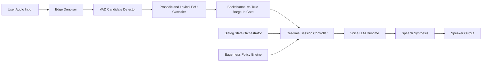
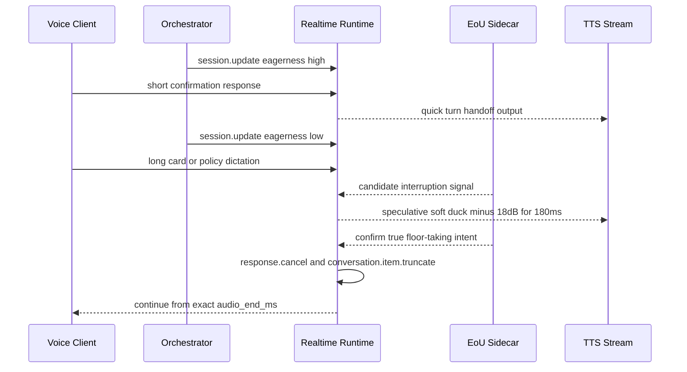
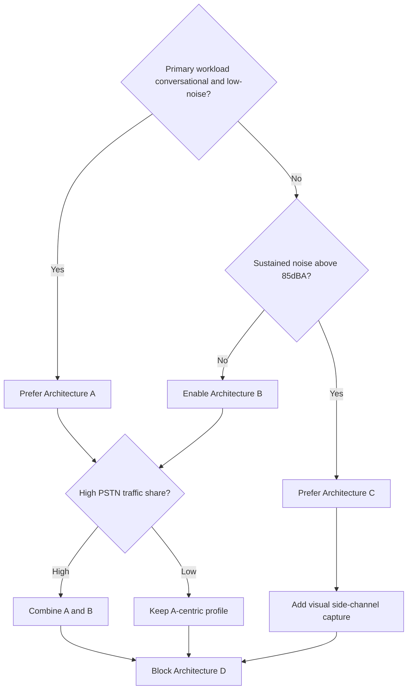

# Real-Time Voice Agent Turn-Taking Selection FAQ: Native `semantic_vad` End-of-Turn vs Cascaded Prosodic/Lexical EoU SLM vs Explicit PTT Floor Control vs Fixed Silence Anti-Pattern
> **Audience**: Cloud & AI Solution Architects, real-time voice platform owners, contact-center engineering teams, and voice reliability SRE leads.
> **Core decision**: optimize end-of-turn responsiveness without increasing false mid-utterance cutoff in noisy, echo-prone, mixed PSTN/WebRTC production environments.
> **Recommended posture**: use A+B as the production baseline, apply C in low-SNR or high-regulation scenarios, and retire D from all customer-facing production paths.

## 1. Executive summary
Voice-agent quality is often decided by turn-taking behavior rather than model knowledge depth.
Users react most negatively to two interaction defects: being cut off mid-speech and waiting too long for turn handoff.
In enterprise flows, those defects directly affect conversion, escalation, and transfer-to-human rates.
A single global silence threshold can appear acceptable in controlled demos yet fail in real call surfaces.
When users dictate card numbers, policy IDs, addresses, or medication references, one premature cutoff can invalidate the entire step.
When users provide short confirmations, excessive hold time feels robotic and erodes trust quickly.
Architecture A uses native multimodal semantic turn detection with dynamic eagerness control.
Architecture B uses cascaded denoising, VAD, and lexical/prosodic EoU classification with two-stage barge-in confirmation.
Architecture C uses explicit floor control through push-to-talk and synchronized side-channel input for extreme-noise environments.
Architecture D represents fixed silence-threshold and uncontrolled speakerphone loop behavior.
This guide quantifies cutoff-latency trade-offs, soft-duck versus hard-truncate UX math, codec/SNR impacts, and three-tier TCO framing.
The goal is to turn voice turn-taking from fragile heuristics into measurable, governable, and continuously improvable platform capability.

## 2. Why turn detection is a multi-objective optimization problem
End-of-turn decisioning is probabilistic, not deterministic.
Short hold windows reduce perceived delay but raise false-cutoff likelihood.
Long hold windows lower false cutoffs but increase conversational lag.
Real deployments add echo leakage, codec loss, burst noise, and speaker variability.
Therefore one static threshold cannot satisfy all situations simultaneously.
State-aware and channel-aware adaptation is required.
A yes/no confirmation prompt should operate with higher eagerness.
A sensitive dictation flow should operate with lower eagerness and stronger confirmation gates.
Backchannel handling is another critical dimension.
Utterances such as “uh-huh,” “right,” “嗯,” or brief affirmations should not always trigger interruption.
If cooperative backchannels are mistaken for floor-taking intent, dialog fluidity collapses.
Hence production turn detection must combine acoustic signals, lexical cues, and dialog state context.

## 3. Goals and boundaries
Goal one is to reduce mid-digit and mid-entity false cutoffs.
Goal two is to keep perceived turn latency within natural conversation tolerance.
Goal three is stable behavior in low-SNR and speakerphone conditions.
Goal four is bounded media and inference operating cost.
Goal five is replayable and explainable turn-decision evidence for audits and tuning.
Boundary one is not zero latency at any cost, but Pareto-optimal interaction quality.
Boundary two is not single-signal control, but combined semantic and prosodic evidence.
Boundary three is not one-time tuning, but continuous calibration by scenario class.

## 4. Candidate architectures
Architecture A uses native multimodal `semantic_vad` with runtime `session.update` eagerness reconfiguration and acoustic echo reference.
Architecture B uses `DeepFilterNet3 + Silero VAD + ONNX EoU` cascades plus two-stage backchannel-versus-barge-in confirmation.
Architecture C uses explicit floor control (`Push-to-Talk` or `Hold-to-Speak`) and synchronized visual side-channel capture where required.
Architecture D uses static `silence_duration_ms` and energy-only VAD under uncontrolled speakerphone feedback conditions.
A is a strong default for most knowledge-driven voice experiences.
B is especially valuable for PSTN, mixed-noise, and accent-diverse environments.
C is preferable when noise, compliance, or safety constraints prioritize deterministic control.
D repeatedly drives either premature interruptions or unnaturally long turn delays.

## 5. Architecture A deep dive: semantic turn detection with dynamic eagerness
Architecture A links turn-taking behavior to dialog-phase intent.
The orchestrator can raise eagerness during short confirmation states for quick handoff.
The orchestrator can lower eagerness during high-risk dictation states for cutoff protection.
These changes are applied through WebSocket `session.update` without SDK redeployment.
Semantic turn logic evaluates clause completeness and contextual intent rather than pause length alone.
Echo-reference integration helps avoid self-barge loops from TTS playback leakage.
A performs well when dialog state modeling is explicit and observable.
A weakens when state transitions are implicit or poorly instrumented.
Therefore production A requires clear state contracts and turn-policy telemetry.

## 6. Architecture B deep dive: cascaded EoU and two-stage interruption control
B separates “sound detected” from “floor-taking intent confirmed.”
Stage one detects candidate interruptions and triggers speculative soft-ducking.
Stage two validates lexical and temporal intent before hard cancellation actions.
Only confirmed barge-ins trigger `response.cancel` and `conversation.item.truncate`.
This design filters cooperative backchannels, coughs, and ambient transient noise.
In PSTN `8 kHz G.711` paths, B can dramatically reduce false barge-ins when tuned correctly.
B requires low-latency edge inference for denoise, VAD, and EoU models.
It also requires region- and language-aware backchannel lexicons.
Complexity is higher than A, but quality gains in noisy production channels are often substantial.

## 7. Architecture C deep dive: explicit floor control and side-channel certainty
C is designed for environments where false interruption is unacceptable.
Push-to-talk gives deterministic floor ownership in low-SNR conditions.
Hold-to-speak semantics reduce accidental interruption from ambient speech.
Synchronized visual keypad or OCR channels can handle sensitive numeric and identity inputs.
This removes dependence on uncertain acoustic interpretation for critical fields.
C sacrifices conversational naturalness for operational certainty.
That trade-off is often correct in industrial maintenance, logistics cabins, and shared clinical spaces.
C also improves auditability because floor transitions are explicit control events.
For high-risk tasks, explicit control can outperform any probabilistic detector.

## 8. Architecture D anti-pattern behavior
D relies on fixed silence windows and energy thresholds.
Short thresholds cause mid-utterance truncation and repeated user correction.
Long thresholds cause awkward lag and lower perceived intelligence.
Speakerphone echo can create self-triggered interruption loops.
Teams often react with ad hoc threshold changes that shift problems rather than solve them.
This creates unstable user experience and unstable operations.
D lacks a principled adaptation model for scenario diversity.
Production programs should classify D as deprecated and blocked.

## 9. Quantitative trade-off models
False-cutoff probability approximation:
`P(cutoff) = 1 - F_pause(τ_hold)`
Where `τ_hold` is hold threshold and `F_pause` is observed pause distribution.
Increasing `τ_hold` lowers cutoff risk but increases perceived response delay.
Soft-duck versus hard-truncate utility can be framed as:
`U = w1 * Naturalness - w2 * RepetitionCost - w3 * Delay`
A common pattern is speculative `-18 dB` ducking for `180 ms` before hard truncate confirmation.
Codec and SNR effects can be represented by:
`Margin_snr = α * (SNR_webrtc - SNR_pstn)`
Lower SNR requires longer confirmation windows and stricter barge-in validation.
These formulas define operating envelopes, not final policy decisions.

## 10. Twelve-dimension comparison matrix
| Dimension | Architecture A | Architecture B | Architecture C | Architecture D |
|---|---|---|---|---|
| Conversational naturalness | High | High | Medium | Low |
| False-cutoff protection | Medium-High | High | Highest | Low |
| Noise robustness | Medium | High | Highest | Low |
| Backchannel discrimination | Medium | High | High | Low |
| Operational complexity | Medium | High | Medium-High | Low |
| End-to-end latency control | High | Medium-High | Medium | Low |
| Compliance explainability | Medium-High | High | High | Low |
| PSTN suitability | Medium | High | High | Low |
| User training burden | Low | Low | Medium-High | Low |
| Recommended role | Baseline path | Noise-hardening path | Deterministic control path | Prohibited |
| Typical measurable gain | Faster natural turns | Fewer false interruptions | Zero accidental cutoffs in extreme noise | None |
| Overall recommendation | Required | Strongly recommended | Scenario-specific | Reject |

## 11. Acoustic and semantic turn-taking control plane


## 12. Sequence for dynamic eagerness and two-stage interruption


## 13. Selection decision tree


### Q1. Why should turn control be tied to dialog state
User tolerance changes by task phase.
A short confirmation turn can accept aggressive handoff.
A long numeric dictation turn cannot tolerate premature cutoff.
Without state awareness, one global threshold must compromise both.
Compromise usually fails both speed and safety.
State-aware policies move optimization closer to user intent.

### Q2. How should backchannel and true interruption be separated
Backchannels are often short, cooperative, and non-floor-taking.
True interruptions carry stronger lexical and temporal intent.
B uses speculative ducking before final interruption confirmation.
This avoids immediate hard truncation on weak signals.
Energy-only detection cannot reliably make this distinction.
Backchannel discrimination should be treated as a first-class capability.

### Q3. When is explicit PTT mandatory
PTT becomes mandatory when sustained noise is extreme and variable.
PTT is also preferred when compliance requires deterministic floor control.
PTT is practical when workflow values correctness over conversational fluidity.
These conditions are common in industrial and shared clinical environments.
PTT plus side-channel input can eliminate critical mid-entry interruption risk.
In such contexts deterministic control outweighs naturalness cost.

### Q4. What is the best soft-duck and hard-truncate strategy
Immediate hard truncate maximizes responsiveness but amplifies misfire frustration.
Speculative soft-duck creates a confirmation window at lower UX risk.
If confirmation fails, audio can recover smoothly without explicit interruption.
If confirmation succeeds, hard truncate can be applied with confidence.
This approach absorbs uncertainty before irreversible action.
Parameter values should be tuned by language, channel, and echo profile.

### Q5. How do PSTN and WebRTC change policy
PSTN usually has lower bandwidth and weaker SNR.
WebRTC typically preserves richer speech cues.
PSTN profiles should widen confirmation windows and lower eagerness.
WebRTC profiles can safely raise eagerness in low-noise contexts.
Single shared parameters across codecs often create avoidable errors.
Channel-specific policy sets are strongly recommended.

### Q6. Five-step rollout and Good fit vs Not for
Step one: classify scenario classes and acceptable cutoff-risk envelopes.
Step two: deploy Architecture A with state-driven eagerness transitions.
Step three: deploy Architecture B with two-stage interruption gates.
Step four: enable Architecture C and side-channel fallback for high-noise classes.
Step five: enforce Architecture D deprecation through policy linting.
Good fit: enterprise voice programs spanning multiple noise profiles and strict reliability targets.
Not for: static demo bots with no sustained operational accountability.

## 14. Implementation snippets
```python
from dataclasses import dataclass

@dataclass
class TurnState:
    phase: str
    eagerness: str
    candidate_ms: int | None = None

def eagerness_for_phase(phase: str) -> str:
    if phase in {"confirm_yes_no", "short_ack"}:
        return "high"
    if phase in {"card_entry", "address_dictation", "policy_number"}:
        return "low"
    return "medium"

def session_update_payload(state: TurnState) -> dict:
    return {
        "type": "session.update",
        "session": {
            "turn_detection": {
                "type": "semantic_vad",
                "eagerness": state.eagerness
            }
        }
    }

def barge_in_actions(candidate: bool, confirmed: bool, audio_end_ms: int) -> list[dict]:
    actions: list[dict] = []
    if candidate:
        actions.append({"type": "soft_duck", "gain_db": -18, "duration_ms": 180})
    if confirmed:
        actions.append({"type": "response.cancel"})
        actions.append({"type": "conversation.item.truncate", "audio_end_ms": audio_end_ms})
    return actions
```

```yaml
apiVersion: apps/v1
kind: Deployment
metadata:
  name: media-eou-sidecar
  namespace: voice-gateway
spec:
  replicas: 6
  selector:
    matchLabels:
      app: media-eou-sidecar
  template:
    metadata:
      labels:
        app: media-eou-sidecar
    spec:
      containers:
        - name: eou
          image: ghcr.io/example/eou-onnx:1.3.0
          args:
            - "--vad=silero"
            - "--denoise=deepfilternet3"
            - "--candidate-ms=180"
            - "--confirm-ms=250"
            - "--soft-duck-db=-18"
          resources:
            requests:
              cpu: "500m"
              memory: "512Mi"
            limits:
              cpu: "2000m"
              memory: "2Gi"
---
apiVersion: autoscaling/v2
kind: HorizontalPodAutoscaler
metadata:
  name: media-eou-sidecar-hpa
  namespace: voice-gateway
spec:
  scaleTargetRef:
    apiVersion: apps/v1
    kind: Deployment
    name: media-eou-sidecar
  minReplicas: 4
  maxReplicas: 30
  metrics:
    - type: Resource
      resource:
        name: cpu
        target:
          type: Utilization
          averageUtilization: 65
```

## 15. Enterprise TCO framing for 100K / 2M / 20M monthly voice minutes
| Tier | Monthly scale | Recommended mix | Dominant cost drivers | Operational gain |
|---|---|---|---|---|
| Tier-1 | 100K voice minutes | A-first baseline | Realtime inference and media gateway baseline | Fast natural handoff |
| Tier-2 | 2M voice minutes | A plus B | Edge EoU inference and denoise compute | Lower false interruption |
| Tier-3 | 20M voice minutes | Layered A+B+C | Multi-scenario policy operations and fallback governance | Stable low-SNR reliability |

## 16. Production readiness checklist
Confirm eagerness transitions are strictly bound to dialog-state transitions.
Confirm high, medium, and low turn profiles exist for key workflow classes.
Confirm backchannel lexicons cover major locale and language variants.
Confirm soft-duck and truncate actions are replayable with exact timing evidence.
Confirm PSTN and WebRTC maintain separate policy bundles.
Confirm denoise and EoU model versions are tied to regression baselines.
Confirm high-noise channels can auto-fallback to PTT or visual side-channel.
Confirm echo-reference health is monitored and included in routine checks.
Confirm false-cutoff rate, turn latency, and repetition rate are co-observed.
Confirm extreme-path drills include speakerphone echo and multi-party overlaps.
Confirm compliance export supports explainable turn-decision evidence.
Confirm Architecture D configurations are blocked in production.

## 17. Operational lessons and optimization guidance
Template turn policies by business phase rather than by generic channel only.
Maintain a curated false-cutoff sample set for continuous tuning.
Track rollback rate caused by repeated user entry as a key quality signal.
Adapt interruption confirmation windows to observed speech-rate distributions.
Use conservative interruption settings for high-value tenant classes.
Monitor average turn count before human transfer in service workflows.
Review A/B/C policy hit distribution in monthly operations governance.
Use one shared metric glossary between product and voice engineering teams.
Refresh accent and ambient-noise corpora in quarterly model updates.
Use replay audits to identify cases where policies are correct but feel unnatural.
Maintain cross-team escalation playbooks for sudden acoustic regressions.
Optimize cost, naturalness, and interruption accuracy as a joint objective.

## 18. Conclusion
Real-time voice turn control is not a single-parameter tuning problem; it is a coordinated optimization problem across acoustics, semantics, dialog state, and business risk.
Architecture A provides scalable default naturalness, Architecture B hardens interruption correctness in noisy and PSTN-heavy conditions, and Architecture C provides deterministic floor guarantees where uncertainty is unacceptable.
Architecture D reflects assumptions that no longer hold in enterprise real-time voice systems and should be removed through policy and control-plane enforcement.
When A, B, and C run as one measured governance loop with replay evidence and periodic recalibration, organizations gain lower repetition cost, more stable turn naturalness, and explainable decision behavior at scale.
