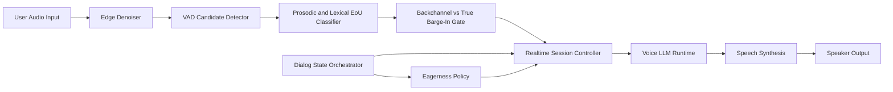
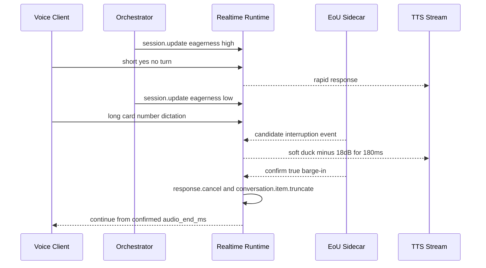
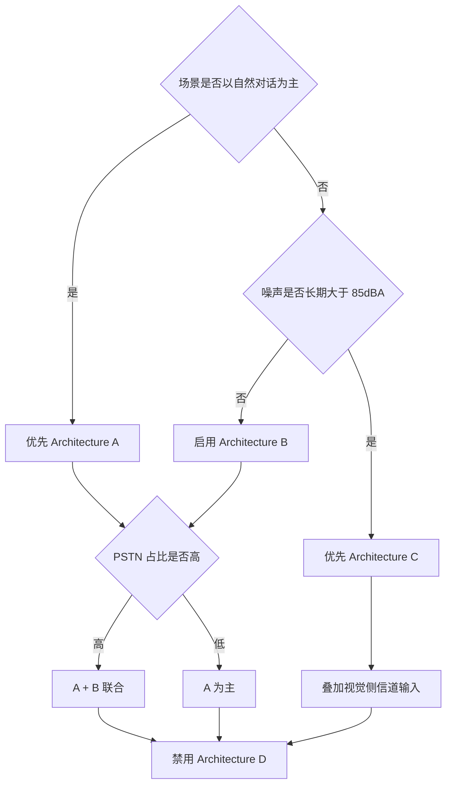

# 实时语音 Agent 轮次终止与打断控制选型 FAQ：`semantic_vad` 语义端点检测 vs 韵律 EoU 级联判定 vs 显式 PTT 地板控制 vs 固定静音阈值反模式
> **适用角色**：Cloud & AI Solution Architect、实时语音平台负责人、联络中心与语音 AI 运维团队。
> **核心问题**：如何在嘈杂环境、回声链路、PSTN 编解码受限条件下，平衡“说话不被截断”与“轮转不拖沓”这对天然冲突指标。
> **建议结论**：默认 A+B 组合，低信噪或高风险场景叠加 C，D 仅保留为反模式教材并从生产配置中彻底清退。

## 1. 执行摘要
语音 Agent 成败通常不取决于模型知识量，而取决于轮转体验。
用户最敏感的两个失真是“被打断”与“等太久”。
在企业场景里，这两类失真直接影响转化率、满意度和人工转接率。
固定静音阈值方案在安静实验室可以工作，在真实声场常常失败。
当用户在报卡号、地址、保单号时，误截断一次就可能导致全流程回滚。
当用户只说“是/不是”时，过慢响应又会显著损害自然感。
Architecture A 使用多模态语义端点检测并动态调节 eagerness。
Architecture B 使用边缘降噪 + 韵律/词汇联合 EoU，并区分 backchannel 与真正抢话。
Architecture C 在极端噪声或强合规场景采用显式 PTT 地板控制确保零误截断。
Architecture D 代表固定 `silence_duration_ms` 与回声环路放任策略。
本文给出 cutoff 概率曲线、soft-duck 与 hard-truncate 体验数学、PSTN/WebRTC 影响与三档 TCO。
目标是把语音轮转治理从“参数拍脑袋”升级为可度量可持续的工程能力。

## 2. 背景：语音轮转是多目标优化而非单阈值问题
端点检测本质上是概率决策问题，而非简单时间门槛问题。
阈值越短，响应越快，但误截断概率升高。
阈值越长，误截断下降，但交互延迟变大。
真实业务还叠加了编解码损失、回声泄漏、噪声突发、方言停顿差异。
因此“全局一个静音阈值”在多场景下必然失效。
企业级策略应按意图、声学环境、会话阶段动态切换。
例如确认问题可偏激进，长数字输入应偏保守。
此外，backchannel 识别是语音 Agent 的关键门槛。
用户“嗯、对、继续”不应被当成抢话。
如果系统把协作性附和当打断，会破坏对话流畅性。
所以轮转控制必须同时理解语音信号与对话状态。

## 3. 目标与边界
目标一：降低 mid-digit cutoff 与误打断比率。
目标二：维持可接受 turn latency，避免“机器人慢半拍”。
目标三：在低 SNR 场景保持稳定可控行为。
目标四：控制实时媒体链路与推理成本。
目标五：提供可回放可解释的轮转决策证据。
边界一：不追求绝对零延迟，而追求可感知自然度最优点。
边界二：不依赖单一信号，而依赖语义、韵律、状态联合判断。
边界三：不以单次 A/B 结果固化参数，需持续校准。

## 4. 四类候选架构
Architecture A：原生多模态 `semantic_vad`，通过 `session.update` 动态调节 `eagerness`，并结合回声参考信号抑制自回授。
Architecture B：`DeepFilterNet3 + Silero VAD + ONNX EoU` 级联，双阶段区分 backchannel 与真实抢话，再触发 `response.cancel` 与 `conversation.item.truncate`。
Architecture C：显式 PTT/Hold-to-Speak 地板控制，结合移动端视觉键盘/OCR 侧信道输入，保证高噪环境零误截断。
Architecture D：固定静音阈值 + 能量门控 + 不处理扬声器回授环路。
A 适合大多数知识型语音场景。
B 适合多噪声、PSTN、复杂说话风格并存场景。
C 适合工业现场、车载、病区等极端环境。
D 在生产面会放大投诉与转人工压力。

## 5. Architecture A 深入：语义端点与状态驱动 eagerness
A 的核心是让 EoT 决策与对话意图联动。
系统可以在问答确认阶段使用高 eagerness，追求迅捷轮转。
在高风险输入阶段切换低 eagerness，降低误截断概率。
这种切换通过 WebSocket `session.update` 实时生效。
因此不需要重新发版客户端 SDK。
A 还应接入声学回声参考，避免把自身播放误判为用户发言。
语义端点检测会结合句法完整性与停顿特征。
相比固定阈值，它在复杂语速与自然停顿中更稳健。
A 的主要风险是配置治理复杂度上升。
需要良好的状态机设计和监控可见性。

## 6. Architecture B 深入：级联 EoU 与两阶段抢话判定
B 的价值在于把“声音出现”与“意图抢话”分开判断。
第一阶段检测候选发声片段并执行短时 soft-duck。
第二阶段结合词汇意图与持续时长确认是否真正打断。
仅当满足时长和语义条件时，才执行 hard truncate。
这样可以过滤大量附和词、咳嗽与环境噪声。
在 PSTN `8kHz G.711` 场景，B 对误打断抑制特别有效。
B 需要边缘媒体网关具备低时延 ONNX 推理能力。
还需维护多语种 backchannel 词表与地域口音样本。
其治理复杂度高于 A，但在复杂环境收益显著。

## 7. Architecture C 深入：显式地板控制与侧信道输入
C 适合“宁慢不误”的高噪高风险流程。
PTT 机制把发言权控制从推断转为显式确认。
用户按住说话可避免噪声误触发。
对于数字与地址输入，可引导用户走视觉键盘/OCR 侧信道。
这种方式几乎消除 mid-digit cutoff 风险。
代价是自然度下降和交互负担上升。
因此 C 更适合作为特定场景策略，而非默认模式。
C 也有利于合规审计，因为地板切换信号更可追踪。
在工业与医疗共享空间，它常是唯一可稳定运行方案。

## 8. Architecture D 反模式说明
D 依赖固定静音阈值，无法适配场景差异。
阈值短时常出现中途截断，阈值长时轮转拖沓。
当扬声器回声进入上行链路时，还会出现自打断循环。
用户需要重复输入，导致任务时长与挫败感上升。
值班团队常通过临时调大阈值“止血”，进一步放大延迟问题。
这种摇摆调参难以形成稳定工程基线。
长期看会导致体验与成本双输。
因此 D 必须在生产配置中明确禁用。

## 9. 数学模型与权衡曲线
误截断概率近似：
`P(cutoff) = 1 - F_pause(τ_hold)`
其中 `τ_hold` 是等待阈值，`F_pause` 是停顿分布函数。
当 `τ_hold` 增大，`P(cutoff)` 下降但 turn latency 上升。
soft-duck 与 hard-truncate 权衡可写为：
`U = w1 * Naturalness - w2 * RepetitionCost - w3 * Delay`
在候选打断阶段先 `-18dB` soft-duck `180ms` 再确认，可降低误截断主观冲击。
PSTN 与 WebRTC 的 SNR 差异可近似影响判定边界：
`Margin_snr = α * (SNR_webrtc - SNR_pstn)`
SNR 越低，越需要延长确认窗口并引入显式控制。
这些公式用于指导参数区间，而非替代线上验证。

## 10. 12 维架构对比矩阵
| 维度 | Architecture A | Architecture B | Architecture C | Architecture D |
|---|---|---|---|---|
| 轮转自然度 | 高 | 高 | 中 | 低 |
| 误截断控制 | 中高 | 高 | 最高 | 低 |
| 复杂噪声鲁棒性 | 中 | 高 | 最高 | 低 |
| backchannel 识别 | 中 | 高 | 高 | 低 |
| 运维复杂度 | 中 | 高 | 中高 | 低 |
| 端到端时延可控 | 高 | 中高 | 中 | 低 |
| 合规可解释性 | 中高 | 高 | 高 | 低 |
| PSTN 适配性 | 中 | 高 | 高 | 低 |
| 客户学习成本 | 低 | 低 | 中高 | 低 |
| 推荐角色 | 默认路径 | 噪声增强路径 | 极端环境路径 | 禁用 |
| 典型收益 | 快速自然 | 低误打断 | 零误截断 | 无 |
| 综合建议 | 必选 | 强烈建议 | 场景化启用 | 反模式 |

## 11. 声学与语义轮转控制平面


## 12. 动态 eagerness 与两阶段打断时序


## 13. 选型决策树


### Q1. 为什么轮转控制必须绑定对话状态
同一用户在不同任务阶段容错差异巨大。
确认题可接受激进抢答，数字输入不可接受截断。
若不绑定状态，只能在全局阈值上折中。
全局折中通常意味着两头都不满意。
状态驱动策略能把体验最优点前移到每个子流程。
这是 A 架构成为默认路径的关键原因。

### Q2. backchannel 与真实抢话如何区分
附和词常短、轻、语义不要求切换发言权。
真实抢话通常持续更长并包含明确意图词。
B 架构先软降噪确认，再做语义判定。
两阶段策略可显著降低误取消回复。
仅靠能量门限无法稳定完成此区分。
因此应把 backchannel 识别视为独立能力。

### Q3. 何时必须启用显式 PTT
当环境噪声长期高且波动大时。
当回声路径无法稳定消除时。
当业务容忍“慢一点”但不能容忍“错一次”时。
这三类条件下 C 的确定性价值高于自然度损失。
PTT 还可减少误触发导致的重复沟通成本。
在工业与医疗高噪场景，C 通常是首选。

### Q4. soft-duck 与 hard-truncate 的最佳组合是什么
直接 hard-truncate 会带来明显“被抢断”感。
先短时 soft-duck 可给系统二次确认窗口。
若确认失败可平滑恢复音量并继续播放。
若确认成功再执行 truncate，用户体验更自然。
这是一种把误判成本前置吸收的工程策略。
实际参数应根据语言与设备回声特性校准。

### Q5. PSTN 与 WebRTC 差异如何影响策略
PSTN 带宽窄、失真高、SNR 常更低。
WebRTC 通常保留更多频谱与时域细节。
在 PSTN 场景应扩大确认窗口并提高保守度。
在 WebRTC 场景可适度提高 eagerness。
同一策略跨编解码直接复用风险较高。
建议按链路类型维护独立参数档位。

### Q6. 五步落地与 Good fit / Not for
第一步：定义场景分层与误截断容忍阈值。
第二步：上线 A 的状态驱动 eagerness 控制。
第三步：上线 B 的两阶段打断判定与边缘 EoU。
第四步：为高噪场景启用 C 与视觉侧信道。
第五步：将 D 写入禁用配置并做持续巡检。
Good fit：多场景语音业务、强调自然度与准确度平衡的企业平台。
Not for：单一静态语音机器人或无持续运维能力的临时项目。

## 14. 生产实现片段
```python
import json
from dataclasses import dataclass

@dataclass
class TurnState:
    phase: str
    eagerness: str
    candidate_ms: int | None = None

def eagerness_for_phase(phase: str) -> str:
    if phase in {"confirm_yes_no", "short_ack"}:
        return "high"
    if phase in {"card_entry", "address_dictation", "policy_number"}:
        return "low"
    return "medium"

def session_update_payload(state: TurnState) -> dict:
    return {
        "type": "session.update",
        "session": {
            "turn_detection": {
                "type": "semantic_vad",
                "eagerness": state.eagerness
            }
        }
    }

def barge_in_state_machine(is_candidate: bool, is_confirmed: bool, audio_end_ms: int) -> list[dict]:
    actions: list[dict] = []
    if is_candidate:
        actions.append({"type": "soft_duck", "gain_db": -18, "duration_ms": 180})
    if is_confirmed:
        actions.append({"type": "response.cancel"})
        actions.append({"type": "conversation.item.truncate", "audio_end_ms": audio_end_ms})
    return actions
```

```yaml
apiVersion: apps/v1
kind: Deployment
metadata:
  name: media-eou-sidecar
  namespace: voice-gateway
spec:
  replicas: 6
  selector:
    matchLabels:
      app: media-eou-sidecar
  template:
    metadata:
      labels:
        app: media-eou-sidecar
    spec:
      containers:
        - name: eou
          image: ghcr.io/example/eou-onnx:1.3.0
          args:
            - "--vad=silero"
            - "--denoise=deepfilternet3"
            - "--candidate-ms=180"
            - "--confirm-ms=250"
            - "--soft-duck-db=-18"
          resources:
            requests:
              cpu: "500m"
              memory: "512Mi"
            limits:
              cpu: "2000m"
              memory: "2Gi"
---
apiVersion: autoscaling/v2
kind: HorizontalPodAutoscaler
metadata:
  name: media-eou-sidecar-hpa
  namespace: voice-gateway
spec:
  scaleTargetRef:
    apiVersion: apps/v1
    kind: Deployment
    name: media-eou-sidecar
  minReplicas: 4
  maxReplicas: 30
  metrics:
    - type: Resource
      resource:
        name: cpu
        target:
          type: Utilization
          averageUtilization: 65
```

## 15. 100K / 2M / 20M 月语音分钟 TCO 框架
| 档位 | 规模 | 推荐组合 | 成本主驱动 | 核心收益 |
|---|---|---|---|---|
| Tier-1 | 100K 月语音分钟 | A 为主 | Realtime 基础推理与媒体网关 | 快速自然交互 |
| Tier-2 | 2M 月语音分钟 | A + B | 边缘 EoU 推理与降噪算力 | 大幅降低误打断 |
| Tier-3 | 20M 月语音分钟 | A + B + C 分层 | 多场景策略运营与侧信道治理 | 高噪场景稳定可控 |

## 16. 上线核查清单
应确认 `session.update` 的 eagerness 切换与对话状态机严格绑定。
应确认关键流程存在“高/中/低”三档端点策略。
应确认 backchannel 词表覆盖中英与目标地区口语习惯。
应确认 soft-duck 与 truncate 动作均可追踪并可回放。
应确认 PSTN 与 WebRTC 使用独立参数配置集。
应确认降噪与 EoU 模型版本与回归集绑定发布。
应确认高噪场景自动引导到 PTT 或视觉侧信道。
应确认回声参考链路健康并纳入日常巡检。
应确认误截断率、响应时延、重复输入率三指标同屏监控。
应确认极端场景演练覆盖扬声器回授与多人插话。
应确认合规审计可导出轮转决策证据链。
应确认 D 类固定阈值策略在生产配置中被禁用。

## 17. 运营经验与优化建议
建议把轮转策略按业务阶段做模板化配置。
建议建立“误截断样本库”供持续阈值学习。
建议跟踪“重复输入导致的任务回滚率”作为体验指标。
建议把抢话确认窗口与语速分布联动动态调节。
建议对高价值租户启用更保守的打断策略。
建议在客服场景监控“转人工前平均轮转次数”。
建议将 A/B/C 策略命中分布接入月度运营评审。
建议让产品与语音工程共享同一体验指标字典。
建议把区域口音与噪声样本纳入季度重训计划。
建议通过回放审计识别“策略正确但感知不佳”的灰区。
建议建立跨部门升级流程处理突发声学问题。
建议将成本、自然度、准确率三维指标联合优化。

## 18. 结论
语音轮转控制不是单参数调优，而是跨声学、语义、状态与业务目标的联合优化问题。
A 负责在大多数场景提供自然且可扩展的默认能力，B 负责在复杂噪声与 PSTN 链路下稳住误打断风险，C 负责在极端环境下提供确定性地板控制与零误截断保障。
D 所代表的固定静音阈值思路在企业实时语音系统中已无法满足体验与合规要求，应通过技术策略与制度门禁共同退出生产面。
当 A/B/C 协同运行并纳入持续观测、回放审计与运营评审后，平台可同时获得更低的重复输入成本、更稳定的轮转自然度与更可解释的决策证据，从而把语音 Agent 从可用推进到可运营、可规模化、可持续优化的生产阶段。
在大规模企业运营中，还应把“轮转决策链路可解释性”作为一级目标，把每一次 soft-duck、每一次 truncate、每一次 eagerness 切换都映射到可查询事件，以便在客户投诉、审计抽检、模型迭代、区域迁移和灾备演练时快速重建上下文，避免出现“知道体验差但不知道哪一步造成差”的定位黑洞，并通过统一事件语义标准让产品、算法、语音工程、SRE、客服运营团队使用同一事实来源进行复盘和改进，减少跨团队口径不一致带来的决策延迟，同时为后续自动化因果分析、根因聚类和策略回归提供高质量数据基底，使经验不再依赖个体记忆而能够沉淀为组织知识资产，并进一步支撑跨区域运营委员会在统一口径下比较各区域策略差异、识别异常分布、判定配置漂移来源、建立可追责的变更审计链，避免“本地经验正确但集团不可复制”的治理断层，并保障在重大事故复盘时能分钟级追溯到触发条件、策略版本、模型快照与链路状态，同时将关键证据自动映射到监管审计模板，减少人工补证和跨部门对账成本，并把关键告警、风险分层与处置时序以标准化格式沉淀到长期知识库，支撑后续自动化训练与治理评估，并持续反哺治理知识图谱。
与此同时，建议建立“场景画像驱动”的参数治理体系，把语速分布、停顿分布、噪声谱、回声强度、链路类型、设备类别、语言口音、任务风险等级等维度作为配置输入，按画像自动生成 A/B/C 的候选策略并在线评估，逐步形成可迁移的策略库；当新业务进入时，不再从零手工调参，而是复用相似画像策略并进行小范围校准，从而显著缩短上线学习曲线并降低因经验差异导致的质量波动，同时保持 FinOps 对媒体与推理成本的可预期控制，并通过策略版本对照实验持续验证“参数变化是否真正改善体验”而非仅在离线集上看似提升，同时把画像与策略映射关系沉淀为可审核的治理资产：每一次策略发布都明确输入特征边界、预期收益区间、回滚阈值、责任人和审批链路，以支持受监管行业对“谁在何时基于何种证据改变了语音决策机制”的外部审查需求，并让新团队成员在入场阶段即可复用成熟策略模板而不必重复试错，并通过月度策略健康度报告持续公开画像覆盖率、策略命中率、回滚频次和异常触发分布，确保治理体系不会在项目高压期被临时绕过，并维持跨国家、多口音、多终端场景的一致决策质量基线与稳定可用性。
最后，企业应将语音轮转治理与业务结果指标建立闭环映射，例如把误截断率、重复输入率、平均轮转延迟、转人工率、会话完成率、客户满意度、投诉触发率等纳入统一因果看板，并在季度治理中检验“策略变化 -> 体验变化 -> 业务变化”的可验证链条；只有当技术指标与业务指标长期同向优化时，语音 Agent 平台才能真正从“可用技术演示”走向“可持续商业基础设施”，并在多地区多行业复制时保持一致质量与治理韧性，同时让管理层能够以可量化证据评估投入产出并持续支持语音治理体系的长期建设，还要在年度预算周期中把语音质量改进收益与收入保护、合规罚款规避、客服人效提升、培训时长缩减等经营指标建立量化关联，确保平台团队不仅对技术可用性负责，也对可持续商业价值交付负责，并在组织层面形成“体验、风险、效率、成本”四维平衡的长期运营共识，并通过跨部门季度经营复盘把语音轮转能力建设纳入公司级数字化转型里程碑，同时建立面向董事会的年度能力成熟度评分，持续校验投入是否转化为可复制的竞争力，并将成熟度变化与年度奖金、资源分配和能力投资优先级挂钩，形成长期激励闭环，保障治理机制可持续与可追踪且可审计。
