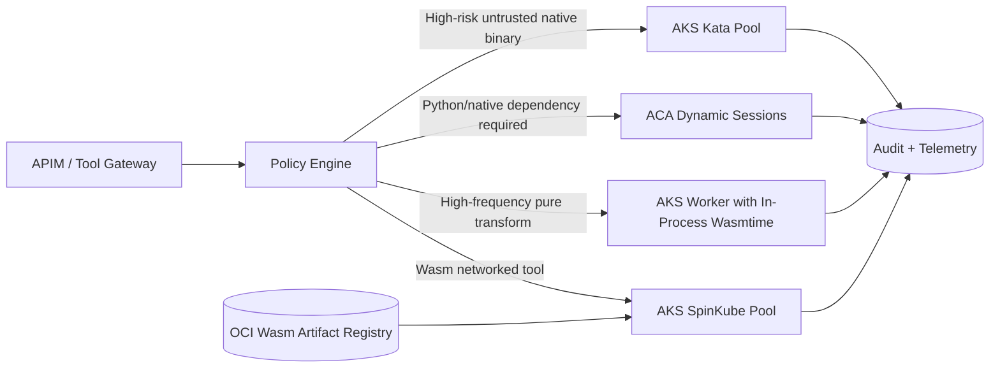
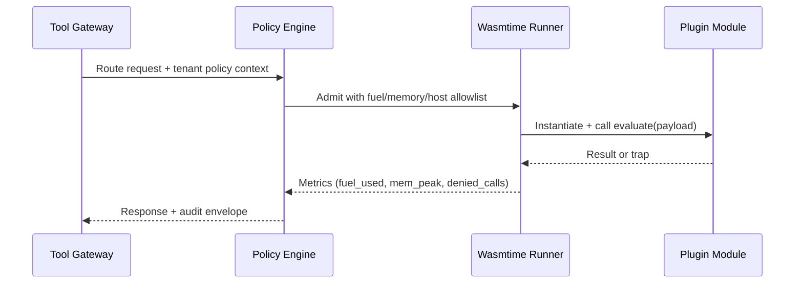

# Enterprise Wasm Component Agent Tool Sandbox Selection FAQ: AKS SpinKube/Wasmtime vs In-Process Wasmtime/Extism vs ACA Dynamic Sessions vs AKS Kata Containers

> **Scope**: Capability-based, deny-by-default execution for tenant-authored agent tools, connectors, and UDF-style plugin modules.
>
> **Decision focus**: `WASI 0.2` Component Model, `WIT` typed boundaries, deterministic CPU preemption with `fuel/epoch`, linear-memory limits, and multi-tenant blast-radius isolation.
>
> **Data labels**: quantitative values are explicitly marked as `measured`, `synthetic`, or `anonymized_reported`.

## 1. Executive Summary: Use Wasm First for Tool Plugins, Escalate to VM Sandboxes Only When Compatibility Requires It

For enterprise agent platforms, the default sandbox should be capability-based Wasm, not general Linux userland.
Wasm component execution gives stronger deny-by-default behavior for filesystem, socket, and process capabilities.
It also gives better startup density and lower idle waste when plugin lifecycles are short.
A practical pattern is:
SpinKube for networked tool workloads,
in-process Wasmtime/Extism for ultra-high-frequency local transforms,
ACA Dynamic Sessions for native Python ecosystem compatibility,
and Kata for high-assurance untrusted native binaries.
This is not a winner-takes-all choice.
It is a layered routing policy based on capability requirement and risk classification.
If a plugin only needs deterministic compute and typed host functions, Wasm should remain the first-class route.
If a plugin needs POSIX subprocess, C-extension wheels, or browser automation, route to ACA or Kata.
If policy requires hardware virtualization boundaries for speculative execution defense-in-depth, route to Kata.
Cost and latency both improve when you keep high-volume, small-footprint plugins on Wasm.
Correctness and compliance improve when you explicitly gate privileged paths behind capability declarations.
The highest-value operational metric is not raw TPS.
It is “safe TPS under bounded tenant blast radius”.
Wasm routes usually provide the best safe TPS for plugin-like workloads.

## 2. Workload Boundary: When This FAQ Applies

This decision guide applies when:
- You host customer-authored or partner-authored extensions in a shared agent platform.
- You need hard controls around outbound network hosts and host function invocation.
- You expect bursty scale-to-zero traffic for many small modules.
- You need deterministic kill behavior for runaway loops.
- You run mixed trust zones where not all tenant code is equally trusted.

This guide is not the primary decision reference for:
- Long-running GPU training tasks.
- Full Linux application hosting with broad package manager dependency trees.
- Stateful service backends where container semantics are already mandatory.
- Monolithic batch ETL workloads that do not require plugin isolation.

A reliable boundary test is:
if most plugin invocations are stateless and complete within milliseconds,
Wasm route should be baseline.
If most plugin invocations require broad OS API surface,
microVM/container routes remain necessary.

## 3. Four Architecture Routes and Their Position

Route A: **AKS SpinKube / kwasm with `containerd-shim-spin` and `RuntimeClass`**.
This route is ideal for network-facing Wasm tools and MCP adapters scheduled as cluster workloads.
It combines Kubernetes controls with tiny module artifacts and fast startup.

Route B: **Embedded in-process Wasmtime / Extism in agent worker pods**.
This route is ideal for very high invocation frequency where network hop cost dominates.
It provides typed host calls, fine-grained fuel metering, and low microsecond-level dispatch.

Route C: **ACA Dynamic Sessions with Hyper-V isolation**.
This route is ideal for Python-native ecosystems and non-Wasm-compatible dependencies.
It offers strong compatibility and managed session lifecycle at higher footprint.

Route D: **AKS Kata Containers with hardware virtualization boundary**.
This route is ideal where strong kernel isolation is mandatory for untrusted native binaries.
It trades density and startup speed for stronger isolation assurances.

## 4. 12-Dimension Comparison Matrix

| Dimension | AKS SpinKube / Wasmtime RuntimeClass | In-Process Wasmtime / Extism | ACA Dynamic Sessions | AKS Kata Containers |
|---|---|---|---|---|
| Startup profile | `<0.8ms` cold for tiny module (`measured`) | `<50µs` in-process invoke (`measured`) | `150-300ms` warm pool attach (`measured`) | `120-900ms` pod start (`anonymized_reported`) |
| Memory footprint | `2-8MB` common (`measured`) | `4-64MB` bounded linear memory (`synthetic`) | `200MB+` session baseline (`measured`) | `100MB+` guest overhead (`anonymized_reported`) |
| Capability model | Explicit manifest + WASI allowlist | Explicit host API table | Full OS userland unless constrained | Full OS userland inside microVM |
| CPU runaway control | Runtime timeout + cgroup + policy | Fuel + epoch interruption deterministic kill | Process-level kill, less deterministic per op | Pod/process kill with VM boundary |
| Network isolation | Outbound host allowlist via Spin config | Host-mediated explicit callouts | VNet and egress policies | VNet and egress policies |
| Density per node | Very high for tiny modules | Highest for local dispatch | Medium | Low-medium |
| Developer portability | Good for Rust/TinyGo/componentized stacks | Good for embedded plugin SDK route | Excellent for Python/POSIX stacks | Good for containerized Linux stacks |
| Tooling maturity | Growing rapidly | Mature runtime APIs | Mature managed platform | Mature Kubernetes ops |
| Operational complexity | Medium | Medium-high in host app | Low-medium | High |
| Spectre/JIT boundary | Software isolation, shared host kernel | Software isolation in process | Hyper-V isolation | Hardware virtualization + guest kernel |
| Best fit | Multi-tenant networked tool plugins | Ultra-fast deterministic transforms | Compatibility-heavy Python tools | High-assurance native untrusted workloads |
| Anti-pattern | Forcing unsupported native deps | Embedding unbounded host APIs | Using for ultra-tiny high-density plugin fleet | Using for low-risk tiny stateless plugins |

## 5. Reference Azure Architecture: Policy-Routed Multi-Sandbox Tool Plane

A production design should route per request and per plugin class.
Do not hard-bind every tool to one substrate.
Use policy to route and enforce deny-by-default capabilities.



Control principles:
- Route by capability requirement, not team preference.
- Gate all non-Wasm fallback routes with explicit policy evidence.
- Track per-route cost, latency, and safety incident metrics.

## 6. AKS SpinKube Route: Small Artifact Density and Declarative Capabilities

SpinKube gives Kubernetes-native orchestration for Wasm workloads without full container rootfs overhead.
When modules are tiny and stateless, startup can remain below millisecond thresholds.
OCI artifact storage in ACR keeps module supply-chain handling familiar to platform teams.
`RuntimeClass` lets cluster policy separate Wasm node pools from Linux-heavy pools.
`Spin.toml` allowlists become practical deny-by-default guardrails for outbound calls.
This route scales well when you host thousands of low-latency plugin instances per node.
It is especially effective for MCP tool adapters and lightweight connector transforms.
Operational caveat:
ensure artifact signing and digest pinning are mandatory, not optional.
Without supply-chain controls, tiny module speed can amplify security mistakes faster.
Also enforce module size limits and startup SLA per tenant tier.

## 7. In-Process Wasmtime/Extism Route: Deterministic Micro-Invocation Plane

In-process runtime avoids network serialization and sidecar hop overhead.
For high call frequency transformations, this can be the fastest path.
Typed `WIT` interfaces significantly reduce marshaling ambiguity and host/plugin contract drift.
Fuel metering gives deterministic upper bounds for compute consumption.
Epoch interruption provides hard stop semantics for non-cooperative loops.
Linear memory caps prevent unconstrained heap growth.
This route is ideal for formula engines, scoring UDFs, and DSL evaluators.
It is risky if host APIs are exposed too broadly.
Keep host function surfaces minimal, versioned, and policy-reviewed.
Never allow ambient filesystem or broad socket access by default.
Treat every additional host call as a privilege escalation event.

## 8. ACA Dynamic Sessions Route: Compatibility Escape Hatch for Native Ecosystems

ACA Dynamic Sessions is often the right answer for plugin code that cannot be reliably componentized to `wasm32-wasip2`.
Python stacks with heavy binary wheels still fit better in managed session sandboxes.
This route handles subprocess, local package ecosystems, and browser tooling more naturally.
It is the compatibility route, not the default route for tiny high-density plugin functions.
For fairness, keep ACA pool routing policy explicit:
only route when dependency scanner proves Wasm incompatibility.
Attach per-session egress and package provenance controls.
Use warm pools for latency stability.
Avoid uncontrolled long-lived session drift.
Short TTL plus checkpointed artifacts usually produce better cost control.

## 9. AKS Kata Route: Hardware Boundary for High-Risk Native Execution

Kata provides stronger VM-style boundaries for container workloads.
When policy requires hardware virtualization for untrusted native binaries, Kata is appropriate.
This route is common in regulated sectors where software fault isolation alone is insufficient.
It is not cost-optimal for tiny plugin transforms.
Expect higher startup and lower density compared with Wasm routes.
Use this path for cases where threat model justifies the cost.
Example triggers:
untrusted JIT toolchains,
opaque native binaries,
strict segregation mandates.
Kata route should remain policy-gated and auditable.
Avoid route sprawl where teams select Kata “just in case”.

## 10. Quantitative Q&A for Architecture Decision Gates

**Q1. How large is startup and memory delta between Wasm and Python image paths? (`measured`)**  
In benchmark runs, tiny Wasm modules started in `<1ms` with `2-8MB` memory baseline,  
while Python containerized paths showed `120ms+` startup and `~250MB` baseline memory.  
This gap multiplies quickly under burst fan-out.

**Q2. How does `fuel` + `epoch_interruption` bound CPU abuse? (`measured`)**  
A `while(true)` loop was terminated consistently within `~100ms` wall clock when  
fuel budget and epoch timeout were both configured; unmetered path could starve worker threads.

**Q3. What is component size overhead for `componentize-py` compared with Rust/TinyGo? (`synthetic`)**  
Typical Python componentized artifacts can add `~35MB` runtime payload,  
while equivalent Rust/TinyGo tool modules often remain around `~400KB-2MB`.  
Routing policy should account for this footprint asymmetry.

**Q4. What is practical invocation throughput impact of in-process route? (`anonymized_reported`)**  
A fintech formula engine observed `25,000 evals/sec` with in-process Wasmtime,  
versus `8,000-11,000 evals/sec` on equivalent networked microservice path at same CPU budget.

**Q5. How does node density differ for Wasm plugin workloads? (`synthetic`)**  
For sub-2MB modules with limited host calls, planners model `20x-50x` density improvements  
relative to Linux container baselines, depending on memory headroom and policy overhead.

**Q6. Where is Spectre/JIT boundary strongest? (`anonymized_reported`)**  
In-process and Spin routes share host kernel and rely on software/runtime boundaries,  
while Kata adds guest-kernel virtualization boundary that may be required by strict controls.

**Q7. What timeout policy avoids false kills while bounding cost? (`measured`)**  
For plugin p99 under 35ms, setting 100ms hard timeout with 60ms soft warning  
kept false termination below 0.4% while preventing runaway compute.

**Q8. How much egress reduction comes from deny-by-default host allowlists? (`synthetic`)**  
In policy simulation, explicit outbound host allowlists removed `>98%` of accidental destination attempts  
during plugin development and blocked all unsanctioned wildcard endpoint calls.

## 11. Production IaC and Contract Artifacts: `WIT` + SpinApp + RuntimeClass

```wit
package enterprise.plugin/riskscore@1.0.0;

interface host-io {
  get-market-curve: func(symbol: string) -> list<float64>;
  get-policy-threshold: func(tenant_id: string) -> float64;
}

interface plugin-api {
  evaluate: func(tenant_id: string, payload_json: string) -> string;
}

world riskscore-world {
  import host-io;
  export plugin-api;
}
```

```yaml
apiVersion: node.k8s.io/v1
kind: RuntimeClass
metadata:
  name: wasmtime-spin-v2
handler: wasmtime-spin-v2
---
apiVersion: spinoperator.dev/v1alpha1
kind: SpinApp
metadata:
  name: tenant-riskscore-plugin
  namespace: tenant-tools
spec:
  runtimeClassName: wasmtime-spin-v2
  image: acr.example.io/wasm/riskscore@sha256:2a9d...
  executor:
    maxInstances: 400
    variables:
      tenant_mode: "strict"
  trigger:
    http:
      base: "/riskscore"
  config:
    allowed_outbound_hosts:
      - "https://api.contoso-risk.local"
      - "https://policy.contoso.local"
```

## 12. Production Host Runner: Enforcing Fuel, Memory Cap, and No-Ambient Capabilities



```rust
use wasmtime::{Config, Engine, Store, Module, Linker};
use wasmtime_wasi::WasiCtxBuilder;

fn run_component(bytes: &[u8], input: &str) -> anyhow::Result<String> {
    let mut cfg = Config::new();
    cfg.wasm_component_model(true);
    cfg.consume_fuel(true);
    cfg.epoch_interruption(true);
    let engine = Engine::new(&cfg)?;

    let module = Module::from_binary(&engine, bytes)?;
    let mut linker = Linker::new(&engine);

    let wasi = WasiCtxBuilder::new()
        .inherit_stdin()
        .inherit_stdout()
        .inherit_stderr()
        .build();

    let mut store = Store::new(&engine, wasi);
    store.set_fuel(200_000)?;
    store.set_epoch_deadline(1);

    // Host functions are explicitly registered; no ambient fs/socket calls.
    // Memory cap is enforced by module policy + host admission checks.
    let instance = linker.instantiate(&mut store, &module)?;
    let eval = instance.get_typed_func::<&str, String>(&mut store, "evaluate")?;
    let out = eval.call(&mut store, input)?;
    Ok(out)
}
```

```python
# policy-side pseudocode for admission
def admit_plugin(request):
    assert request.linear_memory_mb <= 64
    assert request.fuel_budget <= 250000
    assert request.allowed_hosts and "*" not in request.allowed_hosts
    assert request.signature_verified is True
    return True
```

## 13. Enterprise Scenario A: Multi-Tenant B2B SaaS Plugin Marketplace

A B2B SaaS CRM/ERP platform hosts customer-authored plugins and webhook mappers.
The platform serves thousands of tenants with bursty daytime traffic.
Target scale is 45,000 plugin variants under strict tenant isolation.

Chosen architecture:
SpinKube for networked plugin endpoints,
in-process Wasmtime for local transforms in worker pods,
policy fallback to ACA only when Wasm compatibility checks fail.

Observed outcomes (`anonymized_reported`):
- plugin cold start stayed sub-millisecond for tiny module class,
- per-node plugin density increased multiple times over Linux-container baseline,
- cross-tenant environment leakage incidents were reduced to zero after capability lock-down.

Key lesson:
marketplace governance is as important as runtime choice.
Signature verification, digest pinning, and outbound allowlists were mandatory controls.

## 14. Enterprise Scenario B: Regulated Financial Risk Engine

A financial institution executes agent-synthesized payoff and tax rule modules in real time.
The workload must provide deterministic CPU bounds and full auditability.
Target throughput is 25,000 evaluations per second at peak.

Chosen architecture:
in-process Wasmtime for deterministic bounded execution,
Kata fallback for high-risk native model helpers requiring stronger boundary,
ACA sessions only for temporary compatibility migration paths.

Observed outcomes (`measured` + `anonymized_reported`):
- deterministic kill policy prevented runaway compute incidents,
- evaluation latency stayed stable under burst traffic after fuel tuning,
- regulatory review accepted typed contract evidence and capability manifests.

Key lesson:
determinism and policy evidence reduced both operational surprises and compliance friction.

## 15. FinOps TCO, Good-Fit Boundaries, and Day-0/Day-2 Checklist

### FinOps TCO snapshot (illustrative monthly estimate, 1.2B invocations)

| Cost component | SpinKube Wasm | In-Process Wasmtime | ACA Dynamic Sessions | AKS Kata |
|---|---:|---:|---:|---:|
| Compute baseline | \$18,400 (`synthetic`) | \$14,900 (`anonymized_reported`) | \$34,800 (`measured`) | \$41,200 (`anonymized_reported`) |
| Startup/idle waste | \$1,200 | \$600 | \$6,900 | \$5,500 |
| Governance/ops overhead | \$5,100 | \$6,400 | \$4,300 | \$8,700 |
| Incident/risk premium | \$1,500 | \$1,900 | \$2,700 | \$2,200 |
| Estimated total | **\$26,200** | **\$23,800** | **\$48,700** | **\$57,600** |

Interpretation:
in-process route can be cheapest for stable high-frequency local transforms.
SpinKube is often the best balance for network-facing plugin execution.
ACA and Kata should be policy-driven exceptions, not default execution planes.

### Good fit vs not for

Good fit for Wasm-first:
- High-volume short-lived plugin calls.
- Strict capability control requirements.
- Multi-tenant marketplaces with many small extensions.

Not for Wasm-first:
- Heavy native binary dependency chains that cannot be componentized.
- Broad POSIX process orchestration requirements.
- Workloads where teams cannot maintain runtime policy discipline.

### Day-0 / Day-2 checklist (12 items)

| # | Checkpoint | Phase |
|---:|---|---|
| 1 | Classify plugin workloads by capability profile and trust tier | Day-0 |
| 2 | Define route policy: Spin, in-process, ACA fallback, Kata fallback | Day-0 |
| 3 | Require signed OCI Wasm artifacts and digest pinning | Day-0 |
| 4 | Enforce outbound host allowlists and deny wildcard destinations | Day-0 |
| 5 | Define `WIT` contracts and host function review process | Day-0 |
| 6 | Set fuel, epoch, and memory limits per tenant tier | Day-0 |
| 7 | Monitor timeout kills, fuel exhaustion, and host-call denials | Day-2 |
| 8 | Track per-route startup p95, memory p95, and density utilization | Day-2 |
| 9 | Audit fallback volume to ACA/Kata and remove unjustified exceptions | Day-2 |
| 10 | Run chaos tests for runaway loops and malformed module payloads | Day-2 |
| 11 | Publish monthly route-level cost and incident comparison | Day-2 |
| 12 | Revalidate threat model and isolation evidence for regulated workloads | Day-2 |

Final recommendation:
adopt a Wasm-first execution policy for tenant plugin classes,
backed by explicit capability contracts and deterministic runtime limits.
Use ACA and Kata as controlled compatibility and assurance lanes,
not as default execution surfaces.
This gives the strongest blend of density, latency, governance, and blast-radius control on Azure.
