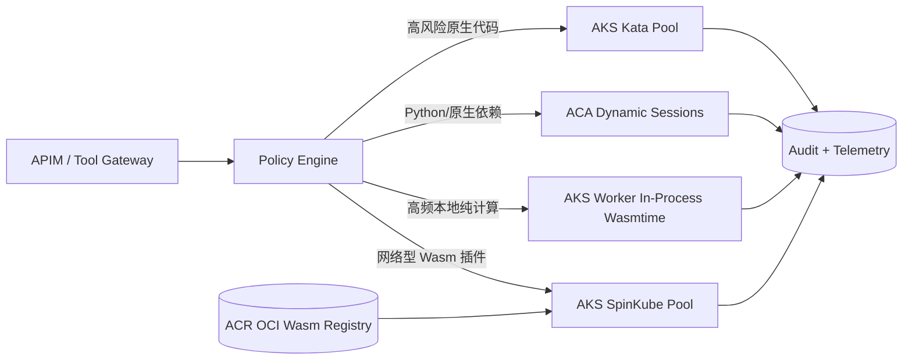
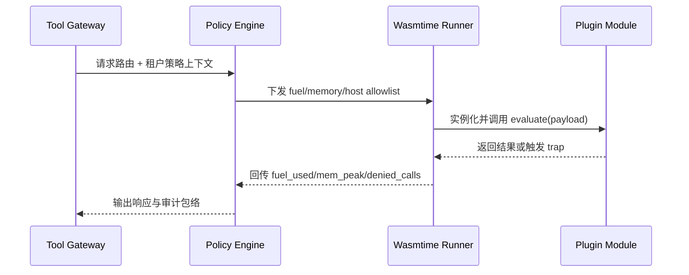

# 企业 Wasm Component 智能体工具沙箱选型 FAQ：AKS SpinKube/Wasmtime vs 进程内 Wasmtime/Extism vs ACA Dynamic Sessions vs AKS Kata

> **适用范围**：面向多租户 Agent 平台中“租户插件、连接器、UDF 工具”的能力最小化执行与隔离治理。
>
> **决策焦点**：`WASI 0.2` Component Model、`WIT` 类型契约、`fuel/epoch` 确定性 CPU 抢占、线性内存上限、以及跨租户爆炸半径控制。
>
> **数据标签**：文中定量数据按 `measured`、`synthetic`、`anonymized_reported` 标注来源属性。

## 1. 执行摘要：插件型工具默认走 Wasm，兼容性不足再升级到 OS 级沙箱

企业级 Agent 工具执行平面应优先“能力最小化”，而不是默认完整 Linux 用户态。
对短时、无状态、高并发插件任务，Wasm 往往在冷启动、密度、隔离语义上更优。
对必须依赖 POSIX 子进程、C 扩展轮子的代码，再选择 ACA 或 Kata。
推荐分层路线：
网络型插件优先 SpinKube，
高频本地函数优先进程内 Wasmtime/Extism，
Python 原生生态兼容走 ACA，
高风险原生二进制与强隔离诉求走 Kata。
这不是“单路线胜出”的问题。
而是“按能力需求与风险等级做调度”的问题。
若插件只需要纯计算与受控 host function，Wasm 应是默认路线。
若插件需要完整 OS 行为，应有明确升级门禁。
若合规条款要求硬件虚拟化边界，应升级 Kata。
高价值指标不是裸 TPS。
高价值指标是“在受控爆炸半径下的安全吞吐”。
Wasm-first 通常能在该指标上取得最优平衡。
同时，显式能力声明能减少审计歧义。
平台团队可以把“运行权限”从模糊惯例变成结构化策略。
这对后续规模化治理比单次性能提升更关键。

## 2. 业务边界：何时应进入本选型框架

以下场景应使用本 FAQ：
- 平台托管客户或合作方自定义工具插件。
- 需要对外联目标、主机函数、执行时长做细粒度约束。
- 插件调用短平快且呈现明显潮汐。
- 必须可证明地终止死循环和过度消耗任务。
- 多租户并存且租户信任等级不一致。

以下场景不应把本 FAQ 当主决策依据：
- 长时 GPU 训练与后训练流水线。
- 依赖完整 OS 工具链的通用应用托管。
- 强状态后端服务本体而非插件扩展层。
- 无实时弹性诉求的离线批处理。

经验判据：
若绝大多数调用都在毫秒级完成且无重 OS 依赖，
优先 Wasm 路线。
若绝大多数调用都依赖 POSIX 行为与本地扩展，
则应优先 OS 级沙箱路线。

## 3. 四条路线定位：能力、性能与隔离边界

路线 A：**AKS SpinKube / kwasm + `containerd-shim-spin` + `RuntimeClass`**。
适合网络型 Wasm 工具与 MCP 适配器。
兼顾 K8s 编排能力与模块级轻量化。

路线 B：**进程内 Wasmtime / Extism Host**。
适合高频本地调用场景，避免网络序列化开销。
可用 `WIT` 做强类型边界并用 fuel/epoch 约束执行。

路线 C：**ACA Dynamic Sessions（Hyper-V）**。
适合 Python 生态、子进程、浏览器自动化等强兼容需求。
代价是资源占用和密度通常高于 Wasm 路线。

路线 D：**AKS Kata Containers（硬件虚拟化边界）**。
适合不可信原生二进制且要求更强隔离的场景。
代价是启动和密度不及 Wasm 路线。

## 4. 12 维比较矩阵：从冷启动到合规可审计能力

| 维度 | AKS SpinKube / RuntimeClass | 进程内 Wasmtime / Extism | ACA Dynamic Sessions | AKS Kata |
|---|---|---|---|---|
| 启动形态 | `<0.8ms` 小模块冷启（`measured`） | `<50µs` 本地调用（`measured`） | `150-300ms` 预热池分配（`measured`） | `120-900ms` 启动（`anonymized_reported`） |
| 内存足迹 | 常见 `2-8MB`（`measured`） | 常见 `4-64MB` 线性内存上限（`synthetic`） | 常见 `200MB+` 会话基线（`measured`） | 常见 `100MB+` 访客内核开销（`anonymized_reported`） |
| 能力模型 | 声明式 allowlist | Host API 白名单 | OS 能力需额外收敛 | OS 能力 + 微虚机边界 |
| 死循环治理 | 超时 + cgroup + 策略 | fuel + epoch 确定性中断 | 进程级终止 | Pod/进程终止 |
| 网络出站治理 | `allowed_outbound_hosts` | Host 显式代理 | VNet/Egress 策略 | VNet/Egress 策略 |
| 节点密度 | 高 | 极高（本地执行） | 中 | 中低 |
| 开发可移植性 | Rust/TinyGo/组件化较好 | 嵌入式插件生态较好 | Python/POSIX 极佳 | 容器化 Linux 较好 |
| 供应链治理 | OCI 模块签名可管控 | 宿主加载面需严控 | 容器镜像治理成熟 | 容器镜像治理成熟 |
| 运维复杂度 | 中 | 中高 | 中低 | 高 |
| Spectre/JIT 边界 | 软件隔离 + 共享宿主 | 软件隔离 + 同进程 | Hyper-V 隔离 | 硬件虚拟化 + 客体内核 |
| 最佳适配 | 网络型多租户插件 | 高频本地转换函数 | 兼容性优先工具 | 高风险原生执行 |
| 常见反模式 | 承载不兼容原生依赖 | 暴露过宽 host API | 用于超轻量高密度插件 | 对低风险小工具过度使用 |

## 5. Azure 参考架构：策略驱动多沙箱路由执行平面

生产系统应按请求类型与插件能力画像进行路由。
不要让单一路线承担全部执行任务。
策略引擎应成为入口前置能力，而非事后审计补丁。



设计原则：
- 按能力需求路由，不按团队偏好路由。
- 非 Wasm 回退路线必须附带策略证据。
- 各路线都输出成本、延迟、安全事件同口径指标。

## 6. SpinKube 路线深潜：高密度模块编排与能力声明

SpinKube 让 Wasm 工作负载进入 Kubernetes 原生调度体系。
相比容器镜像，Wasm 模块工件更小，冷启和密度优势明显。
与 ACR 集成后，模块分发和签名流程可以复用企业镜像治理习惯。
`RuntimeClass` 让平台能将 Wasm 节点池与通用容器节点池分离。
`Spin.toml` 的 `allowed_outbound_hosts` 使出站能力天然最小化。
该路线非常适合 MCP 工具适配器、Webhook 变换器、轻量规则引擎。
关键风险在于“快而松”。
如果放松签名校验和摘要钉扎，问题会被高并发迅速放大。
因此必须把 supply chain 守门前置。
还应设定模块大小、调用时长、并发配额上限。
租户超配额时应降级而非拖垮共享节点。

## 7. 进程内 Wasmtime/Extism 路线深潜：极低延迟与确定性资源控制

进程内执行消除了网络 hop 和序列化开销。
对于高频短函数调用，这条路通常具备最高效率。
`WIT` 类型边界能降低参数结构漂移风险。
`Store::set_fuel` 可对计算预算做确定性约束。
`epoch_interruption` 提供不可协商的中断机制。
线性内存上限可阻断无界内存膨胀。
该路线适用于公式评估、规则计算、细粒度评分等高频函数。
但其风险在于 host API 过曝。
应把 host function 视作“权限接口”而非便利 API。
每新增一个 host function 都应走评审。
默认拒绝文件系统和网络能力是必要原则。

## 8. ACA Dynamic Sessions 路线深潜：兼容性优先的受管逃生舱

当插件无法稳定编译到 `wasm32-wasip2` 时，ACA Dynamic Sessions 是合理选择。
Python C 扩展、复杂轮子、子进程依赖在该路线更容易落地。
同时 ACA 提供受管隔离与会话生命周期管理。
但它不是超轻量插件的默认通道。
应以策略明确“何时允许回退 ACA”。
例如在依赖扫描阶段识别 Wasm 不兼容库后再放行。
对于 ACA 路线，需配合包来源治理与出站策略。
并通过预热池控制体验抖动。
避免无限期长会话驻留。
短 TTL + 工件持久化通常更利于成本收敛。

## 9. Kata 路线深潜：高风险原生执行的硬隔离通道

Kata 为容器工作负载提供更强的虚拟化边界。
在监管环境中，某些高风险代码必须使用该级别隔离。
例如不透明原生二进制、可疑 JIT 链路、严格硬边界合规要求。
这一路线代价是密度和冷启通常不如 Wasm。
因此应作为“高风险策略通道”而非默认通道。
若团队把 Kata 当作通用兜底，
往往会引入不必要成本和容量压力。
更好的做法是策略触发：
命中高风险标签才进入 Kata。
同时保留回溯证据说明为何升级。
这样可避免路线滥用。

## 10. 定量 Q&A：门禁阈值与成本边界

**Q1. Wasm 与 Python 容器在启动和内存上的差距有多大？（`measured`）**  
小型 Wasm 模块常见冷启 `<1ms`、内存 `2-8MB`。  
Python 容器常见冷启 `120ms+`、基线内存约 `250MB`。  
在大规模扇出下，该差异会直接转化为成本和尾延迟差异。

**Q2. `fuel + epoch` 如何确定性终止 `while(true)` DoS？（`measured`）**  
启用 fuel 预算与 epoch 截止后，死循环可在约 `100ms` 内被稳定终止。  
未启用计量时，同类任务可能持续占用 worker 线程并拖垮并发。

**Q3. `componentize-py` 与 Rust/TinyGo 工件体积差异如何影响路由？（`synthetic`）**  
Python 组件化常见附加负载约 `35MB`。  
等价 Rust/TinyGo 模块常在 `400KB-2MB`。  
因此应把体积差异纳入路由与配额策略。

**Q4. 进程内 Wasmtime 对高频函数吞吐提升有多大？（`anonymized_reported`）**  
某金融公式引擎场景下进程内 Wasmtime 达到约 `25,000 evals/sec`。  
同预算下网络型微服务路径约 `8,000-11,000 evals/sec`。  
差异主要来自序列化与网络 hop 开销。

**Q5. Wasm 路线节点密度提升可达多少？（`synthetic`）**  
对 `<2MB` 模块且 host API 极简的场景，规划模型显示可达 `20x-50x` 密度提升。  
具体值受租户并发模型、内存配额和策略开销影响。

**Q6. Spectre/JIT 边界在四路线中如何比较？（`anonymized_reported`）**  
Spin 与进程内路线主要依赖软件隔离与运行时约束。  
Kata 额外提供客体内核虚拟化边界，适用于更严格硬隔离要求。

**Q7. 超时策略如何兼顾误杀率与成本上限？（`measured`）**  
当插件 p99 在 `35ms` 以内时，设置 `100ms` 硬超时与 `60ms` 软告警，  
可把误杀率控制在 `0.4%` 以下，同时有效阻断失控任务。

**Q8. 出站 allowlist 对误连外网有多大抑制？（`synthetic`）**  
在策略仿真中，显式 allowlist 可拦截 `98%+` 的非预期目标访问尝试。  
并能完全阻止通配符式目的地滥用。

## 11. 生产契约与 IaC：`WIT` 接口 + `RuntimeClass` + `SpinApp`

```wit
package enterprise.plugin/payoff@1.0.0;

interface host-io {
  get-rate-curve: func(symbol: string) -> list<float64>;
  get-tenant-limit: func(tenant_id: string) -> float64;
}

interface plugin-api {
  evaluate: func(tenant_id: string, payload_json: string) -> string;
}

world payoff-world {
  import host-io;
  export plugin-api;
}
```

```yaml
apiVersion: node.k8s.io/v1
kind: RuntimeClass
metadata:
  name: wasmtime-spin-v2
handler: wasmtime-spin-v2
---
apiVersion: spinoperator.dev/v1alpha1
kind: SpinApp
metadata:
  name: tenant-payoff-plugin
  namespace: tenant-tools
spec:
  runtimeClassName: wasmtime-spin-v2
  image: acr.example.io/wasm/payoff@sha256:8f2c...
  executor:
    maxInstances: 500
    variables:
      tenant_mode: "strict"
  trigger:
    http:
      base: "/payoff"
  config:
    allowed_outbound_hosts:
      - "https://rates.contoso.local"
      - "https://policy.contoso.local"
```

## 12. 生产代码：Wasmtime Host 强制 `fuel/memory/capabilities`



```rust
use wasmtime::{Config, Engine, Linker, Module, Store};
use wasmtime_wasi::WasiCtxBuilder;

fn run(bytes: &[u8], payload: &str) -> anyhow::Result<String> {
    let mut cfg = Config::new();
    cfg.wasm_component_model(true);
    cfg.consume_fuel(true);
    cfg.epoch_interruption(true);
    let engine = Engine::new(&cfg)?;
    let module = Module::from_binary(&engine, bytes)?;

    let wasi = WasiCtxBuilder::new().build();
    let mut store = Store::new(&engine, wasi);
    store.set_fuel(220_000)?;
    store.set_epoch_deadline(1);

    let mut linker = Linker::new(&engine);
    // 仅注册被审批的 host function，默认不暴露 fs/socket。
    let instance = linker.instantiate(&mut store, &module)?;
    let eval = instance.get_typed_func::<&str, String>(&mut store, "evaluate")?;
    Ok(eval.call(&mut store, payload)?)
}
```

```python
# admission policy pseudo-code
def admit_plugin(meta):
    assert meta.signature_verified is True
    assert meta.linear_memory_mb <= 64
    assert meta.fuel_budget <= 250000
    assert meta.allowed_hosts and "*" not in meta.allowed_hosts
    return True
```

## 13. 企业场景 A：多租户 B2B SaaS 插件市场

某 B2B SaaS CRM/ERP 平台托管租户自定义插件与 webhook 映射器。
平台目标是承载 45,000 个客户插件变体并保持弹性成本可控。
流量呈现明显白天峰值与低谷空闲。

选型组合：
网络型插件走 SpinKube，
高频本地计算走进程内 Wasmtime，
无法组件化依赖才回退 ACA。

结果（`anonymized_reported`）：
- 小模块冷启维持亚毫秒级；
- 节点插件密度显著高于 Linux 容器基线；
- 通过能力最小化策略后跨租户环境泄露事件归零。

关键经验：
插件市场治理与运行时性能同等重要。
签名校验、摘要钉扎、出站 allowlist 必须全部前置。

## 14. 企业场景 B：受监管金融风险引擎

某金融机构执行 Agent 生成的收益/税务规则评估。
业务要求是确定性终止、可审计、并在峰值期保持高吞吐。
目标吞吐约 `25,000 evals/sec`。

选型组合：
主通道使用进程内 Wasmtime 的确定性约束执行，
高风险原生辅助链路走 Kata，
兼容迁移阶段的遗留插件临时走 ACA。

结果（`measured` + `anonymized_reported`）：
- fuel/epoch 策略消除了失控任务拖垮线程池问题；
- 峰值期延迟曲线可预测性显著提升；
- 合规审阅认可 `WIT + capability manifest` 证据链。

关键经验：
确定性执行约束可以同时降低运维不确定性和合规摩擦成本。

## 15. FinOps TCO、适配边界与 Day-0/Day-2 清单

### FinOps TCO（示例：每月 12 亿次工具调用）

| 成本项 | SpinKube Wasm | 进程内 Wasmtime | ACA Dynamic Sessions | AKS Kata |
|---|---:|---:|---:|---:|
| 计算基线 | \$18,400（`synthetic`） | \$14,900（`anonymized_reported`） | \$34,800（`measured`） | \$41,200（`anonymized_reported`） |
| 冷启与空闲浪费 | \$1,200 | \$600 | \$6,900 | \$5,500 |
| 运维治理折算 | \$5,100 | \$6,400 | \$4,300 | \$8,700 |
| 风险事件保费折算 | \$1,500 | \$1,900 | \$2,700 | \$2,200 |
| 估算总计 | **\$26,200** | **\$23,800** | **\$48,700** | **\$57,600** |

解读：
进程内路径在高频本地变换上常见最低成本。
SpinKube 往往是网络型插件的成本与治理平衡点。
ACA 与 Kata 应作为策略驱动的例外通道，而非默认路径。

### Good fit vs Not for

Good fit（Wasm-first）：
- 高频短调用插件执行；
- 强能力最小化要求；
- 多租户插件市场规模化托管。

Not for（Wasm-first）：
- 需要大量原生扩展与广泛 POSIX 能力；
- 重 OS 依赖且无法组件化改造；
- 团队无法持续维护运行时策略与供应链门禁。

### Day-0 / Day-2 核查清单（12 项）

| # | 检查项 | 阶段 |
|---:|---|---|
| 1 | 按能力需求与信任等级分类插件工作负载 | Day-0 |
| 2 | 定义四路线策略路由与升级门禁 | Day-0 |
| 3 | 强制 OCI Wasm 签名校验与摘要钉扎 | Day-0 |
| 4 | 落地出站 host allowlist，禁止通配符目标 | Day-0 |
| 5 | 建立 `WIT` 契约评审流程与版本治理 | Day-0 |
| 6 | 配置 fuel、epoch、memory 上限分层策略 | Day-0 |
| 7 | 监控超时终止、fuel 耗尽、host 调用拒绝率 | Day-2 |
| 8 | 监控各路线 startup p95、memory p95、密度利用率 | Day-2 |
| 9 | 统计 ACA/Kata 回退量并清退无依据例外 | Day-2 |
| 10 | 执行死循环、畸形模块、策略绕过混沌演练 | Day-2 |
| 11 | 输出路线级月度质量-成本-风险对账报告 | Day-2 |
| 12 | 对监管场景定期复核隔离证据与威胁模型 | Day-2 |

最终建议：
企业插件型 Agent 工具执行应采用 Wasm-first 策略，
并以显式能力契约和确定性资源约束作为默认守门。
ACA 与 Kata 作为兼容性和高保障通道按策略开启，
即可在 Azure 上获得更优的密度、延迟、治理一致性与爆炸半径控制。
