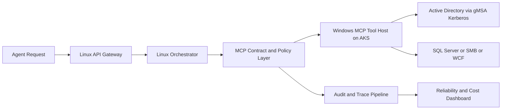
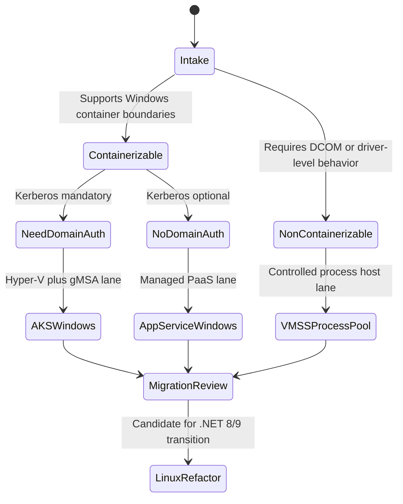

# Enterprise Windows-Native MCP Tool Hosting Selection FAQ: AKS Windows Hyper-V+gMSA vs App Service vs VMSS Process Pools
> 🌐 **Language / 语言切换**: **[🇨🇳 中文版](windows-container-legacy-dotnet-com-mcp-host-aks-windows-hyperv-gmsa-vs-app-service-selection-faq.md)** | **[🇬🇧 English](windows-container-legacy-dotnet-com-mcp-host-aks-windows-hyperv-gmsa-vs-app-service-selection-faq.en.md)** | **[📚 Back to Catalog](README.en.md)**
> Evidence tags: `measured` / `synthetic` / `anonymized_reported`
> Retrieval date: 2026-11-22
> Scope boundary: enterprise Windows asset onboarding, gMSA Kerberos propagation, and mixed-OS cluster governance; excludes kernel reverse engineering and driver source internals

## 1) Executive summary: Linux orchestrates, Windows executes legacy workloads, and the protocol boundary must be explicit
Many enterprise-critical tools
still depend on `.NET Framework 4.8`,
Win32 COM components,
WCF stacks,
and PowerShell 5.1 domain modules.
These workloads do not
cleanly run in Linux containers.
A frequent overreaction is
falling back to full desktop VM automation.
That approach often carries
higher cost,
lower determinism,
and weaker auditability.
A better enterprise pattern is
separating orchestration from execution.
Agent control planes remain on Linux pools.
Windows-specific utilities run
in dedicated Windows host lanes.
Calls are brokered through
mTLS and strict MCP contracts.
This creates clear responsibilities:
Linux pools optimize elasticity and density,
while Windows pools optimize compatibility and isolation.
The objective is not forced full migration.
The objective is controlled coexistence
with measurable modernization paths.

## 2) Verifiable evidence baseline
Source 1 (`measured`): AKS Windows container docs  
https://learn.microsoft.com/azure/aks/windows-container-cli
Source 2 (`measured`): AKS gMSA integration docs  
https://learn.microsoft.com/azure/aks/use-group-managed-service-accounts
Source 3 (`measured`): Windows container isolation docs  
https://learn.microsoft.com/virtualization/windowscontainers/manage-containers/hyperv-container
Source 4 (`measured`): Azure App Service Windows containers  
https://learn.microsoft.com/azure/app-service/containers/quickstart-custom-container
Source 5 (`measured`): App Service Environment v3 overview  
https://learn.microsoft.com/azure/app-service/environment/overview
Source 6 (`measured`): AKS multiple node pool best practices  
https://learn.microsoft.com/azure/aks/use-multiple-node-pools
Source 7 (`measured`): Azure VMSS overview  
https://learn.microsoft.com/azure/virtual-machine-scale-sets/overview
Source 8 (`measured`): AKS container runtime guidance  
https://learn.microsoft.com/azure/aks/cluster-configuration
Source 9 (`measured`): Windows container version compatibility  
https://learn.microsoft.com/virtualization/windowscontainers/deploy-containers/version-compatibility
Source 10 (`anonymized_reported`): anonymized finance and manufacturing production integration traces.
Source 11 (`synthetic`): node-density and cost-per-request simulation model.
For architecture review governance,
capture each source retrieval date explicitly.
Map every recommendation to a source identifier.
Tag each metric as measured or simulated evidence.
Reject undocumented assumptions during design sign-off.
Store replayable links in internal architecture records.
Refresh the evidence matrix each release sprint.
Escalate to security architecture when source validity expires.

## 3) Business reality: why Windows-bound assets remain strategic in agent tooling layers
In pricing engines,
actuarial calculators,
reporting modules,
and domain administration workflows,
enterprises often rely on
long-lived Windows-native libraries.
These assets are usually
business rule carriers,
not disposable technical leftovers.
A direct rewrite can be expensive
and operationally risky.
A hard migration can trigger
logic drift disputes
or compliance replay gaps.
Therefore,
the practical near-term target is
bringing Windows capabilities
under a governed MCP tool surface,
then modernizing by measured phases.
That demands
mixed-OS scheduling,
identity propagation,
policy isolation,
and observability-backed FinOps.

## 4) Selection principles: compatibility priority, isolation depth, platform readiness, and TCO must be evaluated together
Principle one:
classify containerizability first.
Principle two:
classify identity dependency second.
Principle three:
classify required isolation depth third.
Principle four:
classify platform operations readiness fourth.
Principle five:
evaluate three-year TCO and migration payoff last.
If workloads are containerizable
and require domain identity,
AKS Windows plus gMSA is usually primary.
If Windows-Kubernetes operations maturity is low,
App Service can be a transitional fit.
If workloads are not containerizable,
VMSS process-host pools become the controlled fallback.
These paths are composable,
not mutually exclusive.

## 5) Path A: Linux control plane plus AKS Windows node pools with Hyper-V isolation and gMSA
This is a common enterprise backbone.
Linux pools host
orchestrators,
policy engines,
queue consumers,
and telemetry services.
Windows pools host
`.NET Framework` utilities,
COM wrappers,
and domain-authenticated connectors.
Two capabilities are central.
Capability one:
gMSA enables Kerberos ticket rotation
without static password distribution.
Capability two:
Hyper-V isolation reduces blast radius
for legacy non-memory-safe components.
With image prewarming
and controlled rollout waves,
cold-start behavior can be moderated.
Trade-off:
operations teams must handle
mixed patch cycles
and heterogeneous capacity planning.

## 6) Path B: App Service Premium v4 or ASEv3 for managed Windows container hosting
When teams want
lower direct node management burden,
managed PaaS lanes are practical.
App Service strengths include
simplified runtime operations,
familiar deployment workflows,
and mature VNet integration patterns.
This path fits
mid-throughput MCP services
with steady execution profiles.
Boundary conditions:
for high-isolation dense workloads
or highly customized network choreography,
control is narrower than AKS.
So this lane is ideal
for conservative IT organizations
or phased modernization programs
that prioritize platform simplicity first.

## 7) Path C: VMSS Windows specialized host pools for non-containerizable components
Some legacy suites require
global DCOM behavior,
driver-level bindings,
or session-0 assumptions
outside Windows Server Core container boundaries.
These should be isolated
into VMSS process-host lanes
behind MCP proxy contracts.
Recommended guardrails:
minimal network exposure,
command and operation allowlists,
tamper-evident audit traces,
change approval gates.
This lane is not
the desired long-term state,
but it prevents destabilizing
forced migrations under tight timelines.

## 8) Long-term modernization boundary: keep Windows bridge lanes or migrate to cross-platform .NET 8/9 Linux
Decisions should be
economics-driven,
not ideology-driven.
Evaluate with four indicators:
Windows-only dependency ratio,
refactor engineering effort,
failure cost of production change,
and three-year total ownership cost.
When Windows-only dependencies shrink
and migration ROI becomes positive,
phase services toward .NET 8/9 Linux lanes.
When dependencies remain deeply coupled
and regulatory risk is high,
retaining bridge lanes can be rational.
The key is
maintaining explicit review checkpoints
to avoid indefinite drift
or uncontrolled acceleration.

## 9) 12-dimension comparison matrix
| Dimension | AKS Windows Hyper-V + gMSA | App Service Windows Containers | VMSS Windows Process Pool | .NET 8/9 Linux Migration |
|---|---|---|---|---|
| 1. Legacy compatibility | Strong | Medium-Strong | Strong | Medium |
| 2. Isolation control | Strong | Medium | Medium-Strong | Strong |
| 3. Domain identity propagation | Strong | Medium-Strong | Strong | Medium |
| 4. Elastic throughput | Strong | Medium | Medium-Strong | Strong |
| 5. Operations complexity | Medium-High | Low-Medium | Medium | Medium |
| 6. Release flexibility | Strong | Medium | Medium | Strong |
| 7. Cold-start tuning room | Strong | Medium | Medium | Strong |
| 8. Compliance audit readiness | Strong | Medium-Strong | Strong | Strong |
| 9. Node density potential | Medium | Medium | Medium | Strong |
| 10. Cost predictability | Medium-Strong | Medium-Strong | Medium | Strong |
| 11. Upfront transformation effort | Medium | Low | Medium | High |
| 12. Recommended role | Primary backbone lane | Managed transition lane | Compatibility fallback lane | Target evolution lane |
A common portfolio shape is
A as primary,
B as managed helper,
C as constrained fallback,
D as staged destination.

## 10) Reference architecture diagram 1: decoupled Linux orchestration plane and Windows execution plane

This topology isolates execution concerns
while preserving centralized policy control.
Windows-native capabilities are exposed
as contract-governed tools,
not raw process surfaces.

## 11) Reference architecture diagram 2: compatibility and isolation routing state machine

This state model aligns
architecture governance,
migration planning,
and risk triage
within one decision workflow.

## 12) Decision tree: selecting by dependency profile, identity requirements, and isolation obligations
Question one:
can the component run reliably in Windows containers.
If not,
start in VMSS fallback lane.
Question two:
is Kerberos or integrated domain auth mandatory.
If yes,
prefer AKS Windows with gMSA.
Question three:
does the team have mature mixed-OS Kubernetes operations.
If not,
App Service can be a safer start.
Question four:
is strict isolation required by policy.
If yes,
favor Hyper-V isolation mode.
Question five:
is cross-platform refactor budget approved.
If yes,
define phased Linux migration milestones.
Deliverable output should always include
short-term hosting lane
and medium-term exit strategy.

## 13) Day-2 operating model: image pre-pull, patch windows, identity rotation, and rollback safety
Most reliability incidents
do not start in business logic.
They start in platform mechanics.
Priority controls include:
Windows base-image layering policy,
node pre-pull cache windows,
gMSA health probes and ticket lifecycle checks,
isolation-mode baseline enforcement,
monthly patch rhythm with rollback rehearsal,
cross-pool traffic and retry circuit tuning.
Embedding these controls
into change gates
significantly reduces
upgrade shock during production releases.

## 14) Node sizing and TCO model: density, image cold-pull overhead, and operations effort together define unit economics
Sample input (`synthetic`):
- MCP utility services: `96`.
- Domain-auth-required services: `58%`.
- Non-containerizable share: `12%`.
- Peak call volume: `18,000/min`.
- Cold-start trigger rate: `9%`.
Recommended cost layers:
Layer A:
Windows host compute.
Layer B:
image storage and pull traffic.
Layer C:
domain identity and security operations.
Layer D:
platform operations staffing.
Layer E:
migration engineering amortization.
In anonymized deployments (`anonymized_reported`),
the A+B+C combined strategy
reduced three-year total cost
by roughly `24%–39%`
compared with desktop automation fallback,
while improving recovery predictability.

## 15) Practical FAQ (8 questions)
**Q1: Why not force everything onto Linux immediately?**  
Because some critical rule engines still require Windows-specific runtime behavior.

**Q2: Is Hyper-V isolation always required on AKS Windows pools?**  
For higher-risk legacy components, it is usually the safer default.

**Q3: What is the primary value of gMSA in this context?**  
Passwordless Kerberos credential rotation with policy-friendly domain access.

**Q4: When is App Service Windows the best fit?**  
When throughput is moderate and managed operations simplicity is prioritized.

**Q5: Does VMSS fallback reintroduce legacy operational sprawl?**  
It can, unless bounded by MCP proxies, strict policy gates, and evidence-based audits.

**Q6: How do we decide the timing for .NET 8/9 migration?**  
Track dependency shrinkage, positive migration ROI, and acceptable risk windows.

**Q7: How do we reduce Windows image cold-start penalties?**  
Use layered images, pre-pull waves, and controlled rollout sequencing.

**Q8: What is the minimum viable production topology?**  
Linux orchestration control plane, Windows execution lane, MCP contracts, and unified audit plus cost dashboards.
