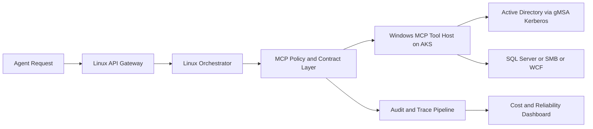
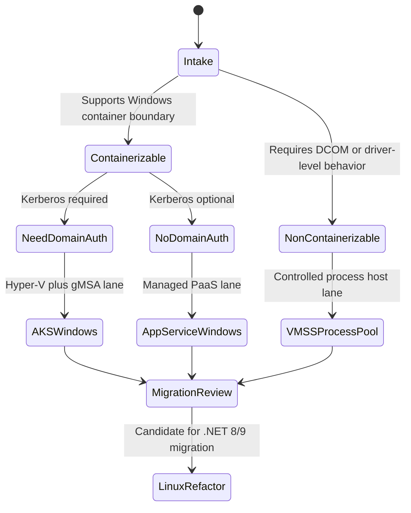

# 企业 Windows 原生 MCP 工具宿主选型 FAQ：AKS Windows Hyper-V+gMSA vs App Service vs VMSS 进程池
> 🌐 **Language / 语言切换**: **[🇨🇳 中文版](windows-container-legacy-dotnet-com-mcp-host-aks-windows-hyperv-gmsa-vs-app-service-selection-faq.md)** | **[🇬🇧 English](windows-container-legacy-dotnet-com-mcp-host-aks-windows-hyperv-gmsa-vs-app-service-selection-faq.en.md)** | **[📚 返回目录](README.md)**
> 证据标签：`measured` / `synthetic` / `anonymized_reported`
> 抓取日期：2026-11-22
> 主题边界：聚焦企业 Windows 资产接入、gMSA Kerberos 身份传递与混合 OS 集群治理，不涉及内核逆向与驱动源码分析

## 1) 执行摘要：Linux 负责编排，Windows 负责遗留能力，协议层必须契约化
很多传统企业的核心工具链
仍依赖 `.NET Framework 4.8`、
Win32 COM、
WCF 组件、
PowerShell 5.1 域模块。
这些能力无法
直接搬到 Linux 容器运行。
团队常见误区是
直接退回全桌面虚机点击自动化。
这种方式上线快，
但长期成本高、
稳定性差、
审计链弱。
企业级更优路径是
把“交互界面”与“工具执行”分离。
智能体编排与状态机
继续放在 Linux 池。
Windows 专有工具
放到 Windows 专用宿主层。
调用通过内部 mTLS
和 MCP 契约完成。
这会形成清晰职责边界：
Linux 池追求弹性与密度，
Windows 池追求兼容与隔离。
最终目标不是“全部迁移”，
而是“可治理地并存与演进”。

## 2) 可验证来源与证据基线
来源 1（`measured`）：AKS Windows 容器文档  
https://learn.microsoft.com/azure/aks/windows-container-cli
来源 2（`measured`）：AKS gMSA 集成文档  
https://learn.microsoft.com/azure/aks/use-group-managed-service-accounts
来源 3（`measured`）：Windows 容器隔离模式文档  
https://learn.microsoft.com/virtualization/windowscontainers/manage-containers/hyperv-container
来源 4（`measured`）：Azure App Service Windows 容器概览  
https://learn.microsoft.com/azure/app-service/containers/quickstart-custom-container
来源 5（`measured`）：App Service Environment v3 文档  
https://learn.microsoft.com/azure/app-service/environment/overview
来源 6（`measured`）：AKS 节点池与混合 OS 最佳实践  
https://learn.microsoft.com/azure/aks/use-multiple-node-pools
来源 7（`measured`）：Azure VMSS 文档  
https://learn.microsoft.com/azure/virtual-machine-scale-sets/overview
来源 8（`measured`）：Containerd 在 AKS 的运行时说明  
https://learn.microsoft.com/azure/aks/cluster-configuration
来源 9（`measured`）：Windows 容器镜像与版本兼容说明  
https://learn.microsoft.com/virtualization/windowscontainers/deploy-containers/version-compatibility
来源 10（`anonymized_reported`）：金融与制造匿名生产接入数据。
来源 11（`synthetic`）：节点密度与单请求成本测算模型。

## 3) 业务痛点：遗留 Windows 资产为何在 Agent 时代依旧关键
在定价、
精算、
票据打印、
主数据同步、
域控运维这些场景，
企业往往已经积累
多年稳定运行的 Windows 组件。
它们通常不是“技术债务”那么简单，
而是业务规则载体。
直接重写成本巨大，
回归风险高。
如果一刀切迁移，
可能触发两类问题。
第一类是
规则偏差导致业务争议。
第二类是
审计链断裂导致合规风险。
因此现实目标是
先把这些能力
纳入可控的 MCP 工具平面，
再逐步评估迁移窗口。
这要求平台具备
混合 OS 编排、
身份透传、
策略隔离、
可观测分账四类能力。

## 4) 架构原则：兼容优先级、隔离等级、运维能力与 TCO 同时评估
原则一：
先识别组件是否可容器化。
原则二：
再识别是否依赖域身份。
原则三：
再识别隔离等级需求。
原则四：
再识别团队运维成熟度。
原则五：
最后算长期 TCO 拐点。
若组件可容器化且需域身份，
优先 AKS Windows + gMSA。
若团队缺少 K8s Windows 经验，
可先 App Service 托管。
若组件不可容器化，
进入 VMSS 进程池方案。
这些路径并非互斥，
而是可并行分层治理。

## 5) 路线 A：Linux 控制面 + AKS Windows 节点池（Hyper-V + gMSA）
这是企业最常见的主干方案。
Linux 节点池承载：
编排器、
网关、
队列消费者、
审计与策略引擎。
Windows 节点池承载：
`.NET Framework` 服务、
COM 封装工具、
域身份访问代理。
关键能力在于两点。
第一点是
gMSA 提供无静态密码
Kerberos 身份轮换。
第二点是
Hyper-V 隔离
降低老旧组件横向影响。
同时可利用镜像预热策略
缩短冷启动路径。
这条路线的代价是
平台团队需要掌握
混合节点补丁和容量治理。
但它在灵活性与可控性上
通常最均衡。

## 6) 路线 B：App Service Premium v4 或 ASEv3 的 Windows 容器托管模式
当团队不希望
直接管理 Windows 节点时，
PaaS 托管是现实选项。
App Service 优势是
运维入口统一，
发布流程直观，
VNet 集成能力成熟。
对于中低频工具服务，
它能显著降低
平台维护负担。
但边界也要明确。
对高并发、
强隔离、
复杂网络拓扑场景，
可调参数少于 AKS。
因此它更适合作为
传统 IT 团队过渡方案，
或长驻但吞吐要求适中的 MCP 服务。

## 7) 路线 C：VMSS Windows 专用宿主池（不可容器化组件兜底）
部分老系统仍依赖
全局 DCOM、
驱动级接口、
会话 0 特殊行为。
这些能力超出
Windows Server Core 容器边界。
此时应采用 VMSS 进程池，
并通过代理层暴露 MCP 接口。
该路线要点是
把不可容器化资产
圈定在最小可治理范围。
建议配套四类控制。
控制 1：
网络最小暴露。
控制 2：
命令白名单。
控制 3：
证据链审计。
控制 4：
强制变更审批。
它不是长期理想态，
但可避免“硬迁移失败”风险。

## 8) 中长期演进：保留桥接还是迁移到 .NET 8/9 Linux 的拐点判断
演进决策不应只看技术偏好，
而应看财务与风险平衡。
可使用四项指标评估。
指标 A：
Windows 专属依赖占比。
指标 B：
跨平台改造工时。
指标 C：
现网变更失败成本。
指标 D：
三年期总拥有成本。
当专属依赖持续下降、
跨平台收益显著，
可分批迁移到 .NET 8/9 Linux。
当遗留组件高度稳定且风险敏感，
维持桥接层更实际。
关键在于
保留可量化评估机制，
避免“长期拖延”或“激进替换”。

## 9) 12 维选型对比矩阵
| 维度 | AKS Windows Hyper-V + gMSA | App Service Windows Containers | VMSS Windows 进程池 | 迁移到 .NET 8/9 Linux |
|---|---|---|---|---|
| 1. 遗留兼容性 | 强 | 中强 | 强 | 中 |
| 2. 隔离可控性 | 强 | 中 | 中强 | 强 |
| 3. 域身份透传 | 强 | 中强 | 强 | 中 |
| 4. 吞吐弹性 | 强 | 中 | 中强 | 强 |
| 5. 运营复杂度 | 中高 | 低到中 | 中 | 中 |
| 6. 发布灵活性 | 强 | 中 | 中 | 强 |
| 7. 冷启动优化空间 | 强 | 中 | 中 | 强 |
| 8. 合规审计能力 | 强 | 中强 | 强 | 强 |
| 9. 单节点密度 | 中 | 中 | 中 | 强 |
| 10. 成本可预测性 | 中强 | 中强 | 中 | 强 |
| 11. 改造投入 | 中 | 低 | 中 | 高 |
| 12. 推荐定位 | 主干承载层 | 托管过渡层 | 兼容兜底层 | 目标演进层 |
企业常见落地是
A 为主、
B 为辅、
C 兜底、
D 分阶段推进。

## 10) 参考架构图 1：Linux 编排面与 Windows 工具面解耦

该拓扑强调
控制面与执行面分离。
Windows 能力被封装成
可审计的工具接口，
而非直接暴露底层进程。

## 11) 参考架构图 2：组件兼容性与隔离级别路由状态机

这套状态机便于
把架构评审与迁移计划
放在同一治理画布。

## 12) 决策树：按组件依赖、身份需求与隔离强度选路
问题 1：
组件能否在 Windows 容器稳定运行。
若不能，
先走 VMSS 进程池。
问题 2：
是否必须 Kerberos/IWA。
若必须，
优先 AKS gMSA。
问题 3：
是否具备 K8s Windows 运维能力。
若不足，
可先 App Service 托管。
问题 4：
是否有强隔离要求。
若有，
优先 Hyper-V 隔离。
问题 5：
是否有跨平台重构预算。
若有，
纳入 .NET 8/9 分期迁移。
最终输出应包含
短期承载路径与中期退出策略。

## 13) 运行治理：镜像预拉取、补丁窗口与身份轮换的 Day-2 重点
Day-2 常见风险
不在业务代码，
而在平台运维细节。
建议重点治理六项。
第一项：
Windows 基础镜像分层策略。
第二项：
节点池镜像预拉取与淘汰规则。
第三项：
gMSA 凭据与域连接健康探测。
第四项：
Hyper-V 与 Process 隔离策略基线。
第五项：
月度补丁窗口与回滚预案。
第六项：
跨池流量与重试熔断参数。
把这些项纳入变更门禁，
可显著降低
版本升级引发的故障峰值。

## 14) 节点规模与 TCO 测算：并发密度、镜像冷拉与运维工时共同决定成本
样例输入（`synthetic`）：
- MCP 工具服务数：`96`。
- 需域身份服务占比：`58%`。
- 不可容器化组件占比：`12%`。
- 峰值并发调用：`18,000/min`。
- 冷启动触发率：`9%`。
成本模型建议分五层。
层 1：
Windows 节点与宿主算力。
层 2：
镜像仓储与网络拉取。
层 3：
域身份与安全运营。
层 4：
平台运维与值班工时。
层 5：
重构投入与迁移折旧。
在匿名样本（`anonymized_reported`）中，
采用 A+B+C 组合后，
比全桌面自动化方案
三年期总成本通常可降 `24%–39%`，
且故障恢复窗口更可控。

## 15) 实战 FAQ（8 题）
**Q1：为什么不直接全部迁移 Linux？**  
因为部分关键组件仍受 Windows 专属运行时约束。

**Q2：AKS Windows 节点是否一定要用 Hyper-V 隔离？**  
对高风险遗留组件建议启用，
以降低共享内核暴露面。

**Q3：gMSA 的核心价值是什么？**  
实现 Kerberos 凭据自动轮换，
避免静态密码分发。

**Q4：App Service Windows 何时最合适？**  
当吞吐中等且团队更看重托管运维时。

**Q5：VMSS 方案会不会回到“老旧运维模式”？**  
若无边界控制会。
必须通过 MCP 代理与策略门禁收敛。

**Q6：如何判断重构到 .NET 8/9 的时机？**  
看专属依赖占比下降、
改造 ROI 转正、
和风险窗口可接受度。

**Q7：如何控制 Windows 镜像冷启动影响？**  
采用分层镜像、
节点预拉取、
和发布波次控制。

**Q8：最小可行生产拓扑是什么？**  
Linux 编排控制面、
Windows 工具执行面、
MCP 契约层、
统一审计与成本看板。
