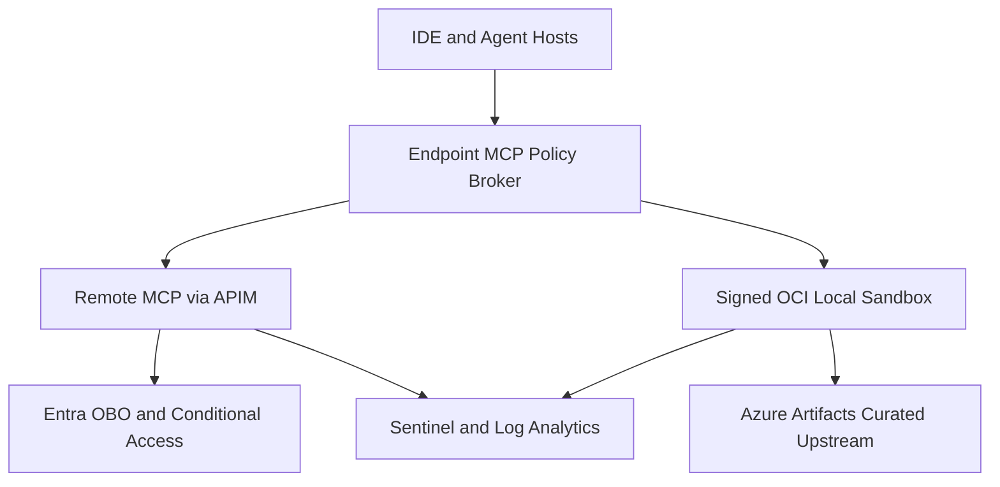
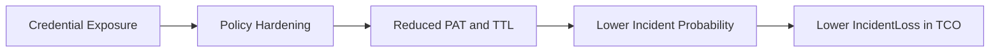
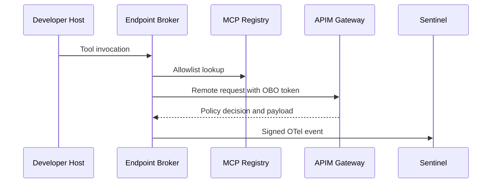

# Enterprise workstation shadow `stdio` MCP sprawl elimination and hybrid local-to-remote MCP governance selection FAQ: Remote APIM registry vs signed OCI sandbox vs Dev Box VNet broker

> 🌐 **Language Switch**: [中文](./workstation-shadow-stdio-mcp-governance-remote-apim-registry-vs-signed-oci-sandbox-vs-devbox-vnet-broker-selection-faq.md) | **English (current)**
> **Audience**: Cloud & AI Solution Architects, endpoint security teams, platform engineering, and developer productivity leaders.
> **Problem frame**: unmanaged `npx -y` / `uvx` packages, plaintext `.env` PATs, ambient `~/.ssh` and `~/.azure` access, and fragmented audit trails across IDE hosts.

## 1. Why shadow `stdio` MCP becomes an enterprise risk multiplier

Local `stdio` MCP servers let teams connect SaaS and infra tools in seconds, but those paths usually bypass centralized identity and policy enforcement.
When tokens are stored in shell profiles, `.env` files, or local caches, credential lifetime diverges from business need and creates durable attack surface.
Parallel usage of VS Code, GitHub Copilot CLI, and desktop hosts splits one business action into multiple local subprocesses, weakening forensic continuity.
The goal is not to ban local tools universally; it is to enforce measurable, auditable, and reversible boundaries while preserving developer throughput.

## 2. Four architecture options and governance boundaries

Architecture A moves network-facing tools to Remote MCP with `Azure API Center + APIM + ACA/AKS` and Copilot Enterprise allowlist-only registry policy.
Architecture B keeps local workspace tools but requires signed OCI containers, rootless runtime, and endpoint execution controls.
Architecture C relocates IDE and MCP processes into Dev Box or Codespaces with VNet-governed egress and short-lived identity.
Architecture D introduces a local policy broker that proxies loopback/stdio calls, applies redaction, constrains package sources, and forwards OTel audit telemetry.

## 3. Layered reference architecture for progressive migration



A practical rollout starts with A+D to establish audit and identity closure, then adds B for latency-sensitive local tooling, and C for strict compliance groups.
This sequence quickly reduces credential exposure days without disrupting core engineering workflows.

## 4. Architecture A: remote-first MCP registry allowlist

A consolidates Jira, ADO, GitHub, Kusto, ServiceNow, and SQL tools behind APIM where OAuth 2.1 OBO, quota, DLP, and policy controls are enforced.
Endpoint hosts retain only registry policy and session transport, driving local PAT persistence close to zero.
Audit completeness typically reaches `98%–100%` because every tool invocation traverses a central telemetry plane.
The tradeoff is transport latency, with P95 often shifting from local `<5ms` IPC to `35–90ms` remote calls unless caching and pooling are tuned.

## 5. Architecture B: signed OCI local sandbox for low latency

B packages local MCP tools as signed `ACR` images and enforces `Notation/Cosign` verification before startup in rootless runtime.
Containers mount only `${workspaceFolder}` and explicitly deny credential paths such as `~/.ssh`, `~/.azure`, and `~/.aws`.
Intune WDAC/AppControl policies block arbitrary `npx -y`, `uvx`, and unknown executables to reduce package-chain drift.
B preserves local responsiveness for AST/lint/test workflows but increases operational complexity for image lifecycle and signing key rotation.

## 6. Architecture C: cloud workstation perimeter

C moves IDE and MCP execution to Dev Box/Codespaces under Conditional Access, VNet injection, and firewall-governed egress.
Credentials are represented as short-lived OIDC or managed identity tokens with `<=60` minute TTL to reduce residual risk.
This model works well for global and outsourced teams by removing unmanaged endpoint variability from the execution path.
Its main cost is dependency on network quality and seat-based compute economics across regions.

## 7. Architecture D: endpoint loopback policy broker

D deploys a local enterprise broker that proxies MCP traffic, classifies payloads, redacts sensitive output, and emits signed telemetry.
Package resolution is constrained to curated `Azure Artifacts` feeds so public registries are accessed only through quarantine workflows.
D is effective for organizations that cannot instantly remove local tooling and need a rapid governance bridge.
Even after remote migration, D remains valuable as a final endpoint guardrail and forensic capture layer.

## 8. Quantitative models: exposure, supply-chain probability, and latency

Credential blast-radius exposure is `Exposure = N_devs * N_pats * TTL_days`, representing total credential-days at risk.
Package compromise probability can be approximated by `P(compromise)=1-(1-p_pkg)^N_unpinned` where `p_pkg` is per-package risk.
Latency budget can be decomposed as `Latency_total = Latency_transport + Latency_policy + Latency_tool` to balance governance and UX.
Three-year decision quality improves when `IncidentLoss` is modeled alongside infra cost instead of evaluated separately.



Executive reporting should pair exposure-reduction trends with false-positive trends so governance does not optimize one metric at the expense of developer productivity.
A weekly governance scorecard that combines latency, compliance, and audit completeness helps sustain multi-team adoption.

## 9. Twelve-dimension quantitative comparison matrix

| Dimension | Architecture A remote-first | Architecture B signed local OCI | Architecture C cloud workstation | Architecture D endpoint broker |
|---|---|---|---|---|
| Endpoint PAT residency | `0%–2%` | `10%–18%` | `1%–3%` | `8%–15%` |
| Tool-call P95 latency | `35–90ms` | `<5ms` local plus `10–20ms` broker | `18–45ms` intranet | `6–18ms` local broker path |
| Audit coverage | `98%–100%` | `85%–95%` | `96%–99%` | `90%–97%` |
| Supply-chain assurance | Registry policy plus APIM | `Notation/Cosign` mandatory verify | golden image plus private feed | quarantined feed plus policy engine |
| Credential TTL control | OBO `15–60` minutes | container token `30–120` minutes | OIDC `<=60` minutes | broker token `10–30` minutes |
| Offline capability | Medium | High | Low | High |
| Isolation boundary | High | Medium-high | High | Medium |
| Operations complexity | Medium | High | Medium-high | Medium |
| Annual governance cost per dev | `$420–$680` | `$510–$760` | `$780–$1,160` | `$460–$720` |
| Unauthorized command block rate | `92%–98%` | `95%–99%` | `88%–95%` | `90%–97%` |
| Incident MTTR | `20–45` minutes | `30–70` minutes | `25–55` minutes | `25–50` minutes |
| Team size fit | `500–15000` developers | `200–8000` developers | `1000–15000` developers | `300–12000` developers |

## 10. Governance flow from registration to runtime enforcement



A single trace-id must link endpoint decision, gateway policy outcome, and backend action to preserve forensic continuity.
Separating block telemetry from allow telemetry prevents high-volume benign traffic from hiding high-risk interventions.

## 11. Production snippets: registry policy, signature verification, and OBO gateway

```json
{
  "mcp": {
    "policyMode": "registry_only",
    "registry": "https://mcp-registry.contoso.internal",
    "allow": ["jira-remote", "ado-remote", "kusto-remote", "workspace-lint-signed"],
    "denyUntrustedStdio": true,
    "enforceSignature": true
  }
}
```

```bash
notation verify contosoacr.azurecr.io/mcp/workspace-lint:1.7.3 --plugin azure-kv
az acr repository show-manifests -n contosoacr --repository mcp/workspace-lint --orderby time_desc
az policy assignment create --name deny-unsigned-mcp --policy /providers/Microsoft.Authorization/policyDefinitions/denyUnsignedContainer
```

```xml
<policies>
  <inbound>
    <validate-jwt header-name="Authorization" require-scheme="Bearer" output-token-variable-name="jwt">
      <openid-config url="https://login.microsoftonline.com/{tenant-id}/v2.0/.well-known/openid-configuration" />
      <audiences><audience>api://mcp-remote-gateway</audience></audiences>
    </validate-jwt>
    <set-variable name="x-user-oid" value="@(context.Principal?.Claims.GetValueOrDefault("oid","unknown"))" />
  </inbound>
</policies>
```

## 12. Python endpoint broker classifier for policy enforcement

```python
from dataclasses import dataclass

@dataclass
class ToolCall:
    tool: str
    package_source: str
    touches_secret_path: bool
    destination: str

ALLOW_REMOTE = {"jira-remote", "ado-remote", "kusto-remote", "github-remote"}
ALLOW_LOCAL_SIGNED = {"workspace-lint-signed", "workspace-test-signed"}

def classify(call: ToolCall) -> str:
    if call.touches_secret_path:
        return "block_secret_path"
    if call.package_source not in {"azure-artifacts", "acr-signed"}:
        return "block_untrusted_source"
    if call.tool in ALLOW_REMOTE and call.destination.startswith("https://apim-"):
        return "allow_remote"
    if call.tool in ALLOW_LOCAL_SIGNED and call.destination == "loopback":
        return "allow_local_signed"
    return "require_human_approval"
```

Runtime policies should emit `reason_code`, `principal_id`, `tool_id`, `package_digest`, and `trace_id` in every deny decision.
A staged rollout with observe, warn, and block phases reduces disruption while policy precision converges.

## 13. Enterprise scenarios and 3-year TCO (500 / 3000 / 15000 developers)

Scenario A: a global manufacturing group with `500` developers adopted A+D first and retained B for latency-sensitive local static analysis.
Within two months, credential exposure days dropped by roughly `83%`, and unauthorized command attempts were blocked before reaching external systems.
Scenario B: a regulated fintech enterprise scaling from `3000` to `15000` developers moved high-sensitivity teams to C while keeping A+D as the mandatory policy plane.
This reduced investigation latency from hours to minutes and produced durable cross-region compliance evidence during audits.

At `3000` developers, teams should target `>=70%` remote MCP coverage and cap signed-local exceptions to `<=20%` for high-frequency engineering workflows.
At `15000` developers, layered rollout by business unit is critical: high-risk product lines adopt full A+C+D controls first, then lower-risk units converge through managed exceptions.

| Operational KPI | 500 developers | 3000 developers | 15000 developers |
|---|---:|---:|---:|
| Remote MCP coverage target | `55%` | `72%` | `85%` |
| Signed-local tool cap | `35%` | `22%` | `10%` |
| Forensic response target | `45` minutes | `30` minutes | `20` minutes |

| Architecture path | 500 developers | 3000 developers | 15000 developers | 3-year total cost | 3-year net value |
|---|---:|---:|---:|---:|---:|
| A remote-first | `$0.9M` | `$4.8M` | `$22.5M` | `$28.2M` | `$36.4M` |
| B signed local OCI | `$1.1M` | `$5.6M` | `$25.7M` | `$32.4M` | `$34.9M` |
| C cloud workstation | `$1.4M` | `$7.2M` | `$30.3M` | `$38.9M` | `$33.1M` |
| D endpoint broker | `$1.0M` | `$5.1M` | `$23.6M` | `$29.7M` | `$35.0M` |
| A+B+D combined | `$1.2M` | `$5.4M` | `$24.1M` | `$30.7M` | `$39.8M` |
| A+C+D combined | `$1.5M` | `$6.5M` | `$27.9M` | `$35.9M` | `$41.6M` |

## 14. Rollout checklist and Q1-Q6 worked math

### Day-0

1. Inventory all MCP tools and classify remote-first versus local-signed candidates.

2. Freeze untrusted package execution paths and establish curated feed governance.

3. Define unified trace-id schema across endpoint, gateway, and SIEM.

4. Launch PAT retirement and token rotation workflow with owner accountability.

5. Publish developer exception and escalation procedures.

6. Prepare rollback playbooks for false-positive spikes.

### Day-1

1. Track allowlist hit rate, deny rate, exception rate, and false-positive rate daily.

2. Measure signed-image coverage and remediation SLA for vulnerable images.

3. Review remote MCP latency percentiles and optimize pooling and cache policies.

4. Audit token TTL distributions to detect policy drift.

5. Perform human review for high-impact deny decisions and tune rules.

6. Communicate policy changes and migration guidance to developer teams.

### Day-2

1. Recalibrate package quarantine and trust-chain policy weekly.

2. Run monthly endpoint credential residue scans with auto-remediation.

3. Audit APIM OBO failure classes monthly and improve identity mapping.

4. Execute quarterly workstation-compromise simulations for lateral-movement controls.

5. Recompute 3-year TCO and incident-loss assumptions quarterly.

6. Convert incident findings into policy-as-code release gates.

### Q1: How is credential exposure reduction estimated?

If `N_devs=3000`, `N_pats=4`, and `TTL_days=30`, exposure is `360000` credential-days; after migration with `N_pats=0.5` and `TTL_days=2`, exposure becomes `3000`.

Reduction is `1 - 3000/360000 = 99.17%`, which provides a direct governance KPI for risk committees.

### Q2: How do we estimate package-chain compromise probability?

With `p_pkg=0.00002` and `N_unpinned=1200`, `P=1-(1-0.00002)^1200≈2.37%` for at least one compromised dependency event.

Reducing `N_unpinned` to `120` via curated feeds lowers probability to about `0.24%`, materially shrinking supply-chain risk.

### Q3: What productivity impact comes from local to remote latency shift?

If local IPC is `4ms` and remote is `60ms`, each call adds `56ms`; at `2000` calls/day this adds `112s` latency budget.

Batching to `700` calls/day lowers added time to `39.2s`, often acceptable with better governance and observability.

### Q4: How do we quantify false-positive operational cost?

At `50000` calls/day, deny rate `2.5%`, and false-positive share `8%`, false-positive denies are `100` events/day.

At `4` minutes to resolve each event, daily productivity loss is `400` minutes and should be a policy optimization target.

### Q5: When should cloud workstation architecture C be prioritized?

If cross-border collaboration exceeds `35%` and endpoint remediation cycles exceed `14` days, C typically reaches compliance faster than endpoint-only hardening.

If offline development exceeds `40%`, phased A+B+D often provides better transition economics before selective C migration.

### Q6: What final architecture mix is recommended at scale?

For minimum credential exposure and strongest audit completeness, start with A+D; add B for low-latency local engineering workflows.

For `15000`-developer enterprises, A+C+D as baseline with controlled B exceptions usually delivers the best risk-performance-cost balance.

## 15. Good fit vs Not for and runtime alert dictionary

Good fit: enterprises with mixed IDE hosts, strict audit demands, and active PAT/supply-chain risk reduction programs.
Not for: very small teams with fully isolated internal tooling and no external SaaS/cloud tool invocation paths.

This pattern is most effective when organizations already have centralized identity controls but lack deterministic execution governance on endpoints.
During M&A integration phases, deploying D first provides immediate observability while A, B, and C can be phased by business criticality.

| Alert key | Trigger condition | Immediate action | Owner |
|---|---|---|---|
| `broker_redaction_failure` | Redaction hit-rate drops unexpectedly | Switch to read-only mode and block outbound traffic | Endpoint Security |
| `untrusted_feed_attempt` | Request to public package feed detected | Force redirect to curated feed and preserve evidence | Platform Engineering |
| `obo_token_ttl_violation` | Token TTL exceeds policy threshold | Revoke session and investigate identity mapping | Identity Team |
| `unsigned_image_start` | Unsigned container start attempt | Terminate process and escalate severity | Runtime Security |
| `remote_mcp_audit_gap` | Missing mandatory APIM audit fields | Block route and rollback gateway revision | Gateway Team |
| `latency_budget_breach` | P95 above target for 15 minutes | Activate degraded mode and cache policy | SRE |
| `policy_false_positive_spike` | False-positive rate exceeds `10%` | Temporarily relax low-risk rule and tune detector | Policy Ops |
| `credential_residue_detected` | Plaintext token found on endpoint scan | Force rotation and isolate endpoint | SOC |

### References (retrieved: 2026-11-24)

1. Azure API Management AI gateway overview: https://learn.microsoft.com/azure/api-management/ai-gateway-overview

2. Azure Container Apps sessions: https://learn.microsoft.com/azure/container-apps/sessions

3. Microsoft Dev Box documentation: https://learn.microsoft.com/azure/dev-box/

4. Notation signed artifact verification: https://github.com/notaryproject/notation

5. OpenTelemetry specification: https://opentelemetry.io/docs/specs/

These sources anchor control-plane capabilities and observability patterns, while exact thresholds should be calibrated to each enterprise network boundary and compliance tier.
A quarterly architecture review should re-validate those thresholds so policy posture remains effective as toolchains evolve.

For board-level governance, pair this technical baseline with measurable risk appetite statements and escalation SLAs.
That linkage turns architecture controls into accountable operating commitments.
