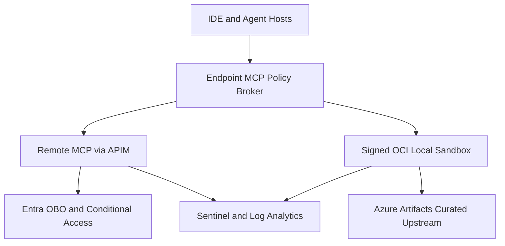
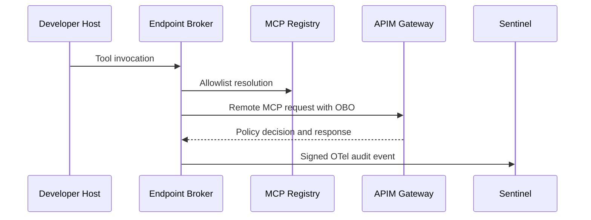

# 企业终端 Shadow `stdio` MCP 蔓延治理与混合本地到远端 MCP 架构选型 FAQ：Remote APIM Registry vs 签名 OCI 沙箱 vs Dev Box VNet Broker

> 🌐 **Language Switch**：**中文（当前）** | [English](./workstation-shadow-stdio-mcp-governance-remote-apim-registry-vs-signed-oci-sandbox-vs-devbox-vnet-broker-selection-faq.en.md)
> **适用对象**：Cloud & AI Solution Architect、企业终端安全团队、平台工程团队、开发者体验团队。
> **问题背景**：企业终端存在 `npx -y` / `uvx` 非锁定依赖、明文 `.env` PAT、`~/.ssh` 与 `~/.azure` 凭据外溢，以及跨 IDE 的工具审计断层。

## 1. Shadow `stdio` MCP 为何会变成企业风险放大器

工作站本地 `stdio` MCP 可以在几秒内接入数据库、工单系统和 SaaS API，效率极高，但默认缺少统一身份、统一策略和统一日志链路。
当团队把访问令牌写入 shell profile、`.env` 或本地缓存后，凭据生命周期通常长于业务需求，形成难回收、难追责、难审计的长期风险。
多终端并行使用 VS Code、GitHub Copilot CLI 与桌面代理宿主时，同一动作可能被多个子进程执行，责任边界和审批证据会被切碎。
治理目标不是一刀切禁用本地工具，而是把本地效率封装到可验证、可隔离、可回滚的企业控制面。

## 2. 四类治理架构与企业适配边界

架构 A 将网络型 MCP 工具全部远端化，依赖 `Azure API Center + APIM + ACA/AKS` 与 Copilot Enterprise MCP Registry allowlist，终端实现 `registry_only`。
架构 B 保留本地工作区工具，但必须在签名 OCI 容器中运行，借助 `Notation/Cosign`、rootless runtime 和 Intune AppControl 落地供应链约束。
架构 C 把 IDE 与本地 MCP 进程整体迁移到 Dev Box/Codespaces，在 VNet 与防火墙边界内执行并使用短时票据。
架构 D 在终端部署 Loopback Policy Broker 统一代理 `stdio`/loopback 流量，执行脱敏、软件源隔离和 OTel 审计上送。

## 3. 分层参考架构：终端代理 + 远端治理 + 可验证本地执行



推荐迁移顺序是 A 与 D 先落地审计与身份闭环，再按团队性能诉求引入 B，最后将高合规团队迁入 C。
这种序列能在不阻断研发效率的前提下，将终端凭据暴露面快速压低，并持续减少未受控子进程比例。

## 4. 架构 A：Remote-First MCP Registry Allowlist

A 将 Jira、ADO、GitHub、Kusto、ServiceNow、SQL 等网络工具迁移为 Remote MCP，通过 APIM 统一执行业务配额、内容过滤与审计标签。
终端侧仅保留 registry allowlist 和会话代理，明文 PAT 与本地脚本 token 需求接近归零。
该模式把工具调用日志完整沉淀到 Sentinel，适合审计压力大、跨区域协作复杂的组织。
主要代价是延迟上升，常见 P95 从 `<5ms` IPC 提升到 `35–90ms` 网络调用，需要连接复用和缓存策略配合。

## 5. 架构 B：签名 OCI 沙箱保留本地低时延

B 以 `ACR` 作为镜像分发源，要求 `Notation/Cosign` 验签后才能启动 MCP 进程，并强制 rootless Podman/Docker `--network=none`。
容器仅挂载 `${workspaceFolder}`，禁止访问 `~/.ssh`、`~/.azure`、`~/.aws` 与系统密钥链目录，降低宿主机凭据侧漏概率。
通过 Intune WDAC/AppControl 阻断任意 `npx -y`、`uvx` 和未知二进制执行，形成“只有签名镜像可运行”的执行面。
B 在本地编译、AST 分析、lint/test 场景具备明显体验优势，但对镜像治理、SBOM 和证书轮换提出更高运维要求。

## 6. 架构 C：Dev Box/Codespaces 云工作站边界

C 将 IDE 与 MCP 进程迁入云工作站，结合 Conditional Access、VNet Injection 与 Azure Firewall Premium 统一出入口。
凭据改为 OIDC 或托管身份短时票据，TTL 控制在 `<=60` 分钟，降低设备丢失和本地木马导致的长期暴露。
该模式适合外包混编、跨境交付和高监管业务，终端退化为展示层，设备合规更易收敛。
挑战在于图形交互依赖网络质量，且席位型成本与区域容量规划需要提前建模。

## 7. 架构 D：终端 Loopback Policy Broker 过渡治理层

D 在端点部署企业 Broker 代理 MCP 通道，对请求与响应进行分类、脱敏、命令准入和签名遥测。
Broker 同时约束依赖来源仅能命中 `Azure Artifacts` 检疫仓，阻断直连公共 npm/pypi 的未审查包下载。
对于暂时无法远端化的工具链，D 可以快速建立审计闭环并降低供应链攻击面。
当组织完成远端迁移后，D 仍可保留为端点最终兜底控制，持续提供取证能力。

## 8. 关键量化模型：暴露面、供应链概率与延迟预算

凭据暴露面公式：`Exposure = N_devs * N_pats * TTL_days`，用于估算凭据总暴露天数并评估回收治理收益。
供应链妥协概率近似：`P(compromise) = 1 - (1 - p_pkg)^N_unpinned`，其中 `p_pkg` 为单包日妥协概率，`N_unpinned` 为未锁定依赖数。
端到端延迟预算：`Latency_total = Latency_transport + Latency_policy + Latency_tool`，其中本地 IPC 常见 `<5ms`，远端 MCP 常见 `35–90ms`。
成本对比可写为：`TCO = Infra + SecOps + IncidentLoss`，治理架构应同时压低事故损失与平台运行成本。


在董事会层面建议同步展示“暴露面下降曲线”与“误报率变化曲线”，避免治理只强调阻断数量而忽略研发体验。
对关键团队可引入每周治理信用分，综合延迟、合规、审计完整性三项指标驱动持续改进。

## 9. 12 维定量对比矩阵

| 维度 | 架构 A：Remote-First | 架构 B：签名 OCI 本地沙箱 | 架构 C：云工作站边界 | 架构 D：Loopback Broker |
|---|---|---|---|---|
| 终端 PAT 驻留比例 | `0%–2%` | `10%–18%` | `1%–3%` | `8%–15%` |
| 工具调用 P95 延迟 | `35–90ms` | `<5ms` 本地 + `10–20ms` broker | `18–45ms` 内网 | `6–18ms` 本地代理 |
| 审计覆盖率 | `98%–100%` | `85%–95%` | `96%–99%` | `90%–97%` |
| 供应链校验强度 | Registry 策略 + APIM | `Notation/Cosign` 强制验签 | 镜像基线 + 私网仓 | 检疫源 + 策略引擎 |
| 凭据 TTL 控制 | OBO `15–60` 分钟 | 容器内短时 token `30–120` 分钟 | OIDC `<=60` 分钟 | 本地代理签发 `10–30` 分钟 |
| 离线可用性 | 中，依赖网络 | 高，本地可运行 | 低，依赖云桌面 | 高，代理降级可本地 |
| 终端隔离边界 | 高，工具远端化 | 中高，容器隔离 | 高，工作负载不落地 | 中，依赖端点硬化 |
| 运维复杂度 | 中 | 高 | 中高 | 中 |
| 单开发者年均治理成本 | `$420–$680` | `$510–$760` | `$780–$1,160` | `$460–$720` |
| 违规命令拦截率 | `92%–98%` | `95%–99%` | `88%–95%` | `90%–97%` |
| 事件定位 MTTR | `20–45` 分钟 | `30–70` 分钟 | `25–55` 分钟 | `25–50` 分钟 |
| 适配团队规模 | `500–15000` 开发者 | `200–8000` 开发者 | `1000–15000` 开发者 | `300–12000` 开发者 |

## 10. 治理流程：从工具注册到运行时拦截



生产环境必须把策略决策、工具上下文和响应摘要绑定同一 trace-id，确保审计追溯能够跨端点、网关和后端系统闭环。
推荐把阻断事件与审批事件分离建模，避免审计系统被高频允许日志淹没，从而漏看高风险拦截告警。

## 11. 生产配置片段：Registry 策略与签名校验

```json
{
  "mcp": {
    "policyMode": "registry_only",
    "registry": "https://mcp-registry.contoso.internal",
    "allow": ["jira-remote", "ado-remote", "kusto-remote", "workspace-lint-signed"],
    "denyUntrustedStdio": true,
    "enforceSignature": true
  }
}
```

```bash
notation verify contosoacr.azurecr.io/mcp/workspace-lint:1.7.3 --plugin azure-kv
az acr repository show-manifests -n contosoacr --repository mcp/workspace-lint --orderby time_desc
az policy assignment create --name deny-unsigned-mcp --policy /providers/Microsoft.Authorization/policyDefinitions/denyUnsignedContainer
```

```xml
<policies>
  <inbound>
    <validate-jwt header-name="Authorization" require-scheme="Bearer" output-token-variable-name="jwt">
      <openid-config url="https://login.microsoftonline.com/{tenant-id}/v2.0/.well-known/openid-configuration" />
      <audiences><audience>api://mcp-remote-gateway</audience></audiences>
    </validate-jwt>
    <set-variable name="x-user-oid" value="@(context.Principal?.Claims.GetValueOrDefault("oid","unknown"))" />
  </inbound>
</policies>
```

## 12. Python 端点策略代理分类器与红线拦截

```python
from dataclasses import dataclass
from typing import List

@dataclass
class ToolCall:
    tool: str
    package_source: str
    touches_secret_path: bool
    destination: str

ALLOW_REMOTE = {"jira-remote", "ado-remote", "kusto-remote", "github-remote"}
ALLOW_LOCAL_SIGNED = {"workspace-lint-signed", "workspace-test-signed"}
BLOCKED_PATHS = {"~/.ssh", "~/.azure", "~/.aws"}

def classify(call: ToolCall) -> str:
    if call.touches_secret_path:
        return "block_secret_path"
    if call.package_source not in {"azure-artifacts", "acr-signed"}:
        return "block_untrusted_source"
    if call.tool in ALLOW_REMOTE and call.destination.startswith("https://apim-"):
        return "allow_remote"
    if call.tool in ALLOW_LOCAL_SIGNED and call.destination == "loopback":
        return "allow_local_signed"
    return "require_human_approval"
```

分类器应与 OTel 事件模型绑定，确保每个阻断决策都输出 `reason_code`、`principal_id`、`tool_id`、`package_digest` 与 `trace_id`。
建议在灰度阶段启用 `observe -> warn -> block` 三段策略，降低一次性硬阻断对业务连续性的冲击。

## 13. 企业场景与三年 TCO（500 / 3000 / 15000 开发者）

场景一：全球制造集团约 `500` 开发者，存在多工厂本地脚本和第三方 SaaS 自动化需求，先上线 A+D 并保留少量 B。
该路径在 8 周内将终端 PAT 暴露天数下降约 `83%`，违规命令拦截率提升至 `95%`，但本地工具灰度期需要额外运行手册。
场景二：跨国金融科技组织约 `3000` 到 `15000` 开发者，先将高敏团队迁入 C，再叠加 A 和 D 统一审计。
该组合把取证时间从小时级压缩到分钟级，同时保证跨区域法规下的令牌生命周期与访问边界可证明合规。

在 `3000` 人阶段，建议把远端化比例作为硬指标推进到 `>=70%`，并保留 `<=20%` 的签名本地工具配额给高频工程任务。
在 `15000` 人阶段，应按业务单元分层治理，核心交易与合规研发单元优先执行 A+C+D 的全量策略，其余单元通过豁免评审逐步收敛。

| 关键运营指标 | 500 开发者 | 3000 开发者 | 15000 开发者 |
|---|---:|---:|---:|
| 远端 MCP 占比目标 | `55%` | `72%` | `85%` |
| 本地签名工具占比上限 | `35%` | `22%` | `10%` |
| 平均取证耗时目标 | `45` 分钟 | `30` 分钟 | `20` 分钟 |

| 架构路径 | 500 开发者 | 3000 开发者 | 15000 开发者 | 三年总成本 | 三年净收益 |
|---|---:|---:|---:|---:|---:|
| A Remote-First | `$0.9M` | `$4.8M` | `$22.5M` | `$28.2M` | `$36.4M` |
| B 签名 OCI 本地沙箱 | `$1.1M` | `$5.6M` | `$25.7M` | `$32.4M` | `$34.9M` |
| C 云工作站边界 | `$1.4M` | `$7.2M` | `$30.3M` | `$38.9M` | `$33.1M` |
| D Loopback Broker | `$1.0M` | `$5.1M` | `$23.6M` | `$29.7M` | `$35.0M` |
| A+B+D 组合 | `$1.2M` | `$5.4M` | `$24.1M` | `$30.7M` | `$39.8M` |
| A+C+D 组合 | `$1.5M` | `$6.5M` | `$27.9M` | `$35.9M` | `$41.6M` |

## 14. 落地清单与 Q1-Q6 数学推导

### Day-0

1. 梳理全部 MCP 工具清单并标记远端化优先级，先迁移网络工具，后治理本地工具。

2. 建立 registry allowlist 与包源白名单，冻结未签名工具新增入口。

3. 为 APIM、端点 Broker 与 SIEM 建立统一 trace-id 规范。

4. 定义 PAT 清退时间窗与自动轮换策略，关闭长期令牌发放。

5. 准备开发者告警与豁免流程，避免上线初期协作中断。

6. 形成应急回退脚本，确保策略误伤时可在分钟级恢复。

### Day-1

1. 按日追踪 `registry_only` 命中率、阻断率、豁免率和误报率。

2. 检查签名镜像覆盖率与镜像漏洞修复 SLA。

3. 评估远端 MCP 延迟分位数，识别需要本地保留的高频工具。

4. 巡检 token TTL 分布，确保超时会话及时失效。

5. 对高风险阻断事件执行人工复核并回写规则。

6. 发布面向开发者的治理变更日志与建议替代路径。

### Day-2

1. 按周校准包源检疫规则与签名信任链。

2. 按月执行终端凭据残留扫描与自动修复任务。

3. 按月审计 APIM OBO 失败码并优化身份映射。

4. 按季度演练工作站失陷场景，验证横向移动阻断能力。

5. 按季度重算三年 TCO 与事件损失模型，更新投资优先级。

6. 持续将事故教训转化为策略即代码并纳入发布门禁。

### Q1: 如何用暴露面公式估算治理收益？

若 `N_devs=3000`、`N_pats=4`、`TTL_days=30`，则暴露面为 `360000` PAT-天；迁移 A 后若 `N_pats=0.5`、`TTL_days=2`，暴露面下降到 `3000` PAT-天。

治理收益可写为 `Reduction = 1 - 3000/360000 = 99.17%`，可直接映射到审计风险下降幅度。

### Q2: 供应链妥协概率如何计算边界值？

若单包日妥协概率 `p_pkg=0.00002`，未锁定依赖数 `N_unpinned=1200`，则 `P=1-(1-0.00002)^1200≈2.37%`。

当引入检疫仓并把未锁定依赖降到 `120` 时，概率降为 `0.24%`，风险等级可从高降到中低。

### Q3: 本地与远端延迟差会造成多少效率损失？

本地 IPC 若为 `4ms`，远端 MCP 若为 `60ms`，单次工具调用增加 `56ms`；每天 `2000` 次调用则增加 `112s`。

若通过批处理把调用数降到 `700` 次，新增时延降到 `39.2s`，可在治理与体验间达到可接受平衡。

### Q4: 如何估算策略阻断对产能的影响？

假设每日 `50000` 次工具调用、阻断率 `2.5%`、误报率 `8%`，则误报阻断约 `100` 次/日。

若单次误报平均修复 `4` 分钟，产能损失约 `400` 分钟/日，应通过白名单优化持续压低误报。

### Q5: 何时应优先迁入云工作站架构 C？

当团队跨境协作比例超过 `35%`，且终端合规整改周期超过 `14` 天时，C 往往比大规模端点改造更快形成合规闭环。

若离线开发占比高于 `40%`，可先采用 A+B+D，再逐步把高敏团队迁移到 C。

### Q6: 如何选择最终推荐组合？

若目标是最低凭据暴露与最高审计完整性，优先 A+D；若目标是保留本地高频工具体验，追加 B；若目标是终端零信任合规，叠加 C。

对 `15000` 人级组织，推荐分层模式 A+C+D 为主、B 为补充，以平衡治理强度、体验与成本。

## 15. Good fit vs Not for 与运行告警字典

Good fit：多 IDE、多工具链、审计要求强且终端异构严重的企业开发平台，尤其适合正在收敛 PAT 与供应链风险的组织。
Not for：十人以内的小团队、纯内网离线开发且无外部 SaaS 工具调用需求的轻量场景。

当组织已形成集中身份体系但终端执行面仍高度分散时，本指南可作为从“策略声明”走向“策略执行可证据化”的迁移蓝图。
若组织处于并购整合期，建议先部署 D 建立统一观测，再按业务优先级推进 A、B、C 的结构化迁移。

| 告警键 | 触发条件 | 立即动作 | 责任团队 |
|---|---|---|---|
| `broker_redaction_failure` | 脱敏规则命中异常下降 | 切换只读模式并阻断外发 | 终端安全 |
| `untrusted_feed_attempt` | 发现直连公共包源请求 | 强制重定向检疫仓并记录证据 | 平台工程 |
| `obo_token_ttl_violation` | OBO token TTL 超策略阈值 | 立即失效并触发身份排查 | 身份治理 |
| `unsigned_image_start` | 启动未签名镜像容器 | 终止进程并提升告警等级 | 运行时安全 |
| `remote_mcp_audit_gap` | APIM 调用缺失审计字段 | 阻断路由并回退上一个版本 | 网关团队 |
| `latency_budget_breach` | 连续 15 分钟 P95 超预算 | 启用降级策略与缓存 | SRE 团队 |
| `policy_false_positive_spike` | 误报率超 `10%` | 临时放宽低风险规则并复盘 | 规则运营 |
| `credential_residue_detected` | 终端扫描发现明文 token | 强制轮换并触发终端隔离 | SOC 团队 |

### 参考来源（抓取日期：2026-11-24）

1. Azure API Management AI gateway overview: https://learn.microsoft.com/azure/api-management/ai-gateway-overview

2. Azure Container Apps and sessions: https://learn.microsoft.com/azure/container-apps/sessions

3. Microsoft Dev Box documentation: https://learn.microsoft.com/azure/dev-box/

4. Notation project and signed artifact verification: https://github.com/notaryproject/notation

5. OpenTelemetry specification: https://opentelemetry.io/docs/specs/

上述来源用于约束控制面能力与可观测实现，具体参数仍需结合企业网络边界、开发习惯与合规等级进行本地化校准。
建议在季度架构评审中复核这些参数，确保策略不会因工具链变化而失效。
