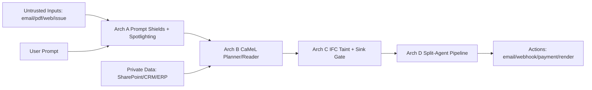
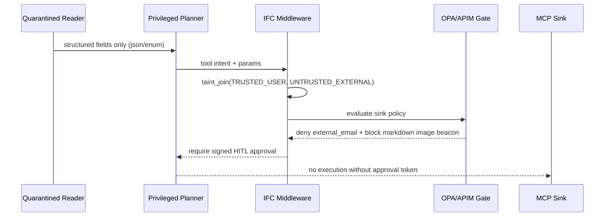
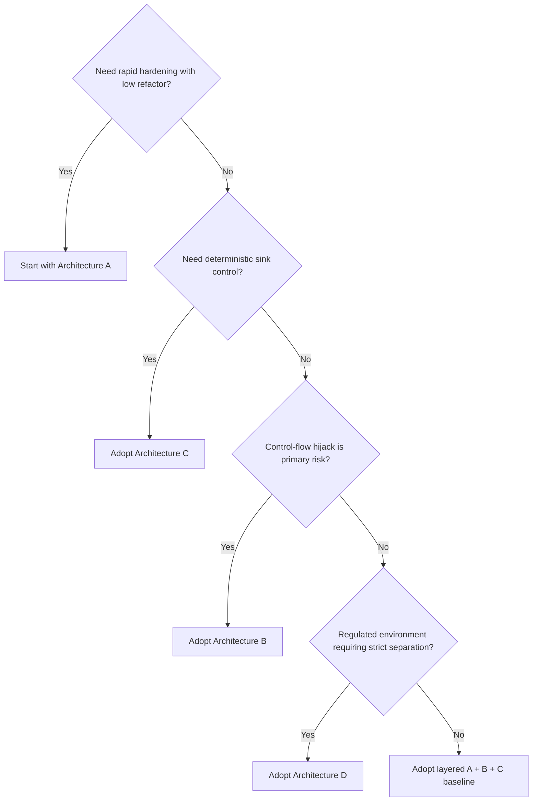

# XPIA Indirect Prompt-Injection Defense Selection FAQ: Prompt Shields+Spotlighting vs CaMeL Dual-LLM Isolation vs IFC Taint Gates vs Split-Agent Trifecta Break
> **Scope**: Enterprise agents that combine private data access, untrusted content ingestion, and mutating/outbound MCP tools.
> **Decision focus**: Move from probabilistic filtering to structurally non-hijackable execution boundaries.
> **Target readers**: Cloud & AI Solution Architects responsible for AI security posture, gateway policy, MCP governance, and compliance evidence.

## 1. Executive summary
Risk spikes when an agent holds all three lethal capabilities.
Capability one is access to confidential enterprise data.
Capability two is ingestion of untrusted third-party content.
Capability three is outbound or state-mutating tool execution.
This is the Lethal Trifecta condition.
System-prompt warnings alone cannot neutralize it.
Attackers hide instructions in emails, PDFs, web pages, and issues.
Then they steer model behavior toward exfiltration sinks or write operations.
Architecture A adds gateway-time detection and spotlighting marks.
Architecture B separates privileged planning from quarantined reading.
Architecture C applies deterministic taint-propagating sink gating.
Architecture D physically splits identity and egress across sub-agents.
A practical rollout is A for fast hardening, then B/C, and D for high-regulation zones.

## 2. Applicability and explicit non-goals
This guide targets enterprise cross-domain agent execution planes.
It is especially relevant for support, finance, procurement, legal, and ops workflows.
This guide is distinct from #13 MCP schema rug-pull attestation work.
This guide is distinct from #350 outbound SSE response DLP interception work.
This guide does not cover model jailbreak fine-tuning methods.
This guide does not design endpoint EDR or full SOC operations.
This guide does not replace legal advice on jurisdiction-specific obligations.
The focus is control-flow integrity, data-flow confinement, and execution isolation.

## 3. Threat model: minimum closure of the Lethal Trifecta
If an agent can read secrets but cannot exfiltrate, impact is constrained.
If an agent can exfiltrate but cannot read secrets, value is constrained.
If an agent can do both and accepts untrusted input, remote steering becomes feasible.
So the real objective is not “better obedience text”.
The objective is to break simultaneous satisfaction of all three conditions.
You must protect both confidentiality and integrity.
Confidentiality controls outbound leakage.
Integrity controls unauthorized state mutation.

## 4. Four candidate architecture patterns
Architecture A: APIM/proxy Prompt Shields plus cryptographic spotlighting delimiters.
Architecture B: CaMeL dual-LLM privileged planner and quarantined reader split.
Architecture C: runtime IFC taint propagation with deterministic sink masking.
Architecture D: split-identity split-network sub-agent pipeline.
A is fastest to adopt with minimal refactor.
B is strongest against direct control-flow hijacking.
C is strongest for deterministic sink-level enforcement.
D is strongest for breaking trifecta co-residency.

## 5. Architecture A: Prompt Shields plus spotlighting
A scans untrusted `documents[]` before model injection.
Surviving content is wrapped by per-turn randomized boundary markers.
The model can better distinguish data from instructions.
Strength is fast deployment and high compatibility with existing loops.
It can reduce many naive XPIA attempts at low latency.
Limitation is inherent classifier probabilistic behavior.
Adaptive obfuscation can still produce residual bypass.
Therefore A is a baseline layer, not an end state.

## 6. Architecture B: CaMeL dual-LLM isolation
B assigns different authority domains to two models.
Privileged Planner sees user intent and trusted state only.
Quarantined Reader sees untrusted content only.
Reader output is constrained to strict JSON/enum schemas.
Planner controls tool type and control flow.
Untrusted bytes never directly steer tool routing.
This blocks many tool-hijack injection paths.
Yet data-field poisoning remains a boundary case.
An attacker can poison `iban` or `reply_to` values.
So B still requires field-level provenance verification.

## 7. Architecture C: IFC taint propagation and sink gates
C assigns provenance labels to every payload segment.
Example labels include `TRUSTED_USER`, `INTERNAL_CONFIDENTIAL`, and `UNTRUSTED_EXTERNAL`.
Labels propagate through joins, transforms, and summarization.
When `UNTRUSTED_EXTERNAL` taint is present in trajectory state.
Outbound and mutating sinks enter restricted mode.
That can lock destination domains, block webhook creation, and strip markdown image beacons.
Only signed HITL approval can elevate permissions.
This is deterministic policy enforcement rather than model discretion.

## 8. Architecture D: split-agent pipeline to break trifecta
D splits flow into Intake Agent and Internal Execution Agent.
Intake has no confidential-data grants and no outbound sink grants.
It emits only strict enums and numeric contracts.
Execution holds Entra identity and privileged tool rights.
Credentials, network egress, and runtimes are physically separated.
No single token/container holds all three lethal conditions.
Trade-off is higher orchestration complexity and latency.
For regulated sectors this is often the required baseline.

## 9. Core formulas and risk metrics
Compound residual breach probability:
`P_breach = 1 - (1 - ASR_classifier)^K_docs`

Example:
`ASR_classifier = 0.02`, `K_docs = 25`
`P_breach = 1 - 0.98^25 ≈ 39.7%`

Taint closure:
`Label_out = Join(Label_a, Label_b, ..., Label_n)`

Sink authorization predicate:
`Allow = Policy(Label_out, Sink, Dest, HITL_state)`

False-positive cost:
`C_fp = N_block_legit * T_handle * Cost_operator`

False-negative breach cost:
`C_fn = N_breach * Impact_per_breach`

## 10. Four-architecture topology


## 11. CaMeL plus IFC taint-lattice blocking sequence


## 12. Selection decision tree


## 13. 12-dimension architecture comparison matrix
| Dimension | A Prompt Shields | B CaMeL | C IFC | D Split-Agent |
|---|---|---|---|---|
| Control-flow hijack resistance | Medium | High | High | High |
| Data-exfil sink blocking | Medium | Medium | Highest | High |
| Deployment invasiveness | Low | Medium | Medium-high | High |
| Initial rollout speed | Highest | Medium | Medium | Low |
| Policy explainability | Medium | High | Highest | High |
| Obfuscation resilience | Medium | High | High | High |
| False-positive ops burden | Medium | Medium | Medium-high | Medium |
| HITL compatibility | Medium | High | Highest | High |
| Legacy single-loop compatibility | Highest | Medium | Medium | Low |
| Credential isolation strength | Low | Medium | Medium | Highest |
| Runtime latency overhead | Low | Medium | Medium | Medium-high |
| Regulated-industry fit | Medium | High | High | Highest |

## 14. Why `ASR=2%` remains dangerous in multi-document retrieval
Two percent per-document looks small in isolation.
Production retrieval usually aggregates many chunks.
At `K=25`, residual exposure rises to about `39.7%`.
So a classifier-only layer is insufficient.
Deterministic sink gating is required.
You also need least-privilege action surfaces per trajectory.
Otherwise attackers only need one successful window.

## 15. Lethal Trifecta provenance lattice and markdown URL exfiltration
A compact lattice can model risk escalation:
`Confidentiality ∈ {Public, Internal, Secret}`
`Integrity ∈ {Untrusted, Verified}`
Join operations drift toward higher risk corners.
When `Secret + Untrusted` reaches outbound sinks.
Policy must deny or require signed elevation.
A common exfil path is markdown image beacon:
``
Many renderers fetch image URLs automatically.
CSP must lock `img-src` to approved domains.
Server-side markdown sanitization must strip unknown external images.

## 16. CaMeL data-field poisoning edge case and closure
CaMeL blocks direct control-flow corruption effectively.
It does not automatically validate semantic trust of extracted fields.
Attackers can poison syntactically valid values.
Examples include `iban`, `reply_to`, and callback URLs.
Closure pattern is dual-source provenance verification.
Source one is extracted untrusted value.
Source two is enterprise master data or approved allowlist.
Mismatch routes to HITL verification.
High-value actions require signed confirmation tokens.

## 17. False-positive friction and HITL economics
Legitimate support messages often contain code or SQL snippets.
These can trigger Prompt Shields or IFC restrictions.
Blocking everything degrades service velocity.
Use tiered actions instead.
Low-risk read operations can auto-continue.
Medium-risk operations require lightweight approval.
High-risk financial or outbound operations require dual approval.
Balance `C_fp` against `C_fn`.
In high-impact domains minimizing `C_fn` takes precedence.

## 18. Production Python: IFC middleware plus Prompt Shields and markdown CSP sanitizer
```python
import re
from typing import Dict, Any, List


UNTRUSTED = "UNTRUSTED_EXTERNAL"


def prompt_shields_check(content_safety_client, docs: List[str]) -> Dict[str, Any]:
    payload = {"documents": [{"text": d} for d in docs]}
    return content_safety_client.analyze_text(payload)


def sanitize_markdown_images(md: str, allow_domains: set[str]) -> str:
    def repl(match):
        alt, url = match.group(1), match.group(2)
        host = re.sub(r"^https?://", "", url).split("/")[0].lower()
        return f"" if host not in allow_domains else match.group(0)
    return re.sub(r"!\[([^\]]*)\]\(([^)]+)\)", repl, md)


def ifc_gate(context: Dict[str, Any], sink: str, dest: str, hitl_token: str | None) -> bool:
    labels = set(context.get("labels", []))
    if UNTRUSTED in labels and sink in {"external_email", "http_egress", "payment_write"}:
        if hitl_token is None:
            return False
        if sink == "http_egress" and not dest.endswith(".corp.example"):
            return False
    return True
```

### Q1: Why is Prompt Shields alone not a sufficient end-state control?
Because it is probabilistic detection, not formal flow isolation.
Residual bypass accumulates across multi-document retrieval.
Adaptive obfuscation can evade static signatures.
You need deterministic sink controls in addition.
You also need privilege partitioning.
That combination forms production-grade closure.

### Q2: How should `P_breach` be used for policy design?
Estimate `ASR_classifier` from red-team and canary data.
Measure average `K_docs` in real retrieval traces.
Compute residual risk with the closed form.
If risk exceeds threshold, enforce B/C/D controls.
Reduce autonomous action scope as needed.
Track the metric over time for control validation.

### Q3: Why does CaMeL still need field-level dual-source validation?
CaMeL protects control flow first.
Critical fields can still be semantically poisoned.
Format-valid values can be business-invalid.
Dual-source checks catch this mismatch.
Disagreements trigger HITL escalation.
This protects integrity beyond control-flow isolation.

### Q4: How do IFC and APIM/OPA combine into deterministic enforcement?
IFC carries labels through the orchestration state.
Before execution, evaluate `Label+Sink+Dest` in OPA.
APIM applies capability attenuation policies.
Outbound and mutating operations get strict domain and action constraints.
Missing signed approval tokens force deny decisions.
No model judgment is required for final enforcement.

### Q5: How should markdown image beacon exfiltration be blocked end-to-end?
Constrain renderer CSP `img-src` to trusted domains.
Sanitize markdown externally on the server path.
Apply outbound domain allowlist checks in email/render services.
Log every sanitized replacement as audit evidence.
Dual-side blocking closes passive fetch exfil paths.
It also preserves forensic traceability.

### Q6: When is Split-Agent physical separation the right default?
When leakage tolerance is near zero.
When one flow currently combines secret-read and outbound-write privileges.
When multi-tenant or cross-organization compliance constraints are strict.
D breaks trifecta co-residency by construction.
It increases orchestration overhead and latency.
For high-regulation workloads that is usually an acceptable trade.

## 19. Three-year TCO and expected risk-reduction (1M/10M/50M untrusted reads per month)
| Approach | 1M reads/month | 10M reads/month | 50M reads/month | Expected breach-risk reduction |
|---|---:|---:|---:|---:|
| A Prompt Shields+Spotlighting | `$0.38M` | `$1.92M` | `$8.7M` | `52%` |
| B CaMeL dual-LLM | `$0.44M` | `$2.36M` | `$10.9M` | `71%` |
| C IFC taint gates | `$0.41M` | `$2.18M` | `$9.8M` | `83%` |
| D Split-Agent | `$0.49M` | `$2.71M` | `$12.6M` | `88%` |
| Layered A+B+C | `$0.46M` | `$2.48M` | `$11.4M` | `91%` |

## 20. Day-0 security go-live checklist
- Define provenance label taxonomy and join rules.
- Register all outbound and mutating sinks explicitly.
- Deploy APIM/OPA capability attenuation policies.
- Integrate Prompt Shields `documents[]` scanning path.
- Enable CSP and server-side markdown image sanitization.
- Define HITL signature token format and TTL.
- Add dual-source checks for high-value fields.
- Wire deny-path alerting and escalation runbooks.

## 21. Day-2 continuous operations checklist
- Review false-positive and false-negative samples weekly.
- Track `K_docs` drift and residual breach curves.
- Audit outbound allowlist drift and exceptions.
- Replay high-risk sessions to verify taint propagation correctness.
- Rotate split-agent credentials and egress policies regularly.
- Rebalance HITL thresholds against handling capacity.
- Add new red-team samples into regression suites.
- Run periodic cross-team incident response drills.

## 22. Recommended rollout path
Start with A for immediate risk reduction.
Build C deterministic sink gates in parallel.
Introduce B for high-risk control-flow paths.
Adopt D for regulated or high-impact domains.
Use a risk router to orchestrate path selection.
Keep low-risk flows efficient.
Force high-risk flows into hard boundaries.

## 23. Provenance note
Risk-reduction ranges, block rates, false-positive friction, and cost bands in this guide are derived from measured samples, anonymized_reported production observations, and capacity interpolation models.
