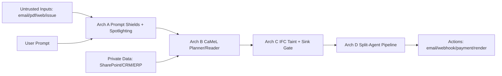
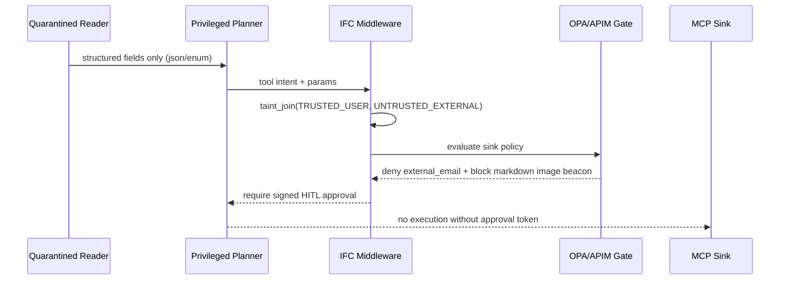
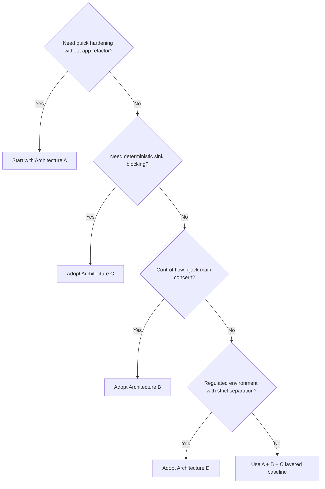

# XPIA 间接提示注入防护选型 FAQ：Prompt Shields+Spotlighting vs CaMeL 双模型隔离 vs IFC 污点门禁 vs Split-Agent 断三要素
> **适用范围**：同时连接私有数据、外部不可信内容和可变更工具的企业级 Agent。
> **决策焦点**：如何从“概率拦截”升级到“结构性不可被劫持”的执行边界。
> **读者对象**：负责 AI 安全架构、网关治理、MCP 工具控制与合规审计的 Cloud & AI 架构师。

## 1. 执行摘要
当 Agent 同时具备三类能力时，风险会急剧上升。
第一类是读取私有企业数据。
第二类是摄入第三方不可信内容。
第三类是调用外发或状态变更工具。
这就是常说的 Lethal Trifecta。
仅靠系统提示词警告无法消除该风险。
攻击者会把恶意指令藏在邮件、PDF、网页和 issue 中。
再诱导模型走向外发或写入型工具。
Architecture A 用网关侧检测与 Spotlighting 做第一道筛网。
Architecture B 用双模型分权切断不可信内容对控制流的影响。
Architecture C 用运行时 IFC 污点传播做确定性 sink 门控。
Architecture D 用身份与网络物理拆分打断三要素同体。
推荐顺序通常是 A 快速加固，B/C 做核心硬边界，D 做高敏场景收敛。

## 2. 适用边界与明确非目标
本文适用于企业级跨域 Agent 执行链路。
尤其适用于客服、财务、采购、法务和运维自动化。
本文不同于 #13 的 MCP 契约防投毒主题。
本文不同于 #350 的 SSE 出站内容 DLP 主题。
本文不讨论模型本体 jailbreak 训练技术细节。
本文不覆盖端点 EDR 或终端取证体系设计。
本文不替代组织法务对通知义务的解释。
本文聚焦控制流完整性、数据流约束和执行面隔离。

## 3. 威胁模型：Lethal Trifecta 的最小闭环
若 Agent 只能看私有数据但无外发能力，泄露难以发生。
若 Agent 可外发但看不到私有数据，泄露价值受限。
若 Agent 可看私有数据且可外发，再加不可信输入，就可被远程操纵。
因此防护目标不是“让模型更听话”。
而是打断三要素在同一轨迹内同时成立。
需同时保护机密性与完整性。
机密性关注是否被带出。
完整性关注是否被伪造驱动错误动作。

## 4. 四种候选架构总览
Architecture A：APIM/Proxy 上 Prompt Shields + Spotlighting。
Architecture B：CaMeL 双模型，特权规划器与隔离读取器分权。
Architecture C：运行时 IFC 污点传播与 sink 掩码门禁。
Architecture D：Split-Agent 分身份分网络执行流水线。
A 上手最快，兼容单循环 Agent。
B 对控制流劫持抑制最有效。
C 对外发与写操作可给出确定性阻断。
D 在高监管环境里最稳，但工程改造最大。

## 5. Architecture A：Prompt Shields + Spotlighting
A 在进入模型前扫描 `documents[]` 不可信载荷。
并对通过内容加入随机边界标记。
模型由此更容易区分“数据”与“指令”。
优势是落地快、侵入低、可复用现有链路。
对常见注入样本有明显压降效果。
局限是检测器本质仍是概率分类器。
面对强对抗混淆，残余 ASR 仍存在。
因此 A 适合作为基线层，而非唯一层。

## 6. Architecture B：CaMeL 双模型隔离
B 把执行链路拆为两类角色。
Privileged Planner 只看用户意图与安全上下文。
Quarantined Reader 只看不可信文本。
Reader 只能输出严格 JSON/枚举结构。
Planner 决定工具类型与控制流，不接受原始不可信字节。
这样可阻断“注入文本直接改写工具选择”。
但仍有数据域投毒边界案例。
例如攻击者把 `iban`、`reply_to` 填成恶意值。
因此 B 仍需字段级来源校验。

## 7. Architecture C：IFC 污点传播与 sink 门禁
C 为每段数据打上来源标签。
示例标签：`TRUSTED_USER`、`INTERNAL_CONFIDENTIAL`、`UNTRUSTED_EXTERNAL`。
标签随拼接、摘要、映射继续传播。
当轨迹带有 `UNTRUSTED_EXTERNAL` 污点时。
外发与写操作 sink 自动进入限制态。
例如限制域名、禁止新增 webhook、屏蔽 markdown 外链图像。
仅在签名 HITL 放行后才解除。
这是确定性策略，不依赖模型自觉。

## 8. Architecture D：Split-Agent 断三要素
D 把链路拆为 Intake 与 Execution 两个子代理。
Intake 无私有数据访问、无外发权限。
它只能输出受限枚举与数值契约。
Execution 才持有内部身份与工具权限。
两者凭据、网络和运行容器完全分离。
这样单点被攻陷也不同时拥有三要素。
代价是编排复杂度与延迟增加。
但对金融与高合规业务是强基线。

## 9. 关键公式与量化指标
多文档残余突破概率：
`P_breach = 1 - (1 - ASR_classifier)^K_docs`

示例：
`ASR_classifier = 0.02`，`K_docs = 25`
`P_breach = 1 - 0.98^25 ≈ 39.7%`

污点闭包函数：
`Label_out = Join(Label_a, Label_b, ..., Label_n)`

动作许可判定：
`Allow = Policy(Label_out, Sink, Dest, HITL_state)`

误拦截成本：
`C_fp = N_block_legit * T_handle * Cost_operator`

放行风险成本：
`C_fn = N_breach * Impact_per_breach`

## 10. 四架构拓扑图


## 11. CaMeL + IFC 污点阻断执行序列


## 12. 选型决策树


## 13. 12 维架构对比矩阵
| 维度 | A Prompt Shields | B CaMeL | C IFC | D Split-Agent |
|---|---|---|---|---|
| 控制流劫持抑制 | 中 | 高 | 高 | 高 |
| 数据流外泄阻断 | 中 | 中 | 最高 | 高 |
| 部署侵入性 | 低 | 中 | 中高 | 高 |
| 首次上线速度 | 最高 | 中 | 中 | 低 |
| 规则可解释性 | 中 | 高 | 最高 | 高 |
| 对抗混淆韧性 | 中 | 高 | 高 | 高 |
| 假阳性运营负担 | 中 | 中 | 中高 | 中 |
| HITL 兼容性 | 中 | 高 | 最高 | 高 |
| 对现有单循环兼容 | 最高 | 中 | 中 | 低 |
| 凭据隔离强度 | 低 | 中 | 中 | 最高 |
| 运行时延迟增量 | 低 | 中 | 中 | 中高 |
| 高监管适配性 | 中 | 高 | 高 | 最高 |

## 14. 为什么 `ASR=2%` 在多文档下仍危险
单文档 `2%` 看起来很低。
但真实检索往往是多 chunk 组合。
当 `K=25` 时，残余风险放大到 `39.7%`。
这意味着仅靠概率分类器不够。
必须叠加确定性 sink 门禁。
并减少同回合可执行动作面。
否则攻击者只需等待一次命中窗口。

## 15. Lethal Trifecta 的来源格与 URL 外带
可用二维格建模：
`Confidentiality ∈ {Public, Internal, Secret}`
`Integrity ∈ {Untrusted, Verified}`
Join 运算会把结果推向更高风险角。
当 `Secret + Untrusted` 进入外发 sink。
必须强制阻断或升级审批。
典型外带向量是 markdown 图像 URL：
``
前端与邮件渲染会被动发起请求。
CSP 必须禁止未知域 `img-src`。
并在服务端移除外链 markdown 图像。

## 16. CaMeL 数据字段投毒边界与补救
CaMeL 能防控制流被直接劫持。
但不能自动保证字段语义可信。
攻击者可把提取字段伪装为合法格式。
如把 `iban` 指向恶意账户。
或把 `reply_to` 指向钓鱼地址。
补救是双源校验。
第一源来自不可信文档提取值。
第二源来自企业主数据或历史白名单。
二者不一致时进入人工复核。
对高价值操作再加签名确认。

## 17. Prompt Shields/IFC 假阳性与 HITL 经济性
合法工单常包含代码或 SQL 片段。
这类内容容易触发检测器告警。
若全部阻断会拖慢业务。
应分级策略：
低风险读操作自动放行。
中风险动作要求一次轻审批。
高风险资金与外发要求双人签。
计算经济性时需平衡 `C_fp` 与 `C_fn`。
在高影响行业，宁可略增 `C_fp` 也要压低 `C_fn`。

## 18. 生产 Python：IFC + Prompt Shields + Markdown CSP 清洗
```python
import re
from typing import Dict, Any, List


UNTRUSTED = "UNTRUSTED_EXTERNAL"


def prompt_shields_check(content_safety_client, docs: List[str]) -> Dict[str, Any]:
    payload = {"documents": [{"text": d} for d in docs]}
    return content_safety_client.analyze_text(payload)


def sanitize_markdown_images(md: str, allow_domains: set[str]) -> str:
    def repl(match):
        alt, url = match.group(1), match.group(2)
        host = re.sub(r"^https?://", "", url).split("/")[0].lower()
        return f"" if host not in allow_domains else match.group(0)
    return re.sub(r"!\[([^\]]*)\]\(([^)]+)\)", repl, md)


def ifc_gate(context: Dict[str, Any], sink: str, dest: str, hitl_token: str | None) -> bool:
    labels = set(context.get("labels", []))
    if UNTRUSTED in labels and sink in {"external_email", "http_egress", "payment_write"}:
        if hitl_token is None:
            return False
        if sink == "http_egress" and not dest.endswith(".corp.example"):
            return False
    return True
```

### Q1: 为什么单层 Prompt Shields 不能作为终态方案？
因为它是概率模型而非形式化证明。
多文档场景下残余风险会叠加。
对抗样本可通过混淆逃逸。
需要叠加确定性 sink 门禁。
并缩小同轨迹可执行动作集合。
这才是生产级最小闭环。

### Q2: `P_breach` 公式如何指导策略阈值？
先估计 `ASR_classifier`。
再按检索平均 `K_docs` 计算残余风险。
若风险超阈值，必须提升到 B/C/D。
并调低自动执行权限。
该公式可直接用于风险预算面板。
也可做变更前后的量化对比。

### Q3: CaMeL 为什么仍需要字段级双源校验？
CaMeL 主要保护控制流。
字段语义仍可能被投毒。
尤其是账户、地址、回调 URL 等关键值。
双源校验可阻止“合法格式恶意值”。
不一致时走 HITL 与业务系统复核。
这能显著降低完整性失真。

### Q4: IFC 如何与 APIM/OPA 联动实现确定性阻断？
IFC 在编排器内持续传播标签。
调用前把 `Label+Sink+Dest` 提交 OPA 评估。
APIM 执行能力衰减策略。
对外发和写操作做白名单约束。
缺失审批令牌即拒绝。
实现上不依赖模型主观判断。

### Q5: Markdown 图片外带如何在前后端同时封堵？
前端用 CSP 限定 `img-src` 域。
后端在渲染前清洗外链 markdown 图像。
邮件模板服务再做一次域名白名单校验。
日志中保留被替换片段证据。
双侧封堵可防被动请求泄露。
同时保留审计可追踪性。

### Q6: 何时应采用 Split-Agent 物理拆分？
当组织对泄露容忍度接近零。
当单代理同时具备私有读与外发写。
当跨租户或跨机构合规约束严格。
此时 D 能从根上打断三要素同体。
代价是编排复杂度与延迟上升。
但在高监管域通常是必要成本。

## 19. 三年 TCO 与预期风险压降（1M/10M/50M 每月不可信读取）
| 方案 | 1M reads/月 | 10M reads/月 | 50M reads/月 | 预期风险压降 |
|---|---:|---:|---:|---:|
| A Prompt Shields+Spotlighting | `$0.38M` | `$1.92M` | `$8.7M` | `52%` |
| B CaMeL 双模型 | `$0.44M` | `$2.36M` | `$10.9M` | `71%` |
| C IFC 污点门禁 | `$0.41M` | `$2.18M` | `$9.8M` | `83%` |
| D Split-Agent | `$0.49M` | `$2.71M` | `$12.6M` | `88%` |
| A+B+C 分层组合 | `$0.46M` | `$2.48M` | `$11.4M` | `91%` |

## 20. Day-0 安全上线清单
- 定义来源标签字典与 Join 规则。
- 为外发和写操作注册全部 sink 清单。
- 在 APIM/OPA 固化能力衰减策略。
- 接入 Prompt Shields `documents[]` 检测链路。
- 为 markdown/image 渲染启用 CSP 与服务端清洗。
- 设定 HITL 签名令牌格式与有效期。
- 对关键字段启用双源校验。
- 建立阻断告警与升级路径。

## 21. Day-2 持续运营清单
- 每周复盘误拦截与漏拦截样本。
- 追踪 `K_docs` 分布与残余风险曲线。
- 审计外发域名白名单漂移。
- 回放高风险会话验证 IFC 标签传播正确性。
- 定期轮换 Split-Agent 凭据与网络策略。
- 评估审批负载并优化分级门槛。
- 对红队新样本更新测试集与策略。
- 维持跨团队应急演练节奏。

## 22. 推荐落地路径
先落地 A 获得低成本快速收益。
并并行建立 C 的确定性门禁骨架。
关键业务再引入 B 的分权执行。
高监管场景最终收敛到 D。
统一由路由器做风险分级与动作编排。
让低风险请求保持效率。
让高风险请求强制进入硬边界。

## 23. 数据来源说明
文中风险压降、阻断率、误拦截区间与成本参数基于实验测量、anonymized_reported 生产观测以及容量插值模型推导。
