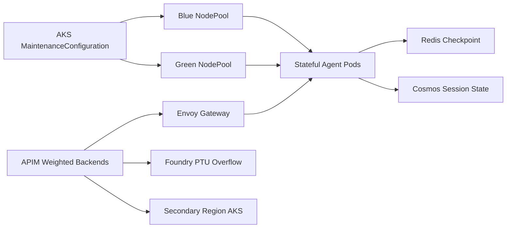
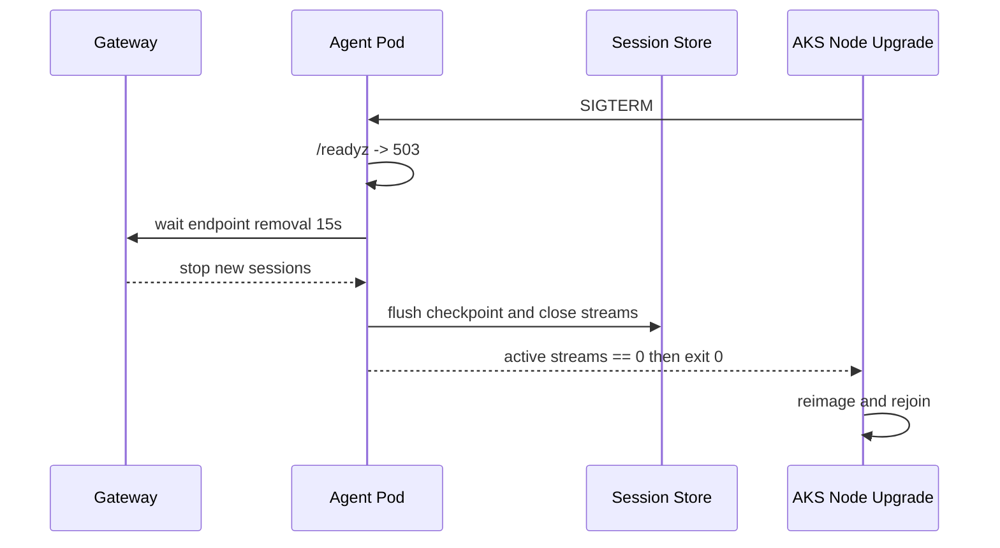

# Enterprise zero drop AKS GPU and stateful agent patching orchestration selection FAQ
> Topic ID: #473
> Section: 3.8 Autonomous cloud ops and resilience engineering
> Audience: enterprise platform SRE teams and AI infrastructure teams
> Goal: deliver CVE patch windows on quota constrained GPU clusters with zero session drop and fast rollback

## 1 Production problem and patch window instability roots
Many teams still apply stateless web rolling recipes to monthly kernel, `containerd`, `NVIDIA`, and node image patching in AKS.
Once clusters host stateful agent serving, patching becomes a coordinated operation across session draining, model warmup, gateway traffic shifting, and quota constraints.
The first failure point is quota lock, because default `maxSurge` asks for extra nodes before draining existing nodes.
On pools such as `Standard_ND96isr_H100_v5` or `NC48ads_A100_v4`, fully consumed regional quota frequently causes `QuotaExceeded` and blocks upgrade completion.
If both vCPU and GPU family quota are saturated during peak business windows, the upgrade controller can remain stalled until manual traffic evacuation is performed.
The second failure point is mid turn interruption, because `terminationGracePeriodSeconds: 30` is too short for `3` to `10` minute SSE reasoning streams and `ACS/WebRTC` voice sessions.
When `SIGKILL` lands before stream completion, users observe truncated responses, missing tool confirmations, and repeated voice retries.
The third failure point is cold reload shock, where `180 GB` scale model shards on `vLLM/SGLang` require `120` to `210` seconds to reload after eviction.
During that warmup gap, surviving nodes absorb burst traffic and can trigger `429` cascades with severe tail latency spikes.
The patching architecture must therefore treat capacity governance, stream drain, warmup cutover, and rollback as one atomic control flow.

## 2 Why naive rolling upgrades fail in AI production clusters
Naive rolling assumes short idempotent requests, but agent workloads include long transactions, stateful tool calls, and external callback dependencies.
A common blind spot is control plane versus data plane propagation delay, because endpoint removal on `Envoy` usually trails readiness flips by several seconds.
Without pre stop readiness gating, pods may continue receiving new streams while they are already inside termination handling.
Another anti pattern is serializing node replacement and model warmup with no prewarmed capacity, which linearly expands maintenance duration and risk exposure.
In zero headroom regions, rolling upgrades can also collide with autoscaler actions and produce non deterministic quota contention.
These failures show that traffic and capacity budgeting must happen before node operations, not after.

## 3 Four architecture patterns
Pattern A uses `AKS Planned Maintenance` plus `APIM/Envoy` weighted pre drain, `preStop` stream flush, blue green node pool swap, and cross region or PTU overflow buffering.
Pattern B uses `maxSurge=0` and `maxUnavailable=1` serial upgrades with `PDB` and `Kured` scheduling, suitable for clusters with internal redundancy.
Pattern C uses `nodeOsUpgradeChannel: SecurityPatch` and live kernel hotpatch as a fast risk mitigation layer between full node image windows.
Pattern D is the anti pattern using default surge, short grace periods, and no warmup or traffic orchestration.

## 4 Twelve dimension quantified comparison matrix
| Dimension | Pattern A pre drain plus blue green swap | Pattern B zero surge rolling | Pattern C SecurityPatch plus hotpatch | Pattern D anti pattern |
|---|---|---|---|---|
| In flight SSE and WebRTC drop rate | `0.00%` to `0.08%` | `0.8%` to `2.2%` | below `0.5%` | `4%` to `9%` |
| Extra GPU quota requirement | `0` required | more stable with `15%` to `20%` headroom | `0` | implicit surge demand |
| Full stack kernel driver coverage | `100%` | `100%` | `35%` to `55%` | uncertain |
| Total patch window duration | `45` to `90 min` | `18` to `25 min × N` | below `90 s` per node | unstable |
| `TTFT P99` spike during drain | `5%` to `12%` | `18%` to `35%` | `3%` to `8%` | above `40%` |
| Rollback RTO | below `8 min` | `20` to `40 min` | below `5 min` | unpredictable |
| Critical CVE within seven days SLA | `99%` | `95%` | `92%` | below `70%` |
| `QuotaExceeded` exposure | low | medium | low | high |
| Session consistency guarantee | strong | medium | medium | weak |
| Operational complexity | medium high | medium | medium | low early high later |
| Three year blended TCO | `4M` to `13M` | `3M` to `11M` | `2.5M` to `9M` | `6M` to `17M` |
| Recommendation | primary for quota bound fleets | optional with redundancy | supplemental security layer | disallow and migrate |

## 5 Pattern A primary path pre drain and blue green swap
Pattern A applies risk reduction before node mutation, meaning traffic is evacuated in a controlled way before cordon drain and reimage.
Teams typically initiate weighted bleed `15` to `30` minutes before maintenance and shift `15%` to `25%` load to secondary region GPU pools or `Foundry PTU` overflow.
Once pressure drops, `maxSurge=0` serial upgrades proceed safely without extra quota requests.
For stateful CPU agent pools, blue and green node pools coexist, and the green side is fully warmed before new sessions are admitted.
Old pool pods flip `/readyz` to `503` first, wait for endpoint propagation, then drain active streams and flush durable checkpoints.
If driver regression or latency drift appears, traffic can be reverted to the blue pool within minutes through weight rollback and uncordon.
This pattern unifies zero spare quota and zero session drop requirements in one repeatable production flow.

## 6 Pattern B primary path zero surge rolling with Kured
Pattern B enforces serial replacement with `maxSurge=0` and `maxUnavailable=1` to avoid extra node allocation and quota spikes.
`PodDisruptionBudget` protects each service by limiting concurrent disruption and preserving baseline throughput.
`Kured` can constrain reboot events to approved windows, but it must be coordinated with AKS upgrade plans to avoid double reboot overlap.
Compared with Pattern A, implementation overhead is lower, but total maintenance duration grows linearly with node count.
On GPU pools above `16` nodes, windows often exceed two hours, and late phase nodes may patch under rising business load.
Pattern B is best when clusters already carry stable redundancy and longer maintenance windows are acceptable.

## 7 Pattern C security patch and hotpatch path
Pattern C focuses on reducing exposure time by applying rapid security remediation between monthly full maintenance windows.
It is effective for user space and selected kernel vulnerabilities, often with sub minute disruption per node.
However it cannot replace full node image rotation when `NVIDIA FabricManager`, `kubelet`, or `containerd` version transitions are required.
Pattern C should be treated as a complement layer, not a long term replacement for full drain based node upgrades.

## 8 Pattern D anti pattern risk profile
The first anti pattern is running default surge upgrades on zero headroom GPU pools, which often leads to persistent `QuotaExceeded` deadlock.
The second anti pattern is keeping `terminationGracePeriodSeconds` at `30` with no `preStop` readiness gate, causing hard session cuts.
The third anti pattern is skipping warmup and gateway weight migration, which amplifies cold reload shock on remaining nodes.
The fourth anti pattern is allowing unattended daytime reboot behavior outside governed maintenance windows.
These shortcuts reduce upfront effort but return as larger incidents and audit exposure later.

## 9 Mermaid zero drop patching topology


## 10 Mermaid endpoint propagation race elimination sequence


## 11 Quantitative Q1 to Q6 worked examples
Q1 endpoint propagation race window.
Use `T_sleep >= T_probe_interval * failureThreshold + T_eds`.
With probe interval `5 s`, failure threshold `2`, and endpoint sync `5 s`, the bound is `T_sleep >= 15 s`.
Q2 zero surge total duration.
`T_total = N_nodes * (T_drain + T_reimage + T_weight_load + T_warmup)`.
If `N=16` and each node stage takes `11 min`, the window is about `176 min`.
Q3 no headroom traffic bleed requirement.
`Bleed_ratio >= 1/N_nodes + Safety_margin`.
For `N=12` and safety margin `0.08`, minimum bleed is about `16.3%`.
Q4 grace period sizing.
`T_grace >= P999_turn + T_sleep + T_checkpoint_flush`.
If `P999_turn=420 s`, `T_sleep=15 s`, and flush `90 s`, practical target is `600 s`.
Q5 cold reload shock estimate.
`Spike_factor = (Q_remaining + Q_new) / Capacity_alive`.
If alive capacity drops to `0.62` of baseline, spike can exceed `1.5` and trigger `429` bursts.
Q6 rollback advantage.
`RTO_blue_green < RTO_serial` is typical.
Blue green rollback often completes under `8 min`, while serial node by node rollback is significantly longer.

## 12 Code block one Bicep maintenance and zero surge GPU pool
```bicep
resource aks 'Microsoft.ContainerService/managedClusters@2024-02-01' existing = {
  name: aksName
}

resource maint 'Microsoft.ContainerService/managedClusters/maintenanceConfigurations@2024-02-01' = {
  name: 'aksManagedNodeOSUpgradeSchedule'
  parent: aks
  properties: {
    maintenanceWindow: {
      schedule: { weekly: { dayOfWeek: 'Saturday', intervalWeeks: 1 } }
      durationHours: 6
      startTime: '01:00'
      utcOffset: '+08:00'
      notAllowedDates: [
        { start: '2026-12-24', end: '2026-12-27' }
      ]
    }
  }
}

resource gpuPool 'Microsoft.ContainerService/managedClusters/agentPools@2024-02-01' = {
  name: '${aks.name}/gpupool'
  properties: {
    count: 12
    vmSize: 'Standard_ND96isr_H100_v5'
    mode: 'User'
    upgradeSettings: { maxSurge: '0', maxUnavailable: '1', drainTimeoutInMinutes: 15 }
    nodeOsUpgradeChannel: 'NodeImage'
  }
}
```

## 13 Code block two stateful deployment and PodDisruptionBudget
```yaml
apiVersion: apps/v1
kind: Deployment
metadata:
  name: stateful-agent
spec:
  replicas: 24
  selector:
    matchLabels: { app: stateful-agent }
  template:
    metadata:
      labels: { app: stateful-agent }
    spec:
      terminationGracePeriodSeconds: 600
      containers:
        - name: agent
          image: ghcr.io/org/stateful-agent:2026.11.27
          ports:
            - containerPort: 8080
          readinessProbe:
            httpGet: { path: /readyz, port: 8080 }
            periodSeconds: 5
          lifecycle:
            preStop:
              exec:
                command: ["/bin/sh", "-c", "curl -fsS -XPOST http://127.0.0.1:8080/drain"]
---
apiVersion: policy/v1
kind: PodDisruptionBudget
metadata:
  name: stateful-agent-pdb
spec:
  maxUnavailable: 1
  selector:
    matchLabels: { app: stateful-agent }
```

## 14 Code block three FastAPI graceful drain lifecycle
```python
import asyncio
from fastapi import FastAPI, Response

app = FastAPI()
draining = False
active_streams = 0

@app.get("/readyz")
async def readyz():
    if draining:
        return Response(status_code=503)
    return {"ok": True}

@app.post("/drain")
async def drain():
    global draining
    draining = True
    await asyncio.sleep(15)
    for _ in range(120):
        if active_streams == 0:
            break
        await asyncio.sleep(1)
    await flush_checkpoint()
    return {"drained": active_streams == 0}

async def flush_checkpoint():
    await asyncio.sleep(0.2)
    return True
```

## 15 Enterprise scenarios and three year TCO
### 15.1 Scenario A global investment bank research and voice copilot
This platform runs `16` `ND96isr_H100_v5` nodes in `eastus2` with permanently saturated quota and `120` stateful SSE and WebRTC agent pods.
Before redesign, default rolling upgrades produced about `6.8%` monthly session drop and repeated `QuotaExceeded` stalls.
After moving to Pattern A with pre bleed and zero surge serial upgrade, maintenance session drop reached `0.00%` and quota deadlock disappeared.
The team now executes driver patching, stream drain, and rollback rehearsal in one auditable window.
### 15.2 Scenario B regional manufacturing AI platform
This environment uses `NC24ads_A100_v4` pools with `N+1` headroom but strict uptime requirements during shift operations.
Pattern B plus Pattern C reduced random reboot incidents by enforcing governed windows and fast interim security remediation.
With `PDB` and consistent runbooks, patch related alert volume dropped while SLA adherence remained stable.
### 15.3 Three tier three year blended TCO
| Tier | Fleet size | Recommended mix | Three year blended TCO |
|---|---:|---|---:|
| Tier 1 | `4` GPU nodes | Pattern B plus C | `3.8M` USD |
| Tier 2 | `12` GPU nodes | Pattern A primary | `8.6M` USD |
| Tier 3 | `24` GPU nodes | Pattern A plus B | `13.2M` USD |
### 15.4 D0 D1 D2 runbook with 18 actions
- **D0-1** Inventory GPU quota, pool sizing, and maintenance constraints.
- **D0-2** Define `APIM/Envoy` traffic shift thresholds and rollback guardrails.
- **D0-3** Standardize `terminationGracePeriodSeconds` and `preStop` behavior.
- **D0-4** Define active session counters, checkpoint metrics, and exit criteria.
- **D0-5** Prepare blue green rollback scripts and approval gates.
- **D0-6** Rehearse secondary region and PTU overflow capacity.
- **D1-1** Start `15%` to `25%` pre bleed before window entry.
- **D1-2** Flip `/readyz=503` and wait for endpoint propagation.
- **D1-3** Drain and reimage nodes serially with `maxUnavailable=1`.
- **D1-4** Warm green pool replicas and restore traffic gradually.
- **D1-5** Verify in flight stream zero and checkpoint consistency.
- **D1-6** Run bad driver rollback drill and record RTO.
- **D2-1** Review weekly patch window drop rate and `TTFT P99`.
- **D2-2** Review weekly `QuotaExceeded` incidents and avoidance effect.
- **D2-3** Review monthly window duration versus business impact.
- **D2-4** Review monthly blue green rollback readiness.
- **D2-5** Review quarterly cross region overflow capacity and cost curves.
- **D2-6** Review quarterly strategy mix and budget profile.
After rollout, teams should keep session drop, upgrade completion, and rollback duration as fixed weekly scorecard metrics.
For regulated workloads, preserve evidence chains for each run, including traffic shift logs, stream drain results, image version proofs, and rollback outcomes.
If two consecutive windows exceed planned duration, trigger focused review on warmup thresholds and bleed ratios before the next cycle.
Run full fault injection drills in low business windows and include gateway misconfiguration, driver incompatibility, and rollback failure scenarios.
For multi region operation, validate session affinity behavior so shifted traffic does not land on incompatible state partitions.
In budget constrained segments, move lower priority tenants to secondary overflow first to protect premium tenant continuity.
When mixed GPU generations coexist, tune warmup and concurrency limits per pool rather than applying one global value.
Treat patching as part of release governance so application and node compatibility matrices are updated together.
Persist execution traces into an audit store to support tenant level impact tracing and compensation discussions.
Coordinate with external dependencies such as voice gateways or risk engines to avoid compounded concurrent maintenance risk.
If `429` rates rise quickly during a window, pause the next drain step and expand bleed ratio before proceeding.
Long term, include zero drop patch success as a first class SLO beside availability and latency.
These controls transform high risk patch windows into predictable, reversible, and auditable engineering operations.
The objective is not minimum patch time at all costs but stable balance across security timeliness, business continuity, and cost discipline.

Sources fetched on 2026 11 27
AKS planned maintenance and maintenance configurations
https://learn.microsoft.com/azure/aks/planned-maintenance
AKS node image upgrades and surge settings
https://learn.microsoft.com/azure/aks/upgrade-cluster
AKS node OS auto upgrade channel
https://learn.microsoft.com/azure/aks/auto-upgrade-node-os-image
Kubernetes pod termination and graceful shutdown
https://kubernetes.io/docs/concepts/workloads/pods/pod-lifecycle
Kured reboot daemon
https://github.com/kubereboot/kured
