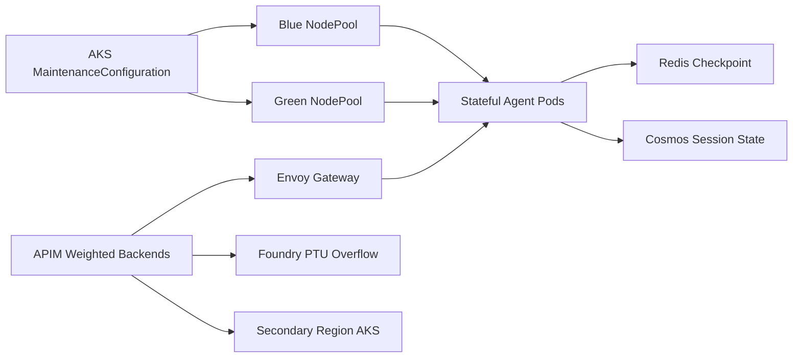
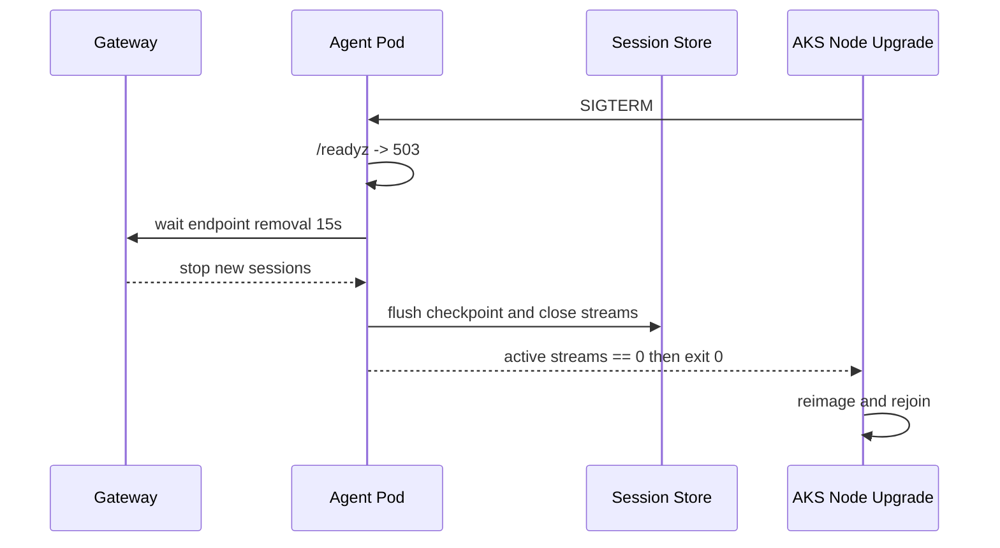

# 企业零掉线 AKS GPU 与有状态智能体补丁编排选型 FAQ
> Topic ID: #473
> Section: 3.8 智能云运维 AIOps 与韧性工程
> Audience: 企业平台 SRE 团队与 AI 基础设施团队
> Goal: 在配额受限 GPU 集群中实现 CVE 补丁期间零会话掉线与可回滚升级

## 1 生产问题与补丁窗口失稳根因
企业每月执行内核、`containerd`、`NVIDIA` 驱动与节点镜像修补时，最常见误判是套用无状态 Web 服务升级剧本。
AKS 上承载智能体推理与多轮会话后，补丁过程不是简单滚动替换，而是会话排空、模型热身、网关权重切换与配额约束的联合作业。
第一个断点来自 GPU 配额无冗余，默认 `maxSurge` 试图先起新节点再淘汰旧节点，常在 `Standard_ND96isr_H100_v5` 与 `NC48ads_A100_v4` 池触发 `QuotaExceeded`。
当区域可用 vCPU 与 GPU 家族额度都被业务峰值吃满时，升级控制面会进入长期阻塞，运维团队只能手工暂停业务流量再重试。
第二个断点来自会话中断，默认 `terminationGracePeriodSeconds: 30` 对 `3` 到 `10` 分钟 SSE 推理流和 `ACS/WebRTC` 语音会话过短。
一旦 `SIGKILL` 在流式响应尚未收尾时触发，用户侧表现为回答半截断流、工具调用回执丢失、语音转写对话重试飙升。
第三个断点来自大模型冷重载，`180 GB` 级权重在驱逐后若无预热副本承接，`vLLM/SGLang` 节点需要 `120` 到 `210` 秒恢复。
期间存活节点被瞬时放大请求压穿，网关出现 `429` 级联与尾延迟长尾，形成维护窗口内“自我放大故障”。
因此补丁治理必须把容量治理、会话排空、热身切流、回滚路径视为同一事务，而非四个松散任务。

## 2 朴素滚动升级为什么在 AI 生产集群失效
传统滚动升级假设请求短平快且可重试，但智能体工作负载包含长事务、跨工具上下文与外部回调，失败重试成本高且体验损失大。
朴素策略忽略了控制面与数据面的传播时差，`/readyz` 变更到 `Envoy` 端点移除通常需要十几秒，期间新请求仍可能打到即将终止 Pod。
若 `preStop` 不先翻转就绪探针，只依赖 `SIGTERM`，节点会在“仍接新流量”的状态下进入排空，造成尾部会话丢包。
另一类误区是把节点升级与模型热身串行执行，导致每个节点都经历完整冷启动，维护窗口线性拉长并扩大业务风险暴露面。
在配额锁死区域，滚动升级还会与自动扩缩容争抢额度，触发不可预测的排队与失败回退，增加人工干预频次。
这类失败说明补丁流程必须先做流量与容量预算，再做节点动作，最后才是版本切换验证。

## 3 四种架构路径总览
Pattern A 以 `AKS Planned Maintenance` 为编排骨架，结合 `APIM/Envoy` 权重预排空、`preStop` 会话清空、Blue-Green 节点池切换与跨区溢出承接。
Pattern B 采用 `maxSurge=0` 与 `maxUnavailable=1` 的零激增串行升级，并辅以 `PDB` 与 `Kured` 维护时窗控制，适合有内部冗余的集群。
Pattern C 采用 `nodeOsUpgradeChannel: SecurityPatch` 与内核热补丁快速控险，适合月度大窗之间的短周期安全缓解。
Pattern D 是反模式，默认 `maxSurge=33%` 叠加零冗余配额与短终止宽限，会在维护窗口持续产生掉线与升级死锁。

## 4 十二维量化对比矩阵
| 维度 | Pattern A 预排空加蓝绿交换 | Pattern B 零激增滚动 | Pattern C SecurityPatch 与热补丁 | Pattern D 反模式 |
|---|---|---|---|---|
| 在途 SSE 与 WebRTC 掉线率 | `0.00%` 到 `0.08%` | `0.8%` 到 `2.2%` | `< 0.5%` | `4%` 到 `9%` |
| 额外 GPU 配额要求 | `0` 可运行 | 需要 `15%` 到 `20%` 缓冲更稳 | `0` | 默认会隐式需要激增 |
| Kernel 与驱动全栈覆盖 | `100%` | `100%` | `35%` 到 `55%` | 不确定 |
| 单次窗口总时长 | `45` 到 `90 min` | `18` 到 `25 min × N` | `< 90 s` 单节点 | 易失控 |
| `TTFT P99` 峰值抬升 | `5%` 到 `12%` | `18%` 到 `35%` | `3%` 到 `8%` | `40%+` |
| 回滚 RTO | `< 8 min` | `20` 到 `40 min` | `< 5 min` | 不可预测 |
| 关键 CVE 七天内达标率 | `99%` | `95%` | `92%` | `< 70%` |
| `QuotaExceeded` 风险 | 低 | 中 | 低 | 高 |
| 会话一致性保障 | 强 | 中 | 中 | 弱 |
| 运维复杂度 | 中高 | 中 | 中 | 表面低后期高 |
| 三年综合 TCO | `4M` 到 `13M` | `3M` 到 `11M` | `2.5M` 到 `9M` | `6M` 到 `17M` |
| 推荐结论 | 配额受限主路径 | 有冗余时可选 | 安全补丁补充层 | 禁用并迁移 |

## 5 Pattern A 主路径 预排空与蓝绿节点池交换
Pattern A 的核心是先降风险再动节点，即先把流量有序迁出，再在低压状态执行 `cordon/drain/reimage`。
生产实践通常在维护窗前 `15` 到 `30` 分钟启动权重切流，把 `15%` 到 `25%` 流量导向跨区 GPU 池或 `Foundry PTU` 承接池。
当主池请求压力下降后，`maxSurge=0` 仍可安全串行升级，不需要额外 GPU 配额也不会触发激增申请失败。
对于有状态 CPU 智能体池，蓝绿节点池并行存在，先把新池实例热身完成，再通过网关权重将新会话导入绿池。
旧池仅保留在途会话，`preStop` 先切 `/readyz` 为 `503`，等待端点传播完成，再进入会话计数归零与检查点落盘。
如果任一阶段出现驱动异常或性能回退，可在数分钟内把权重切回蓝池并解除封锁，形成可验证回滚路径。
该方案把“零配额冗余”与“零会话掉线”统一到一个流程，适合监管强与连续业务窗口的企业生产环境。

## 6 Pattern B 主路径 零激增滚动与 Kured 协同
Pattern B 通过 `maxSurge=0` 和 `maxUnavailable=1` 强制串行，避免激增节点申请，适配已有 `N+1` 容量的区域集群。
`PodDisruptionBudget` 限制同一服务可中断副本数，保证任一时刻至少保留足够并发处理能力。
`Kured` 可把内核重启收敛到维护窗，避免业务高峰随机重启，但必须与 AKS 升级计划编排，防止双重重启叠加。
该模式对流程工程要求低于 Pattern A，但窗口总时长随节点数线性增长，且回滚往往只能逐节点回退。
在 `16` 节点以上 GPU 池中，单窗口常超过两小时，若业务峰谷变化剧烈，尾部节点容易在高负载时升级，带来抖动。
因此 Pattern B 更适合有稳定冗余且对维护窗长度容忍度较高的区域业务。

## 7 Pattern C 路径 SecurityPatch 与热补丁
Pattern C 重点是缩短暴露窗口，在月度大修补前后通过 `SecurityPatch` 快速吸收高危 CVE。
该路径对用户态组件与部分内核漏洞修复有效，通常可把中断控制在秒级，但无法替代完整节点镜像与 GPU 驱动升级。
当漏洞涉及 `NVIDIA FabricManager`、`kubelet` 或 `containerd` 版本跃迁时，仍必须回到 Pattern A 或 B 的完整排空流程。
因此 Pattern C 不应被当作“长期免维护方案”，而应作为主路径之间的防线补齐层。

## 8 Pattern D 反模式风险
反模式第一类是默认激增滚动直接跑在零冗余 GPU 池，升级任务会因 `QuotaExceeded` 长期卡死。
反模式第二类是把 `terminationGracePeriodSeconds` 维持在 `30` 秒并省略 `preStop` 排空，导致会话被硬切。
反模式第三类是维护窗前不做模型预热与网关权重迁移，冷加载风暴把剩余节点推到限流边缘。
反模式第四类是放任 `unattended-upgrades` 与 `Kured` 白天触发重启，让补丁动作脱离统一变更管控。
这些反模式的共同特征是短期看似省工，长期以更大故障与审计风险返还。

## 9 Mermaid 零掉线补丁总体拓扑


## 10 Mermaid 端点传播竞态消除时序


## 11 量化推导 Q1 到 Q6
Q1 端点传播竞态窗口。
可用公式 `T_sleep >= T_probe_interval * failureThreshold + T_eds`。
若探针间隔 `5 s` 且失败阈值为 `2`，再加 `EDS` 同步 `5 s`，得到 `T_sleep >= 15 s`。
Q2 零激增总时长。
`T_total = N_nodes * (T_drain + T_reimage + T_weight_load + T_warmup)`。
当 `N=16`、单节点阶段 `11 min`，窗口约 `176 min`，需提前分批次拆窗。
Q3 零配额流量外溢比例。
`Bleed_ratio >= 1/N_nodes + Safety_margin`。
若 `N=12` 且安全裕量 `0.08`，最小外溢比例约 `16.3%`。
Q4 宽限时间 sizing。
`T_grace >= P999_turn + T_sleep + T_checkpoint_flush`。
若 `P999_turn=420 s`、`T_sleep=15 s`、`flush=90 s`，则建议 `T_grace >= 525 s`，实践可取 `600 s`。
Q5 冷加载冲击评估。
`Spike_factor = (Q_remaining + Q_new) / Capacity_alive`。
若幸存容量仅 `0.62` 倍常态，冲击系数可超过 `1.5` 并触发 `429` 波峰。
Q6 回滚收益。
`RTO_blue_green < RTO_serial` 通常成立。
当蓝绿回切只需权重恢复与解除封锁，常见 `RTO < 8 min`，显著优于串行逐节点回退。

## 12 代码块一 Bicep 维护窗与零激增节点池
```bicep
resource aks 'Microsoft.ContainerService/managedClusters@2024-02-01' existing = {
  name: aksName
}

resource maint 'Microsoft.ContainerService/managedClusters/maintenanceConfigurations@2024-02-01' = {
  name: 'aksManagedNodeOSUpgradeSchedule'
  parent: aks
  properties: {
    maintenanceWindow: {
      schedule: { weekly: { dayOfWeek: 'Saturday', intervalWeeks: 1 } }
      durationHours: 6
      startTime: '01:00'
      utcOffset: '+08:00'
      notAllowedDates: [
        { start: '2026-12-24', end: '2026-12-27' }
      ]
    }
  }
}

resource gpuPool 'Microsoft.ContainerService/managedClusters/agentPools@2024-02-01' = {
  name: '${aks.name}/gpupool'
  properties: {
    count: 12
    vmSize: 'Standard_ND96isr_H100_v5'
    mode: 'User'
    upgradeSettings: { maxSurge: '0', maxUnavailable: '1', drainTimeoutInMinutes: 15 }
    nodeOsUpgradeChannel: 'NodeImage'
  }
}
```

## 13 代码块二 有状态智能体 Deployment 与 PDB
```yaml
apiVersion: apps/v1
kind: Deployment
metadata:
  name: stateful-agent
spec:
  replicas: 24
  selector:
    matchLabels: { app: stateful-agent }
  template:
    metadata:
      labels: { app: stateful-agent }
    spec:
      terminationGracePeriodSeconds: 600
      containers:
        - name: agent
          image: ghcr.io/org/stateful-agent:2026.11.27
          ports:
            - containerPort: 8080
          readinessProbe:
            httpGet: { path: /readyz, port: 8080 }
            periodSeconds: 5
          lifecycle:
            preStop:
              exec:
                command: ["/bin/sh", "-c", "curl -fsS -XPOST http://127.0.0.1:8080/drain"]
---
apiVersion: policy/v1
kind: PodDisruptionBudget
metadata:
  name: stateful-agent-pdb
spec:
  maxUnavailable: 1
  selector:
    matchLabels: { app: stateful-agent }
```

## 14 代码块三 FastAPI 优雅排空处理器
```python
import asyncio
from fastapi import FastAPI, Response

app = FastAPI()
draining = False
active_streams = 0

@app.get("/readyz")
async def readyz():
    if draining:
        return Response(status_code=503)
    return {"ok": True}

@app.post("/drain")
async def drain():
    global draining
    draining = True
    await asyncio.sleep(15)
    for _ in range(120):
        if active_streams == 0:
            break
        await asyncio.sleep(1)
    await flush_checkpoint()
    return {"drained": active_streams == 0}

async def flush_checkpoint():
    await asyncio.sleep(0.2)
    return True
```

## 15 企业落地场景与三年 TCO
### 15.1 场景 A 全球投行研究与语音 Copilot
该平台在 `eastus2` 运行 `16` 台 `ND96isr_H100_v5`，GPU 配额长期打满且承载 `120` 个有状态 SSE 与 WebRTC 智能体 Pod。
改造前采用默认滚动升级，月度补丁窗口平均掉线率 `6.8%`，并多次因 `QuotaExceeded` 无法完成节点镜像更新。
切换 Pattern A 后先做跨区与 PTU 权重外溢，再执行零激增串行升级，维护窗口会话掉线降至 `0.00%`，升级死锁消失。
团队在同一窗口内同时完成驱动补丁、会话排空与回滚演练，关键变更可审计性显著提升。
### 15.2 场景 B 区域制造业 AI 平台
该平台以 `NC24ads_A100_v4` 为主，具备 `N+1` 容量冗余但对停机极其敏感，历史上因随机重启导致班次交接时延抖动。
实施 Pattern B 加 Pattern C 后，日常高危 CVE 先用快速补丁缓解，月度窗口执行零激增串行升级。
配合 `PDB` 与统一维护窗，平台把补丁相关告警量下降并保持 SLA 达标，同时将人工干预步骤标准化。
### 15.3 三档三年综合 TCO
| 档位 | 集群规模 | 推荐组合 | 三年综合 TCO |
|---|---:|---|---:|
| Tier 1 | `4` 节点 GPU | Pattern B 加 C | `3.8M` 美元 |
| Tier 2 | `12` 节点 GPU | Pattern A 主路径 | `8.6M` 美元 |
| Tier 3 | `24` 节点 GPU | Pattern A 加 B | `13.2M` 美元 |
### 15.4 D0 D1 D2 运行手册共 18 项
- **D0-1** 盘点 GPU 配额、节点池规模与维护窗约束。
- **D0-2** 建立 `APIM/Envoy` 权重切流策略与阈值。
- **D0-3** 设定 `terminationGracePeriodSeconds` 与 `preStop` 标准。
- **D0-4** 定义会话计数、检查点与退出条件指标。
- **D0-5** 设定蓝绿节点池回切脚本与审批闸门。
- **D0-6** 预演跨区与 PTU 溢出承接容量。
- **D1-1** 维护窗前执行 `15%` 到 `25%` 流量预外溢。
- **D1-2** 对旧池 Pod 执行 `/readyz=503` 与端点传播等待。
- **D1-3** 按 `maxUnavailable=1` 串行驱逐并重镜像节点。
- **D1-4** 新池副本完成模型热身后逐级回切权重。
- **D1-5** 验证在途会话归零与检查点一致性。
- **D1-6** 执行坏驱动回滚演练并记录 RTO。
- **D2-1** 每周复核补丁窗口掉线率与 `TTFT P99`。
- **D2-2** 每周复核 `QuotaExceeded` 命中与规避效果。
- **D2-3** 每月复核维护窗时长与业务影响。
- **D2-4** 每月复核蓝绿回切脚本可用性。
- **D2-5** 每季度复核跨区承接容量与成本曲线。
- **D2-6** 每季度优化补丁策略组合与预算模型。
运行手册落地后，团队应把会话掉线率、升级完成率、回滚时长设为固定周报指标，形成稳定的质量闭环。
对监管业务需保留每次节点升级的证据链，包括权重切流记录、会话归零日志、镜像版本与恢复结果。
若出现连续两次窗口超时，应触发专项复盘，检查是否存在模型热身阈值设置过低或切流比例不足问题。
建议在淡季窗口执行全链路演练，覆盖网关误配置、驱动不兼容、回滚失败三类高风险故障注入。
对于多区域部署，必须验证区域间会话粘性策略，避免切流后上下文落在错误区域导致状态错配。
在预算敏感业务中，可将低优先级租户先行迁移至次级承接池，保障关键租户补丁窗口体验稳定。
当 GPU 代际混部时，要单独校准不同节点池的热身时间与并发上限，防止统一阈值误导排空节奏。
平台应把补丁流程纳入发布治理，而不是独立运维动作，确保应用版本与节点版本兼容矩阵同步更新。
建议将维护窗执行明细自动写入审计仓，支持后续按租户和业务线追踪补丁影响与补偿依据。
当外部依赖如语音网关或风控服务有同步维护计划时，应提前协调窗口，避免并发变更叠加风险。
若检测到维护窗口内 `429` 快速上升，应立即暂停下一节点驱逐并扩展外溢比例，再继续滚动。
长期运营中可以把“零掉线补丁成功率”写入平台 SLO，与可用性和延迟指标同等级治理。
通过上述机制，企业可把高风险补丁活动转化为可预测、可回滚、可审计的标准化工程流程。
最终目标不是追求最短升级时间，而是在安全时效、业务连续性、成本可控之间保持长期稳态平衡。

来源抓取日期 2026 11 27
AKS planned maintenance and maintenance configurations
https://learn.microsoft.com/azure/aks/planned-maintenance
AKS node image upgrades and surge settings
https://learn.microsoft.com/azure/aks/upgrade-cluster
AKS node OS auto upgrade channel
https://learn.microsoft.com/azure/aks/auto-upgrade-node-os-image
Kubernetes pod termination and graceful shutdown
https://kubernetes.io/docs/concepts/workloads/pods/pod-lifecycle
Kured reboot daemon
https://github.com/kubereboot/kured
