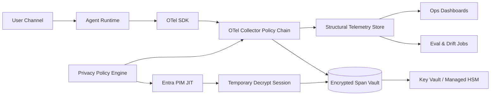
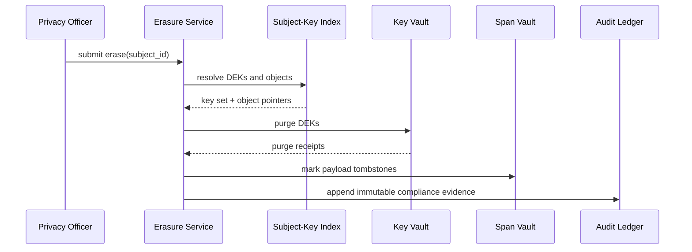
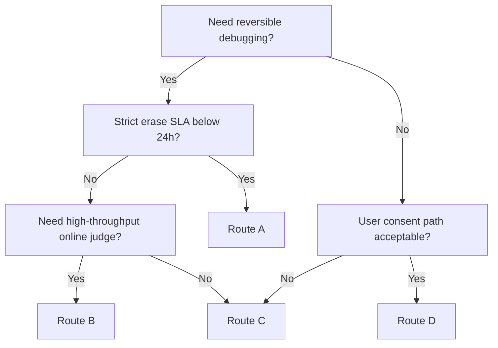

# Enterprise Zero-PII LLMOps Trace Debugging Selection FAQ: Claim-Check Span Vault vs OTel HMAC Pseudonymization vs ε-DP Structural Clustering vs User-Initiated Diagnostic Snapshots

> **Audience**: Cloud and AI Solution Architects, platform engineering leads, LLMOps operators, privacy counsel, security governance teams, and incident response owners.
> **Decision problem**: in regulated production, `OTEL_INSTRUMENTATION_GENAI_CAPTURE_MESSAGE_CONTENT=true` can contaminate immutable telemetry planes with toxic PII, while setting it to `false` blinds root-cause workflows for hallucinations, tool arguments, and policy failures.

---

## 1) Executive summary: choose by risk envelope, not by convenience

You can break the observability-vs-privacy deadlock only if you separate **debug signal**, **identity signal**, and **content signal** across different control planes.

Recommended decision thresholds:

- If you need **reversible debugging** and **provable erasure** together, choose **Route A**.
- If you need **high-throughput online evaluation** with stable multi-turn co-reference, choose **Route B**.
- If your primary objective is **minimum exposure by design** and you can accept lower debugging fidelity, choose **Route C**.
- If your legal model requires **explicit user intent before any payload capture**, choose **Route D**.

Practical gates:

- GDPR erasure SLO: `P95 <= 24h`, highly regulated environments target `P95 <= 4h`.
- Added runtime overhead: keep telemetry-induced `p99` latency increase under `+20ms`.
- Residual sensitive-token leakage risk: `< 1e-5` per trace for high-risk entities.
- Break-glass access: dual-custody approval, fixed `15-minute` JIT entitlement, immutable audit chain.

---

## 2) Why the deadlock appears in real programs

The deadlock is structural, not operational:

1. **Append-only evidence stores conflict with erase obligations**
   Operations teams optimize for tamper-evident append paths, while privacy law requires irreversible subject-level deletion under statutory timelines.

2. **Full payload capture accelerates debugging but widens blast radius**
   Prompt and completion text leaks into search indexes, exports, BI replicas, and downstream analyst workflows.

3. **Cross-team visibility erodes least privilege**
   SRE, prompt engineers, model risk, and compliance all need some signal; without decomposition, everyone asks for full-text access.

4. **Inline redaction has measurable latency and CPU costs**
   NER, pattern scanners, and token replacement pipelines can consume budgets intended for inference.

---

## 3) Route definitions (A/B/C/D)

### Route A — Claim-check envelope encryption with span vault and Entra PIM JIT break-glass

- OpenTelemetry span carries only structural metadata and a pointer URI.
- Sensitive payload is envelope-encrypted and stored in a vault tier.
- Per-subject DEK mapping allows `O(1)` cryptographic erasure via key purge.
- Decryption requires dual-approval JIT elevation with full evidence capture.

### Route B — Inline format-preserving HMAC pseudonymization in the collector path

- Sensitive entities are detected by deterministic plus ML-assisted recognizers.
- Cleartext entities are replaced by stable pseudonyms, for example `[IBAN_8f3a]`.
- Multi-turn co-reference remains analyzable because aliases remain stable in epoch windows.
- Works well when engineers need high-volume debugging without storing cleartext PII.

### Route C — Zero-payload structural telemetry plus local ε-DP failure clustering

- No prompt/completion bytes are persisted at all.
- Only structural fields are emitted: latency, token counts, tool route, policy outcomes.
- Local in-memory clustering computes aggregate failure signatures and exports noisy counts.
- Strongest data minimization posture, weakest per-case forensic depth.

### Route D — Explicit user-initiated diagnostics plus synthetic full-capture staging

- Production background capture excludes payload content by default.
- A signed one-session consent bundle is created only when the user reports a bad answer.
- Full-fidelity replay occurs in an isolated staging lane with strict TTL controls.
- Lowest background exposure, but debugging throughput depends on user participation.

---

## 4) Architecture principles and quantitative invariants

### 4.1 Erasure guarantee invariant

`T_erase = T(request_to_irreversible_unrecoverability)`

Policy gate:

`P95(T_erase) <= T_policy`

Interpretation: if decryptability remains possible after `T_policy`, compliance failed even when records were hidden from regular dashboards.

### 4.2 Residual leak probability under imperfect detection

Let `R` be detection recall for sensitive entities and `k` the number of sensitive entities per trace:

`P_residual = 1 - R^k`

This clarifies why pseudo-redaction alone cannot be your only control in high-consequence domains.

### 4.3 Differential privacy utility bound

For count queries under Laplace mechanism, noise scale is `b = 1/ε`.

Minimum sample size for target relative error `δ` at confidence `1-α`:

`n_min >= z_(1-α/2) * b / δ`

If `ε` is too small, low-frequency incidents collapse into noise.

### 4.4 Collector latency budget

`Δp99 = Δparse + Δdetect + Δreplace + Δexport`

Runtime policy:

`Δp99 <= 20ms`

If this threshold is breached, apply route-by-risk segmentation rather than global redaction inflation.

### 4.5 Break-glass exposure window

`W_exposure = TTL_jit * N_sessions_open * P_misuse`

Short TTL, one-shot scopes, and dual approval reduce the effective exposure envelope.

### 4.6 Judge fidelity under pseudonyms

`F_judge = Corr(score_cleartext, score_pseudonymized)`

Use release gates only when `F_judge >= 0.9` and re-validate after every pseudonymization pattern revision.

---

## 5) Mermaid diagram: control-plane separation for zero-PII observability



---

## 6) Mermaid diagram: Route A erase and break-glass sequence



---

## 7) Mermaid diagram: route selection decision tree



---

## 8) Twelve-dimension comparison matrix

| Dimension | Route A Claim-Check Vault | Route B HMAC Pseudonymization | Route C Structural + ε-DP | Route D User Snapshot |
|---|---|---|---|---|
| Erasure confidence | Very high via key shredding | Medium, depends on detector quality | Very high by design | High with strict consent model |
| Root-cause depth | High | Medium-high | Low | Medium |
| Runtime latency overhead | Medium | Medium-high | Low | Low |
| Engineering complexity | High | Medium | Medium | Medium |
| Least-privilege enforceability | High with PIM controls | Medium | High | High |
| Multi-turn semantic continuity | High | High | Low | Medium |
| Forensic reproducibility | High | Medium-high | Medium-low | Medium |
| Cost profile | Higher platform and governance | Compute-heavy collector path | Lower telemetry storage | Lower background cost, higher support friction |
| Cross-region governance | Strong with region-scoped keys | Requires salt-domain rigor | Straightforward | Straightforward |
| LLM judge compatibility | High | Medium-high | Low | Medium |
| Incident response speed | High once controls mature | Medium-high | Medium | Medium-low |
| Typical fit | Banking, healthcare, public sector | Enterprise SaaS at scale | Privacy-max environments | Consumer and strict consent-first programs |

---

## 9) Quantitative deep-dive Q1..Q6

### Q1 — How do you satisfy GDPR erasure without massive ADX/Parquet rewrite churn?

Physical row-level deletion in immutable or append-focused systems can trigger heavy compaction and reindexing cycles:

`C_rewrite ≈ V_daily * Retention_days * C_io_per_tb`

Route A transforms this into key-centric irrecoverability:

`C_erase_claimcheck ≈ C_key_purge + C_audit_append`

The operational implication is dramatic: compliance SLA no longer depends on scanning and rewriting historical telemetry partitions.

### Q2 — What is the residual leakage risk when pseudonymization recall is high but not perfect?

Using `P_residual = 1 - R^k`, even high recall can leave measurable risk.

Example:

- `R = 0.995`
- `k = 10`

`P_residual ≈ 4.9%`

So Route B should be paired with policy-based tenant segmentation:

- high-risk tenants escalated to Route A,
- low-risk workflows can remain on Route B with continuous validation.

### Q3 — What is the ε-DP utility trade-off for low-frequency failure clusters?

When failure clusters are rare, DP noise can dominate signal.

Approximate signal-to-noise condition:

`c_true >> 1/ε`

If your rare-but-critical incident class appears only a few times per day, set route-specific monitoring:

- structural DP metrics for trend posture,
- controlled forensic lane for root-cause completion.

### Q4 — Can collector-side pseudonymization stay within a strict p99 budget?

Suppose measured overhead components:

- parse: `2.1ms`
- NER detect: `8.2ms`
- pseudonym rewrite: `1.6ms`
- export: `2.9ms`

Total:

`Δp99 = 14.8ms`

This stays inside a `20ms` envelope but requires explicit capacity policy:

- reserve CPU headroom,
- isolate collector pools for high-risk routes,
- enforce autoscaling based on queue depth and latency.

### Q5 — How should break-glass controls be tuned for auditable emergency use?

Minimum control set:

- dual custody approval (operations + compliance),
- immutable reason code and ticket binding,
- one-session scope,
- TTL fixed to `15 minutes`,
- automatic revocation and audit emission on completion.

Risk expression:

`Risk_bg = P_unauthorized * Duration_exposed * Data_scope`

All three factors should be bounded in policy, not in human convention.

### Q6 — How much evaluation fidelity is lost after pseudonymization?

Measure with rank and absolute-score agreement:

`F_rank = Spearman(clear, pseudo)`
`F_abs = 1 - MAE(clear, pseudo) / Score_range`

Gate recommendation:

- `F_rank >= 0.9`
- `F_abs >= 0.85`

Below threshold, adapt judge prompts to pseudonym tokens and retrain calibration curves.

---

## 10) Production implementation block A: Python OTel span claim-check envelope encryptor

```python
import os
import json
from dataclasses import dataclass
from cryptography.hazmat.primitives.ciphers.aead import AESGCM
from opentelemetry.sdk.trace.export import SpanExporter, SpanExportResult

@dataclass
class SubjectKeyRef:
    tenant_id: str
    subject_id: str
    dek: bytes

class ClaimCheckExporter(SpanExporter):
    def __init__(self, wrapped: SpanExporter, vault, key_lookup):
        self._wrapped = wrapped
        self._vault = vault
        self._key_lookup = key_lookup

    def _encrypt_payload(self, key_ref: SubjectKeyRef, payload: dict, span_id: str) -> str:
        nonce = os.urandom(12)
        body = json.dumps(payload, ensure_ascii=False).encode("utf-8")
        ciphertext = AESGCM(key_ref.dek).encrypt(nonce, body, None)
        object_id = f"{key_ref.tenant_id}/{key_ref.subject_id}/{span_id}.bin"
        self._vault.upload(object_id, nonce + ciphertext)
        return f"blob://span-vault/{object_id}"

    def export(self, spans):
        rewritten = []
        for span in spans:
            attrs = dict(span.attributes)
            prompt = attrs.get("genai.prompt")
            completion = attrs.get("genai.completion")
            if prompt or completion:
                key_ref = self._key_lookup(
                    tenant_id=attrs.get("tenant.id", "unknown"),
                    subject_id=attrs.get("subject.id", "anonymous"),
                )
                uri = self._encrypt_payload(
                    key_ref,
                    {"prompt": prompt, "completion": completion},
                    str(span.context.span_id),
                )
                attrs["claimcheck.uri"] = uri
                attrs["privacy.route"] = "claim_check"
                attrs.pop("genai.prompt", None)
                attrs.pop("genai.completion", None)
            span.attributes.clear()
            span.attributes.update(attrs)
            rewritten.append(span)
        return self._wrapped.export(rewritten)

    def shutdown(self):
        self._wrapped.shutdown()
        return SpanExportResult.SUCCESS
```

---

## 11) Production implementation block B: collector policy chain + KQL + PIM guardrails

```yaml
receivers:
  otlp:
    protocols:
      grpc:
      http:

processors:
  memory_limiter:
    check_interval: 1s
    limit_mib: 1024
  transform/pseudonymize:
    error_mode: ignore
    trace_statements:
      - context: span
        statements:
          - set(attributes["genai.prompt"], replace_pattern(attributes["genai.prompt"], "\\b\\d{12,19}\\b", "[CARD_HASH]"))
          - set(attributes["genai.prompt"], replace_pattern(attributes["genai.prompt"], "\\b[A-Z]{2}\\d{2}[A-Z0-9]{1,30}\\b", "[IBAN_HASH]"))
          - set(attributes["privacy.route"], "hmac_pseudonymized")
  filter/highrisk_to_claimcheck:
    traces:
      span:
        - attributes["tenant.risk"] == "regulated" and attributes["privacy.route"] != "claim_check"
  batch:
    send_batch_size: 2048
    timeout: 2s

exporters:
  azuremonitor:
    connection_string: ${APPLICATIONINSIGHTS_CONNECTION_STRING}

service:
  pipelines:
    traces:
      receivers: [otlp]
      processors: [memory_limiter, transform/pseudonymize, filter/highrisk_to_claimcheck, batch]
      exporters: [azuremonitor]
```

```kusto
traces
| where timestamp > ago(1d)
| summarize p95=percentile(duration, 95), failures=countif(severityLevel >= 3)
          by route=tostring(customDimensions["privacy.route"]),
             tenant=tostring(customDimensions["tenant.id"])
| order by failures desc
```

PIM policy baseline:

- Eligible role only (no permanent assignment).
- Approval required from two distinct approvers.
- Assignment duration capped at `15m`.
- Ticket ID and incident hash mandatory in justification field.
- Post-access attestation and weekly compliance review.

---

## 12) Enterprise scenario A: EU retail bank wealth copilot under GDPR and BaFin

Operating constraints:

- Cross-border users with deletion rights and strict retention controls.
- Advisory outputs require explainability and post-incident forensic traceability.
- Works council requires narrowly scoped employee access to customer-originated text.

Recommended architecture:

- Route A as default for regulated tenant segments.
- Route B only for low-sensitivity analytic cohorts after legal sign-off.
- Route-specific key domains by region to enforce residency and legal boundary separation.

Target outcomes:

- erasure `P95 < 4h`,
- zero unauthorized payload access,
- stable release-gate quality with pseudonymized evaluator correlation above threshold.

---

## 13) Enterprise scenario B: multi-hospital clinical documentation agent under HIPAA

Operating constraints:

- PHI must not be retained in broad-access analytics systems.
- Engineers still need timely diagnosis of summarization omissions and tool parameter defects.
- Incident evidence must remain auditable for internal and external reviews.

Recommended architecture:

- Route C as baseline telemetry posture for all sites.
- Route D for explicit clinician-reported incident snapshots.
- Route A for designated critical units requiring controlled forensic reversibility.

Target outcomes:

- PHI cleartext leakage in telemetry: zero,
- MTTR reduction through structured telemetry and selective snapshot workflow,
- audit conformance for access and retention controls.

---

## 14) Three-year TCO model (illustrative)

| Cost bucket (USD) | Route A | Route B | Route C | Route D |
|---|---:|---:|---:|---:|
| Platform engineering and security integration | 1,280,000 | 980,000 | 760,000 | 700,000 |
| Telemetry storage and query workload | 430,000 | 410,000 | 230,000 | 190,000 |
| Compliance operations and audit readiness | 370,000 | 290,000 | 220,000 | 250,000 |
| Incident response and remediation overhead | 140,000 | 220,000 | 130,000 | 180,000 |
| Total 3-year TCO | 2,220,000 | 1,900,000 | 1,340,000 | 1,320,000 |

Interpretation:

- Route A carries the highest direct spend but the strongest legal defensibility in strict regimes.
- Route C and D minimize passive data exposure but can externalize cost into slower root-cause closure.
- Route B balances debuggability and cost at scale but needs continuous residual-risk governance.

---

## 15) Day-0 / Day-1 / Day-2 rollout checklist

### Day-0 (architecture and governance alignment)

- Define data classes: structural telemetry, sensitive payload, identity artifacts, policy events.
- Define route assignment policy by tenant risk tier.
- Approve erasure SLO, evidence schema, and legal attestation workflow.
- Define route escalation and downgrade triggers.

### Day-1 (implementation and release gates)

- Instrument OTel semantic conventions for GenAI spans.
- Implement route-aware collector pipeline policies.
- Deploy key hierarchy and subject-key index service for claim-check route.
- Configure Entra PIM JIT workflow and immutable audit sink.
- Add release gates for latency overhead and evaluator fidelity.

### Day-2 (operations and continuous control)

- Weekly validation of `P_residual`, `Δp99`, and `F_judge`.
- Monthly break-glass tabletop and erasure-runbook execution drill.
- Quarterly route reclassification by tenant behavior and legal updates.
- Continuous drift checks for pseudonym dictionaries and detector quality.

---

## Good fit vs not for

### Good fit

- Organizations with strong privacy obligations and active regulator scrutiny.
- Teams that need both root-cause observability and auditable data minimization.
- Multi-tenant SaaS environments with differentiated risk tiers.

### Not for

- Early prototypes with no legal or contractual privacy commitments.
- Teams without IAM governance maturity for JIT privileged workflows.
- Environments that cannot sustain route-specific operational complexity.

---

## Authoritative references

- OpenTelemetry GenAI semantic conventions: https://opentelemetry.io/docs/specs/semconv/gen-ai/
- Azure Monitor OpenTelemetry guidance: https://learn.microsoft.com/azure/azure-monitor/app/opentelemetry-overview
- Microsoft Entra Privileged Identity Management: https://learn.microsoft.com/entra/id-governance/privileged-identity-management/pim-configure
- Azure Key Vault concepts: https://learn.microsoft.com/azure/key-vault/general/basic-concepts
- GDPR Article 17 text: https://gdpr-info.eu/art-17-gdpr/
- HIPAA Security Rule overview: https://www.hhs.gov/hipaa/for-professionals/security/laws-regulations/
- NIST Privacy Framework: https://www.nist.gov/privacy-framework

