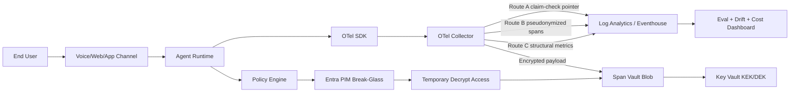
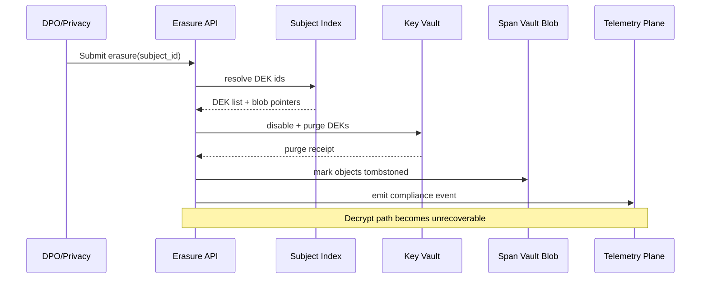
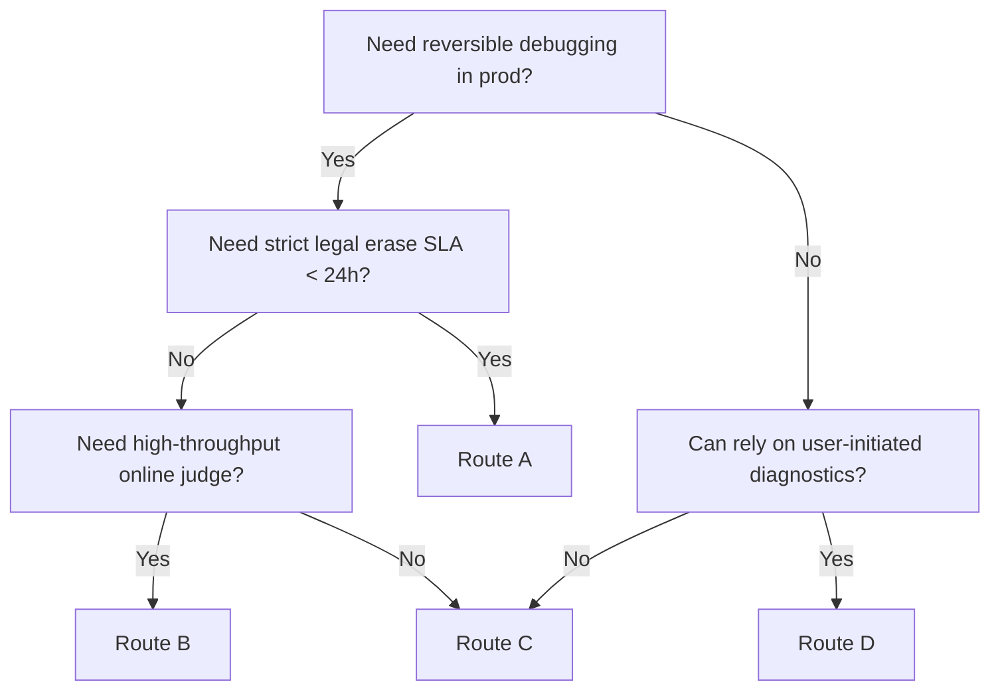

# 企业零 PII LLMOps 可观测与可调试选型 FAQ：Claim-Check 加密 Span Vault vs OTel HMAC 伪名化 vs ε-DP 结构化聚类 vs 用户显式诊断快照

> **适用对象**：Cloud & AI Solution Architect、平台工程、LLMOps、合规与法务、SRE 与 SOC 联合团队。
> **问题定义**：当 `OTEL_INSTRUMENTATION_GENAI_CAPTURE_MESSAGE_CONTENT=true` 时，生产遥测会把 Prompt/Completion 明文写入不可变审计存储，触发 GDPR Art.17、HIPAA、工会与本地隐私法冲突；当其为 `false` 时，工程团队失去根因定位能力，出现“可合规但不可运维”的死锁。

---

## 1. 执行摘要（先给决策，再给细节）

如果你正在建设受监管行业的生产 Agent 平台，推荐按以下阈值决策：

- 需要**可逆调试**与**可擦除合规**并存，优先 **Route A（Claim-Check + 加密 Vault + PIM JIT）**。
- 需要**高吞吐在线评测**，且多轮对话指代保持要求高，优先 **Route B（Collector 内联 HMAC 伪名化）**。
- 需要**最小数据暴露面**，并接受调试深度下降，优先 **Route C（零内容结构遥测 + ε-DP 聚类）**。
- 组织对“默认后台采集”零容忍，强调用户主导授权，优先 **Route D（显式报错快照 + 合成环境全捕获）**。

关键门槛建议：

- **GDPR 删除 SLA**：`P95 <= 24h`，金融与医疗场景建议 `P95 <= 4h`。
- **遥测附加时延**：在线推理链路 `p99` 增量不超过 `+20ms`。
- **PII 残留风险**：对高敏字段（IBAN、SSN、MRN）要求残留概率 `< 1e-5/trace`。
- **Break-Glass 审批**：双人授权，默认 `15min` 时效，审计日志完整可追溯。

---

## 2. 死锁根因：可观测性与隐私目标在同一数据平面的冲突

死锁来自四个结构矛盾：

1. **不可变存储 vs 可删除义务**
   Log Analytics、Eventhouse、WORM 审计层强调追加不可改；GDPR Art.17 要求在法定时限内删除可识别数据。

2. **明文调试收益 vs 泄漏面扩张**
   明文 Prompt 能加速排障，但会将诊断数据外溢到 BI、报表、副本、导出与备份链路。

3. **跨团队协同 vs 最小权限原则**
   SRE、提示工程、模型治理、法务都想访问同一证据，导致权限扩散与职责边界模糊。

4. **线上低时延 vs 在线脱敏算力成本**
   NER、规则匹配、哈希映射会增加 CPU 与尾延迟；高峰时段容易挤压推理资源。

---

## 3. 四条架构路线（A/B/C/D）定义

### Route A：Claim-Check 包络加密 Span Vault + Entra PIM Break-Glass

- Span 仅保留结构字段：`tenant_id`、`session_id`、`tool_name`、`status`、`latency_ms`、`policy_verdict`。
- 原文内容经包络加密后写入对象存储，Span 中仅写 `blob://...` URI 与摘要指针。
- 每主体 DEK（Data Encryption Key）独立，映射在 Key Vault / Cosmos 索引。
- 删除请求通过“密钥粉碎”达到 `O(1)` 擦除语义，避免全表重写。

### Route B：OTel Collector 内联格式保持 HMAC 伪名化

- 通过 Presidio / Azure AI Language NER 提取敏感实体。
- 使用 epoch-salt HMAC 把实体替换为稳定伪名，如 `[IBAN_8f3a]`、`[MRN_f1c2]`。
- 支持跨轮关联分析与在线 LLM-as-a-Judge，不落明文。
- 适合需要高覆盖调试、但可接受少量残留风险的团队。

### Route C：零内容结构遥测 + 本地 ε-DP 失败聚类

- 生产链路不写入任何 prompt/completion bytes。
- 仅输出结构指标：token、latency、tool_error_code、route_id、policy_hit。
- 在本地内存执行失败聚类，写出加噪后的聚合计数。
- 对隐私最友好，但对具体根因定位能力最弱。

### Route D：显式“报告问题”诊断快照 + 合成环境全捕获

- 生产默认零内容日志。
- 仅当用户点击“报告错误答案”时，收集一次性签名快照。
- 通过一次性 session key、短 TTL、用途绑定来降低滥用。
- 适合高合规组织，但排障吞吐依赖用户参与。

---

## 4. 设计原则与量化公式

### 4.1 删除服务等级目标

`SLA_erase = P95(T_submit_to_unrecoverable) <= T_policy`

- 金融建议 `T_policy = 4h`。
- 一般企业建议 `T_policy = 24h`。

### 4.2 残留泄漏概率

设单实体识别召回率为 `R`，单对话包含 `k` 个高敏实体，残留概率：

`P_residual = 1 - R^k`

例如 `R=0.995, k=8`，则 `P_residual ≈ 3.94%`，说明仅靠 NER 仍需防线叠加。

### 4.3 DP 统计实用性边界

对于计数查询，拉普拉斯机制噪声尺度 `b = 1/ε`。
若需要相对误差 `δ`，样本规模下界可估算：

`n_min >= z_(1-α/2) * b / δ`

当 `ε` 过低时，低频故障信号会被噪声淹没。

### 4.4 收集器开销预算

`Δp99_total = Δp99_parse + Δp99_ner + Δp99_hmac + Δp99_export`

生产门禁建议：`Δp99_total <= 20ms`。

### 4.5 Break-Glass 风险窗口

`W_exposure = N_approvers * TTL_jit * P_misuse`

双人审批可有效降低 `P_misuse`，但会增加应急时延。

### 4.6 调试有效性保真度

`F_debug = Corr(score_cleartext, score_redacted)`

若 `F_debug < 0.9`，需重训评审器或改进伪名模板。

---

## 5. Mermaid：分层解耦的零 PII 生产可观测架构



---

## 6. Mermaid：Route A 删除请求与 JIT 解密序列



---

## 7. Mermaid：Route 选择决策树



---

## 8. 12 维度对比矩阵（A/B/C/D）

| 维度 | Route A Claim-Check Vault | Route B HMAC 伪名化 | Route C 零内容 + ε-DP | Route D 显式快照 |
|---|---|---|---|---|
| 合规删除能力 | 极强，密钥粉碎 | 中等，需重放替换 | 极强，几乎无内容 | 强，内容最少 |
| 调试深度 | 高，可审计解密 | 中高，语义受损小 | 低，仅结构统计 | 中，依赖用户触发 |
| 线上时延开销 | 中（指针写入） | 中高（NER+HMAC） | 低 | 低 |
| 工程复杂度 | 高 | 中 | 中 | 中 |
| 误用风险 | 受控于 PIM | 主要在盐管理 | 低 | 低 |
| 多轮关联能力 | 高 | 高（稳定伪名） | 低 | 中 |
| 成本结构 | Vault + KV + 审批 | CPU + Collector 扩容 | 统计服务成本低 | 工单与客服成本高 |
| 取证可追溯 | 强 | 强 | 中 | 中 |
| 跨区域复制治理 | 可做区域密钥隔离 | 需盐域隔离 | 简单 | 简单 |
| LLM Judge 适配 | 高 | 中高 | 低 | 中 |
| SOC 协同体验 | 高 | 中 | 中 | 低到中 |
| 典型适用行业 | 金融/医疗/政府 | 零售/互联网金融 | 超高隐私研发 | 消费产品与工会敏感组织 |

---

## 9. 定量深挖 Q1..Q6

### Q1：GDPR 删除 SLA 如何与 ADX/Parquet 压实冲突共存？

若直接物理删行，存储重写成本：

`C_rewrite ≈ V_daily * R_retain * C_io`

其中 `V_daily` 为日入库体积，`R_retain` 为保留天数。
Route A 通过密钥粉碎把复杂度降为：

`C_shred ≈ O(1) + C_audit`

可把删除从“重写 TB 级数据”转为“撤销密钥 + 合规凭证”。

### Q2：NER 召回不足会带来多大残留泄漏概率？

`P_residual = 1 - R^k`。
示例：`R=0.99, k=12`，`P_residual ≈ 11.4%`。
这意味着 Route B 必须叠加正则、字典、上下文模式、人工抽检与高风险租户 Route A 升级策略。

### Q3：ε-DP 对故障聚类可用性的影响如何量化？

对低频故障簇（真实计数 `c`），加噪后观测方差近似：

`Var(c') = 2/ε^2`

当 `c << 1/ε` 时，监控告警易失真。
生产建议：核心 SLO 告警不依赖 DP 单源，改用多信号交叉。

### Q4：Collector 伪名化会不会把 p99 时延推爆？

假设：

- `T_parse = 2ms`
- `T_ner = 7ms`
- `T_hmac = 1.5ms`
- `T_export = 3ms`

则：

`Δp99_total = 13.5ms`

在 `20ms` 预算内，但高峰期需预留 30% CPU headroom，避免与推理实例抢核。

### Q5：Break-Glass 如何做到“可用但不可滥用”？

推荐控制：

- 双审批（平台负责人 + 合规负责人）。
- JIT 令牌 `TTL=15min`，不可续期。
- 一次性查询上限（例如最多 `N=5` 条 span payload）。
- 审批理由、工单号、会话哈希强绑定。

风险可近似表达为：

`Risk_bg = P(unauthorized_approval) * Exposure_window`

通过双人审批与用途绑定显著降低第一项。

### Q6：伪名化后 LLM-Judge 分数还能信吗？

定义保真度：

`F_debug = Spearman(Score_clear, Score_pseudo)`

若 `F_debug >= 0.9`，可用于发布门禁；
若低于阈值，需针对伪名模板做 prompt 适配，避免 `[IBAN_xxxx]` 影响语义判断。

---

## 10. 生产实现示例 A：Python Claim-Check 包络加密 SpanProcessor

```python
import base64
import json
import os
from cryptography.hazmat.primitives.ciphers.aead import AESGCM
from opentelemetry.sdk.trace.export import SpanExporter, SpanExportResult

class ClaimCheckEncryptingExporter(SpanExporter):
    def __init__(self, inner_exporter, blob_client, dek_resolver):
        self.inner = inner_exporter
        self.blob = blob_client
        self.dek_resolver = dek_resolver

    def export(self, spans):
        rewritten = []
        for span in spans:
            attrs = dict(span.attributes)
            tenant_id = attrs.get("tenant.id", "unknown")
            subject_id = attrs.get("subject.id", "anonymous")
            content = attrs.get("genai.prompt") or attrs.get("genai.completion")
            if content:
                dek = self.dek_resolver(tenant_id, subject_id)  # 32 bytes
                nonce = os.urandom(12)
                cipher = AESGCM(dek)
                payload = json.dumps({"content": content}).encode("utf-8")
                ct = cipher.encrypt(nonce, payload, None)
                blob_id = f"{tenant_id}/{subject_id}/{span.context.span_id}.bin"
                self.blob.upload_blob(blob_id, nonce + ct, overwrite=True)
                attrs["claimcheck.uri"] = f"blob://span-vault/{blob_id}"
                attrs["claimcheck.sha256"] = base64.b64encode(ct[:16]).decode("ascii")
                attrs.pop("genai.prompt", None)
                attrs.pop("genai.completion", None)
            span.attributes.clear()
            span.attributes.update(attrs)
            rewritten.append(span)
        return self.inner.export(rewritten)

    def shutdown(self):
        self.inner.shutdown()
        return SpanExportResult.SUCCESS
```

---

## 11. 生产实现示例 B：OTel Collector 伪名化与策略门禁

```yaml
receivers:
  otlp:
    protocols:
      grpc:
      http:

processors:
  batch:
    timeout: 2s
  memory_limiter:
    check_interval: 1s
    limit_mib: 1024
  transform/pii_hmac:
    error_mode: ignore
    trace_statements:
      - context: span
        statements:
          - set(attributes["genai.prompt"], replace_pattern(attributes["genai.prompt"], "\\b[A-Z]{2}\\d{2}[A-Z0-9]{1,30}\\b", "[IBAN_HASH]"))
          - set(attributes["privacy.mode"], "hmac_pseudonymized")
  filter/high_risk:
    traces:
      span:
        - attributes["tenant.risk"] == "regulated" and attributes["privacy.mode"] != "claim_check"

exporters:
  azuremonitor:
    connection_string: ${APPLICATIONINSIGHTS_CONNECTION_STRING}

service:
  pipelines:
    traces:
      receivers: [otlp]
      processors: [memory_limiter, transform/pii_hmac, filter/high_risk, batch]
      exporters: [azuremonitor]
```

KQL 示例（结构化失败聚类）：

```kusto
traces
| where timestamp > ago(24h)
| where customDimensions["privacy.mode"] in ("claim_check", "hmac_pseudonymized", "structural_only")
| summarize failures=countif(severityLevel >= 3), p95_latency=percentile(duration, 95)
          by route=tostring(customDimensions["route.id"]), tenant=tostring(customDimensions["tenant.id"])
| order by failures desc
```

---

## 12. 企业场景一：欧盟零售银行财富顾问 Copilot（GDPR + BaFin）

业务约束：

- 跨国客户，需满足 GDPR 删除请求与数据最小化。
- 投资建议有审计追责需求，需要复盘工具调用路径。
- 工会要求严格限制员工可见客户原文。

推荐方案：

- 主路径用 Route A，重点客户启用双区域密钥隔离。
- 风险较低租户补充 Route B 提升评测吞吐。
- Break-Glass 审批绑定工单与客户同意记录。

结果目标：

- 删除 SLA `P95 < 4h`。
- 线上 p99 增量 `< 15ms`。
- 月度审计中未经授权访问为 `0`。

---

## 13. 企业场景二：美国多医院临床文档 Agent（HIPAA）

业务约束：

- PHI 绝不能进入广泛可读日志域。
- 值班工程师需要定位“摘要错漏”和“工具参数错误”根因。
- 医疗事件必须保留取证链，且可证明最小访问原则。

推荐方案：

- 生产默认 Route C（零内容结构遥测）。
- 对严重事件触发 Route D 用户授权快照。
- 对核心院区采用 Route A 作为受控升级路径。

结果目标：

- PHI 明文日志暴露事件为 `0`。
- 严重告警 MTTR 从 `75min` 降到 `35min`。
- 审批日志与访问证据满足内部审计抽样。

---

## 14. 三年 TCO 模型（示例）

| 成本项 | Route A | Route B | Route C | Route D |
|---|---:|---:|---:|---:|
| 平台工程人力（3年） | 1,200,000 | 900,000 | 750,000 | 680,000 |
| 遥测存储与查询 | 420,000 | 390,000 | 220,000 | 180,000 |
| 安全与审计运营 | 360,000 | 280,000 | 210,000 | 240,000 |
| 合规事件处置预留 | 120,000 | 210,000 | 90,000 | 160,000 |
| 总计（USD） | 2,100,000 | 1,780,000 | 1,270,000 | 1,260,000 |

解读：

- Route C/D 表面成本更低，但调试深度不足可能转化为业务损失。
- Route A 成本最高，但在高监管行业常是“最小可接受架构”。

---

## 15. Day-0 / Day-1 / Day-2 落地清单

### Day-0（架构与治理对齐）

- 明确数据分类：Prompt/Completion、工具参数、身份字段、业务编号。
- 定义租户风险分级与默认路线（A/B/C/D）。
- 与法务确定删除 SLA 与审计证据格式。

### Day-1（工程上线）

- 接入 OTel 语义约定，拆分结构字段与内容字段。
- Collector 管道加入脱敏与策略门禁。
- 接入 Entra PIM JIT 与双审批工作流。
- 配置 Key Vault、对象存储、Subject 索引服务。

### Day-2（运营与持续改进）

- 每周评估 `F_debug`、`P_residual`、`Δp99_total`。
- 每月演练删除工单与 break-glass 审计追溯。
- 每季度评估路线切换：高风险租户上移 A，低风险批处理可下移 C。

---

## Good Fit / Not For

### Good Fit

- 受 GDPR、HIPAA、金融监管等强约束组织。
- 需要同时满足可观测、可删除、可审计三重目标。
- 有成熟 IAM 与合规流程团队可承接治理复杂度。

### Not For

- 仍处于 PoC、无正式合规要求、仅追求极简落地。
- 无法承担密钥治理与审批运营的人力投入。
- 对调试深度要求极低且可接受较长修复时间。

---

## 参考资料（含标准与官方文档）

- OpenTelemetry GenAI Instrumentation: https://opentelemetry.io/docs/specs/semconv/gen-ai/
- Azure Monitor OpenTelemetry: https://learn.microsoft.com/azure/azure-monitor/app/opentelemetry-overview
- Microsoft Entra PIM: https://learn.microsoft.com/entra/id-governance/privileged-identity-management/pim-configure
- Azure Key Vault: https://learn.microsoft.com/azure/key-vault/general/basic-concepts
- GDPR Article 17: https://gdpr-info.eu/art-17-gdpr/
- HIPAA Security Rule Summary: https://www.hhs.gov/hipaa/for-professionals/security/laws-regulations/
- NIST Privacy Framework: https://www.nist.gov/privacy-framework

