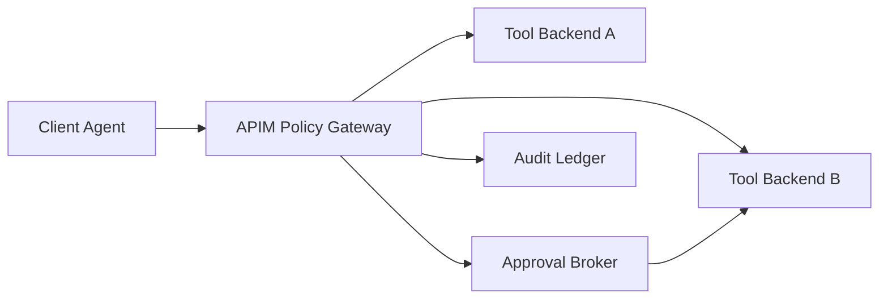
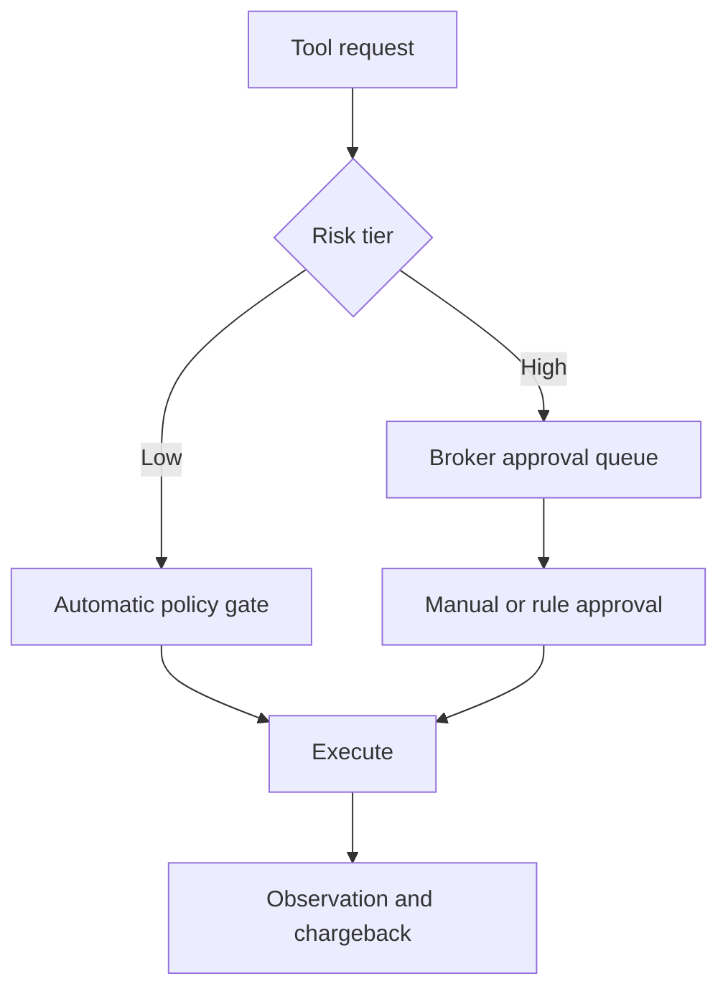

# Enterprise zero-trust MCP/A2A tool-governance selection FAQ (APIM+Entra+DPoP vs sidecar Envoy vs brokered approval)

> Audience: Cloud & AI Solution Architects, platform security leads, and API governance teams.
>
> Core question: how to enforce identity, least privilege, budget guardrails, and audit traceability for every tool call in multi-agent production systems.

## 1. Executive summary

Production MCP/A2A governance cannot rely on prompt-only controls. A layered zero-trust model is recommended:

- **Route A**: `APIM + Entra OBO + DPoP` as the default enterprise control plane.
- **Route B**: `Envoy sidecar + ext_authz` for low-latency in-mesh policy enforcement.
- **Route C**: brokered two-stage approval (automated adjudication plus human/rule approval) for high-risk actions.
- **Route D**: raw tool parameter passthrough, shared privileged tokens, and no call ledger.

Default recommendation is **A + C**, with selective **B** in high-throughput internal domains.

## 2. Why classical API auth is insufficient for agent tooling

- Agent workflows frequently involve delegated multi-hop tool invocations.
- Tool arguments are business semantic payloads, not just transport fields.
- Budget controls must bind to identity, tool class, argument profile, and risk tier.
- Incident response requires replayable route-policy and approval-decision chains.

## 3. Route definitions

### Route A: APIM + Entra OBO + DPoP unified governance

- OBO preserves user principal context instead of shared backend super-identity.
- DPoP adds sender-constrained token usage to reduce replay risk.
- Gateway policy enforces allowlists, argument schema checks, and budget gates.

### Route B: Envoy sidecar with ext_authz

- Suitable for high-throughput low-latency internal calls.
- OPA/Rego enables method and argument-level policy checks.
- Requires policy rollout discipline and sidecar drift controls.

### Route C: brokered approval for high-risk operations

- High-risk actions are paused for approval after automated pre-checks.
- Typical for money movement, production writes, and sensitive external actions.
- Works well with durable orchestration for resumable approvals.

### Route D: anti-pattern baseline

- No principal-context enforcement on tool calls.
- `tool_name` and `args` accepted without policy binding.
- Detection is post-factum only, with weak real-time prevention.

## 4. Quantitative models

### 4.1 Expected risk exposure

Definitions:

- `N_call`: tool calls per time window
- `P_invalid`: invalid or unauthorized request probability
- `P_bypass`: policy bypass probability
- `L_impact`: impact cost per unauthorized success

Expected risk:

`Risk_exp = N_call * P_invalid * P_bypass * L_impact`

### 4.2 Policy overhead latency

`ΔT_policy = T_authn + T_authz + T_schema + T_budget`

Track `ΔT_policy_p95` continuously as a first-class SLO component.

### 4.3 Approval throughput constraint

`Throughput_approved = min(Q_auto, Q_human, Q_backend)`

Approval channels require explicit capacity planning to avoid business stalls.

### 4.4 Budget circuit-breaker model

`Budget_left = Budget_total - Σ(cost_tool_call_i)`

When `Budget_left < Threshold`, trigger downgrade/defer/freeze policy for high-risk classes.

## 5. Twelve-dimension comparison matrix

| Dimension | Route A APIM | Route B Sidecar | Route C Broker | Route D Anti-pattern |
|---|---|---|---|---|
| Identity verifiability | High | Medium-high | High | Low |
| Replay protection | High | Medium | High | Low |
| Argument-level enforcement | High | High | Medium-high | Low |
| Latency control | Medium-high | High | Medium | High (no controls) |
| Compliance auditability | High | Medium-high | High | Low |
| Cross-org governance | High | Medium | High | Low |
| Engineering complexity | Medium | High | Medium-high | Low |
| Operational burden | Medium | High | Medium | Low |
| Security value | High | High | High | Low |
| Budget controllability | High | Medium-high | High | Low |
| Evolvability | High | Medium-high | High | Low |
| Recommendation | ✅ Default | ✅ Throughput add-on | ✅ High-risk path | ⛔ |

## 6. Deep quantitative Q&A (Q1-Q8)
### Q1: Why add DPoP to the tool governance path?
Bearer tokens alone do not prove possession context. DPoP reduces replay opportunities in intermediary compromise scenarios.

### Q2: Can sidecar controls replace gateway controls?
Not fully. Sidecars are excellent for intra-mesh enforcement, but cross-domain policy ownership and unified audit still require gateway governance.

### Q3: Does brokered approval always degrade UX?
No. Approval should be risk-tiered. Low-risk reads remain automatic while high-risk writes are gated.

### Q4: How do we stop prompt-injection-driven dangerous calls?
Combine principal verification, schema constraints, risk scoring, and approval workflow. Do not rely on prompt-only constraints.

### Q5: Will budget circuit breakers break critical operations?
They should not if critical workloads have protected reserve budgets and explicit priority policies.

### Q6: How is accountability managed in cross-org A2A?
Use bilateral receipts and call-ledger correlation for initiator, executor, and approver accountability boundaries.

### Q7: How should policy upgrades be audited?
Version every policy release and persist policy version in each call ledger record for deterministic replay.

### Q8: When to evolve from A to A+B+C?
As call volume, risk diversity, and compliance scrutiny increase, multi-route governance provides better resilience and control.

## 7. Architecture diagrams (Mermaid)





## 8. Production snippet: APIM DPoP and tool allowlist policy

```xml
<policies>
  <inbound>
    <base />
    <validate-jwt header-name="Authorization" failed-validation-httpcode="401" />
    <check-header name="DPoP" failed-check-httpcode="401" failed-check-error-message="DPoP required" />
    <set-variable name="tool" value="@(context.Request.MatchedParameters["toolName"])" />
    <choose>
      <when condition="@((string)context.Variables["tool"]=="wire-transfer")">
        <set-header name="x-approval-required" exists-action="override"><value>true</value></set-header>
      </when>
    </choose>
  </inbound>
</policies>
```

## 9. Production snippet: Envoy ext_authz risk-tier filter

```yaml
http_filters:
- name: envoy.filters.http.ext_authz
  typed_config:
    "@type": type.googleapis.com/envoy.extensions.filters.http.ext_authz.v3.ExtAuthz
    transport_api_version: V3
    failure_mode_allow: false
    with_request_body:
      max_request_bytes: 8192
```

## 10. Enterprise scenarios (2+)

### Scenario A: cross-border financial operations copilot

- High-risk actions such as limit changes and transfer operations require brokered approval.
- Standard inquiry traffic remains auto-routed via Route A for efficiency.
- Every sensitive call has an explicit accountability trail.

### Scenario B: global supply-chain multi-agent network

- Frequent cross-organization A2A interactions with heterogeneous trust boundaries.
- APIM enforces identity and budget guardrails; sidecar policies optimize in-mesh latency.
- External tool spend is bounded with anomaly-triggered circuit breakers.

### Scenario C: regulated sovereign private-cloud platform

- Strong emphasis on policy verifiability and regional control planes.
- Routing, approval, and budget policies are versioned as governed artifacts.
- Quarterly audits require replayability of high-risk tool invocations.

## 11. Three-tier 3-year TCO (USD)

| Scale tier | Route A baseline | Route A+B | Route A+C | Route A+B+C |
|---|---:|---:|---:|---:|
| 100 tools/day | 1,200,000 | 1,360,000 | 1,480,000 | 1,610,000 |
| 5,000 tools/day | 6,800,000 | 7,400,000 | 8,050,000 | 8,600,000 |
| 50,000 tools/day | 34,500,000 | 36,200,000 | 39,100,000 | 40,800,000 |

Interpretation:

- Composite governance costs more than minimal controls but materially reduces loss exposure.
- A+B+C is justified when high concurrency and high compliance are both non-negotiable.

## 12. Day-0 / Day-1 / Day-2 checklist

### Day-0 (policy baseline)
- Day-0 control 1: classify tool risk tiers, principal models, approval criteria, and budget thresholds.
- Day-0 control 2: classify tool risk tiers, principal models, approval criteria, and budget thresholds.
- Day-0 control 3: classify tool risk tiers, principal models, approval criteria, and budget thresholds.
- Day-0 control 4: classify tool risk tiers, principal models, approval criteria, and budget thresholds.
- Day-0 control 5: classify tool risk tiers, principal models, approval criteria, and budget thresholds.
- Day-0 control 6: classify tool risk tiers, principal models, approval criteria, and budget thresholds.
- Day-0 control 7: classify tool risk tiers, principal models, approval criteria, and budget thresholds.
- Day-0 control 8: classify tool risk tiers, principal models, approval criteria, and budget thresholds.
- Day-0 control 9: classify tool risk tiers, principal models, approval criteria, and budget thresholds.
- Day-0 control 10: classify tool risk tiers, principal models, approval criteria, and budget thresholds.
- Day-0 control 11: classify tool risk tiers, principal models, approval criteria, and budget thresholds.
- Day-0 control 12: classify tool risk tiers, principal models, approval criteria, and budget thresholds.
- Day-0 control 13: classify tool risk tiers, principal models, approval criteria, and budget thresholds.
- Day-0 control 14: classify tool risk tiers, principal models, approval criteria, and budget thresholds.
- Day-0 control 15: classify tool risk tiers, principal models, approval criteria, and budget thresholds.
- Day-0 control 16: classify tool risk tiers, principal models, approval criteria, and budget thresholds.
- Day-0 control 17: classify tool risk tiers, principal models, approval criteria, and budget thresholds.
- Day-0 control 18: classify tool risk tiers, principal models, approval criteria, and budget thresholds.
- Day-0 control 19: classify tool risk tiers, principal models, approval criteria, and budget thresholds.
- Day-0 control 20: classify tool risk tiers, principal models, approval criteria, and budget thresholds.
- Day-0 control 21: classify tool risk tiers, principal models, approval criteria, and budget thresholds.
- Day-0 control 22: classify tool risk tiers, principal models, approval criteria, and budget thresholds.
- Day-0 control 23: classify tool risk tiers, principal models, approval criteria, and budget thresholds.
- Day-0 control 24: classify tool risk tiers, principal models, approval criteria, and budget thresholds.
- Day-0 control 25: classify tool risk tiers, principal models, approval criteria, and budget thresholds.
- Day-0 control 26: classify tool risk tiers, principal models, approval criteria, and budget thresholds.
- Day-0 control 27: classify tool risk tiers, principal models, approval criteria, and budget thresholds.
- Day-0 control 28: classify tool risk tiers, principal models, approval criteria, and budget thresholds.
- Day-0 control 29: classify tool risk tiers, principal models, approval criteria, and budget thresholds.
- Day-0 control 30: classify tool risk tiers, principal models, approval criteria, and budget thresholds.
- Day-0 control 31: classify tool risk tiers, principal models, approval criteria, and budget thresholds.
- Day-0 control 32: classify tool risk tiers, principal models, approval criteria, and budget thresholds.
- Day-0 control 33: classify tool risk tiers, principal models, approval criteria, and budget thresholds.
- Day-0 control 34: classify tool risk tiers, principal models, approval criteria, and budget thresholds.
- Day-0 control 35: classify tool risk tiers, principal models, approval criteria, and budget thresholds.
- Day-0 control 36: classify tool risk tiers, principal models, approval criteria, and budget thresholds.
- Day-0 control 37: classify tool risk tiers, principal models, approval criteria, and budget thresholds.
- Day-0 control 38: classify tool risk tiers, principal models, approval criteria, and budget thresholds.
- Day-0 control 39: classify tool risk tiers, principal models, approval criteria, and budget thresholds.
- Day-0 control 40: classify tool risk tiers, principal models, approval criteria, and budget thresholds.
- Day-0 control 41: classify tool risk tiers, principal models, approval criteria, and budget thresholds.
- Day-0 control 42: classify tool risk tiers, principal models, approval criteria, and budget thresholds.
- Day-0 control 43: classify tool risk tiers, principal models, approval criteria, and budget thresholds.
- Day-0 control 44: classify tool risk tiers, principal models, approval criteria, and budget thresholds.
- Day-0 control 45: classify tool risk tiers, principal models, approval criteria, and budget thresholds.
- Day-0 control 46: classify tool risk tiers, principal models, approval criteria, and budget thresholds.
- Day-0 control 47: classify tool risk tiers, principal models, approval criteria, and budget thresholds.
- Day-0 control 48: classify tool risk tiers, principal models, approval criteria, and budget thresholds.
- Day-0 control 49: classify tool risk tiers, principal models, approval criteria, and budget thresholds.
- Day-0 control 50: classify tool risk tiers, principal models, approval criteria, and budget thresholds.
- Day-0 control 51: classify tool risk tiers, principal models, approval criteria, and budget thresholds.
- Day-0 control 52: classify tool risk tiers, principal models, approval criteria, and budget thresholds.
- Day-0 control 53: classify tool risk tiers, principal models, approval criteria, and budget thresholds.
- Day-0 control 54: classify tool risk tiers, principal models, approval criteria, and budget thresholds.
- Day-0 control 55: classify tool risk tiers, principal models, approval criteria, and budget thresholds.
- Day-0 control 56: classify tool risk tiers, principal models, approval criteria, and budget thresholds.
- Day-0 control 57: classify tool risk tiers, principal models, approval criteria, and budget thresholds.
- Day-0 control 58: classify tool risk tiers, principal models, approval criteria, and budget thresholds.
- Day-0 control 59: classify tool risk tiers, principal models, approval criteria, and budget thresholds.
- Day-0 control 60: classify tool risk tiers, principal models, approval criteria, and budget thresholds.
- Day-0 control 61: classify tool risk tiers, principal models, approval criteria, and budget thresholds.
- Day-0 control 62: classify tool risk tiers, principal models, approval criteria, and budget thresholds.
- Day-0 control 63: classify tool risk tiers, principal models, approval criteria, and budget thresholds.
- Day-0 control 64: classify tool risk tiers, principal models, approval criteria, and budget thresholds.
- Day-0 control 65: classify tool risk tiers, principal models, approval criteria, and budget thresholds.
- Day-0 control 66: classify tool risk tiers, principal models, approval criteria, and budget thresholds.
- Day-0 control 67: classify tool risk tiers, principal models, approval criteria, and budget thresholds.
- Day-0 control 68: classify tool risk tiers, principal models, approval criteria, and budget thresholds.
- Day-0 control 69: classify tool risk tiers, principal models, approval criteria, and budget thresholds.
- Day-0 control 70: classify tool risk tiers, principal models, approval criteria, and budget thresholds.

### Day-1 (deployment and controlled rollout)
- Day-1 control 1: wire gateway identity checks, broker flow, and immutable audit logging in staged rollout rings.
- Day-1 control 2: wire gateway identity checks, broker flow, and immutable audit logging in staged rollout rings.
- Day-1 control 3: wire gateway identity checks, broker flow, and immutable audit logging in staged rollout rings.
- Day-1 control 4: wire gateway identity checks, broker flow, and immutable audit logging in staged rollout rings.
- Day-1 control 5: wire gateway identity checks, broker flow, and immutable audit logging in staged rollout rings.
- Day-1 control 6: wire gateway identity checks, broker flow, and immutable audit logging in staged rollout rings.
- Day-1 control 7: wire gateway identity checks, broker flow, and immutable audit logging in staged rollout rings.
- Day-1 control 8: wire gateway identity checks, broker flow, and immutable audit logging in staged rollout rings.
- Day-1 control 9: wire gateway identity checks, broker flow, and immutable audit logging in staged rollout rings.
- Day-1 control 10: wire gateway identity checks, broker flow, and immutable audit logging in staged rollout rings.
- Day-1 control 11: wire gateway identity checks, broker flow, and immutable audit logging in staged rollout rings.
- Day-1 control 12: wire gateway identity checks, broker flow, and immutable audit logging in staged rollout rings.
- Day-1 control 13: wire gateway identity checks, broker flow, and immutable audit logging in staged rollout rings.
- Day-1 control 14: wire gateway identity checks, broker flow, and immutable audit logging in staged rollout rings.
- Day-1 control 15: wire gateway identity checks, broker flow, and immutable audit logging in staged rollout rings.
- Day-1 control 16: wire gateway identity checks, broker flow, and immutable audit logging in staged rollout rings.
- Day-1 control 17: wire gateway identity checks, broker flow, and immutable audit logging in staged rollout rings.
- Day-1 control 18: wire gateway identity checks, broker flow, and immutable audit logging in staged rollout rings.
- Day-1 control 19: wire gateway identity checks, broker flow, and immutable audit logging in staged rollout rings.
- Day-1 control 20: wire gateway identity checks, broker flow, and immutable audit logging in staged rollout rings.
- Day-1 control 21: wire gateway identity checks, broker flow, and immutable audit logging in staged rollout rings.
- Day-1 control 22: wire gateway identity checks, broker flow, and immutable audit logging in staged rollout rings.
- Day-1 control 23: wire gateway identity checks, broker flow, and immutable audit logging in staged rollout rings.
- Day-1 control 24: wire gateway identity checks, broker flow, and immutable audit logging in staged rollout rings.
- Day-1 control 25: wire gateway identity checks, broker flow, and immutable audit logging in staged rollout rings.
- Day-1 control 26: wire gateway identity checks, broker flow, and immutable audit logging in staged rollout rings.
- Day-1 control 27: wire gateway identity checks, broker flow, and immutable audit logging in staged rollout rings.
- Day-1 control 28: wire gateway identity checks, broker flow, and immutable audit logging in staged rollout rings.
- Day-1 control 29: wire gateway identity checks, broker flow, and immutable audit logging in staged rollout rings.
- Day-1 control 30: wire gateway identity checks, broker flow, and immutable audit logging in staged rollout rings.
- Day-1 control 31: wire gateway identity checks, broker flow, and immutable audit logging in staged rollout rings.
- Day-1 control 32: wire gateway identity checks, broker flow, and immutable audit logging in staged rollout rings.
- Day-1 control 33: wire gateway identity checks, broker flow, and immutable audit logging in staged rollout rings.
- Day-1 control 34: wire gateway identity checks, broker flow, and immutable audit logging in staged rollout rings.
- Day-1 control 35: wire gateway identity checks, broker flow, and immutable audit logging in staged rollout rings.
- Day-1 control 36: wire gateway identity checks, broker flow, and immutable audit logging in staged rollout rings.
- Day-1 control 37: wire gateway identity checks, broker flow, and immutable audit logging in staged rollout rings.
- Day-1 control 38: wire gateway identity checks, broker flow, and immutable audit logging in staged rollout rings.
- Day-1 control 39: wire gateway identity checks, broker flow, and immutable audit logging in staged rollout rings.
- Day-1 control 40: wire gateway identity checks, broker flow, and immutable audit logging in staged rollout rings.
- Day-1 control 41: wire gateway identity checks, broker flow, and immutable audit logging in staged rollout rings.
- Day-1 control 42: wire gateway identity checks, broker flow, and immutable audit logging in staged rollout rings.
- Day-1 control 43: wire gateway identity checks, broker flow, and immutable audit logging in staged rollout rings.
- Day-1 control 44: wire gateway identity checks, broker flow, and immutable audit logging in staged rollout rings.
- Day-1 control 45: wire gateway identity checks, broker flow, and immutable audit logging in staged rollout rings.
- Day-1 control 46: wire gateway identity checks, broker flow, and immutable audit logging in staged rollout rings.
- Day-1 control 47: wire gateway identity checks, broker flow, and immutable audit logging in staged rollout rings.
- Day-1 control 48: wire gateway identity checks, broker flow, and immutable audit logging in staged rollout rings.
- Day-1 control 49: wire gateway identity checks, broker flow, and immutable audit logging in staged rollout rings.
- Day-1 control 50: wire gateway identity checks, broker flow, and immutable audit logging in staged rollout rings.
- Day-1 control 51: wire gateway identity checks, broker flow, and immutable audit logging in staged rollout rings.
- Day-1 control 52: wire gateway identity checks, broker flow, and immutable audit logging in staged rollout rings.
- Day-1 control 53: wire gateway identity checks, broker flow, and immutable audit logging in staged rollout rings.
- Day-1 control 54: wire gateway identity checks, broker flow, and immutable audit logging in staged rollout rings.
- Day-1 control 55: wire gateway identity checks, broker flow, and immutable audit logging in staged rollout rings.
- Day-1 control 56: wire gateway identity checks, broker flow, and immutable audit logging in staged rollout rings.
- Day-1 control 57: wire gateway identity checks, broker flow, and immutable audit logging in staged rollout rings.
- Day-1 control 58: wire gateway identity checks, broker flow, and immutable audit logging in staged rollout rings.
- Day-1 control 59: wire gateway identity checks, broker flow, and immutable audit logging in staged rollout rings.
- Day-1 control 60: wire gateway identity checks, broker flow, and immutable audit logging in staged rollout rings.
- Day-1 control 61: wire gateway identity checks, broker flow, and immutable audit logging in staged rollout rings.
- Day-1 control 62: wire gateway identity checks, broker flow, and immutable audit logging in staged rollout rings.
- Day-1 control 63: wire gateway identity checks, broker flow, and immutable audit logging in staged rollout rings.
- Day-1 control 64: wire gateway identity checks, broker flow, and immutable audit logging in staged rollout rings.
- Day-1 control 65: wire gateway identity checks, broker flow, and immutable audit logging in staged rollout rings.
- Day-1 control 66: wire gateway identity checks, broker flow, and immutable audit logging in staged rollout rings.
- Day-1 control 67: wire gateway identity checks, broker flow, and immutable audit logging in staged rollout rings.
- Day-1 control 68: wire gateway identity checks, broker flow, and immutable audit logging in staged rollout rings.
- Day-1 control 69: wire gateway identity checks, broker flow, and immutable audit logging in staged rollout rings.
- Day-1 control 70: wire gateway identity checks, broker flow, and immutable audit logging in staged rollout rings.

### Day-2 (continuous governance)
- Day-2 control 1: review unauthorized blocks, approval latency, budget drift, and policy-hit distribution by tenant tier.
- Day-2 control 2: review unauthorized blocks, approval latency, budget drift, and policy-hit distribution by tenant tier.
- Day-2 control 3: review unauthorized blocks, approval latency, budget drift, and policy-hit distribution by tenant tier.
- Day-2 control 4: review unauthorized blocks, approval latency, budget drift, and policy-hit distribution by tenant tier.
- Day-2 control 5: review unauthorized blocks, approval latency, budget drift, and policy-hit distribution by tenant tier.
- Day-2 control 6: review unauthorized blocks, approval latency, budget drift, and policy-hit distribution by tenant tier.
- Day-2 control 7: review unauthorized blocks, approval latency, budget drift, and policy-hit distribution by tenant tier.
- Day-2 control 8: review unauthorized blocks, approval latency, budget drift, and policy-hit distribution by tenant tier.
- Day-2 control 9: review unauthorized blocks, approval latency, budget drift, and policy-hit distribution by tenant tier.
- Day-2 control 10: review unauthorized blocks, approval latency, budget drift, and policy-hit distribution by tenant tier.
- Day-2 control 11: review unauthorized blocks, approval latency, budget drift, and policy-hit distribution by tenant tier.
- Day-2 control 12: review unauthorized blocks, approval latency, budget drift, and policy-hit distribution by tenant tier.
- Day-2 control 13: review unauthorized blocks, approval latency, budget drift, and policy-hit distribution by tenant tier.
- Day-2 control 14: review unauthorized blocks, approval latency, budget drift, and policy-hit distribution by tenant tier.
- Day-2 control 15: review unauthorized blocks, approval latency, budget drift, and policy-hit distribution by tenant tier.
- Day-2 control 16: review unauthorized blocks, approval latency, budget drift, and policy-hit distribution by tenant tier.
- Day-2 control 17: review unauthorized blocks, approval latency, budget drift, and policy-hit distribution by tenant tier.
- Day-2 control 18: review unauthorized blocks, approval latency, budget drift, and policy-hit distribution by tenant tier.
- Day-2 control 19: review unauthorized blocks, approval latency, budget drift, and policy-hit distribution by tenant tier.
- Day-2 control 20: review unauthorized blocks, approval latency, budget drift, and policy-hit distribution by tenant tier.
- Day-2 control 21: review unauthorized blocks, approval latency, budget drift, and policy-hit distribution by tenant tier.
- Day-2 control 22: review unauthorized blocks, approval latency, budget drift, and policy-hit distribution by tenant tier.
- Day-2 control 23: review unauthorized blocks, approval latency, budget drift, and policy-hit distribution by tenant tier.
- Day-2 control 24: review unauthorized blocks, approval latency, budget drift, and policy-hit distribution by tenant tier.
- Day-2 control 25: review unauthorized blocks, approval latency, budget drift, and policy-hit distribution by tenant tier.
- Day-2 control 26: review unauthorized blocks, approval latency, budget drift, and policy-hit distribution by tenant tier.
- Day-2 control 27: review unauthorized blocks, approval latency, budget drift, and policy-hit distribution by tenant tier.
- Day-2 control 28: review unauthorized blocks, approval latency, budget drift, and policy-hit distribution by tenant tier.
- Day-2 control 29: review unauthorized blocks, approval latency, budget drift, and policy-hit distribution by tenant tier.
- Day-2 control 30: review unauthorized blocks, approval latency, budget drift, and policy-hit distribution by tenant tier.
- Day-2 control 31: review unauthorized blocks, approval latency, budget drift, and policy-hit distribution by tenant tier.
- Day-2 control 32: review unauthorized blocks, approval latency, budget drift, and policy-hit distribution by tenant tier.
- Day-2 control 33: review unauthorized blocks, approval latency, budget drift, and policy-hit distribution by tenant tier.
- Day-2 control 34: review unauthorized blocks, approval latency, budget drift, and policy-hit distribution by tenant tier.
- Day-2 control 35: review unauthorized blocks, approval latency, budget drift, and policy-hit distribution by tenant tier.
- Day-2 control 36: review unauthorized blocks, approval latency, budget drift, and policy-hit distribution by tenant tier.
- Day-2 control 37: review unauthorized blocks, approval latency, budget drift, and policy-hit distribution by tenant tier.
- Day-2 control 38: review unauthorized blocks, approval latency, budget drift, and policy-hit distribution by tenant tier.
- Day-2 control 39: review unauthorized blocks, approval latency, budget drift, and policy-hit distribution by tenant tier.
- Day-2 control 40: review unauthorized blocks, approval latency, budget drift, and policy-hit distribution by tenant tier.
- Day-2 control 41: review unauthorized blocks, approval latency, budget drift, and policy-hit distribution by tenant tier.
- Day-2 control 42: review unauthorized blocks, approval latency, budget drift, and policy-hit distribution by tenant tier.
- Day-2 control 43: review unauthorized blocks, approval latency, budget drift, and policy-hit distribution by tenant tier.
- Day-2 control 44: review unauthorized blocks, approval latency, budget drift, and policy-hit distribution by tenant tier.
- Day-2 control 45: review unauthorized blocks, approval latency, budget drift, and policy-hit distribution by tenant tier.
- Day-2 control 46: review unauthorized blocks, approval latency, budget drift, and policy-hit distribution by tenant tier.
- Day-2 control 47: review unauthorized blocks, approval latency, budget drift, and policy-hit distribution by tenant tier.
- Day-2 control 48: review unauthorized blocks, approval latency, budget drift, and policy-hit distribution by tenant tier.
- Day-2 control 49: review unauthorized blocks, approval latency, budget drift, and policy-hit distribution by tenant tier.
- Day-2 control 50: review unauthorized blocks, approval latency, budget drift, and policy-hit distribution by tenant tier.
- Day-2 control 51: review unauthorized blocks, approval latency, budget drift, and policy-hit distribution by tenant tier.
- Day-2 control 52: review unauthorized blocks, approval latency, budget drift, and policy-hit distribution by tenant tier.
- Day-2 control 53: review unauthorized blocks, approval latency, budget drift, and policy-hit distribution by tenant tier.
- Day-2 control 54: review unauthorized blocks, approval latency, budget drift, and policy-hit distribution by tenant tier.
- Day-2 control 55: review unauthorized blocks, approval latency, budget drift, and policy-hit distribution by tenant tier.
- Day-2 control 56: review unauthorized blocks, approval latency, budget drift, and policy-hit distribution by tenant tier.
- Day-2 control 57: review unauthorized blocks, approval latency, budget drift, and policy-hit distribution by tenant tier.
- Day-2 control 58: review unauthorized blocks, approval latency, budget drift, and policy-hit distribution by tenant tier.
- Day-2 control 59: review unauthorized blocks, approval latency, budget drift, and policy-hit distribution by tenant tier.
- Day-2 control 60: review unauthorized blocks, approval latency, budget drift, and policy-hit distribution by tenant tier.
- Day-2 control 61: review unauthorized blocks, approval latency, budget drift, and policy-hit distribution by tenant tier.
- Day-2 control 62: review unauthorized blocks, approval latency, budget drift, and policy-hit distribution by tenant tier.
- Day-2 control 63: review unauthorized blocks, approval latency, budget drift, and policy-hit distribution by tenant tier.
- Day-2 control 64: review unauthorized blocks, approval latency, budget drift, and policy-hit distribution by tenant tier.
- Day-2 control 65: review unauthorized blocks, approval latency, budget drift, and policy-hit distribution by tenant tier.
- Day-2 control 66: review unauthorized blocks, approval latency, budget drift, and policy-hit distribution by tenant tier.
- Day-2 control 67: review unauthorized blocks, approval latency, budget drift, and policy-hit distribution by tenant tier.
- Day-2 control 68: review unauthorized blocks, approval latency, budget drift, and policy-hit distribution by tenant tier.
- Day-2 control 69: review unauthorized blocks, approval latency, budget drift, and policy-hit distribution by tenant tier.
- Day-2 control 70: review unauthorized blocks, approval latency, budget drift, and policy-hit distribution by tenant tier.
- Day-2 control 71: review unauthorized blocks, approval latency, budget drift, and policy-hit distribution by tenant tier.
- Day-2 control 72: review unauthorized blocks, approval latency, budget drift, and policy-hit distribution by tenant tier.
- Day-2 control 73: review unauthorized blocks, approval latency, budget drift, and policy-hit distribution by tenant tier.
- Day-2 control 74: review unauthorized blocks, approval latency, budget drift, and policy-hit distribution by tenant tier.
- Day-2 control 75: review unauthorized blocks, approval latency, budget drift, and policy-hit distribution by tenant tier.
- Day-2 control 76: review unauthorized blocks, approval latency, budget drift, and policy-hit distribution by tenant tier.
- Day-2 control 77: review unauthorized blocks, approval latency, budget drift, and policy-hit distribution by tenant tier.
- Day-2 control 78: review unauthorized blocks, approval latency, budget drift, and policy-hit distribution by tenant tier.
- Day-2 control 79: review unauthorized blocks, approval latency, budget drift, and policy-hit distribution by tenant tier.
- Day-2 control 80: review unauthorized blocks, approval latency, budget drift, and policy-hit distribution by tenant tier.
- Day-2 control 81: review unauthorized blocks, approval latency, budget drift, and policy-hit distribution by tenant tier.
- Day-2 control 82: review unauthorized blocks, approval latency, budget drift, and policy-hit distribution by tenant tier.
- Day-2 control 83: review unauthorized blocks, approval latency, budget drift, and policy-hit distribution by tenant tier.
- Day-2 control 84: review unauthorized blocks, approval latency, budget drift, and policy-hit distribution by tenant tier.
- Day-2 control 85: review unauthorized blocks, approval latency, budget drift, and policy-hit distribution by tenant tier.
- Day-2 control 86: review unauthorized blocks, approval latency, budget drift, and policy-hit distribution by tenant tier.
- Day-2 control 87: review unauthorized blocks, approval latency, budget drift, and policy-hit distribution by tenant tier.
- Day-2 control 88: review unauthorized blocks, approval latency, budget drift, and policy-hit distribution by tenant tier.
- Day-2 control 89: review unauthorized blocks, approval latency, budget drift, and policy-hit distribution by tenant tier.
- Day-2 control 90: review unauthorized blocks, approval latency, budget drift, and policy-hit distribution by tenant tier.
- Day-2 control 91: review unauthorized blocks, approval latency, budget drift, and policy-hit distribution by tenant tier.
- Day-2 control 92: review unauthorized blocks, approval latency, budget drift, and policy-hit distribution by tenant tier.
- Day-2 control 93: review unauthorized blocks, approval latency, budget drift, and policy-hit distribution by tenant tier.
- Day-2 control 94: review unauthorized blocks, approval latency, budget drift, and policy-hit distribution by tenant tier.
- Day-2 control 95: review unauthorized blocks, approval latency, budget drift, and policy-hit distribution by tenant tier.
- Day-2 control 96: review unauthorized blocks, approval latency, budget drift, and policy-hit distribution by tenant tier.
- Day-2 control 97: review unauthorized blocks, approval latency, budget drift, and policy-hit distribution by tenant tier.
- Day-2 control 98: review unauthorized blocks, approval latency, budget drift, and policy-hit distribution by tenant tier.
- Day-2 control 99: review unauthorized blocks, approval latency, budget drift, and policy-hit distribution by tenant tier.
- Day-2 control 100: review unauthorized blocks, approval latency, budget drift, and policy-hit distribution by tenant tier.
- Day-2 control 101: review unauthorized blocks, approval latency, budget drift, and policy-hit distribution by tenant tier.
- Day-2 control 102: review unauthorized blocks, approval latency, budget drift, and policy-hit distribution by tenant tier.
- Day-2 control 103: review unauthorized blocks, approval latency, budget drift, and policy-hit distribution by tenant tier.
- Day-2 control 104: review unauthorized blocks, approval latency, budget drift, and policy-hit distribution by tenant tier.
- Day-2 control 105: review unauthorized blocks, approval latency, budget drift, and policy-hit distribution by tenant tier.
- Day-2 control 106: review unauthorized blocks, approval latency, budget drift, and policy-hit distribution by tenant tier.
- Day-2 control 107: review unauthorized blocks, approval latency, budget drift, and policy-hit distribution by tenant tier.
- Day-2 control 108: review unauthorized blocks, approval latency, budget drift, and policy-hit distribution by tenant tier.
- Day-2 control 109: review unauthorized blocks, approval latency, budget drift, and policy-hit distribution by tenant tier.
- Day-2 control 110: review unauthorized blocks, approval latency, budget drift, and policy-hit distribution by tenant tier.
- Day-2 control 111: review unauthorized blocks, approval latency, budget drift, and policy-hit distribution by tenant tier.
- Day-2 control 112: review unauthorized blocks, approval latency, budget drift, and policy-hit distribution by tenant tier.
- Day-2 control 113: review unauthorized blocks, approval latency, budget drift, and policy-hit distribution by tenant tier.
- Day-2 control 114: review unauthorized blocks, approval latency, budget drift, and policy-hit distribution by tenant tier.
- Day-2 control 115: review unauthorized blocks, approval latency, budget drift, and policy-hit distribution by tenant tier.
- Day-2 control 116: review unauthorized blocks, approval latency, budget drift, and policy-hit distribution by tenant tier.
- Day-2 control 117: review unauthorized blocks, approval latency, budget drift, and policy-hit distribution by tenant tier.
- Day-2 control 118: review unauthorized blocks, approval latency, budget drift, and policy-hit distribution by tenant tier.
- Day-2 control 119: review unauthorized blocks, approval latency, budget drift, and policy-hit distribution by tenant tier.
- Day-2 control 120: review unauthorized blocks, approval latency, budget drift, and policy-hit distribution by tenant tier.

## 13. Good fit vs Not for

### ✅ Good fit

- High-compliance environments with high-risk tool actions.
- Multi-tenant and cross-organization agent ecosystems.
- Organizations requiring strong traceability and accountability controls.

### ⛔ Not for

- Small, short-lived PoCs with homogeneous low-risk actions.
- Teams without policy operations capacity.
- Experimental workloads with no governance or chargeback requirements.

## 14. Five-step rollout guide

1. Inventory tools and classify operational risk.
2. Define principal propagation and call contract boundaries.
3. Deploy gateway policy with tiered control decisions.
4. Integrate approval broker and immutable call ledger.
5. Iterate weekly on controls using drift and incident telemetry.

## 15. Core KPIs

- `policy_block_rate`
- `approval_latency_p95`
- `unauthorized_attempt_count`
- `tool_call_cost_per_tenant`
- `dpop_validation_failure_rate`
- `audit_replay_success_rate`

## 16. Final recommendation

Adopt Route A as baseline, layer Route C for high-risk actions, and introduce Route B where low-latency in-mesh throughput is a hard requirement.

One-line conclusion:

**MCP/A2A governance maturity is measured not by tool-call volume, but by how provably constrained, attributable, and replayable every high-risk call remains under pressure.**
