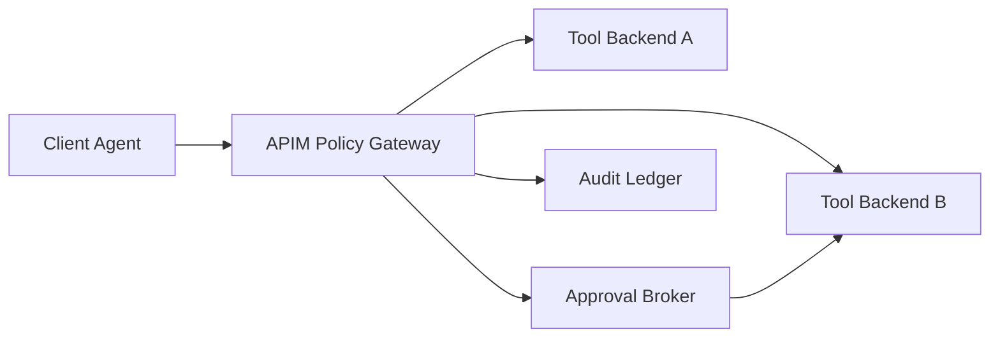
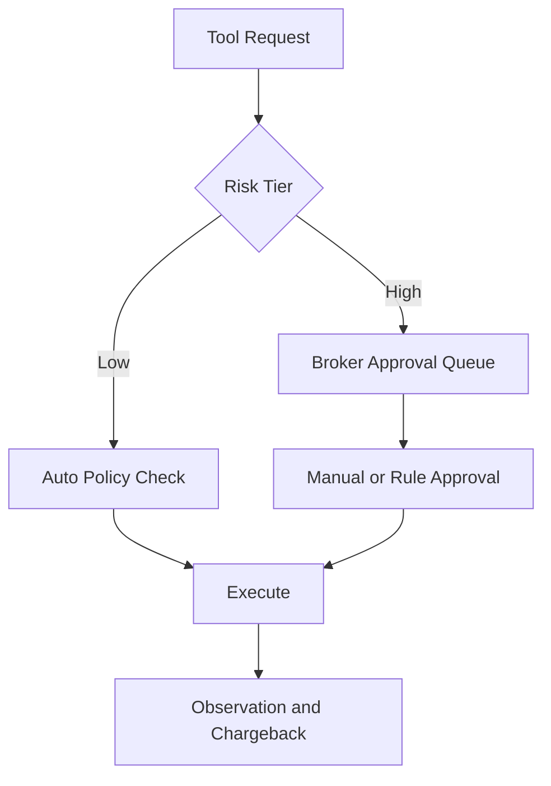

# 企业零信任 MCP/A2A 工具治理选型 FAQ（APIM+Entra+DPoP vs Sidecar Envoy vs Broker 审批）

> 适用角色：Cloud & AI Solution Architect、平台安全负责人、API 治理与合规团队。
>
> 核心问题：在多智能体与多工具链协同时，如何保证每一次工具调用都具备可验证身份、最小权限、预算门禁与可追责审计。

## 1. 一页结论

企业级 MCP/A2A 治理不应依赖“提示词自觉”。建议采用分层零信任控制：

- **Route A**：`APIM + Entra OBO + DPoP` 统一网关强制策略，作为默认生产主线。
- **Route B**：`Envoy Sidecar + ext_authz` 细粒度服务网格内联控制，适合高吞吐内网场景。
- **Route C**：`Brokered Approval` 双阶段审批（自动判定 + 人审）用于高风险工具与跨组织调用。
- **Route D**：工具参数直通、共享高权限令牌、无调用账本反模式。

推荐基线是 **A + C**，在高吞吐子域补充 **B**。

## 2. 为什么传统 API 鉴权不足以覆盖 Agent 工具链

- Agent 可能在一次会话中触发多跳调用，存在委派链放大。
- 工具参数往往包含业务语义，必须做语义级而非仅字段级校验。
- 预算和频率限制要绑定到“主体 + 工具 + 参数模板 + 风险等级”。
- 一旦发生越权，需要可还原完整调用链与策略决策链。

## 3. 四条路线定义

### Route A：APIM + Entra OBO + DPoP 统一网关治理

- 通过 OBO 继承用户主体，避免共享后台高权身份。
- 用 DPoP 做发送方约束，降低 token 重放风险。
- 在网关做工具 allowlist、参数模式约束、预算门禁。

### Route B：Envoy Sidecar + ext_authz 内联治理

- 适合高吞吐低延迟内网调用，策略判定可下沉到网格。
- 结合 OPA/Rego 实现方法级与字段级策略。
- 需要处理策略发布一致性与 sidecar 生命周期漂移。

### Route C：Broker 审批与高风险双阶段控制

- 先自动判定，再对高风险动作进行人工或规则审批。
- 适合财务转账、生产变更、外部高风险写操作。
- 可与 Durable 编排结合，支持可恢复审批工作流。

### Route D：反模式

- 工具调用不校验主体上下文。
- 请求体中的 `tool_name` 与 `args` 不做策略绑定。
- 仅依赖日志事后排查，无实时阻断。

## 4. 定量模型

### 4.1 调用风险暴露面

设：

- `N_call`：单位时间工具调用数
- `P_invalid`：无效或越权请求概率
- `P_bypass`：策略绕过概率
- `L_impact`：单次越权影响成本

风险期望值：

`Risk_exp = N_call * P_invalid * P_bypass * L_impact`

### 4.2 策略门禁引入的时延开销

`ΔT_policy = T_authn + T_authz + T_schema + T_budget`

在生产上应保证 `ΔT_policy_p95` 可控并可观测。

### 4.3 审批链吞吐约束

`Throughput_approved = min(Q_auto, Q_human, Q_backend)`

审批链必须容量规划，否则会形成业务阻塞。

### 4.4 预算熔断模型

`Budget_left = Budget_total - Σ(cost_tool_call_i)`

当 `Budget_left < Threshold` 时触发降级、延迟或冻结高风险调用。

## 5. 12 维对比矩阵

| 维度 | Route A APIM | Route B Sidecar | Route C Broker 审批 | Route D 反模式 |
|---|---|---|---|---|
| 身份可验证性 | 高 | 中高 | 高 | 低 |
| 重放防护 | 高 | 中 | 高 | 低 |
| 参数级门禁 | 高 | 高 | 中高 | 低 |
| 时延控制 | 中高 | 高 | 中 | 高（无门禁） |
| 合规审计 | 高 | 中高 | 高 | 低 |
| 跨组织治理 | 高 | 中 | 高 | 低 |
| 工程复杂度 | 中 | 高 | 中高 | 低 |
| 运维负担 | 中 | 高 | 中 | 低 |
| 业务安全收益 | 高 | 高 | 高 | 低 |
| 预算可控性 | 高 | 中高 | 高 | 低 |
| 可演进性 | 高 | 中高 | 高 | 低 |
| 结论 | ✅ 默认主线 | ✅ 高吞吐补充 | ✅ 高风险动作 | ⛔ 禁用 |

## 6. 深度问答（Q1-Q8）
### Q1：为什么要把 DPoP 放进工具治理链路？
因为仅有 Bearer Token 无法证明“谁在持有并使用令牌”，DPoP 可降低中间重放风险。

### Q2：Sidecar 是否能替代网关？
不能完全替代。Sidecar 适合内网低延迟控制，但跨域治理、统一审计与产品级策略仍需网关。

### Q3：审批链会不会拖垮体验？
高风险动作才应进审批链。普通读操作继续自动放行，通过风险分级控制用户体验。

### Q4：如何防止 prompt 注入触发危险工具？
采用“主体鉴权 + 参数模式 + 风险评分 + 审批门禁”多层组合，不依赖单点规则。

### Q5：预算熔断是否会影响关键业务？
关键业务应有保留预算池和优先级白名单，确保熔断先作用于低价值路径。

### Q6：跨组织 A2A 如何做责任切分？
采用双边签名回执与调用链账本，明确发起方、执行方、审批方三方责任。

### Q7：策略版本迭代如何回溯？
每次策略发布必须带版本号，调用日志记录命中版本并支持回放复核。

### Q8：什么时候需要从 A 演进到 A+B+C？
当调用规模提升、风险动作增多且合规审计变严时，三路线组合会更稳。

## 7. Mermaid 架构图





## 8. 生产片段：APIM DPoP 与工具白名单策略

```xml
<policies>
  <inbound>
    <base />
    <validate-jwt header-name="Authorization" failed-validation-httpcode="401" />
    <check-header name="DPoP" failed-check-httpcode="401" failed-check-error-message="DPoP required" />
    <set-variable name="tool" value="@(context.Request.MatchedParameters["toolName"])" />
    <choose>
      <when condition="@((string)context.Variables["tool"]=="wire-transfer")">
        <set-header name="x-approval-required" exists-action="override"><value>true</value></set-header>
      </when>
    </choose>
  </inbound>
</policies>
```

## 9. 生产片段：Envoy ext_authz 风险分层

```yaml
http_filters:
- name: envoy.filters.http.ext_authz
  typed_config:
    "@type": type.googleapis.com/envoy.extensions.filters.http.ext_authz.v3.ExtAuthz
    transport_api_version: V3
    failure_mode_allow: false
    with_request_body:
      max_request_bytes: 8192
```

## 10. 企业场景（2+）

### 场景 A：跨国金融运营 Copilot

- 高风险动作（资金变更、额度变更）必须走 Broker 审批。
- 普通查询走 Route A 自动放行，保证效率。
- 所有关键调用具备审计链与责任归属。

### 场景 B：全球供应链 Agent 网络

- 跨组织 A2A 调用频繁，主体链复杂。
- 通过 APIM 统一身份与预算门禁，再在网格内做低延迟细分控制。
- 对外部工具调用实行成本封顶和异常熔断。

### 场景 C：高合规政企私有云平台

- 强调主权部署和策略可核验。
- 路由策略、审批策略、预算策略版本化管理。
- 季度审计要求可回放每一条高风险调用。

## 11. 三档三年 TCO（USD）

| 规模档位 | Route A 主线 | Route A+B | Route A+C | Route A+B+C |
|---|---:|---:|---:|---:|
| 100 工具/天 | 1,200,000 | 1,360,000 | 1,480,000 | 1,610,000 |
| 5,000 工具/天 | 6,800,000 | 7,400,000 | 8,050,000 | 8,600,000 |
| 50,000 工具/天 | 34,500,000 | 36,200,000 | 39,100,000 | 40,800,000 |

解释：

- 组合路线成本更高，但在高风险行业可显著降低合规事故与越权损失。
- A+B+C 适合高并发且高合规要求同时存在的企业。

## 12. Day-0 / Day-1 / Day-2 清单

### Day-0（策略基线）
- 明确工具分级、主体模型、审批条件与预算阈值。

### Day-1（上线与灰度）
- 打通网关、身份、审批与审计链路，完成灰度验证。

### Day-2（持续治理）
- 复盘越权阻断、审批时延、预算偏差与策略命中率。

## 13. Good fit vs Not for

### ✅ Good fit

- 高合规、高风险工具调用场景。
- 多组织、多租户、跨区域协同平台。
- 需要强审计与责任追踪体系的企业。

### ⛔ Not for

- 单团队临时 PoC。
- 无审批流程也无合规要求的轻量实验。
- 不具备策略运维能力的极小团队。

## 14. 五步落地指南

1. 盘点工具资产与风险等级。
2. 定义主体透传与调用契约。
3. 部署网关策略并启用分层门禁。
4. 接入审批与审计账本。
5. 周期优化策略并固化演练。

## 15. 核心 KPI

- `policy_block_rate`
- `approval_latency_p95`
- `unauthorized_attempt_count`
- `tool_call_cost_per_tenant`
- `dpop_validation_failure_rate`
- `audit_replay_success_rate`

## 16. 最终建议

建议默认采用 Route A，并对高风险动作叠加 Route C，在高吞吐内网场景引入 Route B 作为性能补充。

一句话：

**MCP/A2A 治理的关键不是“能不能调工具”，而是“每次调工具是否可证明、可约束、可追责”。**
